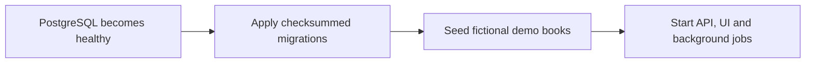
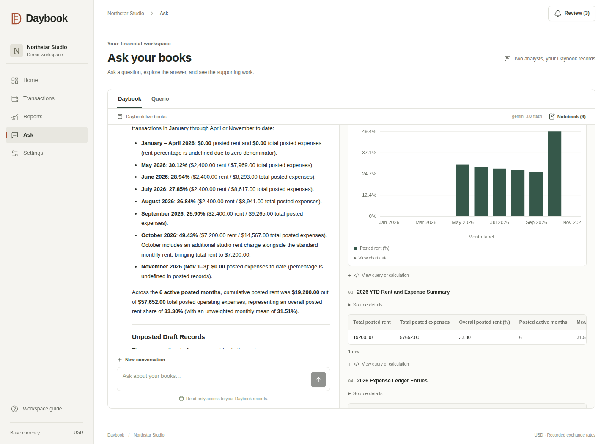
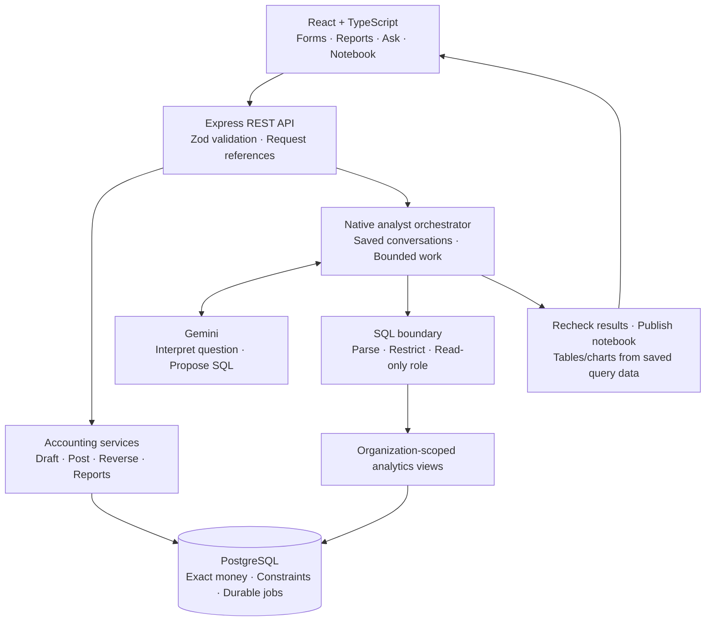
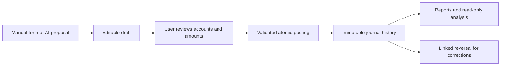

# Daybook

**Double-entry accounting with a Gemini analyst that answers from your books.**

React · TypeScript · Express REST · PostgreSQL · Docker Compose

[Open public demo](https://daybook-ledger-delta.vercel.app/analyst?tab=daybook) · [Run locally](#run-locally) · [Review the features](#a-10-minute-review) · [Architecture PDF](docs/reports/submission-architecture.pdf) · [Original assignment](docs/ORIGINAL_ASSIGNMENT.md)

| For the reviewer                           | What you need                                             |
| ------------------------------------------ | --------------------------------------------------------- |
| Run the full application                   | Docker Engine/Desktop with **Compose v2**                 |
| Use AI entry, categorization and Ask       | **Your own Gemini API key**, with model access and quota  |
| Use accounting without AI                  | No API key needed                                         |
| External accounts required for local setup | **None beyond Gemini for AI** — PostgreSQL runs in Docker |
| Optional integrations                      | Querio and TypeSafe/Jev are **not required**              |

## Run locally

### 1. Clone and configure

```sh
git clone https://github.com/Spiich/spiich-accounting-assignment-rayid-ali.git
cd spiich-accounting-assignment-rayid-ali
cp .env.example .env
```

Open `.env` in your editor. Set your key and keep these defaults:

```dotenv
AI_PROVIDER=gemini
GEMINI_API_KEY=your_key_here
CATEGORY_PROVIDER=gemini
NATIVE_ANALYST_ENABLED=true
AI_MODEL=
ANALYST_MODEL=gemini-3.8-flash
```

Leave Querio, TypeSafe and OpenAI credentials blank. `.env` is ignored by Git and excluded from Docker's build context; keys stay on the backend.

**Model access:** transaction entry and categorization default to `gemini-3.5-flash-lite`; the native analyst is pinned to `gemini-3.8-flash`. Your Google project must support those models and have available quota. An arbitrary `ANALYST_MODEL` substitution is not supported by the current native transport. Manual accounting still works when AI is unavailable.

### 2. Start the stack

```sh
docker compose up --build
```

### 3. Open Daybook

**http://localhost:3001** · **[Ask → Daybook](http://localhost:3001/analyst?tab=daybook)**

The first build can take several minutes. Startup automatically performs:



There is no separate SQL import or hosted database to configure. The Northstar Studio demo contains 22 accounts, six months of activity, multi-currency entries, recurring schedules, drafts and deliberately unusual transactions. Dates are anchored to the **first seed**; later restarts keep your existing records.

<details>
<summary><strong>Stop, restart, change a key, or start without demo entries</strong></summary>

```sh
# Inspect containers and startup output.
docker compose ps
docker compose logs --tail=100 app migrate

# Reload .env settings after changing a key.
docker compose up -d --force-recreate app

# Stop while keeping your database.
docker compose down
```

Data persists in the named PostgreSQL volume `spiich_postgres_data`. **Do not use `down -v` if you want to keep it.** Local books do not synchronize with the hosted demo. The application binds to localhost; PostgreSQL is not exposed to the host by default.

For a default chart of accounts with no demo journal, set `SEED_DEMO=false` before the first startup. Changing it afterward does not delete existing entries.

</details>

## See the analyst



_Actual released application displaying a saved answer against fictional demo books. Notebook tables, charts and source queries are inspectable. These November 2026 values are illustrative; your fresh local seed may have different dates and balances._

## A 10-minute review

| Open                     | Try this                                                                                | What to inspect                                                                       |
| ------------------------ | --------------------------------------------------------------------------------------- | ------------------------------------------------------------------------------------- |
| **Home**                 | Review cash, revenue, expenses and recent activity.                                     | Recorded posted balances; drafts are excluded.                                        |
| **Transactions**         | Enter a $500 office-supplies purchase using the company card. Save, review, then post.  | Supplies debit and card-liability credit are equal. Posted history cannot be edited.  |
| **Reports**              | Open trial balance, P&L, balance sheet and an account ledger.                           | Matching date filters, debit/credit totals, opening and running balances, CSV export. |
| **Settings → Accounts**  | Add an account; inspect its type, code and parent.                                      | Unique codes, account tree and protection of accounts with history.                   |
| **Settings → Recurring** | Inspect or create a repeating transaction.                                              | Scheduled occurrences become **drafts**, awaiting review and posting.                 |
| **Review / alerts**      | Inspect seeded unusual rent and possible duplicate expenses.                            | Explainable rule-based alerts; a flag is not proof of an error.                       |
| **AI entry**             | “Bought office supplies for $340 with the company credit card.”                         | Proposed accounts, clarification when needed, and explicit review before posting.     |
| **Ask → Daybook**        | “For every month this year, show rent as a percentage of total expenses, with a chart.” | Answer, period, denominator, table, chart and underlying SQL.                         |

More useful questions:

- “What is my current recorded cash balance?”
- “Show all Adobe transactions, with drafts listed separately.”
- “What percentage of total expenses was office supplies this year?”
- “Model adding a $4,500 monthly salary with 20% employer overhead. Show your assumptions.”

The native analyst can take several minutes for a multi-step question. Progress and Stop controls are available. A hiring scenario is an assumption-based calculation, not knowledge of a future salary or external bank balance.

## Architecture



| Decision                               | Why it matters                                                                                      |
| -------------------------------------- | --------------------------------------------------------------------------------------------------- |
| **One journal is the source of truth** | Reports and AI analysis read the same recorded accounting facts.                                    |
| **Exact decimals**                     | PostgreSQL `NUMERIC` and `decimal.js` avoid binary floating-point money errors.                     |
| **Database-enforced posting rules**    | Deferred constraints enforce balanced posted entries; validation is not confined to the frontend.   |
| **Read-only AI analysis**              | Generated SQL is parsed and restricted to scoped views under a limited reader role.                 |
| **Structured notebook output**         | React renders saved tables/charts; the app does not execute model-generated HTML.                   |
| **Explicit SQL, no ORM**               | Joins, reporting rules, transactions and locking are directly inspectable.                          |
| **REST, not GraphQL**                  | Resource endpoints cover accounts, entries, reports, recurring templates and analyst conversations. |

The three analyst tools are application code: **`inspect_schema`**, **`query_sql`**, and **`publish_notebook`**. Gemini can propose a new query for a new question; the backend controls execution. Before publication, selected queries are rechecked together and recognized money/percentage claims require numeric support. These checks constrain errors; they do not prove every interpretation is correct.

### How a transaction becomes accounting history



For the **$500 supplies purchase on a card**:

| Account                   |       Debit |      Credit |
| ------------------------- | ----------: | ----------: |
| Office supplies — expense |     $500.00 |           — |
| Company card — liability  |           — |     $500.00 |
| **Total**                 | **$500.00** | **$500.00** |

Posting checks the reviewed revision, account ownership, currency/rates and equal base debits/credits. Idempotency keys and row locks address repeated/concurrent requests. A reversal retains the original entry and records its exact opposite.

## Assignment coverage

| Area                      | Delivered behavior                                                                                                                                                      |
| ------------------------- | ----------------------------------------------------------------------------------------------------------------------------------------------------------------------- |
| Double entry and accounts | Balanced postings, immutable history, linked reversals; account tree with unique codes and five types.                                                                  |
| Multi-currency            | USD base; USD/EUR/GBP/CAD/JPY accounts, saved exchange rates and native/base balances.                                                                                  |
| Recurring transactions    | Weekly/monthly/yearly templates, automatic pending drafts, calendar anchors and duplicate prevention.                                                                   |
| Reporting                 | Trial balance, income statement, balance sheet and account ledger with date filters.                                                                                    |
| Natural-language entry    | Structured proposals, ambiguity handling, account validation and confirmation before posting.                                                                           |
| Categorization learning   | Reviewed **posted corrections** become relevant examples for later suggestions; reversing/forgetting invalidates them. This is example retrieval, not model retraining. |
| Anomaly detection         | Duplicate, amount and category rules; durable jobs, alerts and review/dismissal. Amount checks need four comparable positive samples.                                   |
| Financial insights        | Read-only generated SQL, conversational follow-ups, inspectable tables and charts.                                                                                      |
| Frontend and operations   | React UI, search/filter/pagination, TypeScript throughout, PostgreSQL migrations, Compose, tests and request-correlated errors.                                         |

## Inspect the code

| Start here                                                                                                    | Responsibility                                                                             |
| ------------------------------------------------------------------------------------------------------------- | ------------------------------------------------------------------------------------------ |
| [`db/migrations/`](db/migrations/)                                                                            | Database schema, deferred balance constraints, immutability, permissions and scoped views. |
| [`server/ledger.ts`](server/ledger.ts)                                                                        | Create, revise, post and reverse entries.                                                  |
| [`server/reports.ts`](server/reports.ts)                                                                      | Posted-journal queries, date scope, signs and saved FX.                                    |
| [`server/recurring.ts`](server/recurring.ts) / [`server/anomalies.ts`](server/anomalies.ts)                   | Scheduled drafts, background work and alert rules.                                         |
| [`server/categorization-memory.ts`](server/categorization-memory.ts)                                          | Posted-correction examples and their lifecycle.                                            |
| [`server/native-analyst-service.ts`](server/native-analyst-service.ts)                                        | Model/tool orchestration, conversation continuity and failure handling.                    |
| [`server/analyst-sql.ts`](server/analyst-sql.ts) / [`server/analyst-notebook.ts`](server/analyst-notebook.ts) | Restricted SQL execution, result storage and notebook publication.                         |
| [`server/app.ts`](server/app.ts) / [`docs/API.md`](docs/API.md)                                               | REST endpoints and API contracts.                                                          |
| [`shared/`](shared/) / [`web/src/`](web/src/)                                                                 | TypeScript/Zod contracts, exact money utilities and React UI.                              |
| [`tests/`](tests/)                                                                                            | PostgreSQL integration, provider contracts, failure handling and browser workflows.        |

Modules are grouped by capability; this is not a uniformly separated controller/service/repository implementation. `api/` contains Vercel entry points into the backend, not a separate accounting system. `research/` holds optional experiments and is not required for normal startup.

## Verification

| Check                                | What it establishes                                                                              |
| ------------------------------------ | ------------------------------------------------------------------------------------------------ |
| **3,366 application tests passed**   | Contracts, exact arithmetic, real PostgreSQL behavior, provider boundaries and failure handling. |
| **60 browser workflows passed**      | Accounting UI, both analyst tabs, notebooks, recovery and mobile viewport behavior.              |
| **Docker lifecycle and persistence** | Startup, scheduling, anomaly processing and preservation through container recreation.           |
| **Separate model evaluations**       | Bounded real-model evidence, with original failures and limits retained in the linked reports.   |

These counts refer to the handoff source. [Exact CI and handoff evidence](docs/evidence/submission-handoff.json) records commits, skips and the separate Docker checks; overlapping test totals are not added together. Ordinary CI uses scripted provider responses and makes no paid model calls. Passing engineering tests is not a universal AI-accuracy score.

With the Docker stack running:

```sh
docker compose --profile test run --build --rm tests
```

<details>
<summary><strong>Node development and browser verification</strong></summary>

Requires **Node 22.12+**. Copy/configure `.env` as above, then:

```sh
npm ci
npm run dev
```

Open **http://localhost:5173**. With database URLs unset, the launcher starts a real local PostgreSQL server and retains data in `.tools/postgres`. The API uses port 3001 and PostgreSQL uses 55432. Do not run Compose and this launcher on the same host ports. Compose is the primary cross-platform setup; the convenience launcher was exercised on macOS arm64.

```sh
npm run build
npm run format:check
npx playwright install chromium

# Standalone checks; the launcher owns its test database lifecycle.
npm run dev -- --test
npm run dev -- --test-browser --production
```

Browser checks use a separate workspace and disable the provider key. More options and evidence are in [Verification](docs/VERIFICATION.md).

</details>

## Troubleshooting

| Symptom                                   | Check / next step                                                                                                                                              |
| ----------------------------------------- | -------------------------------------------------------------------------------------------------------------------------------------------------------------- |
| App does not open                         | Wait for the first build; inspect `docker compose ps` and `docker compose logs --tail=100 app migrate`.                                                        |
| Port 3001 is occupied                     | Stop the conflicting process or change the app's Compose port mapping and browser URL.                                                                         |
| AI unavailable or provider error          | Check the saved key, model access and quota, then recreate `app` to reload `.env`. Copy the error's request reference when diagnosing; do not publish the key. |
| Query takes a while                       | Native analysis can use several model/tool steps. Watch progress; use Stop if needed.                                                                          |
| Report and transaction-list totals differ | Match date/account filters and check draft versus posted status. Drafts are not confirmed expenses.                                                            |
| Dates differ from the screenshot          | Demo dates are fixed when that database is first seeded; local and hosted books are independent.                                                               |
| Querio is not connected                   | Use **Daybook**. Querio is an optional comparison integration and has separate credentials.                                                                    |

## Scope and reading material

- **Shared demo:** the production link is public and writable, without application-user authentication. Use local Docker for isolated review; do not enter confidential data into the demo.
- **Accounting scope:** saved FX rather than automatic revaluation; no bank feed/reconciliation, full invoice/payment allocation, tax engine or document-upload workflow. Base currency is USD and current business-date helpers use America/New_York.
- **AI scope:** read-only execution and numeric support do not guarantee correct dates, categories, denominators or interpretations. Three hosted checks took 94–321 seconds. Million-user capacity and universal accuracy are not claimed.

| Document                                                                 | Use it for                                                    |
| ------------------------------------------------------------------------ | ------------------------------------------------------------- |
| **[Current architecture PDF](docs/reports/submission-architecture.pdf)** | Three-page visual explanation of the current system.          |
| [Reviewer setup and reading guide](docs/SUBMISSION_GUIDE.md)             | Additional setup, review and operational detail.              |
| [Original assignment](docs/ORIGINAL_ASSIGNMENT.md)                       | The provided specification, preserved verbatim.               |
| [Complete project knowledge base](docs/MEETING_NOTES_KNOWLEDGE_BASE.md)  | Detailed explanations, table inventory and code walkthroughs. |
| [Native analyst design](docs/NATIVE_ANALYST.md)                          | SQL boundary, durable execution, notebook checks and limits.  |
| [Analyst comparison PDF](docs/reports/analyst-workspace-comparison.pdf)  | Native/Querio experiment, scores and observed failures.       |
| [Category-learning PDF](docs/reports/category-learning-explained.pdf)    | Correction learning and separate Gemini/Jev measurements.     |

Querio/Jev and older RAG/vector/Wren comparisons are optional research context, not dependencies for running the submitted Gemini application. The hosted deployment and local submission can differ in UI defaults; the demo link above explicitly selects Daybook.
