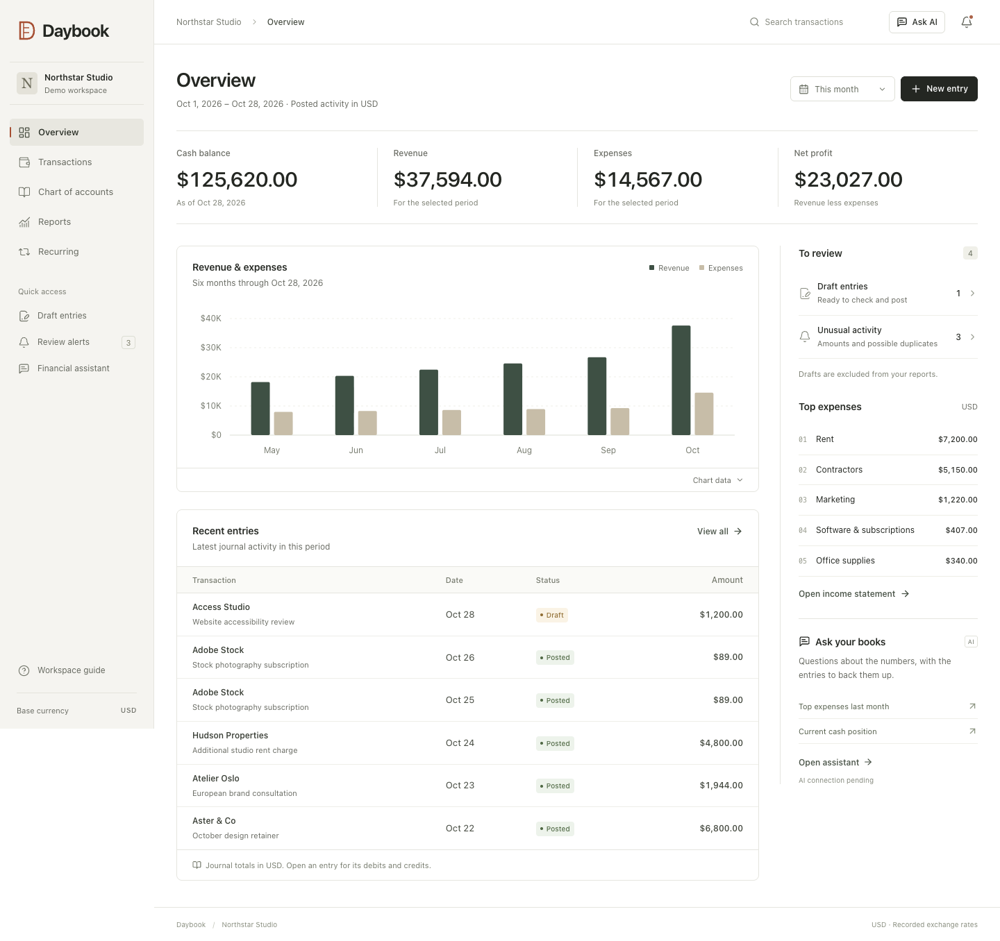

# Daybook · Accounting workspace

> Updated 2026-10-30: the deployed accounting application remains separate from the research study. The latest research pilot stopped at **101/108 episodes** after Gemini's daily free-tier quota was exhausted; its full data fingerprint was unchanged. The planned held-out comparison is unrun, and no winning architecture is claimed. See the [study narrative](docs/reports/research-study.md), [V2 validity notice](docs/evidence/research-runs/pilot-v2/validity-notice.json) and [checkpoint](CHECKPOINT.md).

A React and TypeScript accounting workspace backed by PostgreSQL. Every posted journal entry is balanced and immutable at the database level. AI prepares entries for review and selects read-only financial queries; the ledger and SQL own the financial numbers.

The deployed assistant uses `gemini-3.1-flash-lite` or the selectable OpenAI adapter. Selected hosted cash, transaction-search, expense and entry-proposal checks succeeded; intermittent provider failures remain. Its [application baseline](https://github.com/rayidali/spiich_homework/actions/runs/41103851106) passed 103 backend tests, 10 browser workflows and Docker startup/persistence. These checks are not a model-accuracy score.

An isolated research implementation compares nine AI routes: the current tool architecture, broader analytics, lexical documents, managed File Search, Gemini embeddings with pgvector, Jev reranking, Wren and two answer reviewers. Research uses Gemini 3.5 Flash-Lite with separate synthetic fixtures and read-only analytical access. The first pilot is disqualified by diagnosed adapter defects; V2 is incomplete and remains diagnostic. **1,620 held-out route episodes and 240 held-out reviewer outcomes have not run.** The [protocol](docs/PLAN.md), [narrative and diagrams](docs/reports/research-study.md), [diagnostic V2 HTML report](docs/evidence/research-runs/pilot-v2/report.html), [12-page PDF](docs/evidence/research-runs/pilot-v2/study-report.pdf) and [reproduction guide](docs/research/REPRODUCE.md) describe the implemented work and its limits. None of these experimental routes is enabled in production chat.



The screenshot records the earlier design. Fresh screenshots of Home / Transactions / Reports / Settings are generated in the browser-evidence artifact of the [successful CI run](https://github.com/rayidali/spiich_homework/actions/runs/40999183176); they still need visual review before replacing these images.

## Run with Docker Compose

Requires Docker Engine/Desktop with Compose v2. No API key is needed to explore the accounting application.

```sh
docker compose up --build
```

Open **http://localhost:3001**. Startup waits for PostgreSQL, applies checksummed migrations, seeds the workspace, then starts the application. The database persists in a named volume. Subsequent starts keep your existing data.

The seeded Northstar Studio workspace has 22 accounts, six months of activity, an unpaid invoice, a EUR receipt, a draft awaiting review, two recurring schedules, and intentional unusual/duplicate expenses to inspect. Demo dates are anchored to the first seed run; restarting never shifts posted history.

## Connect AI when ready

Both Gemini and OpenAI are supported. Copy `.env.example` to `.env` only if you do not already have one, then configure your chosen provider locally:

```dotenv
AI_PROVIDER=gemini
GEMINI_API_KEY=your_key_here
```

Leave `AI_MODEL` empty to use the provider default: `gemini-3.1-flash-lite` or `gpt-6-luna`. For OpenAI, set `AI_PROVIDER=openai` and `OPENAI_API_KEY`. Remove any stale model override when switching providers. Keys remain on the server and are excluded from version control, Docker images, and the submission. Restart the local server after changing `.env`, or recreate the Compose app:

```sh
docker compose up -d --force-recreate app
```

Use a model your project can access. Gemini's default was selected from Google's current [model documentation](https://ai.google.dev/gemini-api/docs/models/gemini-3.1-flash-lite). Direct testing reproduced generation timeouts on the earlier model. With Flash-Lite, selected hosted financial questions and a draft proposal succeeded; transient failures remain. The full live evaluation/accuracy score has not been completed, and timed-out calls have unknown usage/billing. The key is configured server-side on Vercel as well as locally, but no GitHub Actions key secret was configured. With no key, manual accounting, reports, recurrence, and statistical alerts continue working.

Start with the bounded four-case smoke evaluation against a running, migrated database:

```sh
npm run ai:evaluate -- --suite smoke
```

The harness contains 40 labeled cases: 20 development and 20 reserved for holdout. It checks complete entries, exact query arguments/evidence, correction retrieval, and unchanged journal history. Clarification meaning is explicitly left for human review. It creates two new synthetic workspaces and predefined fixture postings; **model responses are never posted and your demo workspace is untouched**. Runs may incur provider charges. Attempts are capped, automatic retries are disabled, and observed token usage stops later requests; this is not an absolute billing ceiling. Results go to `docs/evidence/ai-evaluations/` and `ai-evaluation.json`. See `npm run ai:evaluate -- --help` and [verification](docs/VERIFICATION.md).

With Compose, use the dedicated evaluation profile, which has administrative access only for creating its isolated fixtures. The normal app retains its restricted database role:

```sh
docker compose --profile evaluate run --build --rm evaluate
```

The production 40-case live evaluation is separate from the research benchmark and remains incomplete. Jev, semantic vectors, managed File Search and Wren are implemented and exercised in the isolated research harness; they are not production features. Mastra has not been added.

## Local development without Docker

Requires Node 22.12+ and npm. The convenience launcher uses an isolated, real PostgreSQL server through `embedded-postgres`; local data stays in `.tools/postgres`.

```sh
npm ci
npm run dev
```

Open **http://localhost:5173**. The API runs on port 3001 and PostgreSQL on 55432. Ctrl-C stops the servers and preserves data. Restart the command after adding a key to `.env`.

To use your own PostgreSQL, set both database URLs shown in `.env.example`. `MIGRATION_DATABASE_URL` must permit migrations and role creation; `DATABASE_URL` uses the restricted `spiich_app` role. The launcher skips embedded PostgreSQL when `DATABASE_URL` is set. The portable launcher was exercised on macOS arm64; Compose is the cross-platform submission path.

Set `SEED_DEMO=false` **before the first start** for an empty journal with the default chart. It does not erase an already seeded workspace.

## What is included

| Requirement                 | Implementation                                                                                              |
| --------------------------- | ----------------------------------------------------------------------------------------------------------- |
| Double entry                | Exact decimals, 2–100 lines, balanced USD base amounts, deferred PostgreSQL constraints                     |
| Chart of accounts           | Tree, unique codes, five account types, create/edit/archive/restore/delete unused accounts                  |
| Journal                     | Simple USD form, full manual/FX entries, AI clarification and review, drafts, revisions and reversals       |
| Currency                    | USD base; USD, EUR, GBP, CAD, JPY accounts; stored rates and native/base balances                           |
| Recurrence                  | Weekly/monthly/yearly, calendar anchors, automatic drafts, edit future content, pause/resume, recovery      |
| Reporting                   | Trial balance, P&L, balance sheet, account ledger with opening/running balances, filters and CSV            |
| Transactions                | Search, account/date/status/currency filters, cursor pagination, entry drill-down                           |
| AI entry and categorization | Structured proposals, clarification, account validation, relevant history and correction retrieval          |
| Anomaly detection           | Duplicate matching, median amount deviations, unusual vendor categories, review/dismissal                   |
| Insights                    | Allowlisted financial tools, SQL-derived answers, evidence and links to the underlying views                |
| UX                          | Four primary destinations, explicit account-effects review, accessible controls and progressive detail      |
| Operations                  | Migrations, Docker Compose, health checks, request IDs, outbox jobs, passing CI, protected Vercel/Neon demo |

Categorization happens during AI-assisted creation; this submission does not include a bank-feed or CSV-import workflow. Correction retrieval improves the context of later suggestions; it is not model fine-tuning.

## Verification

With `npm run dev` already running, use another terminal:

```sh
npm test
npm run build
npm run dev -- --test-browser --reuse-db --production
npm run format:check
```

For a standalone run that owns and stops its local PostgreSQL:

```sh
npm run dev -- --test
npm run build
npm run dev -- --test-browser --production
```

Playwright uses installed Chromium or the local Brave browser when available. On another machine, install its browser with `npx playwright install chromium`. Browser checks create a separate workspace, use port 3002, and exercise the built application. They do not modify the demo workspace, and the launcher disables the provider key for these workflows.

The Docker integration-test service is available with:

```sh
docker compose --profile test run --build --rm tests
node scripts/check-compose-persistence.mjs --execute
```

The persistence command recreates app/database containers and checks that a complete existing posted entry survives; it preserves the named volume and makes no journal writes. Run it after Compose startup. This check passed in the [successful CI run](https://github.com/rayidali/spiich_homework/actions/runs/40999183176).

The deployed application baseline passed **103 backend tests** (29 accounting, 14 AI/database contracts, 24 provider, 23 evaluation, 6 simple-entry and 7 hosted scheduler tests), **10 production browser workflows**, Docker build/startup/health, containerized backend tests, and posted-entry persistence across app/database container recreation.

For research source **`05a9fe3`**, [CI 41142335257](https://github.com/rayidali/spiich_homework/actions/runs/41142335257) passed application/backend and browser verification, application Compose startup/persistence and the separate native Wren/pgvector database job. The matching local checkpoint passed **399 isolated tests**, build and formatting ([evidence](docs/evidence/research-local-v3.json)); this is not a claim of an exact CI backend count. The opt-in live-AI job was skipped. Preserved pilot results are unchanged, and these engineering checks do not establish held-out answer accuracy. See [research CI evidence](docs/evidence/research-ci-v3.json) and [verification details](docs/VERIFICATION.md).

## Reading the code

```text
db/migrations/    PostgreSQL constraints, permissions, revisions, provenance
server/ledger.ts  One entry creation/posting/reversal path
server/reports.ts Posted-journal financial queries
server/ai.ts      Shared proposal validation and approved financial tools
server/ai-provider.ts  Gemini/OpenAI adapters, safe errors, usage and budgets
server/recurring.ts / anomalies.ts  Bounded durable background work
server/app.ts    Validated REST API and error responses
server/hosting/  TypeScript Vercel API/scheduler adapters
api/             Tiny exports of generated native ESM hosted bundles
shared/          Money arithmetic and TypeScript/Zod contracts
web/src/         React pages, forms and reusable UI
tests/           Real PostgreSQL tests, provider contracts, browser workflows
scripts/         Migration, resumable seeding, dev launcher, live AI evaluation
research/        Isolated routes, retrieval, Wren bridge, validators and reference/scoring code
scripts/research/  Fixture setup, indexing, controlled runs and report generation
```

For the current research explanation, start with the **[study narrative](docs/reports/research-study.md)** and its hiring-cost walkthrough and architecture diagrams. The older eight-page **[visual architecture report](docs/reports/architecture-review.pdf)** and **[interactive HTML version](docs/reports/architecture-review.html)** preserve the planning snapshot from before the Gemini/interface implementation. Use the checkpoint for current execution status.

The [beginner accounting walkthrough](docs/ACCOUNTING_WALKTHROUGH.md) explains the numbers, and the [architecture](docs/ARCHITECTURE.md) provides implementation details and research sources. The [demo and interview guide](docs/INTERVIEW_GUIDE.md) explains the design in practical terms. [API reference](docs/API.md), [delivery plan](docs/PLAN.md), and [build log](docs/BUILD_LOG.md) record implementation details and decisions. The [Daybook design record](docs/DESIGN.md) explains the visual identity, downloaded design skills, interaction rules, and before/after evidence.

## Deliberate boundaries

This is a single configured workspace application, as authentication was excluded from the assignment. Organization-scoped tables and composite foreign keys prepare the data model for tenancy; they do not replace production authentication, authorization, or row-level security. Compose binds the UI/API to localhost.

Reports use historical recorded exchange rates. Automated period-end revaluation, tax, inventory, invoice lifecycle management, bank reconciliation, and formal period closing are outside this implementation. Production financial insights support four explicit query families and clarification. Broader analysis and Wren-planned SQL exist only in the isolated experiment, behind bounded query checks and a restricted reader.

The design includes concurrency controls and bounded work that support growth. **Million-user capacity has not been load-tested or claimed.** The architecture document describes the workload assumptions, operational requirements, and measurements needed to earn that claim.

## Hosted demo and continuation

Open [Daybook](https://daybook-ledger-delta.vercel.app) and sign in with the owner's Vercel account if prompted. Hosting uses Vite static output, Express Functions and a separate free Neon database. Vercel protection controls access to the shared writable demo; application-level identity is outside assignment scope. Reviewer access is still to be decided.

[Hosting](docs/HOSTING.md) explains the build-only migration credential, restricted runtime role, native ESM bundle, daily scheduler and deployment-variable requirements. Production values were supplied as deployment overrides, so a fresh CLI deploy needs explicit private configuration; a repository push is not a configured Vercel auto-deploy. Docker remains the complete portable startup path.

The hosted trial balance and balance sheet had zero differences. Scheduler authorization and an authorized batch passed. Automatic daily firing, fresh hosted browser visual inspection and live AI accuracy remain unverified. Larger job backlogs can wait for later hosted invocations; this is not a measured million-user deployment.

Research remains stopped after the documented daily-quota incident. A replacement local Gemini key passed one tiny availability check on 2026-10-30 (14 input/5 output tokens, $0.0000167 estimated). The user requested frugal use: a persistent one-request/$0.01 Gemini/$0 Jev policy now blocks further study calls while an additional budget is pending. The check does not establish account balance, index access or full-study capacity. Preserve the original failures and reservations. Held-out evaluation and a product recommendation remain pending. Hosted visual review, physical-phone checks and reviewer sharing are separate unfinished product checks. Resume from [CHECKPOINT.md](CHECKPOINT.md); do not reset the database or rebuild the application.
