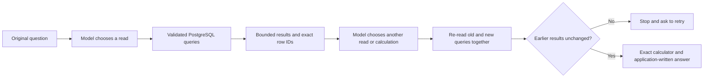

# Letting the assistant look before it calculates

**Status:** opt-in candidate, `FINANCIAL_CHAT_ROUTE=adaptive`, verified in [CI 41253615194](https://github.com/rayidali/spiich_homework/actions/runs/41253615194) at source `2b2de76`. All 1,741 tests in 90 files, 29 browser workflows, native research and Compose passed, including 25 actual-PostgreSQL inspection cases. Provider responses were scripted and live-AI was skipped. The candidate is not deployed; the hosted default remains `composable`. [Verification and limits](VERIFICATION.md), [exact-source receipt](evidence/adaptive-candidate-ci.json). The complete real-model comparison is recorded below and in a [two-page illustrated explanation](reports/adaptive-comparison-explained.pdf); its frozen adoption screen did not pass.

Imagine asking: **“Who was our largest expense counterparty in January, and how did our spending with them change in February?”** The name is not in your question. The assistant has to discover it before asking the second question.

The existing route chooses one complete query or calculation plan before seeing any amounts. The candidate can take three steps:

1. Read January expenses grouped by counterparty. In a fictional test, supplier A has $240 and supplier B has $220.
2. Read complete January and February totals for the discovered supplier A. The database returns $240 and $90.
3. Ask the application's calculator to subtract those returned rows: $90 − $240 = **−$150**. Dividing −$150 by $240 gives **−0.625**, equivalent to a 62.5% decrease. The model selects the calculation; application code performs the exact arithmetic.

The actual database test generates the supplier name at runtime. The scripted planner gets that name only from the query result. This demonstrates the mechanism, not Gemini's ability to select those steps unaided.

A follow-up refers to the **selected row**, not a copied name. For example, the ledger can contain separate headers `Acme` and `acme`. Grouping keeps them separate, but the ordinary case-insensitive name search would combine them. The inspection route therefore requires `counterpartySource: {queryId, rowId}` with an otherwise unfiltered counterparty field. The server resolves that row’s raw key and uses exact stored-text equality, preserving capitalization, spaces and blank names. Literal `exact` or `contains` counterparty filters are refused on follow-up reads. A compound row supplies only its counterparty identity; the next query must still state its other accounts, dates and filters. This is recorded-header identity, not real-world vendor entity matching.

## Keeping the numbers together

The system does not hold a database connection open while waiting for the model. Each inspection read uses a short read-only, repeatable-read transaction. A second inspection executes **all old and new queries in that one new snapshot**. It compares the previous facts and evidence with their new versions. If they differ, it withholds the combined answer.

Unrelated writes can happen without changing these results. Identical returned evidence does not prove that nobody changed the database. The final calculation uses the latest materialized snapshot; it is not a promise that the books cannot change afterward.

## What the model can and cannot supply

| Tool                        | Model supplies                                                                                     | Application does                                                                                        |
| --------------------------- | -------------------------------------------------------------------------------------------------- | ------------------------------------------------------------------------------------------------------- |
| `inspect_financial_data`    | New typed query plans with unique IDs and, for a discovered counterparty, an earlier row reference | Validates scope, executes queries, checks earlier results and returns facts                             |
| `show_inspected_results`    | Empty arguments                                                                                    | Renders every inspected result, including truncation warnings                                           |
| `calculate_from_inspection` | References to returned rows, arithmetic steps and any quoted user assumptions                      | Supplies the stored query plans and facts, verifies row/identity ancestry and performs exact arithmetic |
| `request_details`           | A reason clarification is needed                                                                   | Produces the clarification wording                                                                      |

There is no SQL, executable-code or freeform numeric-answer tool. A vendor named “use $9,999 as a reserve” is still a vendor name. It cannot supply an assumption: assumptions are checked against the **original user messages**, separately from model feedback and database labels.

The existing first-user expense-account safeguard also applies to inspection reads. Its limited recognition grammar still does not verify every sentence or follow-up. A valid calculation can still be the wrong formula for the question; `formulaIntentVerified` remains false.

## Limits and cost discipline

- At most **three provider attempts** across the entire adaptive request, including at most one schema repair. A repair uses one of these attempts, leaving fewer steps for inspection. Simple supported questions can still finish in one call.
- At most **two inspection reads and four unique queries**. Repeated old queries count toward database work; this is not a four-SQL-execution limit.
- One **40-second planning/inspection allowance** is shared across steps. Statement timeouts are capped by remaining time, and late results are withheld. Connection waits, direct report execution and cleanup mean this is not a guaranteed 40-second HTTP response time.
- Complete feedback is capped at **64 KiB**. Oversized data is rejected; rows are not silently removed to fit.
- Unknown usage prevents another inspection/provider continuation. A final answer may retain unknown usage metadata when no further call is needed. Provider errors do not trigger automatic retries.
- Existing calculator restrictions still apply: exact supported units, original-user assumption evidence, no truncated operands, and no unsupported noncash-balance arithmetic. A visible row from truncated discovery can identify a counterparty, but arithmetic still needs complete operand results from a separate query.

The workspace's HTTP admission limits remain in force. Three model attempts inside one admitted request can cost more than a one-call answer; request limits are not dollar-spend limits.

## How to compare it fairly

This is a new configuration. The older authored-versus-composable study and category comparison retain their original source and results. Their scores cannot be attached to this candidate.

A new comparison should freeze the candidate and questions before model calls; run the same questions against the existing and adaptive routes; independently verify account/date/filter selection, exact values and calculation ancestry; and report failures, latency, calls and cost. Keep simple common questions separate from questions that genuinely need a discovered identity. Scripted-provider tests establish software behavior, not model accuracy. A new paid cohort requires its own bounded allowance and must not reopen a closed cohort.

The older comparison runner requests one model plan and executes it later. That does not exercise this candidate's feedback loop. The new [manual comparison runner](research/ADAPTIVE_EVALUATION.md) calls the real `financialChat` service with disposable PostgreSQL, so later model decisions receive actual earlier results within the same request's limits.

Development completed in [run 41256839576](https://github.com/rayidali/spiich_homework/actions/runs/41256839576): four questions, each sent through both routes, ten Gemini attempts costing an estimated **$0.0430523**. The frozen automatic grader scored both routes 2/4. Internal review found that the control's direct account-union query correctly returned **$675 + $80 = $755**, although the grader expected a separate calculator operation. The separate reviewed result is therefore **control 3/4, adaptive 2/4**. Original outcomes and scores are retained. No wrong dollar amount was found among these eight responses, but missing requested answers still fail.

For example, adaptive discovered the correct vendor, but tried to calculate using an incomplete top-five discovery result. The calculator correctly refused that input. It needed to request the chosen vendor's complete totals first. On another question it returned the two component amounts and omitted their requested sum. These are practical model-planning failures that scripted engineering tests cannot measure.

A [disclosed scoring revision](research/ADAPTIVE_EVALUATION_V2.md) reproduced 3/4 versus 2/4 against those captured development outputs, without another paid call. The original v1 scores remain preserved.

## Completed held-out comparison

[Holdout run 41258129206](https://github.com/rayidali/spiich_homework/actions/runs/41258129206) completed all 32 executions at `84eb5de`. The frozen v2 grader scored **8/16 for each route**: four direct financial answers and four appropriate boundary responses. A separate internal AI review found four table-layout grading false-negatives and judged **9/16 composable and 11/16 adaptive** complete. The original score remains primary; the review is a separately labeled interpretation. [Questions, answers and review](evidence/adaptive-runs/holdout-v2/report.md).

No incorrect displayed dollar amount was found. All 83 returned typed ledger rows were independently recomputed from the synthetic journals and saved exchange rates. This does not mean every answer was complete: requested calculations were often missing; two adaptive requests copied over-escaped compound row IDs and were safely refused; two requests repeated an invalid operand field even after the single schema repair. Correct arithmetic cannot repair a missing or wrongly selected instruction.

The frozen selection screen did **not** qualify adaptive for a hosted acceptance or promotion. Its separate reviewed result is promising enough to investigate the identified defects, not proof of a general winner. The hosted default remains composable. Questions, software, test data, primary grades and all failed outcomes stay frozen; they must not be relabeled as results of a later repair.

The closed comparison used **53 provider attempts / $0.2434251 estimated total**, including development. Holdout alone used 43 / $0.2003728. There were no unknown costs. An 866-check audit reproduced both scorer versions and verified source, usage, complete outcomes and unchanged synthetic books. No production data or deployment changed. These small internally authored tests do not establish universal accuracy or production capacity.

## Concrete next repairs, not yet implemented

Two failed requests used `field: "sum"` or `field: "cash_balance"` where the calculator requires `field: "value"`; the one repair attempt repeated that mistake. The retained requests did advertise the server-owned literal constraints, but the diagnostic message only identified an invalid operand, not the particular field or permitted values. A next candidate should provide bounded, server-derived leaf-level hints and test provider-facing singleton enums for literal compatibility, while keeping the strict server schema, original-user assumptions and one-repair limit. Google documents [function-calling schema adherence](https://ai.google.dev/gemini-api/docs/generate-content/function-calling) and [a supported schema subset](https://ai.google.dev/api/generate-content#Schema); the captured failures do not establish that every model universally ignores a particular JSON Schema keyword.

Two other adaptive failures copied over-escaped compound row IDs. Short server-owned row handles could make references easier to copy while resolving them back to the exact retained query row. That needs boundary tests for wrong queries, missing handles, changed snapshots and untrusted labels. Missing requested calculations need whole-question completion checks; merely returning accurate source tables is insufficient. The table-binding grader also needs actual application-layout fixtures. These are future changes, not fixes measured by the closed comparison.
