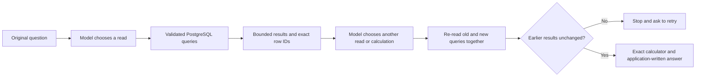

# Letting the assistant look before it calculates

**Status:** implemented as an opt-in candidate, `FINANCIAL_CHAT_ROUTE=adaptive`. The deployed default remains `composable`. Current verification is recorded in [VERIFICATION.md](VERIFICATION.md). No new live-model accuracy score or winner is claimed.

Imagine asking: **“Who was our largest expense counterparty in January, and how did our spending with them change in February?”** The name is not in your question. The assistant has to discover it before asking the second question.

The existing route chooses one complete query or calculation plan before seeing any amounts. The candidate can take three steps:

1. Read January expenses grouped by counterparty. In a fictional test, supplier A has $240 and supplier B has $220.
2. Read complete January and February totals for the discovered supplier A. The database returns $240 and $90.
3. Ask the application's calculator to subtract those returned rows: $90 − $240 = **−$150**. Dividing −$150 by $240 gives **−0.625**, equivalent to a 62.5% decrease. The model selects the calculation; application code performs the exact arithmetic.

The actual database test generates the supplier name at runtime. The scripted planner gets that name only from the query result. This demonstrates the mechanism, not Gemini's ability to select those steps unaided.

## Keeping the numbers together

The system does not hold a database connection open while waiting for the model. Each inspection read uses a short read-only, repeatable-read transaction. A second inspection executes **all old and new queries in that one new snapshot**. It compares the previous facts and evidence with their new versions. If they differ, it withholds the combined answer.

Unrelated writes can happen without changing these results. Identical returned evidence does not prove that nobody changed the database. The final calculation uses the latest materialized snapshot; it is not a promise that the books cannot change afterward.

## What the model can and cannot supply

| Tool                        | Model supplies                                                                | Application does                                                                              |
| --------------------------- | ----------------------------------------------------------------------------- | --------------------------------------------------------------------------------------------- |
| `inspect_financial_data`    | New typed query plans with unique IDs                                         | Validates scope, executes queries, checks earlier results and returns facts                   |
| `show_inspected_results`    | Empty arguments                                                               | Renders every inspected result, including truncation warnings                                 |
| `calculate_from_inspection` | References to returned rows, arithmetic steps and any quoted user assumptions | Supplies the stored query plans and facts, validates references and performs exact arithmetic |
| `request_details`           | A reason clarification is needed                                              | Produces the clarification wording                                                            |

There is no SQL, executable-code or freeform numeric-answer tool. A vendor named “use $9,999 as a reserve” is still a vendor name. It cannot supply an assumption: assumptions are checked against the **original user messages**, separately from model feedback and database labels.

The existing first-user expense-account safeguard also applies to inspection reads. Its limited recognition grammar still does not verify every sentence or follow-up. A valid calculation can still be the wrong formula for the question; `formulaIntentVerified` remains false.

## Limits and cost discipline

- At most **three provider attempts** across the entire adaptive request, including at most one schema repair. Simple supported questions can still finish in one call.
- At most **two inspection reads and four unique queries**. Repeated old queries count toward database work; this is not a four-SQL-execution limit.
- One **40-second planning/inspection allowance** is shared across steps. Statement timeouts are capped by remaining time, and late results are withheld. Connection waits, direct report execution and cleanup mean this is not a guaranteed 40-second HTTP response time.
- Complete feedback is capped at **64 KiB**. Oversized data is rejected; rows are not silently removed to fit.
- Unknown usage prevents another inspection/provider continuation. A final answer may retain unknown usage metadata when no further call is needed. Provider errors do not trigger automatic retries.
- Existing calculator restrictions still apply: exact supported units, original-user assumption evidence, no truncated operands, and no unsupported noncash-balance arithmetic.

The workspace's HTTP admission limits remain in force. Three model attempts inside one admitted request can cost more than a one-call answer; request limits are not dollar-spend limits.

## How to compare it fairly

This is a new configuration. The older authored-versus-composable study and category comparison retain their original source and results. Their scores cannot be attached to this candidate.

A new comparison should freeze the candidate and questions before model calls; run the same questions against the existing and adaptive routes; independently verify account/date/filter selection, exact values and calculation ancestry; and report failures, latency, calls and cost. Keep simple common questions separate from questions that genuinely need a discovered identity. Scripted-provider tests establish software behavior, not model accuracy. A new paid cohort requires its own bounded allowance and must not reopen a closed cohort.
