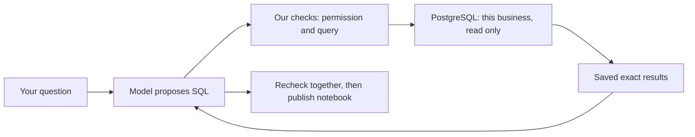

# Daybook: an AI analyst that shows its working

[Read the two-page PDF](reports/analyst-workspace-comparison.pdf).

**Delivered:** switch between Daybook and Querio in Ask. The report below separates measured accuracy, later repair tests and the released interface.

## 1. How your question becomes an answer

Imagine a bookkeeper who can read your records, calculate and prepare a notebook, but cannot change the books. Daybook offers two options: Querio and our own Gemini analyst.

The original chat picked from prepared financial functions. The replacement writes a new **SQL query—a question in the database’s language**. “What percentage of each month’s expenses was rent?” becomes: find monthly rent, find monthly expenses, then divide. We do not need to handwrite a new financial function for every question.

We wrote three general tools: explain the records, run a checked read-only query, and publish a notebook. These are our code, not built-in Gemini accounting tools. The model chooses the calculation; PostgreSQL calculates with exact decimals.



Before publishing, the server reruns the selected queries together. Changed records require another look. Tables and charts use the actual results. This protects the evidence; it cannot prove that the model understood every word.

This route reads structured PostgreSQL records. pgvector, Gemini File Search, Jev and Wren belong to older, separate experiments. They are not used here, and there is no hidden document source.

## 2. A small example: the Figma bill

Our test books contain a **$60 Figma draft**. Draft means it has not been posted into the books. Someone could have already paid the real bill before entering that draft.

A useful answer finds the $60 record, explains that it is unposted and uses a credit-card account, and says whether payment cleared is unknown. “Nothing found” hides the record; “paid” or “unpaid” from draft status alone invents evidence.

The notebook makes the working visible. This sketch uses test reference values, not a screenshot:

```text
Month       Rent        All expenses     Rent share
January   $1,000.00       $1,260.00         79.37%
April         $0.00           $0.00         Undefined
[Chart of these values] [Open the query and exact rows]
```

April’s percentage is undefined: zero divided by zero is not a percentage. But a zero-spending month still belongs in an average of monthly dollar amounts.

## 3. What the experiment actually found

E labels our last full comparison run. Both options received the same eight user turns. A pass requires correct requested figures, dates, extra financial claims and any requested chart. A conversation passes only if every turn passes.

| Version  | Conversations passed | User turns correct | Requested charts rendered |
| -------- | -------------------: | -----------------: | ------------------------: |
| Native E |                5 / 6 |              7 / 8 |                     2 / 2 |
| Querio   |                4 / 6 |              6 / 8 |                     2 / 2 |

**We kept the mistakes.** E supplied all requested figures correctly, but an extra sentence invented a $45 draft instead of $60. That whole answer fails. Querio’s two failures involved early rounding: percentages differed by 0.01 percentage points, although dollar amounts were right. One follow-up also changed the requested dates.

A later support check rejects recognized money/percentage figures missing from the selected SQL results or user inputs. Matching a number still does not prove its meaning. In the separate two-question F test, one answer passed; the other failed after two 40-second timeouts. The passed answer removed an optional unsupported aside. It did not demonstrate a live correction of the invented $45.

The latest runtime allows 120 seconds for a model request, 180 for the hosted function and 210 for its worker lock. Attempt and spending caps remain. **It has not repeated the full eight-turn comparison.** Three hosted answers passed financial review: monthly rent, hiring cost and its follow-up. With no new income and recorded expenses as a rough cash-spending estimate, salary plus 20% extra employer costs changed $5,400 to $6,000; how long cash would last changed **7.65 to 7.38 months**. Responses took **94–321 seconds** and included unrequested detail. They are three observations, not a speed benchmark. The saved rent notebook and provider tabs passed protected desktop/mobile checks; the final interface-only readability update passed CI, protected browser review and promotion.

## 4. Why trust the test—and where to stop trusting it

We froze fictional books with **59 entries, 118 lines and 38 known facts**. Separate Python code using exact decimals calculated the answer sheet; neither model received it. AI-assisted review checked every stated number, dates, assumptions and supporting query. Database fingerprints confirmed the books stayed unchanged.

Six additional E turns passed separately, including hiring assumptions and missing bank evidence. Charts were replayed through the real interface on desktop and simulated mobile. That is separate from checking the hosted backend.

This is a small development test improved with feedback: **14 of 25 authored turns**, not a blind test. Native used Gemini 3.8 Flash; Querio used Sonnet 5.5. Models and software both differ. These results cannot establish an architecture-only winner or universal accuracy. Earlier attempts, including their failures, remain in the detailed evidence.

**Product choice:** keep both options. Use native for custom SQL with inspectable calculations; keep Querio as an alternative analyst. The released interface retains the separately tested backend; it does not borrow an older version’s score. Neither option should present guesses as recorded facts.

## Evidence and reproduction

- [Full comparison manifest](evidence/native-analyst-comparison.json): E versus Querio; additional E acceptance and targeted F stay separate.
- [E financial and rendering review](evidence/native-analyst-e-review.json) and [F targeted review](evidence/native-analyst-f-review.json): original errors and unavailable answers remain failures.
- [Frozen test specification](../tests/analyst-workspace-acceptance/README.md): 18 authored conversations / 25 turns; the executed native subset covers 14 turns, with 38 independent Decimal facts.
- [Three hosted answers, unchanged books and final costs](evidence/native-analyst-hosted-acceptance.json): the live dataset is separate from the synthetic comparison.
- [Final UI CI](evidence/native-analyst-ui-ci.json), [protected browser review](evidence/native-analyst-release-browser.json) and [backend byte equivalence](evidence/native-analyst-backend-equivalence.json): presentation checks do not create a new financial score.
- [Verified promotion](evidence/native-analyst-release.json): final UI `10778bae`, model-tested backend `60435f2`, both tabs available on the protected site.

The detailed A–F chronology and earlier experiments remain in [Native analyst](NATIVE_ANALYST.md), [Verification](VERIFICATION.md) and [Build log](BUILD_LOG.md). No reported score combines the best answer from different versions. This was an AI-assisted engineering evaluation, not independent professional accounting certification.
