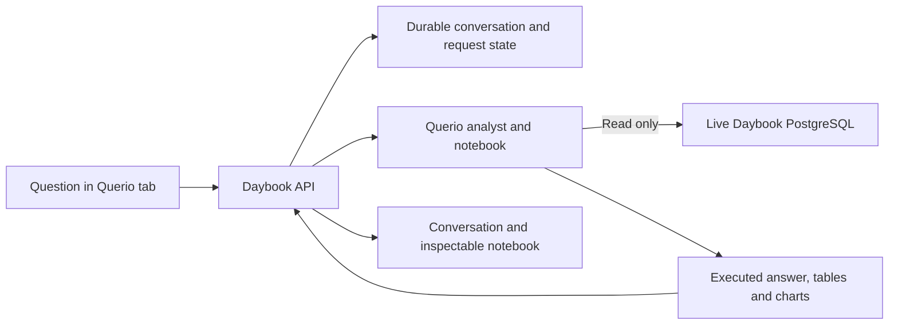

# The analyst workspace

## Querio workspace delivered — November 3, 2026

**Ask → Querio is promoted** at the existing protected Daybook URL, deployment `dpl_HNS1v2XznQrY1cTgmSjZpPwaHCeK`, runtime source `e464efe6ce35644131235521ddb5e78eecdc4f08`. Three real turns across two conversations correctly answered cash, monthly rent percentages/chart, and the November3 $180 Figma draft. All accounts/entries/lines fingerprints stayed unchanged; created remote compute closed. These are integration checks, not a general accuracy score. Thirteen model responses were observed, expected within the user-reported396 included credits; invoice cost is unverified. New-task Gemini spend remains zero.

Full CI `41741412666` on `61e0ccb1d493efc7a12aafe19cf5b75a1590f6ee` passed3079 tests,45 browser workflows, native research and Compose3078 overlapping tests plus container-recreation persistence. All101 deployed source files match that CI commit byte-for-byte; only Docker/Compose/build-log differ from runtime commit. Hosted browser `41742126787` passed actual saved-answer desktop/mobile rendering, reload and tab switching with zero model calls; four screenshots visually reviewed. Temporary browser secrets removed and absence verified. See `docs/evidence/querio-workspace-release.json`.

Status: **first Querio integration implemented locally; combined CI, live acceptance and release pending.** The separate native redesign follows this integration. Neither route has a new comparative accuracy score.

Open **Ask** in Daybook or `/analyst`. The full workspace initially selects **Querio**; the existing assistant drawer keeps **Daybook** selected for continuity. Both offer tabs and a full-workspace link. The first-phase Daybook tab uses the existing local assistant implementation, including its earlier unpromoted generated-analysis candidate; it is not the requested new analyst yet.

## Querio inside Daybook

The browser sends questions to our server. The server holds the Querio API key, binds notebook and agent sessions to the configured live datasource, and returns the answer plus safe notebook output. This is an API integration, not a public board iframe. The provider's own saved Explore remains available through a link.

`QUERIO_API_KEY`, `QUERIO_WORKSPACE_ID`, `QUERIO_DATASOURCE_SLUG` and optional `QUERIO_MODEL` are server settings. Use the live datasource, not the old synthetic benchmark. No key, owner database credential or remote compute identity is sent to the client. This retains the assignment's existing single-workspace demo scope; it is not a complete multi-tenant authentication product.

Migration008 stores conversations, messages, notebook results, provider resource references, idempotency IDs and short ownership leases. It does not change the journal schema or posted records. Repeated message references return the existing work; conflicting text is rejected. Multiple processes coordinate through PostgreSQL. Each request advances bounded work rather than holding one HTTP request open for the whole analysis. The browser can recover after reload or a lost response.

Completed turns save their notebook and close their remote compute. A follow-up opens fresh compute against the same saved notebook/history. An uncertain provider submission is reconciled against saved runs and is never blindly repeated. Stop is a durable flag that survives concurrent saves. The normal Node worker, hosted post-response worker and scheduled maintenance can advance work already requested by the user. No worker invents questions. A provider outage can still leave cleanup pending; retained IDs and request references support investigation.

## Notebook presentation

Tables retain decimal strings and display explicit truncation. Notebook source can be expanded. Markdown links are restricted; arbitrary provider HTML, scripts and remote images are not injected. Supported static chart data is rendered as accessible SVG with the exact values available in a table. Null values remain gaps. Unsupported transformations or chart forms produce a display notice and retain the source rather than silently drawing a different chart. Querio loads only when its tab opens.

## Checks and limits

The initial local run passed **117 checks**: 25 lifecycle, 38 HTTP/configuration, 44 output-normalization, six presentation and four acceptance-fixture checks. These include lost submissions, cancellation races, source binding, follow-ups and safe chart output. The final independent fixture also runs seven Python reference checks. Eleven actual PostgreSQL cases are authored but skipped locally because isolated PostgreSQL is unavailable; CI is required. Six new browser workflows are scripted but have not yet run here. TypeScript and the production build pass. These are engineering checks, not live model accuracy.

A subsequent local run passed 126 focused checks after exact percentage-chart support. CI `41738672028` passed 3,079 backend tests including all eleven PostgreSQL cases, plus 44 of 45 browser workflows. The remaining read-count assertion and CI production-build environment are corrected for a fresh run; full CI and hosted provider/browser checks remain pending. Earlier failures are retained in the build log.

The user approved **$5 total** for new API testing. Querio's published credits count internal model calls, so a question can consume multiple credits. The user reports 104 of 500 included credits used, leaving 396 at that check; provider token metadata still cannot be treated as a Querio invoice. No new inference has been dispatched at this checkpoint. The earlier evaluations remain frozen and separate.

## Native analyst and comparison

The next implementation should let the analyst inspect the schema, write read-only queries, calculate new results, revise errors and produce inspectable tables/charts. It should preserve accounting protections while expanding question coverage. The independently authored [acceptance set](../tests/analyst-workspace-acceptance/README.md) has 18 conversations, 25 turns and four chart requests, with exact reference calculations and separate assessments of numbers, meaning, scope and usefulness. A meaningful comparison needs actual runs on matching records and context; no superiority is claimed from implementation alone.
