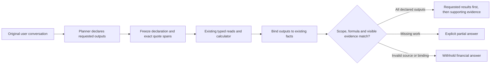

# Checking declared answer completeness

**Implemented and full CI verified as the opt-in `FINANCIAL_CHAT_ROUTE=complete` candidate; not deployed or measured with live models.** Source `382f39f93719fead3a622aa3cb3b773bef1ed58f` passed [CI 41262702669](https://github.com/rayidali/spiich_homework/actions/runs/41262702669): 2,097 tests, all 31 browser workflows, native research and Docker Compose. The six new actual-PostgreSQL cases and two new browser workflows are included in those totals. [Exact-source receipt](evidence/answer-completion-candidate-ci.json). Production remains `93a8617` / `composable`; existing studies, failures and closed budgets remain unchanged.

An answer can contain correct numbers and still omit something the user requested. The [held-out comparison](evidence/adaptive-runs/holdout-v2/report.md) contains examples of correct tables without the requested difference. The new checker makes a declared omission visible. It does not prove that the model understood every part of a question.

## Four requested results, not just two correct numbers

Illustration and offline regression, not a new model trial:

> Show January and February spending, the dollar change, and the relative change.

Suppose the correctly scoped amounts are January **$240** and February **$90**.

| Declared output   | Checked source or operation |       Result |
| ----------------- | --------------------------- | -----------: |
| January spending  | Exact January source row    |         $240 |
| February spending | Exact February source row   |          $90 |
| Dollar change     | February minus January      |        −$150 |
| Relative change   | Change divided by January   | −0.625 ratio |

The existing deterministic calculator displays `−0.625 ratio`; this is mathematically −62.5%. The new checker does not introduce free-form percentage conversion or let the model write numerical prose. A zero January denominator remains an undefined calculation, not an invented zero or percentage.

Showing only the two amounts is partial. A correct calculation hidden from visible evidence is also partial. An equal amount from another account, date, currency or person does not satisfy the required source.



The declaration freezes **before reading financial amounts**. The application already reads a planning account chart before the initial model call. Successful scope checks use the chart from the actual financial execution snapshot, not that earlier planning chart.

## The implemented contract

The schemas are in [answer-contract.ts](../server/answer-contract.ts). Query descriptors reuse `publicFinancialQuerySchema`; they do not introduce a second natural-language date/account parser or arbitrary SQL.

Each of one to eight outputs has a unique ID, one to three exact original-user quotes and one requirement:

| Requirement         | What is checked                                                                                                                                   |
| ------------------- | ------------------------------------------------------------------------------------------------------------------------------------------------- |
| `value`             | A scalar financial scope: metric, aggregation, accounts, period, status, currency and every filter. A matching account/month cell can fulfill it. |
| `table`             | The query scope plus grouping, order, limit and declared `all` or `top` coverage.                                                                 |
| `selected_identity` | An exact first-ranked account/counterparty row, requested ordering and `unique` or `any_one` tie policy.                                          |
| `arithmetic`        | An ordered add/subtract/multiply/divide operation over earlier scalar outputs, sourced user assumptions or a validated calendar-month count.      |

Value requirements have `selectedAccountCode: null` by default. A posting code can select a single row within the declared scope, for example the bank cell from a server-selected `cash_balance` account table. It cannot add a noncash account to the cash set. When an amount threshold is present, the original account set used to qualify transactions remains part of the scope: a broad-account threshold followed by account grouping is not equivalent to a narrow-account threshold, even if the displayed amount is equal.

`counterpartyFrom` can bind a value/table to an earlier declared counterparty selection. The application uses its exact stored key, preserving case and whitespace. Copied case-insensitive name filters cannot substitute for that identity. Dynamic account-filter deferral is not implemented; `selectedAccountCode` is an explicit code, not an arbitrary placeholder.

A unique leader needs enough returned ranking evidence to rule out a tie. A single truncated top row does not prove uniqueness. `any_one` has the narrower meaning of one maximal/minimal row under the declared order; it does not claim the complete set of ties.

Later bindings identify existing facts:

```ts
type OutputBinding = {
  outputId: string;
  source:
    | { kind: 'query_row'; queryId: string; rowId: string }
    | { kind: 'query_result'; queryId: string }
    | { kind: 'calculation'; calculationId: string };
};
```

Inspection `rowId` values may be request-local handles. They resolve through the committed session map to exact canonical rows. A handle cannot be guessed from a label, copied from another query/session or treated as a supplied amount.

## Freeze first; bind later

[prepareAnswerContract](../server/answer-completion.ts) parses and freezes the initial declaration and stores its hash. Its limit is 16 KiB of serialized UTF-8 data. Each quote is at most 500 characters and must occur exactly once in the specified original USER message. The server computes UTF-16 spans; the model does not count offsets. Assistant text, database labels, inspection data and repair feedback cannot establish those anchors. Original-user assumptions retain their separate numeric/unit validator: an output quote never authorizes an amount.

The initial `financial_analysis`, `financial_scenario` or `inspect_financial_data` call carries the declaration. Initial inspection requires empty bindings because no result exists yet. Subsequent inspection cannot replace the declaration; `show_inspected_results` and `calculate_from_inspection` supply final bindings only. IDs and dependencies must be unique and earlier-only. A direct final plan cannot bypass the checker.

The new route exposes these typed tools and `request_details`. The authored, composable and ordinary adaptive routes retain their existing behavior. Missing contracts on the new route cannot silently become a complete answer. Legacy routes without a contract are not given a new completeness claim.

## Source and visibility checks

[finalizeAnswerContract](../server/answer-completion.ts) is pure: it checks existing executed facts and makes no database/provider call. It compares effective posting IDs from the execution chart, not names or dollars. Calendar cells retain clipped periods; stock balances retain as-of dates and all-history semantics. Exact counterparty proofs, cash predicates, saved currency basis, co-occurring accounts and amount-filter basis stay separate checks.

Arithmetic is replayed through the existing deterministic calculator. The checker compares ordered source ancestry, units and original-user assumption occurrences. Harmless overlapping quote boundaries can identify the same user quantity; another equal-valued occurrence cannot. No operation is inferred merely because two amounts are present. A correctly scoped direct union total can fulfill a value requirement without a separate calculator node. Commutative or more general algebraic equivalence is not newly inferred.

[Financial evidence references](../shared/financial-evidence.ts) are additive and server-owned. Each visible row may carry a query-row, calculation or assumption reference; whole query tables carry their query identity and truncation state. The checker matches those references and displayed values rather than relying on table titles, positions or a bag of dollar amounts. Empty complete tables can be linked without inventing a zero row. Existing rendering remains compatible.

The [answer renderer](../server/completion-answer.ts) shows fulfilled requested results first, then supporting tables. Posted, draft and hypothetical labels are inherited from the server evidence. It replaces the old headline on a partial answer so a valid last calculation does not imply that every requested result was delivered.

```ts
{
  completionBasis: 'model_declared',
  userIntentVerified: false,
  status: 'fulfilled' | 'partial' | 'unassessed',
  outputs: [/* outputId, fulfilled/missing/unsupported/invalid, evidence locations */]
}
```

Missing or unsupported outputs remain explicitly unresolved. Invalid source/scope/binding evidence causes the integration to withhold all financial facts/evidence, rather than advertise it as a valid partial answer. A missing execution-snapshot chart cannot be replaced by the planning chart.

## Existing safeguards and limits

The candidate retains organization scoping, read-only typed queries, exact decimal/rational arithmetic, saved exchange rates, cash identity, original-user assumptions, snapshot consistency and truncated-operand refusal. A top-N table can be fulfilled while visibly truncated; those rows still cannot be used as calculator operands. Generic noncash `account_balance` arithmetic remains unsupported. A cash-account calculation must use the supported cash metric and actual cash provenance, never a name or coincidentally equal balance.

Limits remain three provider attempts including at most one schema repair, two inspection rounds, four unique queries, eight calculator nodes, 64 KiB feedback and a shared 40-second planning/inspection budget with late-result withholding. This is not a guaranteed HTTP wall-time SLA. Unknown usage cannot authorize another continuation, and provider failures do not gain automatic retries. The finalizer adds no call or allowance. Operational logs contain bounded status/count metadata, not user quotes, raw arguments or credentials.

## What has been checked, and what remains

Exact-source CI passed **2,097 tests across 105 files** (four skipped), **31 browser workflows** in 48.8 seconds, native research and Compose. Compose passed 2,096 tests across 104 files (five skipped). The totals include **46 pure finalizer**, **20 tool-envelope**, **22 mocked service integration**, **17 diagnostic**, **23 evidence/quantity** and **six actual-PostgreSQL finalizer** cases. The two new browser workflows check visible partial/withheld behavior using scripted API responses. These counts overlap; do not add named suites, local reruns or Compose to the normal total. Live-AI was skipped. The browser used the CI build, not the hosted app or a physical device. The earlier local command reached 499 passing assertions but failed its database setup with EPERM; it remains a local nonpass, separate from the successful actual-PostgreSQL CI. [Receipt and exact source binding](evidence/answer-completion-candidate-ci.json).

Key regressions include all four example outputs, omitted calculations, hidden correct facts, reordered evidence, equal-dollar wrong account/date/status/filter, threshold basis, single cash-account selection, compound calendar cells, no-transaction averages, exact-case identities, tied rankings, wrong-session handles, different same-dollar assumptions and incomplete monthly coverage. Service tests retain shared repair/attempt/deadline and unknown-usage behavior. Database tests independently seed refunds and amounts, exercise changing group descendants and retained inspection snapshots, and compare book fingerprints.

The main limitation is deliberate: a model that omits a user requirement from its initial declaration may fulfill every declared output. The response always retains `userIntentVerified: false`. This version does not solve general conversational interpretation, arbitrary business questions, missing real-world data or all formula selection.

Future work is separate: execute a missing, already-declared operation through the existing calculator; expose unresolved bindings in a continuation within the remaining original budget; support more narrowly proved algebraic equivalences and dynamic identities; and run a separately versioned comparison after source freeze. None is implemented by the current checker, and no old cohort may be reopened to fund it.
