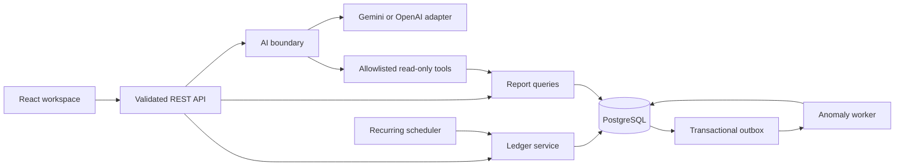
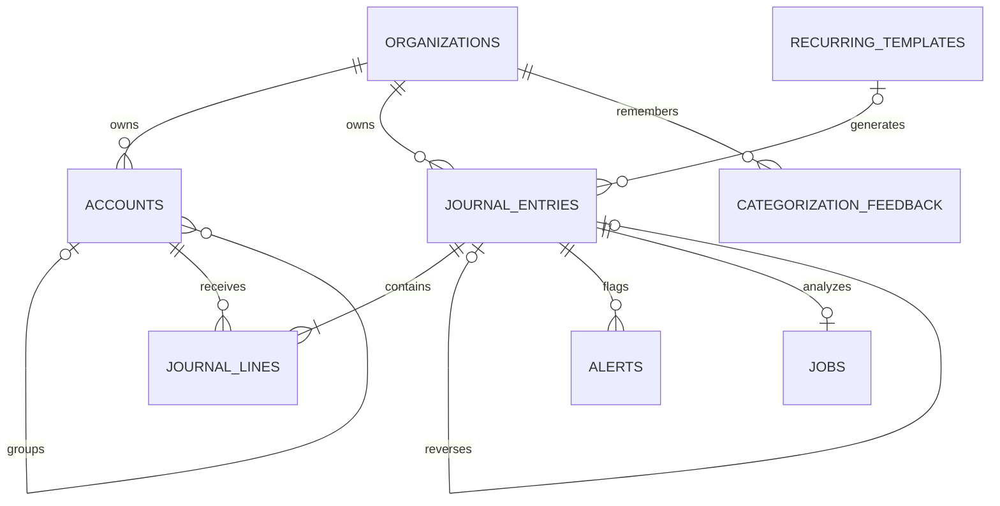
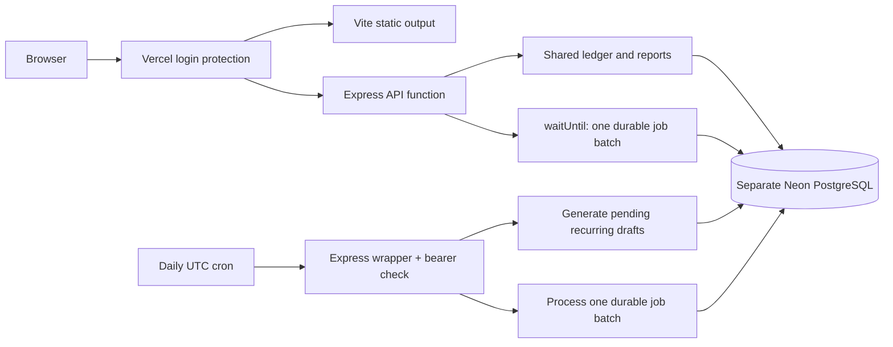

# Architecture and engineering decisions

## 2026-10-30 live AI recovery update

The hosted model and source default are now **`gemini-3.1-flash-lite`**. Direct API testing reproduced the earlier model's generation timeouts and confirmed working text/JSON/tool calls on Flash-Lite. A separate journal-proposal rejection was traced to the 100-line `maxItems` constraint in Gemini's decoding grammar: the transport now omits array maxima, while the full original Zod limit, account checks and exact-money/balance rules remain enforced locally.

Selected hosted checks succeeded: cash **$125,620.00**, **12 Acme Corp entries**, September expenses **$9,265.00**, and a review-only **$340 Supplies debit / Company credit card credit** proposal. Cash/search/expense values matched independent endpoints, and the 73-entry journal list was unchanged. An initial expense timeout succeeded on manual repeat, while a later search failed; **intermittent provider failures remain**. No automatic retry, paid-plan change or accuracy guarantee was introduced.

Local build/native imports and **60 isolated tests** passed, including two new schema regressions. [Full CI](https://github.com/rayidali/spiich_homework/actions/runs/41103851106) for source `7ecb435c421862dba5efd4e3b6f743c93fd1888e` **passed 103 backend tests, 10 browser workflows, native hosted imports and Docker startup/persistence**; the opt-in live evaluation job was skipped. These selected checks are not the full 40-case live evaluation. [Detailed evidence](evidence/chat-recovery-verification.json) records successes and failures. Earlier timeout-only notes below describe the 2026-10-29 snapshot.

> Saved 2026-10-29. The implemented modular monolith now has both Docker/native and protected Vercel/Neon hosting paths. Full CI passed **101 backend tests, 10 browser workflows, native hosted imports and Docker persistence**. Hosted API/reports/scheduler passed HTTP checks. Gemini model-metadata access succeeded; live financial chat timed out. Scale/failover/restore and live AI accuracy remain unverified. Resume from [CHECKPOINT.md](../CHECKPOINT.md).

For a pictorial introduction, open the [eight-page PDF report](reports/architecture-review.pdf) or [interactive HTML version](reports/architecture-review.html). They are the planning snapshot before the provider/interface implementation. Current implementation and verification status are recorded below and in the checkpoint.

## Gemini and evaluation implementation

The user authorized implementation after the report. `server/ai-provider.ts` now isolates native Gemini `generateContent` and OpenAI Responses from shared accounting rules in `server/ai.ts`. Gemini uses the documented JSON-schema response format and allowlisted function declarations; OpenAI remains selectable. No orchestration framework or new application dependency was needed. The configurable Gemini default is now `gemini-3.1-flash-lite`, verified against the official [model page](https://ai.google.dev/gemini-api/docs/models/gemini-3.1-flash-lite) and [REST reference](https://ai.google.dev/api/generate-content).

Both transports have a 25-second timeout, one attempt without automatic retries, bounded output and at most four in-flight requests per process. A financial question must produce exactly one permitted call with validated arguments. Unknown fields, including attempted organization overrides, are rejected. Numerical answers still come from SQL and application code. Proposals still pass the same active-account, exact-money and balance checks and require user review.

Provider metadata records reported token usage, configured/resolved model and duration without storing keys or raw error payloads. The CLI evaluation adds exact attempt limits and an observed-token guard; it stops when usage is unknown. A request already underway can exceed the token threshold, so this is not a hard billing cap. The 40-case dataset is split into development/holdout sets with full entry comparisons, exact financial query/evidence checks, correction retrieval and organization-isolation cases. Synthetic fixtures use new workspaces and the journal is fingerprinted around model calls. Clarification meaning remains an explicit human-review item. An authenticated model-metadata request succeeded and a hosted financial question returned the safe 25-second AI_TIMEOUT. Successful live generation/accuracy remains unestablished; metadata access is a different check from generation. The root cause and provider usage of the timeout are unknown.

## The central invariant

A posted entry has 2–100 lines, and the exact sum of its base debits equals the exact sum of its base credits. Posted headers and lines cannot be edited or deleted by the application database role. Everything else—dashboard, reports, AI, recurring work—is built around that journal.

A modular monolith keeps transaction boundaries clear and the one-command setup small. The backend uses explicit parameterized SQL through `pg`; the accounting rules are easier to review when their SQL is visible. React consumes the same Zod-derived input contracts. No browser component has a database credential or provider key.

## Data model

Drafts may be unbalanced, but every stored line must have one positive side, valid precision, a positive rate, and a valid leaf account. The UI/API require at least two lines; the database enforces the count at posting. Composite `(organization_id, id)` foreign keys prevent attaching another organization's account or template to an entry. Accounts have unique codes within their organization.

Grouping accounts never receive journal lines. Hierarchy changes take an organization-specific advisory lock to prevent racing cycles. Account type, currency, grouping, and cash classification cannot change after journal usage, which prevents historical reports from silently changing meaning. Names and codes remain editable; this version does not keep an audit history of account-label changes.

## Why constraints live in PostgreSQL

A normal `CHECK` constraint is not a safe way to validate sums over other rows. Deferrable constraint triggers validate the final state of the whole entry when its transaction commits. This allows all lines to be inserted before the balance is checked. The tests bypass the API deliberately to prove the database rejects bad writes. [PostgreSQL constraints](https://www.postgresql.org/docs/current/ddl-constraints.html), [constraint triggers](https://www.postgresql.org/docs/current/sql-createtrigger.html).

Every line mutation locks the parent entry row. Posting locks that same row. This closes the race where a line edit starts while another request is posting the entry. The posting trigger also locks referenced accounts while checking whether they are archived.

The runtime role is separate from the migration owner. It cannot alter the schema, disable triggers, or truncate the ledger. An administrator can still change the database; this is an application integrity boundary, not a claim of protection against a database superuser.

## Exact amounts and currency policy

- Store money as PostgreSQL `numeric` and exchange rates as exact decimals; return them as JSON strings.
- Use `decimal.js` for application arithmetic. Display formatting preserves cents even beyond JavaScript's safe integer range.
- Require the account's currency on each line; JPY has zero decimal places, other supported currencies have two.
- A rate means **USD per one unit of the line's currency**. USD lines require rate 1.
- Store generated `round(native_amount * rate, 2)` base amounts. Validate balance after rounding each line.
- Do not hide a rounding residual. The user must supply an explicit balancing line with an appropriate account.
- Reversals copy the exact original rates and swap debit/credit amounts.

PostgreSQL `numeric` provides exact decimal arithmetic suitable for monetary amounts. [Numeric types](https://www.postgresql.org/docs/current/datatype-numeric.html).

Balances are historical book values. A EUR bank can show a native amount and its accumulated USD carrying value. Converting that bank at today's spot rate, settling foreign receivables, and recognizing unrealized gains/losses require separate revaluation/settlement workflows. This submission does not claim to implement full IAS 21 accounting.

## Posting, retries and review

1. Validate the request and normalize input with Zod.
2. Create a draft in a transaction, using an organization-scoped idempotency key and request hash.
3. On a repeated key, return the original resource only if the create payload matches; otherwise return 409.
4. For edits/posting, lock the draft and compare the client's reviewed revision.
5. Validate accounts, currency rules, and balance again; update the status to posted.
6. PostgreSQL validates final invariants and inserts an analysis job in the same transaction.
7. Commit, then return the posted entry.

Posting an already posted entry is harmless. Network retries never need a second financial event. Idempotency applies to creation/reversal/template creation; draft revision checks prevent stale edits. A browser that loses an edit response may need to reload its draft before retrying.

Corrections use a new linked reversal. SQL compares both line multisets to verify that it exactly negates the original. A unique constraint allows at most one direct reversal, and a reversal cannot predate its original. Both remain in historical reports according to their dates. Entry numbers are database identities and may have gaps; they are not legal invoice numbers.

## Reports and consistency

Only posted entries affect financial reports. P&L uses activity within an inclusive date interval. The balance sheet uses all history through an as-of date and includes all unclosed revenue minus expenses in equity. The trial balance shows opening amounts, interval activity, and closing debit/credit balances. The account ledger adds pre-period opening balance to its ordered running sum before applying pagination.

Multi-query reports run inside a read-only repeatable-read transaction. This prevents the first and second parts of a report from seeing different commits. A single report is consistent; separate reports opened at different times can naturally differ if someone posts between them. Business dates are PostgreSQL `DATE` values, kept as strings; this version uses America/New_York for today's date.

Transaction and ledger lists use date/UUID cursor ordering with a unique tie-breaker. New entries cannot make an offset suddenly skip an existing row. Pagination is not a frozen cross-request snapshot: a new backdated posting may change subsequent report pages, so users should refresh after concurrent writes.

## Background work

Posting queues an analysis job atomically. Workers claim bounded batches with `FOR UPDATE SKIP LOCKED`, process up to four jobs concurrently, and renew a two-minute lease every 30 seconds. Lease tokens prevent an old worker from completing a reclaimed job. Failures use exponential backoff; after five attempts the job stays failed for operator investigation. There is no operator retry UI in this version.

Delivery is at least once. Alert uniqueness on `(entry_id, rule)` makes repeated analysis safe, and an upsert preserves a user's dismissal. A job can succeed even if a prior attempt produced some of its alerts; no financial values are mutated.

The recurring scheduler locks up to 20 due templates, creates at most 50 occurrences per tick and 10 per template, and advances dates in the same transaction as entry creation. Occurrence uniqueness and deterministic keys prevent duplicates. Calendar anchors preserve Jan 31 → Feb 28 → Mar 31 and leap-day behavior. Paused schedules catch up on resume. An end date is inclusive.

A savepoint isolates each template. Invalid accounts pause that template with an actionable error and roll back its partial batch; other templates continue. Editing changes future generated content, not existing drafts. Original frequency and anchor stay fixed; create a new schedule to change them. Foreign recurring occurrences require explicit rate confirmation before posting.

In Docker/native mode the scheduler and worker share the API process. The scheduler serves its configured organization; the continuous anomaly worker can claim across organizations. Multiple instances contend safely through database locks/leases. Hosted adapters pass the configured organization explicitly. A production multi-tenant scheduler would enumerate due organizations independently and use dedicated worker deployment/connection budgets.

## Vercel hosting and operational boundaries

The hosted demo keeps the same ledger/report/AI services and PostgreSQL invariants. Static Vite assets run on Vercel; tiny `api/index.js` and `api/cron.js` exports load generated native ESM from TypeScript adapters in `server/hosting/`. esbuild resolves internal extensionless imports, and CI imports both wrappers. No application rules were duplicated for hosting and no applied migration was rewritten.

The runtime connects with a strong-password restricted `spiich_app` account over a pooled TLS URL. Build-only owner access runs checksummed migrations, role hardening and the idempotent seed. Production credentials were supplied as deployment overrides; persistent project production variables and automatic Git deployment are not configured assumptions. Local private operational files are excluded from source/archives.

Successful mutations schedule bounded analysis with `waitUntil`; daily cron generates pending recurring entries and processes a bounded job batch. PostgreSQL retains job retry state. The observed Hobby plan's daily timer plus request-triggered batches can leave large backlogs waiting. This adapter is sufficient for a protected demo, while sustained workers, distributed cost/concurrency limits and aggregate connection budgeting need measured production design. The in-process four-call AI limit is per function process, not global across replicas.

All-deployment Vercel protection gates this shared workspace. It does not implement application users, per-user authorization or multi-tenant isolation policies. Hosted data is separate from local PostgreSQL and Docker. HTTP smoke checks established reports balance and scheduler auth/work; they do not establish real-phone layout, automatic timer firing, recovery capacity or live model accuracy. Full details and resource state are in [hosting](HOSTING.md).

## AI and statistical signals

Natural-language input uses a strict structured response with READY/CLARIFY states. Context includes active accounts, up to six relevant historical entries, and up to six confirmed corrections. These are untrusted data, never instructions. Proposals go through the same business validation as manual inputs and cannot post automatically.

Insight chat selects one of four functions: expense summary, revenue comparison, transaction search, or cash position. It can also ask for clarification. There is no generated SQL executor. SQL calculates amounts; application code composes the numeric answer and evidence links. The model can still misinterpret a period or intent, so dates remain visible in the answer. Context retrieval is the learning mechanism; no fine-tuning is performed.

The server caps in-flight model requests at four, provider requests at a 25-second timeout per attempt, and SDK retries at one. Requests opt out of stored Responses. Provider failures leave the books untouched. The default model is configurable and selected for focused structured tasks; live acceptance depends on the evaluation suite after credentials are available. [Structured output](https://developers.openai.com/api/docs/guides/structured-outputs), [function calling](https://developers.openai.com/api/docs/guides/function-calling), [GPT-6 Luna](https://developers.openai.com/api/docs/models/gpt-6-luna).

Anomaly detection uses explainable statistical rules rather than a model call: possible duplicates within three days, expense amount at least 1.75 times a median from 4–24 previous samples with at least 50 native currency units of difference, and a changed vendor expense category after at least four historical examples. These are review hints. They have false positives and do not detect every anomaly or establish fraud. Thresholds and the fixed native-currency difference should be tuned by currency and customer data in production.

## Architecture discussion: proposed next iteration, not implemented

This section preserves the earlier discussion. After the visual report, the user authorized the Gemini adapter, stronger evaluation harness and simpler UI, which are now implemented in source; live/runtime verification remains outstanding. Paid Jev and other models/services remain acceptable when justified. Jev, vector retrieval and document ingestion have not been integrated.

The proposed baseline is the existing accounting engine plus a selected Gemini adapter, approved financial functions, current business definitions, and evidence-backed responses. PostgreSQL retains the authoritative ledger. A function should return exact values together with its date range, currency, scope, and record/query provenance. The model may interpret intent incorrectly even when its JSON is valid; validate arguments, show the interpreted scope, and ask for missing facts. A stronger model cannot supply an unknown payment account or exchange rate reliably.

Retrieval is a separate design choice. Existing SQL/text retrieval may suffice for the current dataset. Gemini File Search provides managed retrieval for uploaded documents; pgvector would provide semantic retrieval alongside operational records in PostgreSQL. Neither is necessary for exact SQL totals, and neither is a replacement for the ledger. Choose one document retrieval path if that feature is added, measure retrieval quality, enforce organization scope in code, and account for index freshness. Source records should be revalidated when a retrieved example informs a posting suggestion.

Jev is a candidate for category selection, relevance ranking, and narrow checks that a generated claim follows from supplied evidence. Compare it with the Gemini-only baseline before adding it to a request path. Its confidence is not a measured accounting accuracy rate, two models can share an error, and semantic checks do not replace deterministic monetary validation. All proposed postings still require user confirmation. When a check fails, return a clarification or verified facts; do not run an unbounded repair loop.

Proposed evaluation dimensions are correct account/tool selection, required clarification, unsupported-claim rate, retrieval relevance, cross-organization isolation, latency, and cost. Include invoice-payment double counting, missing rates, misleading descriptions, stale records, and provider failure. Keep held-out examples separate from prompt tuning, record model/prompt versions, and retain a rollback path. These are planned checks, not additional passing tests.

Sources reviewed: [Gemini function calling](https://ai.google.dev/gemini-api/docs/function-calling), [structured-output limits](https://ai.google.dev/gemini-api/docs/structured-output), [managed File Search](https://ai.google.dev/gemini-api/docs/file-search), [TypeSafe models](https://docs.typesafe.ai/models), and [Jev confidence](https://docs.typesafe.ai/confidence).

## Repository research: references under consideration

Reviewed public GitHub metadata, READMEs, licenses, and selected implementation files on **2026-10-29**. Star counts are a dated popularity snapshot. These repositories have not been installed, executed, audited in full, or incorporated into Daybook.

| Repository                                                | Stars observed | Most useful reference for Daybook                                           | Fit limitation                                                                                            |
| --------------------------------------------------------- | -------------: | --------------------------------------------------------------------------- | --------------------------------------------------------------------------------------------------------- |
| [Midday](https://github.com/midday-ai/midday)             |         15,102 | TypeScript financial assistant, transaction workflows, application tools    | Broader business assistant; its reviewed tools do not establish assignment-level double-entry correctness |
| [Bigcapital](https://github.com/bigcapitalhq/bigcapital)  |          3,992 | React/TypeScript accounting, journals, reports, currency tests              | Its Compose stack uses MariaDB; not a PostgreSQL starter for this assignment                              |
| [WrenAI](https://github.com/Canner/WrenAI)                |         18,008 | Explicit business definitions and context for natural-language data queries | Separate analytics infrastructure; integration and accuracy would need evaluation                         |
| [Actual Budget](https://github.com/actualbudget/actual)   |         29,859 | TypeScript transaction workflows and configurable categorization rules      | Personal budgeting rather than the required business accounting scope                                     |
| [ERPNext](https://github.com/frappe/erpnext)              |         40,746 | Broad accounting workflows and domain reference                             | Python/Frappe ERP, substantially larger scope and different stack                                         |
| [TigerBeetle](https://github.com/tigerbeetle/tigerbeetle) |         17,271 | Financial transaction invariants and storage design                         | Separate database written in Zig; does not satisfy the PostgreSQL requirement by substitution             |

Midday's [report tools](https://github.com/midday-ai/midday/blob/main/apps/api/src/mcp/tools/reports.ts) validate tool inputs through schemas, check the report scope, and pass server-side team context to named database query functions. This is a concrete reference for the existing Daybook function boundary. Its [assistant runtime](https://github.com/midday-ai/midday/blob/main/apps/api/src/chat/assistant-runtime.ts) also bounds tool-loop steps. Neither pattern establishes that generated explanations are always accurate.

Bigcapital's [manual-journal tests](https://github.com/bigcapitalhq/bigcapital/blob/develop/packages/server/src/modules/ManualJournals/commands/ManualJournalGL.spec.ts) cover exchange-rate conversion, balanced converted totals, and retention of currency/rate metadata. Wren's [context model](https://github.com/Canner/WrenAI/blob/main/docs/core/concepts/what_is_context.md) explains why table schemas alone leave business meaning ambiguous. The proposed Daybook adaptation is a reviewed dictionary of revenue, cash, posted status, periods, and currency alongside existing approved SQL functions. Adding Wren itself is a separate decision.

Licensing needs a component-level check before copying code. Actual is MIT, TigerBeetle is Apache-2.0, Bigcapital identifies as AGPL-3.0, and ERPNext identifies as GPL-3.0. Wren's [license map](https://github.com/Canner/WrenAI/blob/main/LICENSE) assigns Apache-2.0 to current code paths and CC BY 4.0 to documentation, with package manifests authoritative for published artifacts. Midday's [license file](https://github.com/midday-ai/midday/blob/main/LICENSE) contains AGPL-3.0, while its [README](https://github.com/midday-ai/midday#license) separately describes commercial licensing; clarify those terms before code reuse.

Maintenance also matters: [Maybe](https://github.com/maybe-finance/maybe) had 54,209 stars and [Vanna](https://github.com/vanna-ai/vanna) had 23,804, but both were archived when checked. Midday was not archived, although its latest push reported by GitHub was 2026-06-13. Popularity is not evidence of current maintenance, accounting correctness, or production capacity.

Recommendation under discussion: use Midday for assistant interaction patterns, Bigcapital for accounting comparisons, Wren for explicit business meaning, and Actual for transaction/rule usability. Preserve Daybook's existing PostgreSQL ledger and verify any adopted behavior with our own cases. No dependency or product change is approved merely by inclusion in this research list.

## Midday and Actual Budget source walkthrough

Reviewed on **2026-10-29** for a beginner explanation of product design, architecture, and assignment fit. Midday was inspected at [51587319](https://github.com/midday-ai/midday/commit/51587319f26a0ffaa9dfccab1920373cb65689b7), dated June 13; Actual at [1d9ec2d1](https://github.com/actualbudget/actual/commit/1d9ec2d1d410e9d393c666eb6dd24ace92edc96c), dated October 29. This is selected source/documentation inspection, not an installation, full audit, or live accuracy test.

Midday's founders [announced joining Ramp and winding down the hosted product](https://midday.ai/updates/joining-ramp/). This materially qualifies the earlier repository recommendation: use it as a reference, not a proposed hosted dependency. Its [pre-accounting product](https://midday.ai/pre-accounting/) collects bank transactions and receipts, categorizes and matches them, and prepares accounting exports. The inspected transaction schema does not establish the assignment's immutable, balanced journal model.

Midday's source separates a React/Next.js dashboard, a Hono/Bun API, shared TypeScript packages, PostgreSQL through Drizzle, Supabase services, and background workers. The [API entry point](https://github.com/midday-ai/midday/blob/51587319f26a0ffaa9dfccab1920373cb65689b7/apps/api/src/index.ts) exposes REST/OpenAPI and tRPC. Trigger.dev bank-sync tasks coexist with BullMQ/Redis workers; the README alone is an incomplete map. The [overview](https://github.com/midday-ai/midday/blob/51587319f26a0ffaa9dfccab1920373cb65689b7/apps/dashboard/src/components/widgets/index.tsx) combines a summary, assistant entry, quick actions and linked metrics. Transaction details open in a sheet with expandable supporting information. The sidebar's hover-expanded labels are not automatically a good fit for Daybook's requested beginner usability.

The [chat runtime](https://github.com/midday-ai/midday/blob/51587319f26a0ffaa9dfccab1920373cb65689b7/apps/api/src/chat/assistant-runtime.ts) uses Vercel AI SDK ToolLoopAgent, not Mastra in that path, with a ten-step limit. [Tool selection](https://github.com/midday-ai/midday/blob/51587319f26a0ffaa9dfccab1920373cb65689b7/apps/api/src/chat/tools.ts) uses embeddings to select relevant tool definitions. Its report tools validate arguments, require report scope, pass server-derived team context and invoke authored SQL queries. This retrieves financial facts but does not prove generated prose is accurate. Prompt instructions about confirming sends are distinct from a backend approval gate; the inspected invoice-send handler does not itself require a separate confirmation token.

[Receipt matching](https://github.com/midday-ai/midday/blob/51587319f26a0ffaa9dfccab1920373cb65689b7/packages/db/src/queries/transaction-matching.ts) uses amount/currency/date filters, text similarity and confirmation/rejection feedback. [Migration 0032](https://github.com/midday-ai/midday/blob/51587319f26a0ffaa9dfccab1920373cb65689b7/packages/db/migrations/0032_drop_transaction_embeddings.sql) drops transaction/inbox embeddings; this does not mean the whole product has no vectors or establish why the change was made. [Transaction enrichment](https://github.com/midday-ai/midday/blob/51587319f26a0ffaa9dfccab1920373cb65689b7/apps/worker/src/processors/transactions/enrich-transaction.ts) uses Gemini structured results and preserves existing categories through its helper. Its completed status is not proof of a correct classification. No model retraining or measured accuracy is inferred.

Actual is a personal envelope-budgeting reference. Its [architecture](https://actualbudget.org/docs/contributing/project-details/architecture/) uses React/Vite and a local SQLite calculation engine, running in a browser worker or Electron child process, plus an optional sync server. Sync convergence is a separate responsibility from accounting invariants. [Optional encryption](https://actualbudget.org/docs/getting-started/sync/) covers synced budget data, not all local data or bank-sync tokens.

Actual's [transaction type](https://github.com/actualbudget/actual/blob/1d9ec2d1d410e9d393c666eb6dd24ace92edc96c/packages/loot-core/src/types/models/transaction.ts) stores a signed integer amount, account, category/payee and optional split/transfer links. Linked opposing transfers are not a general double-entry journal. Its [reconciliation guide](https://actualbudget.org/docs/accounts/reconciliation/) allows confirmed edits even to locked transactions, and [native multi-currency is unsupported](https://actualbudget.org/docs/budgeting/multi-currency/). Its reports and schedules are useful references but do not establish the assignment's required journal reports or AI suite. The [server Compose](https://github.com/actualbudget/actual/blob/1d9ec2d1d410e9d393c666eb6dd24ace92edc96c/packages/sync-server/docker-compose.yml) packages its own architecture, not a PostgreSQL ledger.

Actual's [rules](https://actualbudget.org/docs/budgeting/rules/) normalize payees and assign categories with inspectable conditions/actions. It learns editable payee-category rules from corrections; these are not LLM calls. Proposed Daybook lessons: keep frequent actions visible, show evidence beside suggestions, use explicit confirmed rules for familiar cases, and reserve AI for uncertain interpretation. Preserve Daybook's exact, immutable PostgreSQL journal and hard posting-review boundary. No adoption, dependency installation, or implementation decision was made.

## Spiich research and implications for the assignment

Public sources checked on **2026-10-29**. The user is unsure which engineering role the exercise targets and wants to finish in **one or two days**, alongside other commitments. Both role descriptions were reviewed. This is research and a proposed approach, not an implementation decision or a claim about the company's private systems.

Spiich describes a sales product spanning conversational assistance, meetings, CRM updates, and background work. Its September 23 announcement reports a EUR 3 million seed round, bringing total funding to EUR 3.6 million. These are company-published facts. [Product overview](https://spiich.ai/help/getting-started/what-is-spiich), [funding announcement](https://spiich.ai/articles/spiich-raises-3m-seed-round).

The [Fullstack Engineer posting](https://spiich.ai/careers/fullstack-engineer) lists React, TypeScript, Node.js, Express, PostgreSQL, Neo4j, Docker, Google Cloud, Mastra, and several model providers. It emphasizes complete features, integration reliability, performance, and operation. The [Founding AI Engineer posting](https://spiich.ai/careers/founding-ai-engineer) emphasizes retrieval, knowledge graphs, model selection, and agents triggered by schedules or CRM events. Those listings are evidence of advertised technologies and responsibilities, not a full production architecture audit.

Their [CRM sync documentation](https://spiich.ai/help/your-data/crm-sync-rules) describes rejecting and rolling back writes that the CRM refuses. Their [assistant behavior guide](https://spiich.ai/help/chat-and-voice/what-spiich-does-on-its-own) describes clarification for ambiguous changes. Their [background-agent guide](https://spiich.ai/help/background-agents/background-agents-overview) documents triggers, permissions, and inspectable runs. The inferred connection is dependable natural-language operations over an authoritative business system. Journal invariants, reviewable proposals, correction memory, retries, recurring jobs, and evidence-backed reports exercise related skills. The reviewed public material does not establish that Spiich builds an accounting product or reveal the private reason for choosing this domain. The supplied assignment's explicit rubric remains the scope authority.

Using a managed model is compatible with owning application behavior. Google's [function-calling guide](https://ai.google.dev/gemini-api/docs/function-calling) assigns function execution to application code, and its [structured-output guide](https://ai.google.dev/gemini-api/docs/structured-output) requires value validation even for schema-conforming output. Daybook must still enforce scope, exact money, posting rules, clarification, retries, and evidence. A balanced proposal can still contain a semantically wrong category; database invariants and model-quality evaluation cover different failures.

The components under discussion serve different jobs:

- Gemini supplies language interpretation and tool selection. It can also supply embeddings for a separately managed retrieval store.
- [Gemini File Search](https://ai.google.dev/gemini-api/docs/file-search) manages ingestion and retrieval of uploaded material. It is a possible document-retrieval choice if that scope is added.
- [pgvector](https://github.com/pgvector/pgvector) adds vector similarity search to PostgreSQL. A focused candidate is retrieval of relevant confirmed corrections or historical examples, followed by validation of current source records. Exact financial totals still come from ledger SQL.
- Wren supplies business definitions and data-query infrastructure. Its clearest potential value is broader analytics beyond the current approved tool families; the semantic-definition idea can be applied without installing the framework.
- Mastra supplies TypeScript agent orchestration, tracing, and [evaluation facilities](https://mastra.ai/docs/evals/overview). Its [classifier interface](https://mastra.ai/docs/classifier) also supports TypeSafe Jev. This makes it relevant to the advertised stack, but does not establish that Spiich uses Jev or that Daybook needs either dependency.

The proposed first comparison is Gemini with existing SQL/text context versus the same model with hybrid lexical/vector context. Keep the ledger, fixture, tool definitions, and checks shared. Evaluate a Jev category check separately only if category errors justify it; evaluate Wren separately if required questions exceed the approved tools. Branches isolate code changes, while the shared test cases establish which behavior is better. See the [bounded comparison plan](PLAN.md#proposed-one-to-two-day-finish-and-comparison).

## Path to a million users

“A million users” is not a workload specification. As an illustrative planning assumption, one million registered users with 20% active daily and 20 journal writes per active user means four million entries per day: about 46 average writes/second and roughly 930 at a 20× peak. Reads, line counts, large tenants, retention, report frequency, and AI usage can dominate the system. These are planning calculations, not measured throughput.

The current foundation helps: tenant-leading indexes, exact immutable facts, idempotency, per-entry locks, bounded connection pools, cursor reads, bounded worker batches, explicit timeouts, and separately testable modules. Limits are currently 250 accounts and 200 schedules per workspace, 100 lines per entry, and 128 KB API bodies. Ledger/report reads still aggregate history and will need measured optimization as histories grow.

Before claiming production capacity:

1. Add authentication, organization membership, authorization, audit actors, RLS defense in depth, distributed rate/cost quotas, and secure secret provisioning. Resolve tenant identity from authentication.
2. Benchmark representative small, large, and unusually active tenants; measure p50/p95/p99 read/write latency, lock waits, pool saturation, WAL volume, dead tuples, and worker lag. Include contention and backdated writes.
3. Deploy stateless API replicas and separate workers behind an ingress; budget connections globally through a pooler. Add managed PostgreSQL failover, encrypted backups/PITR, and tested restore procedures.
4. Add checkpointed per-account daily summaries when report scans become the measured bottleneck. Keep the journal authoritative, reconcile projections, and explicitly handle backdated entries. Serve financial read-after-write requests from the primary until replica freshness is established.
5. Introduce tenant sharding only when a measured capacity/isolation requirement justifies it. Keep all lines of an entry and its transaction on one shard. Partitioning has consequences for unique constraints and foreign keys; do not casually partition the existing schema by date.
6. Define service objectives, error budgets, release/rollback procedures, retention policies, support ownership, and a restore drill. Add tracing, queue-age metrics, model-quality evaluations, and alerting on invariant/report discrepancies.

An additional queue, cache, microservice, or Kubernetes cluster is justified by a measured need. None is necessary to make this assignment's posting transaction correct.
