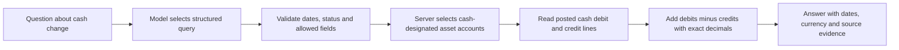

# Cash change: what the new query means

Suppose the business starts March with $100 in its bank account. A customer pays $50, the business pays $20 for supplies, and it moves $30 from the bank to petty cash.

| Event             | Bank change | Petty-cash change | Combined cash change |
| ----------------- | ----------: | ----------------: | -------------------: |
| Customer payment  |        +$50 |                $0 |                 +$50 |
| Supplies payment  |        −$20 |                $0 |                 −$20 |
| Internal transfer |        −$30 |              +$30 |                   $0 |
| March total       |          $0 |              +$30 |                 +$30 |

The answer to “How much did our cash change during March?” is **+$30**. Closing cash is **$130**, a different quantity. Revenue and profit also answer different questions: a loan increases cash without being revenue, and an unpaid customer invoice can create revenue without receiving cash.

The `net_cash_movement` query requires an inclusive start and end date, posted entries, summation and an empty account-code list. That empty list tells the server to select every cash-designated asset posting account, including archived accounts. A model cannot substitute the Assets group, a receivable named “Cash,” or its preferred bank-account subset. A positive result means an increase; a negative result means a decrease. No matching cash activity produces zero.

The query supports one grouping dimension: total, account, month, quarter, counterparty label or journal entry. Monthly and quarterly series include empty periods and clip partial boundaries. Transaction descriptions, counterparty labels, co-occurring accounts and signed per-entry amount limits can filter activity, but the response must retain those restrictions. A mixed $150 cash payment containing $40 of supplies still has a $150 cash effect; matching the Supplies account does not prove that all $150 purchased supplies.

Base-currency results use the USD debit/credit amounts saved when each entry was posted. Native-currency results use only one explicitly selected currency, without conversion. A transfer from USD cash to EUR cash cancels in the combined base total when both saved cash amounts match, but it appears separately in USD-only and EUR-only results. A recorded difference between their saved carrying values remains a real difference in the recorded cash lines. This feature does not calculate current exchange-rate revaluation.

Source facts contain `cashMovementSource`, resolved account identities, query dates and filters. Calculator outputs retain separate `cashMovementSources` with periods; existing `cashSources` retain balance dates. Movement never acquires a closing-balance label merely because its amount happens to match a balance. Calculations still require USD monetary operands and complete query results. Their exact arithmetic does not establish that every model-selected formula matches the user's intention.

This is **net recorded cash movement**, not gross receipts/payments, a reconciled bank statement, available credit, or a formal operating/investing/financing cash-flow statement. The current model can still select the wrong otherwise-valid metric for unverified wording; this capability is not a universal question-meaning safeguard.

## Verification boundaries

- Offline compiler tests check server-owned cash selection, native/base SQL expressions, bound filter values, invalid scopes, limits and output provenance. Their supplied database rows are stubs, not database arithmetic evidence.
- Chat tests run the real planner-schema/compiler/response path with a stubbed model selection. They verify error withholding and all-history handling, not live model understanding.
- Calculator tests distinguish movement periods from balance dates, reject incompatible source facts and retain lineage through exact arithmetic.
- PostgreSQL tests post synthetic entries through the real ledger, then compare query results with hand-calculated expectations: transfers, loans, refunds, archived cash, draft/date/workspace exclusions, foreign currencies, reversals, empty periods and opening-plus-movement-equals-closing. Read-only calls compare full account/header/line fingerprints before and after.

Execution status belongs to the current [checkpoint](../CHECKPOINT.md) and [build log](BUILD_LOG.md). These deterministic tests do not change any frozen model-comparison score. No provider cohort is reopened by this feature.
