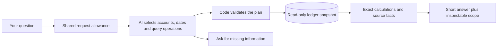

# Financial-chat reliability work

Status: active, 2026-10-31. The focused repair is deployed and verified; the broader candidate remains undeployed. [Release receipt](evidence/chat-scope-release.json).

## The failure

“Office supplies” identifies one account. Returning the total of every expense account answers the wrong question even if every number is real. The original four-tool interface could not express a specific expense account. Its tests did not sufficiently check that the selected query retained the user's meaning.

## First repair

The deployed repair supports seven read-only financial operations plus clarification: scoped expenses, overall expenses with explicit total/top/all views, income totals, metric comparisons, legacy revenue comparison, journal text search and cash position. The planner receives organization-scoped account identities, not guessed account codes. PostgreSQL supplies figures and application code writes numeric answers. A category group includes descendants exactly once; historical archived accounts remain reportable; posted credits/reversals affect their actual dates.

If a question omits the reporting period, the assistant asks which period and retains the category in the follow-up. A request that cannot be represented must be explained, not replaced with a similar query. This contract does not by itself prove that a model always follows it.

## How we check it

- PostgreSQL regressions use small transactions with independently specified totals, including a category outside the top five, account trees, foreign workspaces, FX and reversals.
- Provider contracts check structured input/output and deterministic response construction. They do not measure model understanding.
- Browser coverage checks the clarification and scoped-answer interaction.
- An independently authored question matrix covers actual wording, follow-ups, dates, rankings, totals and unsupported combinations. Live evaluation must score retained constraints and correct amounts, not merely HTTP success.

The scoped repair passed full database/browser/Compose CI and23 hosted checks:16 exact answers and7 appropriate clarifications. All74 current journals and22 accounts stayed unchanged. A collaborating AI agent reviewed clarification meaning; this was not human/accountant adjudication. Existing category scores measure a different task.

## Broader active work

Evaluate a bounded semantic query plan that can compose filters, grouping and calculations over the ledger without executing arbitrary model-written code. Reuse the useful lessons from the closed architecture study, but do not present its results as evaluation of changed product code. Compare meaningful alternatives on the same frozen questions; use exact numerical and scope checks where possible and disclose any subjective model judging. Add explicit off-topic and abuse behavior with tested cost/rate limits. A failed or unsupported request must leave the books unchanged and provide a traceable explanation.

No guarantee of universal question coverage, perfect AI accuracy or production-scale capacity is made. The goal is a precise, evidence-backed answer when data and validated operations suffice, and a clear limitation or clarification when they do not.

## Candidate flow, not yet released

The candidate combines filters and grouping instead of requiring a new function for each sentence. It keeps journal totals, expenses, balances and draft projections distinct. Review found and fixed two traps: filtered past activity labeled as a full balance, and an empty group of the wrong account type producing a misleading zero. Financial query execution has row/query/time bounds. No model SQL or executable code is accepted.

New migration007 stores one workspace's fixed UTC minute/day counts and expiring active-request leases. Defaults are12 requests/minute,100/day and four active requests, shared across chat, entry proposals and category suggestions. Counters remain consumed after failure; acquisition/storage failure prevents provider work. These are request controls, not a dollar billing cap; fixed-window boundaries permit bursts, consistent configuration is required across instances, and leases do not cancel hung work. No application login or tenant authorization has been added.

The broader comparison uses a fresh synthetic product-schema ledger, eight development and twenty untouched held-out questions per route. It compares authored tools against composable tools under the same model/budgets. The separate maximum is60 calls/$0.50; no broad route result is available yet. All earlier studies and the23-request repair cohort stay closed.
