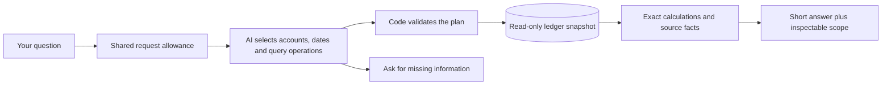

# Financial-chat reliability work

Status: active, 2026-10-31. The stable demo still serves verified `e7a514e`. The latest schema-repair candidate passed CI and completed six hosted checks, but one all-history expense question received an invented start date. Five checks passed; the candidate was never promoted. Earlier cash-source and schema failures remain preserved. [Current stable release](evidence/chat-scope-release.json), [latest staged incident](evidence/chat-schema-repair-blocked-release.json).

## The failure

“Office supplies” identifies one account. Returning the total of every expense account answers the wrong question even if every number is real. The original four-tool interface could not express a specific expense account. Its tests did not sufficiently check that the selected query retained the user's meaning.

## First repair

The deployed repair supports seven read-only financial operations plus clarification: scoped expenses, overall expenses with explicit total/top/all views, income totals, metric comparisons, legacy revenue comparison, journal text search and cash position. The planner receives organization-scoped account identities, not guessed account codes. PostgreSQL supplies figures and application code writes numeric answers. A category group includes descendants exactly once; historical archived accounts remain reportable; posted credits/reversals affect their actual dates.

If a question omits the reporting period, the assistant asks which period and retains the category in the follow-up. A request that cannot be represented must be explained, not replaced with a similar query. This contract does not by itself prove that a model always follows it.

## How we check it

- PostgreSQL regressions use small transactions with independently specified totals, including a category outside the top five, account trees, foreign workspaces, FX and reversals.
- Provider contracts check structured input/output and deterministic response construction. They do not measure model understanding.
- Browser coverage checks the clarification and scoped-answer interaction.
- An independently authored question matrix covers actual wording, follow-ups, dates, rankings, totals and unsupported combinations. Live evaluation must score retained constraints and correct amounts, not merely HTTP success.

The scoped repair passed full database/browser/Compose CI and23 hosted checks:16 exact answers and7 appropriate clarifications. All74 current journals and22 accounts stayed unchanged. A collaborating AI agent reviewed clarification meaning; this was not human/accountant adjudication. Existing category scores measure a different task.

## Broader query design

Evaluate a bounded semantic query plan that can compose filters, grouping and calculations over the ledger without executing arbitrary model-written code. Reuse the useful lessons from the closed architecture study, but do not present its results as evaluation of changed product code. Compare meaningful alternatives on the same frozen questions; use exact numerical and scope checks where possible and disclose any subjective model judging. Add explicit off-topic and abuse behavior with tested cost/rate limits. A failed or unsupported request must leave the books unchanged and provide a traceable explanation.

No guarantee of universal question coverage, perfect AI accuracy or production-scale capacity is made. The goal is a precise, evidence-backed answer when data and validated operations suffice, and a clear limitation or clarification when they do not.

## Broader flow (candidate blocked; source repair in progress)

The candidate combines filters and grouping instead of requiring a new function for each sentence. It keeps journal totals, expenses, balances and draft projections distinct. Review found and fixed two traps: filtered past activity labeled as a full balance, and an empty group of the wrong account type producing a misleading zero. Financial query execution has row/query/time bounds. No model SQL or executable code is accepted.

New migration007 stores one workspace's fixed UTC minute/day counts and expiring active-request leases. Defaults are12 requests/minute,100/day and four active requests, shared across chat, entry proposals and category suggestions. Counters remain consumed after failure; acquisition/storage failure prevents provider work. These are request controls, not a dollar billing cap; fixed-window boundaries permit bursts, consistent configuration is required across instances, and leases do not cancel hung work. No application login or tenant authorization has been added.

The broader comparison is complete and closed: one setup call, sixteen development calls and forty held-out calls cost an estimated **$0.1369382**, with no unknown usage or retries, below its $0.50/60-call ceiling. Both routes used the same Gemini model, clock and synthetic books. Real PostgreSQL executed the saved model plans; the before/after financial fingerprints matched. [Exact results and CI](evidence/chat-query-runs/holdout-v1/database-results.json), [operational audit](evidence/chat-query-runs/holdout-v1/operational-audit.json).

After separately recorded internal-AI wording review, the conservative primary scores are **18/20 for composable queries versus6/20 for authored tools**; common-capability scores are7/7 versus6/7. No wrong displayed financial answer or hard-boundary violation was found in the captured artifacts. This is a small purpose-built synthetic comparison, not a production accuracy guarantee. The routes differ in tools, instructions and required chart context; it is not a single-component causal experiment.

Two primary candidate misses remain recorded. One was a valid $385 average whose complete expense-account group differed syntactically from the evaluator's unfiltered selection. Two independent account-set reviews proved exact semantic equivalence; a separately reported sensitivity is19/20, while the primary18/20 remains unchanged. The other was a rejected hiring-calculation plan, which supplied a noncanonical balance-field name and paraphrased a word quantity. No financial answer was executed for that rejected plan. [Wording/safety review](evidence/chat-query-runs/holdout-v1/rubric-review.json), [account-set proof](evidence/chat-query-runs/holdout-v1/account-equivalence-review.json).

The predeclared comparison gate favors composable queries for separate product verification. A later parser-compatibility repair is a new source version: it accepts a balance-field alias only for an explicitly bound balance query and supports bounded English cardinal quantities while retaining the actual user's quoted text and span. It does not inherit or overwrite the held-out score. Its full source CI passed, but the separate hosted acceptance stopped after seven of eight requests. All earlier studies and the 23-request repair cohort stay closed.

## Hosted acceptance exposed a cash-source error

Candidate `7be9224` reached READY and passed full CI41237787408. B01–B05 retained the requested category, follow-up period, ranking, combined vendor filter and monthly totals. B06 also answered the receivable balance correctly: its raw evaluator failure was an account-grouping mismatch, and a separate review proved the selected account was one posting leaf with no truncation. The original automatic result remains preserved.

B07 was a real source-identity failure. Asked to start a hiring projection from cash, the model selected the Assets group, which includes receivables and equipment. Those noncash balances happened to net to zero at the requested date, so the dollar result coincided with the cash-only calculation. Exact arithmetic and valid account permissions did not establish that the selected economic quantity was cash. The acceptance check correctly stopped the release; B08 was not called.

The cohort is terminally closed: seven settled requests, six reviewed passes, one source failure, $0.0253555 known-use estimate and no unknown reservation or retry. All 74 journal records and 22 accounts were unchanged. Each response reference matched both its selected-tool event and HTTP event on the exact source/deployment. The protected stable alias now points back to `e7a514e`; no database rollback was performed, and additive migration007 remains applied.

The next repair must provide a server-owned cash source, preserve its identity through calculation ancestry and prevent a cash objective from accepting generic assets. Equal numbers or a query named “cash” are insufficient. Nonzero and offsetting noncash balances must be covered by regression tests. This is separate product verification; the frozen comparison and its report are unchanged. [Sanitized incident receipt](evidence/chat-broad-blocked-release.json).

## Cash-source repair passed CI; model-schema failure still blocks release

The next source, `7b52a9b`, passed full CI41239769459 with real PostgreSQL regressions and was staged without promoting the stable alias. It enforces `cash_balance` over server-selected cash ASSET accounts, rejects generic balance operands before calculator queries and propagates cash account/date lineage. The first hosted June30 hiring case passed those exact source and formula checks.

The second October31 case returned HTTP502 with `AI_INVALID_RESPONSE` at `model_schema`. Captured runtime logs identify the exact request, source and stage, but contain no validated-query event or rejected-field details. No financial answer was released. We cannot responsibly attribute this failure to a particular missing field, enum or token limit. A bounded schema-repair path and safe issue metadata are being developed as a separate change.

The six-slot cohort closed incomplete after two requests: $0.0088424 known-use estimate plus $0.02 retained for unknown usage, total $0.0288424 charged against its ceiling. C03–C06 were never called; no retry or new call is permitted by that closed ledger. All 74 journals and 22 accounts stayed unchanged. The actual stable-alias lookup after staging still identifies `e7a514e`; the new candidate was never promoted. [Sanitized incident and audit](evidence/chat-cash-blocked-release.json).

## All-history scope failure remains a failed release check

The `012edb2` staged cohort completed six HTTP requests and six provider attempts at $0.0281190, all known usage. C01–C04 and C06 passed. C05 explicitly requested all recorded Office supplies history through October 31; the selected `expense_by_account` query instead started on January 1, 2000. Both totals happen to be $1,740 because this snapshot has no matching earlier postings. Equality on today's data does not authorize discarding earlier history, so `NARROW_SCOPE` remains a failure. No numerical-error claim is made.

Independent artifact review matched all six requests to 24 safe runtime events—provider usage, final plan, selected tool and HTTP—and verified unchanged 74-journal/22-account rows. Every response had one attempt and `repairStatus: not_needed`; the new bounded schema-repair path was not exercised live. Full execution is complete, but the release is not accepted. The next correction must preserve this evidence and pass separately versioned checks; it cannot inherit the old comparison score.
