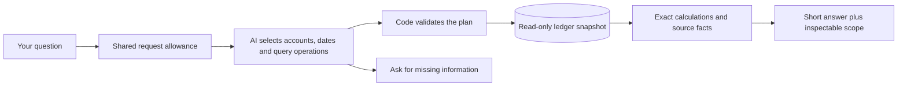

# Financial-chat reliability work

## Compound grouping — deployed and CI verified

Questions can now group recorded amounts jointly by two or three ordered dimensions: account, person/business and month or quarter. Account/time views include every scoped posting account; person/business combinations fill missing periods only for tuples actually observed after the requested filters. Closing balances retain opening history. Exact arithmetic keeps each row’s account identity and period. The server caps the complete grid at 30,000 cells and 120 periods, then applies a global 50-row display limit with explicit truncation. This expands supported queries; it does not prove general question or formula intent. [Plain-language grouped-spending walkthrough](COMPOUND_GROUPING.md).

Exact-source CI passed **1,629 tests across 85 files and all 29 browser workflows**. The 98 named compound-grouping tests—45 compiler/output, four chat, 35 calculator and 14 real-PostgreSQL tests—are included in that test total. The one new compound-result browser workflow is included in the browser total. Provider responses and the browser chat response are stubbed; actual database cases use independently specified arithmetic. Browser checks run against the CI build, not the hosted demo. No provider inference, new model-accuracy score or reopened budget was involved. Protected health, metadata and SPA GETs verify deployment, not hosted browser behavior or model understanding. No fresh full-ledger comparison was made; unchanged current books are not claimed. Earlier studies and live-model results remain bound to their original source.

## Net cash movement — deployed and CI verified

`net_cash_movement` measures signed posted cash change over an inclusive date range: cash debits minus cash credits. The server selects all cash-designated asset posting accounts, including archived history. Results use saved USD base values or one explicit native currency, with activity filters and grouping kept visible. Calculator movement ancestry retains periods and identities separately from as-of cash balances. This is net change, not gross payments, payment allocation, revenue, profit or a formal cash-flow statement. [Plain-language cash-change walkthrough](CASH_MOVEMENT.md).

The earlier `012f297` cash-movement release passed **1,530 tests across 81 files and all 28 browser workflows**. The 75 named cash-movement cases—26 compiler/output, seven chat, 30 calculator and 12 real-PostgreSQL tests—are included in that total. Provider responses in engineering tests are stubbed; actual database cases use independently specified arithmetic. Browser checks run against the CI build, not the hosted demo. No provider inference, new model-accuracy score or reopened budget was involved. Protected health, metadata and SPA GETs verify deployment, not hosted browser behavior or model understanding. No fresh full-ledger comparison was made; unchanged current books are not claimed. Earlier studies and live-model results remain bound to their original source.

## Deployed expense scope guard

Suppose you ask, “How much did we spend on Office supplies from 2026-01-01 to 2026-03-31?” A legal AI plan could still choose Rent, all expenses or a shorter period. The deployed guard compares those explicit instructions with the plan before reading money. It withholds a mismatch even if the wrong account happens to have exactly the same dollar total.

The guard recognizes only supported standalone first-user questions, with no earlier user turns: an exact unique expense-account name or code, optionally followed by explicit ISO start/end dates. Supported total-expense wording and shorthand share the same rules. Assistant-only preambles are permitted, retaining their original indices. Any earlier user turn makes the guard unassessed, even when a later question looks complete, because prior account, vendor or date instructions may still apply. It compares complete posting-account descendants, net posted base-currency expense semantics, grouping and absence of unrequested filters. Identity resolution and financial execution use one repeatable-read snapshot. If an account was known during planning but its name disappears, the initial chart can veto execution; it cannot prove a match. Duplicate names, unknown explicit codes and ambiguous shorthand require clarification. A name unknown in both charts remains unassessed so a valid vendor query can still run.

Successful `scopeVerification` includes original-user spans, effective account IDs and an explicit list of checked fields. No supplied dates means no date proof: the executed period remains visible and evidence says it was not verified. Conflicts return no amounts, evidence or success proof; unrecognized wording also gets no proof. The guard does not rewrite or retry the plan. Multi-user conversations still reach ordinary execution with all context and no proof; tests explicitly show that both a retained and a dropped prior vendor filter receive no verification claim. This does not prevent every wrong follow-up answer. Follow-up interpretation, arbitrary vendor clauses, negation, comparisons and multi-part questions remain outside this limited semantic check, even though the complete conversation is retained.

The earlier `6082a36` expense-scope release passed **1,455 tests across 77 files and all 28 browser workflows**. Its 12 real-PostgreSQL expense-scope cases passed; the model callbacks were stubbed. These totals include the named suites and must not be added together. Local pre-publication checks passed 189 focused tests, including 71 pure guard and 36 mocked integration cases, plus eight offline compiler checks, TypeScript and production build. CI browser workflows exercise the built app, not the protected hosted page or physical devices. No provider inference, new accuracy score or reopened evaluation budget was involved in this release. Protected health, metadata and SPA GETs are read-only deployment checks, not hosted visual inspection or live model comprehension. No fresh full-ledger comparison was performed, so unchanged current books are not claimed. Earlier model results remain tied to their original source.

## Deployed follow-up context repair

The browser previously sliced away earlier turns, and the API/calculator limited requests to twelve messages. A later follow-up could therefore lose the original account, vendor or date instruction before the model saw it. The deployed source retains every accepted role/content message, using shared limits of 100 messages, 4,000 characters each, 48,000 raw characters total and 112 KiB UTF-8 conversation JSON. Exceeding a limit produces an explicit error before any request; New conversation preserves unsent input. Validation does not trim accepted content. Entry-example retrieval remains separately bounded to the last 4,000 user characters.

Reset after a successful draft save and failed post now clears the discarded proposal binding on the next save. Deliberate category corrections retain their proposal; replacement suggestions bind the new one. Busy assistant input is disabled so a failed response cannot overwrite newer typing. The evidence footer does not label draft or hypothetical answers as posted facts. The earlier `f4f3a7` conversation release passed **1,334 tests across 74 files and all 28 browser workflows**, including the eight new conversation cases. Actual PostgreSQL checks cover shared HTTP admission across chat, entry and category and the 15-message entry contract, with model callbacks stubbed. These counts include the named suites; they are not additive. Browser checks used the CI production build, not the hosted interface or physical devices. No provider calls, new model scores or reopened evaluation budgets were involved in this release. Protected HTTP checks verify deployed health, metadata and the SPA document; they do not measure rendered usability, live conversation comprehension or unchanged current journal contents. Earlier hosted model results remain tied to their original source.

Retaining context repairs transport, not general semantic verification. A legal query can still select the wrong account, date or formula; [broader capability and meaning gaps](PRODUCT_PLAN.md#broader-question-goal-remains-partial) remain explicit.

Source **`93a8617932daff772c5b5d9c836be15692a64979` is promoted** at [Daybook](https://daybook-ledger-delta.vercel.app), deployment `dpl_2Rh1j9ryaPzor5vsREcDvYJHgFSQ`. [Full CI 41251437109](https://github.com/rayidali/spiich_homework/actions/runs/41251437109) passed verification, native research and Compose; live-AI was skipped. The actual stable alias and project production target match this READY/PROMOTED deployment, with all-deployment protection retained. [Release evidence](evidence/compound-grouping-release.json).

The active `composable` chat route combines existing report tools with validated ledger queries and exact scenario arithmetic. The model chooses a structured plan; application code compiles permitted queries and calculates the answer. It cannot execute arbitrary SQL or post entries. Cash sources are server-selected, assumptions require original-user evidence, and eligible explicit all-history requests retain their full date scope. Shared PostgreSQL request admission and safe request/provider/plan diagnostics are enabled. File Search, vector retrieval, Wren and reviewer agents remain separate research paths.

The preceding `7ac0a88` release passed **three known date-scope regressions** for $0.0100061 in three provider attempts, with all 74 journals and 22 accounts unchanged and all three requests matched to 12 runtime events. All-history guard provenance was observed, but the model already chose the canonical date (`changed: false`): no actual lower-bound replacement or schema-repair call occurred live. This is bounded regression evidence, not a new general accuracy score. The earlier frozen comparison's 18/20 result belongs to its own source. [Three-case acceptance](evidence/chat-history-acceptance.json). These calls were not repeated for the `f4f3a7` conversation release or the later expense-scope, cash-movement and compound-grouping releases.

## The failure

“Office supplies” identifies one account. Returning the total of every expense account answers the wrong question even if every number is real. The original four-tool interface could not express a specific expense account. Its tests did not sufficiently check that the selected query retained the user's meaning.

## First repair

The historical e7 repair introduced seven read-only financial operations plus clarification: scoped expenses, overall expenses with explicit total/top/all views, income totals, metric comparisons, legacy revenue comparison, journal text search and cash position. The planner receives organization-scoped account identities, not guessed account codes. PostgreSQL supplies figures and application code writes numeric answers. A category group includes descendants exactly once; historical archived accounts remain reportable; posted credits/reversals affect their actual dates.

If a question omits the reporting period, the assistant asks which period and retains the category in the follow-up. A request that cannot be represented must be explained, not replaced with a similar query. This contract does not by itself prove that a model always follows it.

## How we check it

- PostgreSQL regressions use small transactions with independently specified totals, including a category outside the top five, account trees, foreign workspaces, FX and reversals.
- Provider contracts check structured input/output and deterministic response construction. They do not measure model understanding.
- Browser coverage checks the clarification and scoped-answer interaction.
- An independently authored question matrix covers actual wording, follow-ups, dates, rankings, totals and unsupported combinations. Live evaluation must score retained constraints and correct amounts, not merely HTTP success.

The scoped repair passed full database/browser/Compose CI and23 hosted checks:16 exact answers and7 appropriate clarifications. All74 current journals and22 accounts stayed unchanged. A collaborating AI agent reviewed clarification meaning; this was not human/accountant adjudication. Existing category scores measure a different task.

## Broader query design

Evaluate a bounded semantic query plan that can compose filters, grouping and calculations over the ledger without executing arbitrary model-written code. Reuse the useful lessons from the closed architecture study, but do not present its results as evaluation of changed product code. Compare meaningful alternatives on the same frozen questions; use exact numerical and scope checks where possible and disclose any subjective model judging. Add explicit off-topic and abuse behavior with tested cost/rate limits. A failed or unsupported request must leave the books unchanged and provide a traceable explanation.

No guarantee of universal question coverage, perfect AI accuracy or production-scale capacity is made. The goal is a precise, evidence-backed answer when data and validated operations suffice, and a clear limitation or clarification when they do not.

## Historical broader candidate and its source repair

The candidate combines filters and grouping instead of requiring a new function for each sentence. It keeps journal totals, expenses, balances and draft projections distinct. Review found and fixed two traps: filtered past activity labeled as a full balance, and an empty group of the wrong account type producing a misleading zero. Financial query execution has row/query/time bounds. No model SQL or executable code is accepted.

New migration007 stores one workspace's fixed UTC minute/day counts and expiring active-request leases. Defaults are12 requests/minute,100/day and four active requests, shared across chat, entry proposals and category suggestions. Counters remain consumed after failure; acquisition/storage failure prevents provider work. These are request controls, not a dollar billing cap; fixed-window boundaries permit bursts, consistent configuration is required across instances, and leases do not cancel hung work. No application login or tenant authorization has been added.

The broader comparison is complete and closed: one setup call, sixteen development calls and forty held-out calls cost an estimated **$0.1369382**, with no unknown usage or retries, below its $0.50/60-call ceiling. Both routes used the same Gemini model, clock and synthetic books. Real PostgreSQL executed the saved model plans; the before/after financial fingerprints matched. [Exact results and CI](evidence/chat-query-runs/holdout-v1/database-results.json), [operational audit](evidence/chat-query-runs/holdout-v1/operational-audit.json).

After separately recorded internal-AI wording review, the conservative primary scores are **18/20 for composable queries versus6/20 for authored tools**; common-capability scores are7/7 versus6/7. No wrong displayed financial answer or hard-boundary violation was found in the captured artifacts. This is a small purpose-built synthetic comparison, not a production accuracy guarantee. The routes differ in tools, instructions and required chart context; it is not a single-component causal experiment.

Two primary candidate misses remain recorded. One was a valid $385 average whose complete expense-account group differed syntactically from the evaluator's unfiltered selection. Two independent account-set reviews proved exact semantic equivalence; a separately reported sensitivity is19/20, while the primary18/20 remains unchanged. The other was a rejected hiring-calculation plan, which supplied a noncanonical balance-field name and paraphrased a word quantity. No financial answer was executed for that rejected plan. [Wording/safety review](evidence/chat-query-runs/holdout-v1/rubric-review.json), [account-set proof](evidence/chat-query-runs/holdout-v1/account-equivalence-review.json).

The predeclared comparison gate favors composable queries for separate product verification. A later parser-compatibility repair is a new source version: it accepts a balance-field alias only for an explicitly bound balance query and supports bounded English cardinal quantities while retaining the actual user's quoted text and span. It does not inherit or overwrite the held-out score. Its full source CI passed, but the separate hosted acceptance stopped after seven of eight requests. All earlier studies and the 23-request repair cohort stay closed.

## Hosted acceptance exposed a cash-source error

Candidate `7be9224` reached READY and passed full CI41237787408. B01–B05 retained the requested category, follow-up period, ranking, combined vendor filter and monthly totals. B06 also answered the receivable balance correctly: its raw evaluator failure was an account-grouping mismatch, and a separate review proved the selected account was one posting leaf with no truncation. The original automatic result remains preserved.

B07 was a real source-identity failure. Asked to start a hiring projection from cash, the model selected the Assets group, which includes receivables and equipment. Those noncash balances happened to net to zero at the requested date, so the dollar result coincided with the cash-only calculation. Exact arithmetic and valid account permissions did not establish that the selected economic quantity was cash. The acceptance check correctly stopped the release; B08 was not called.

The cohort is terminally closed: seven settled requests, six reviewed passes, one source failure, $0.0253555 known-use estimate and no unknown reservation or retry. All 74 journal records and 22 accounts were unchanged. Each response reference matched both its selected-tool event and HTTP event on the exact source/deployment. At that checkpoint, the protected stable alias pointed back to `e7a514e`; no database rollback was performed, and additive migration007 remains applied.

The next repair must provide a server-owned cash source, preserve its identity through calculation ancestry and prevent a cash objective from accepting generic assets. Equal numbers or a query named “cash” are insufficient. Nonzero and offsetting noncash balances must be covered by regression tests. This is separate product verification; the frozen comparison and its report are unchanged. [Sanitized incident receipt](evidence/chat-broad-blocked-release.json).

## Cash-source repair passed CI; model-schema failure still blocks release

The next source, `7b52a9b`, passed full CI41239769459 with real PostgreSQL regressions and was staged without promoting the stable alias. It enforces `cash_balance` over server-selected cash ASSET accounts, rejects generic balance operands before calculator queries and propagates cash account/date lineage. The first hosted June30 hiring case passed those exact source and formula checks.

The second October31 case returned HTTP502 with `AI_INVALID_RESPONSE` at `model_schema`. Captured runtime logs identify the exact request, source and stage, but contain no validated-query event or rejected-field details. No financial answer was released. We cannot responsibly attribute this failure to a particular missing field, enum or token limit. A bounded schema-repair path and safe issue metadata are being developed as a separate change.

The six-slot cohort closed incomplete after two requests: $0.0088424 known-use estimate plus $0.02 retained for unknown usage, total $0.0288424 charged against its ceiling. C03–C06 were never called; no retry or new call is permitted by that closed ledger. All 74 journals and 22 accounts stayed unchanged. The actual stable-alias lookup after staging still identifies `e7a514e`; the new candidate was never promoted. [Sanitized incident and audit](evidence/chat-cash-blocked-release.json).

## All-history scope failure remains a failed release check

The `012edb2` staged cohort completed six HTTP requests and six provider attempts at $0.0281190, all known usage. C01–C04 and C06 passed. C05 explicitly requested all recorded Office supplies history through October 31; the selected `expense_by_account` query instead started on January 1, 2000. Both totals happen to be $1,740 because this snapshot has no matching earlier postings. Equality on today's data does not authorize discarding earlier history, so `NARROW_SCOPE` remains a failure. No numerical-error claim is made.

Independent artifact review matched all six requests to 24 safe runtime events—provider usage, final plan, selected tool and HTTP—and verified unchanged 74-journal/22-account rows. Every response had one attempt and `repairStatus: not_needed`; the new bounded schema-repair path was not exercised live. Full execution is complete, but the release is not accepted. The later explicit-history correction preserved this evidence and passed its own three-case check; it does not inherit the old comparison score.

## Historical explicit-history release — 7ac0a88

The conservative temporal compiler reads only the latest original user message and changes at most one eligible flow range. Original-user span evidence is returned even when the model already chose the canonical lower date. It leaves quoted, negated, conflicting or unsupported wording unchanged and never rewrites scenarios, balances or multiple-query plans. The live D01 check had `changed: false`; actual date replacement is covered offline, not observed live. D02 and D03 kept their explicit dates and returned no normalization.

The three-request ledger is terminally closed at $0.0100061. All requests used one model attempt, so live schema-repair recovery is still unobserved. After independent acceptance, promotion returned HTTP201 and both the actual stable alias and project production target matched7ac0a88. Protected health/meta/SPA-document GETs then passed without another chat call. Earlier failures and costs remain in their original receipts.
