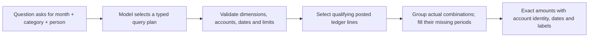

# Seeing spending by month, category and person

“How much did we spend?” asks for one number. “Show spending by month, category and person” asks for a table. The second question needs all three labels attached to every amount.

Consider these deliberately made-up books from the PostgreSQL test fixture:

| Category        | Person/business | January | February | March |
| --------------- | --------------- | ------: | -------: | ----: |
| Office supplies | Acme            |    $160 |     −$10 |    $0 |
| Rent            | Acme            |     $60 |       $0 |    $0 |
| Rent            | Beta            |     $30 |       $0 |    $0 |
| Office supplies | Gamma           |      $0 |      $50 |    $0 |

Acme's negative February amount is a refund. March has no activity. There is no recorded Supplies/Beta or Rent/Gamma combination, so the query does not manufacture those relationships. The same table contains 12 category/person/month cells, which the current chat displays as labeled rows.

The plan uses `groupBy: ["month", "account", "counterparty"]`. Application code generates the SQL from known dimensions and binds user values as parameters. The model supplies no executable SQL. Existing single-dimension queries keep their original format and row identities.

For **account plus time**, every selected posting account gets each period, including archived accounts and accounts with no activity. For **person/business combinations**, only combinations observed after the requested filters and transaction-level amount thresholds get time rows. Names are literal journal-header text, not verified vendor identities. Blank names remain distinct from a business literally named “(No counterparty).” Named values are quoted in compound labels.

Amounts still mean what their metric says. A per-transaction average divides each cell by its distinct matching entries; repeated lines do not count as extra transactions. An empty average is undefined, while an empty sum is zero. A transaction may contribute to several account cells, so per-cell transaction counts and averages are not interchangeable with an overall count or average. A full journal debit total is not an expense or cash-payment total.

**Closing balances work differently.** Account/month and account/quarter balance rows include all history through each closing date, even postings before the displayed start. Different account types stay in separate rows with their respective normal signs. Native-currency views use one explicit currency; base-currency views use saved USD values.

Each compound row carries ordered dimension keys and actual account IDs. Exact arithmetic can refer to those rows while retaining cash balance dates and cash-movement periods separately. A month-count denominator still comes from a complete single monthly series. When averaging selected compound series per month, each selected account/person combination must cover the same complete calendar period. January for Acme plus February for Beta cannot pretend to be one complete two-month series.

The complete grid is limited to **30,000 cells and 120 periods**. A larger request asks for a narrower scope; it does not silently discard vendors before calculating. The final **50-row display limit is global**, with explicit truncation. It is not “top 50 for each vendor,” automatic pagination or a complete large table. Calculations reject truncated query results. Generic noncash-balance arithmetic and non-USD monetary arithmetic remain unsupported by the scenario calculator.

The new query can express more questions. It does not prove that every unfamiliar sentence or follow-up chooses the right plan. The earlier scientific comparisons retain their original source and scores; their scalar-only normalizer explicitly refuses these later compound plans. See the current [verification record](VERIFICATION.md) for executed tests, deployment evidence and limits.
