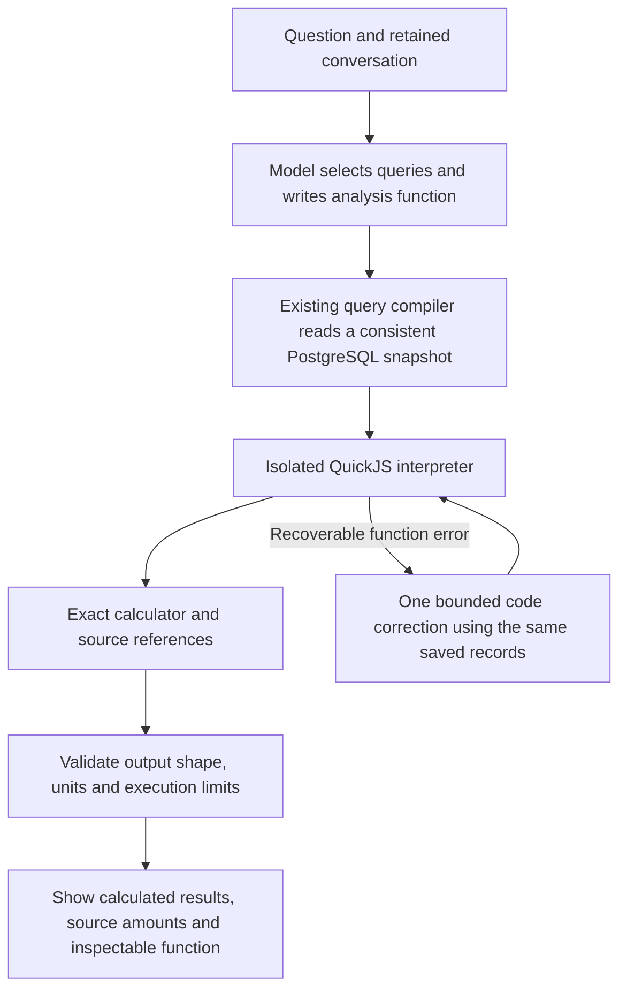

# Generated financial analysis

Status: **implemented locally; release and real-model acceptance pending**. The current hosted release is still `9f90a500`. This document describes a new candidate, not a live accuracy result.

## The problem the user found

The user asked for monthly rent percentages, clarified the year, and received two lists of dollar amounts. Neither list answered the requested percentage. The existing calculator allowed eight individually named arithmetic steps, so it could not express eleven or twelve monthly divisions in one call. It also rendered ratios as decimals and stopped the whole calculation on a zero denominator. These limits were reproduced against the actual parser/calculator without any model calls. The original 31 conversation cases did not contain this combination.

The conversation transport retains the original messages. No exact original hosted request was correlated, so the investigation does not claim to have observed its provider arguments or lost context. The repeated period question matches the application's existing generic clarification template.

## The new capability

`financial_program` lets the model select existing financial queries and write a JavaScript function body over their results. The function can define helpers, loop, map, filter, join, sort and aggregate. It can calculate a monthly percentage table, cumulative spending, a median, a ranking or a new combination without a separate business-specific tool.

The default composable route offers this new tool alongside ordinary reports, scenarios and conversation. Simple questions can still use a single report. The experimental complete route is unchanged and does not receive program-result facts as if they were its older scalar calculation facts. Earlier route scores remain historical.

## A walkthrough

For “What percentage of each month's expenses was rent this year?”, the queries return monthly rent and monthly total expenses. The function matches months by their actual dates and identities, divides each rent value by the corresponding expense value, and requests percentage formatting.

Using the amounts the user pasted, May is `2400 / 7969 × 100 = 30.12%` and October is `7200 / 14567 × 100 = 49.43%`. These are calculations from supplied figures, not a fresh hosted-database observation. A zero denominator produces an unavailable cell, preserving the other months. The explanation must distinguish no transactions from offsetting transactions with zero net value.

“Percentage” needs a denominator. Rent divided by revenue, monthly total expenses and annual expenses answer different questions. The model is instructed to clarify missing meaning and preserve the requested output when a follow-up supplies only the year. This instruction still needs real conversation testing; generated-code execution does not prove that the model chose the intended denominator.

## Exact values and isolation

The interpreter receives materialized query results with opaque value handles. Those handles refer to exact rational values held by the application. Generated JavaScript cannot construct a valid numeric output handle from a literal or object. Financial arithmetic uses the host's `calc` API; JavaScript floating-point arithmetic is not used for displayed money. Percent formatting multiplies an exact ratio by 100 only at presentation.

Each returned number includes its exact fraction and contributing query/row references. The program text and SHA-256 identify the executed function. The interface offers collapsed “Inspect the calculation” details, rendering the code as plain text. Diagnostic logs record only bounded metadata, such as the program hash, result count and error code; they do not log code, financial values or raw conversation.

Explicit thresholds or rates, such as “50%”, can enter as quoted user parameters. The existing quantity validator checks their value, unit and exact original-user text before database reads. They appear in a reserved `user_inputs` table and in calculation details. They are never presented as recorded amounts; arithmetic that uses them carries hypothetical provenance. Repairs cannot change these inputs. Counting requires distinct original handles rather than an invented array of repeated values.

QuickJS `0.32.0` runs as a separate WebAssembly interpreter, with no exposed database, filesystem, network, credentials or module loader. There are limits on code, guest-heap memory, stack, elapsed execution, calculator operations, input and output sizes. The 16 MiB heap limit is not a cap on the entire Node/WASM process. Interruption is cooperative; it is not a hard real-time deadline. This is not Node `eval` or Node `vm`. The dependency and its transitive packages are pinned with registry integrity hashes.

Queries retain existing workspace, account, date, posting and currency checks. Input tables must be complete, use one posting status and use base USD or counts. The generated program cannot fetch omitted rows. Raw account-balance arithmetic and per-entry averages remain excluded; supported cash balances retain their as-of identity. Programs cannot post, edit or reverse entries.

If a recoverable function error occurs, the existing planning allowance may permit one code-only correction. The model cannot change queries in that correction, and execution reuses the original materialized records. Unknown provider usage, a consumed allowance or a resource limit stops further work. Invalid output never falls back to displaying operand tables as if the calculation succeeded.

## What this does not prove

A mathematically exact program can still answer the wrong question. Dividing rent by revenue when the user meant total expenses is wrong even if every number has source references. Generated labels and descriptions are also not independently verified facts. The application reports `interpretationVerified: false`; provenance is not a certificate of the model's interpretation.

Existing query scope and result limits remain. This is generated analysis over available accounting records, not unlimited SQL access, arbitrary external data, a document-upload system or a promise of universal answers. Resource tests establish observed rejection behaviour, not proof against every possible interpreter vulnerability.

## Evaluation

New execution tests use real QuickJS with scripted programs. Chat integration tests use scripted provider responses and the actual query compiler/interpreter. Separate PostgreSQL tests seed balanced fictional books and independently check percentages, medians, cumulative values, refunds, filters, unchanged journals and truncated-input rejection. Browser tests use scripted responses. These layers must be reported separately from model accuracy.

The first core candidate, `ae8b5802`, passed [CI 41712606780](https://github.com/rayidali/spiich_homework/actions/runs/41712606780): 2,899 normal tests (including six new real PostgreSQL cases), 37 browser workflows (including two new calculation views), the native bundled QuickJS/WASM smoke check, and Docker Compose with persistence after container recreation. Compose's 2,898 tests overlap the normal suite. Live AI was skipped. This first receipt predates the quoted-parameter and acceptance-runner additions; the combined run below covers them.

Combined source `ed70e003` includes those additions. [CI 41714572781](https://github.com/rayidali/spiich_homework/actions/runs/41714572781) passed 2,922 normal tests and 37 browser workflows; the independently seeded acceptance database passed 96 stored-line checks and six oracle totals with unchanged books. The [combined receipt](evidence/generated-analysis-combined-ci.json) records all job outcomes. These counts include the five quoted-parameter tests and 18 new evaluator tests; they are not additional totals or a model score.

An independently authored 22-conversation development specification and exact Python rational oracles cover broader combinations, including weighted annual share versus average monthly share, rolling averages, quarter growth and follow-ups that change the numerator or denominator. It is not a blinded holdout. No score exists until the real-model run executes and its original outcomes are reviewed. The full earlier 31-case conversation set also needs a new run on the candidate.

The [new runner](../scripts/flexible-analytics-evaluation/README.md) retains all 22 cases and 26 user turns, including actual previous assistant answers. Its 18 provider-free tests include mutations for wrong denominators, omitted months, invented values and operand-only answers. Exact arithmetic checks and semantic review are separate: running a calculation successfully never earns an overall conversation pass. The installed workflow requires a fresh disposable database, exact source binding and a separately approved maximum allowance; no paid run has executed.

The prepared live checks are the full earlier 31-case / 35-turn suite, proposed at most $0.20, and the new 22-case / 26-turn suite, proposed at most $0.30. Both are currently unapproved and unexecuted. They use the existing conservative cost reservations and stop conditions; these limits are tracked estimates, not provider invoice guarantees. Earlier cohorts remain closed. Release and hosted checks follow actual answer review, not just successful CI.

## Querio research and decision

Querio's documented agent writes SQL and Python in a notebook, executes dependent cells and retains inspectable analysis. That is a useful architecture reference. Its MCP interface exposes notebook-authoring tools, and the separate Embedded API provides a conversational integration. Those are not its only API possibilities: the official v3 documentation also describes agent sessions and prompt runs using normal authenticated API requests. Earlier reasoning that generalized MCP's limitations to all regular API keys was too restrictive. The newer request-discovery export is explicitly partial and omits these agent operations, so actual availability and account entitlement must be verified. [Analysis](https://docs.querio.ai/understand/analysis), [MCP](https://docs.querio.ai/reference/mcp), [Embedded API](https://docs.querio.ai/embed/api), [v3 agent sessions](https://docs.querio.ai/api-v3#run-an-agent), [current resource API](https://docs.querio.ai/llms/reference/api.md).

The previously reviewed public pricing listed a free workspace with 500 monthly model-call credits, Core at $2,499 monthly or $25,000 annually, and separate embedding offerings. Those listings do not establish what the user's existing API key can do; a commercial Embedded subscription must not be assumed necessary for every API experiment. No purchase or data connection was made. Daybook's candidate remains our own generated-analysis implementation. [Pricing](https://querio.ai/pricing).

The user subsequently supplied a Querio key locally. Two read-only requests succeeded: `GET /api/v2/me` authenticated, and `GET /api/v2/workspaces` returned an empty list. This establishes authentication only, not analyst access, a connected datasource, free inference or integration success. Workspace identity/setup remains unresolved. No Querio prompt, notebook, datasource connection, account creation or inference was submitted. Raw identity details and credentials stay private; no identifiers appear in this document.

The earlier Wren experiment used the pinned semantic engine with our research SQL policy. It did not evaluate Wren's entire chat product, and our restrictions on CTEs and joins were integration limitations. Its score is not evidence that Querio or another complete product would perform worse.
