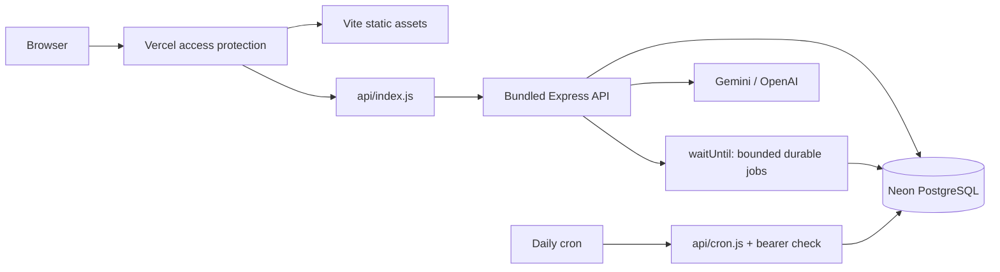

# Hosting Daybook

## 2026-10-30 live AI recovery update

The hosted model and source default are now **`gemini-3.1-flash-lite`**. Direct API testing reproduced the earlier model's generation timeouts and confirmed working text/JSON/tool calls on Flash-Lite. A separate journal-proposal rejection was traced to the 100-line `maxItems` constraint in Gemini's decoding grammar: the transport now omits array maxima, while the full original Zod limit, account checks and exact-money/balance rules remain enforced locally.

Selected hosted checks succeeded: cash **$125,620.00**, **12 Acme Corp entries**, September expenses **$9,265.00**, and a review-only **$340 Supplies debit / Company credit card credit** proposal. Cash/search/expense values matched independent endpoints, and the 73-entry journal list was unchanged. An initial expense timeout succeeded on manual repeat, while a later search failed; **intermittent provider failures remain**. No automatic retry, paid-plan change or accuracy guarantee was introduced.

Local build/native imports and **60 isolated tests** passed, including two new schema regressions. [Full CI](https://github.com/rayidali/spiich_homework/actions/runs/41103851106) for source `7ecb435c421862dba5efd4e3b6f743c93fd1888e` **passed 103 backend tests, 10 browser workflows, native hosted imports and Docker startup/persistence**; the opt-in live evaluation job was skipped. These selected checks are not the full 40-case live evaluation. [Detailed evidence](evidence/chat-recovery-verification.json) records successes and failures. Earlier timeout-only notes below describe the 2026-10-29 snapshot.

> Saved 2026-10-29 America/New_York. [Daybook is live](https://daybook-ledger-delta.vercel.app) behind Vercel login. Hosted HTTP checks and the [full CI run](https://github.com/rayidali/spiich_homework/actions/runs/40999183176) passed. Live Gemini chat timed out; successful generation remains unverified. See [checkpoint](../CHECKPOINT.md).

## Resources and access

| Resource            | Current state                                                               |
| ------------------- | --------------------------------------------------------------------------- |
| Owner               | Local CLI identity `rayidali`, team `rayidalis-projects`                    |
| Vercel project      | `daybook-ledger`; Hobby plan observed during provisioning                   |
| Stable URL          | https://daybook-ledger-delta.vercel.app                                     |
| Verified deployment | `dpl_HQefAFAGwPS2x52c1nXPetRYovKq`, production, READY                       |
| Database            | Separate Neon `daybook-db`, free plan through an existing integration       |
| Region              | `iad1`                                                                      |
| Protection          | Vercel Authentication for all deployments; anonymous requests reach sign-in |
| Portable submission | Existing Docker Compose stack, independent of hosted resources              |

The user's existing local Vercel session was used; no chat connector was connected. The earlier unrelated database was not reused or changed. No paid subscription or plan upgrade was made. The hosted database contains its own synthetic demo history, separate from development data and the Compose volume.

The assignment excludes application authentication, so this remains one writable configured workspace. Vercel's login gate protects the demo, not tenant-level authorization. The owner can sign in to access it. Reviewer sharing still needs an explicit access/sharing choice; do not silently remove protection. Private automation credentials used for smoke checks are excluded from the repository and ZIP.

## Request and build paths



`api/index.js` and `api/cron.js` are tiny exports; their application code is TypeScript in `server/hosting/`. `scripts/bundle-hosting.mjs` compiles the internal extensionless imports into native Node ESM in ignored `.vercel-build/`, with npm packages external for dependency tracing. `vercel.json` includes these generated bundles, serves `dist`, routes API requests before the SPA fallback, sets the region and allows 60 seconds per function. CI imports both native modules before running database/browser tests.

The configured build is:

```sh
npm ci --include=dev --no-audit --no-fund
npm run hosting:prepare
npm run build
npm run hosting:bundle
```

Development dependencies are needed to compile TypeScript/Vite/esbuild even though the running app is in production mode. Docker's existing build/runtime separation remains available.

## Database roles and deployment variables

| Variable                            | Scope                                 | Purpose                                                 |
| ----------------------------------- | ------------------------------------- | ------------------------------------------------------- |
| `DATABASE_URL`                      | Runtime and build                     | TLS pooled connection for restricted `spiich_app`       |
| `MIGRATION_DATABASE_URL`            | **Build only**                        | Unpooled migration owner for migrations/role setup/seed |
| `CRON_SECRET`                       | Runtime                               | Generated bearer secret for scheduled work              |
| `AI_PROVIDER`                       | Runtime                               | `gemini` for the verified deployment configuration      |
| `GEMINI_API_KEY` / `OPENAI_API_KEY` | Runtime, chosen provider              | Server-only provider access                             |
| `AI_MODEL`                          | Optional runtime override             | Model accessible to that provider account               |
| `ORGANIZATION_ID`                   | Optional trusted server configuration | Defaults to the seeded assignment workspace             |

Use a generated password of at least 32 characters for hosted `spiich_app`. `scripts/prepare-hosting.ts` applies checksummed migrations, sets that strong role password, and runs the seed idempotently before building. Applied migrations were not edited. Reuse the established restricted credential on routine deployments; changing it rotates access for existing instances and must be coordinated.

The owner integration is connected to the project's **development environment only**. Production/runtime and build values were supplied as **deployment overrides**. They were not committed or assumed to be persistent production project variables. The Gemini key was supplied to Vercel server-side, but no GitHub Actions secret was configured.

A new CLI deployment must receive the appropriate runtime variables and build-only owner variable through an authorized private mechanism. Do not assume `vercel --prod` from a fresh checkout will inherit them. Do not put secrets in `vercel.json`, command-line flags, `VITE_*` variables or source files. Review existing private local deployment state without printing it. A repository push currently supplies CI evidence; no Git-triggered Vercel auto-deploy connection has been established.

## Background behavior and limitations

Successful API mutations register `processJobs(config.organizationId)` using Vercel `waitUntil`. This lets a bounded analysis batch continue after the response, while PostgreSQL stores the jobs durably. Failed work retains its retry state for later invocations. `waitUntil` is not itself a persistent queue or an unlimited worker runtime.

`GET /api/cron` is wrapped in Express and verifies `Authorization: Bearer <CRON_SECRET>` before any database work. It calls scoped recurring generation, then a bounded job batch. It never posts generated drafts. Missing/wrong credentials return 401; wrong methods return 405; internal work failures return safe 503 errors. Application scheduler authorization is separate from Vercel's deployment gate.

`vercel.json` configures daily **06:00 UTC** execution. The Hobby scheduler is daily and can run later within the hour. **An automatic scheduled firing has not been observed yet**; the manual authorized HTTP call only proves the handler works. Preview deployments do not establish production schedule behavior.

Recurring generation processes up to 20 templates/50 occurrences, capped at 10 per template per invocation; anomaly processing claims up to four jobs. Larger catch-up queues can take several invocations. Docker/native run the continuous scheduler/worker in the API process; the hosted demo relies on request-triggered processing and a daily catch-up. Continuous backlog processing, deployment-wide AI quotas, connection budgets and operational alerts need additional work before production-scale claims.

## Verified deployment observations

[Sanitized evidence](evidence/hosting-verification.json) records:

- SPA document, database health and organization metadata responded successfully after authenticated access.
- October 2026 trial balance debits and credits were both **$190,072.00**, with **$0.00 difference**.
- P&L responded; the balance sheet showed **$132,420.00 assets = $178.00 liabilities + $132,242.00 equity**, with **$0.00 difference**.
- Scheduler returned **401 without its bearer secret**; an authorized call generated zero due drafts and processed four queued jobs. Health remained OK.
- An authenticated Google model-metadata request succeeded for the configured model. A hosted financial question returned **HTTP 504 / `AI_TIMEOUT` after 25 seconds**. No successful live generation, token-use result, billing result or accuracy score is established.

These financial figures are synthetic demo observations at the recorded time. They are separate from the accounting walkthrough's five-event fixture and can change after legitimate postings.

Hosted browser visual review is pending. CI's ten browser workflows run against its built app and isolated PostgreSQL; they are not a live browser test of this protected URL.

## Failures resolved and next checks

1. Project creation initially rejected an unsupported `nodeVersion` property; the successful creation omitted it and deployment settings selected Node 22.x.
2. The first build applied migrations/seed, then lacked TypeScript because production installation omitted build dependencies. Explicit `--include=dev` resolved that build issue.
3. A READY deployment still failed API invocation. Explicit native ESM bundling was introduced, then hosted API checks passed; CI now checks both wrapper imports.
4. The raw scheduler request lacked Express's `req.get()`. Wrapping it in Express resolved the invocation; live authorization/work checks passed.

Next, investigate the Gemini timeout with bounded, sanitized probes; run live evaluation in isolated workspaces; observe an automatic cron firing; inspect fresh screenshots and the hosted browser flow; decide reviewer access. A successful build, metadata call or contract suite alone does not complete these checks.

Private operational files are in ignored `.tools/vercel-session/` and contain credentials. Keep them local, excluded from archives and screenshots. Local Node CLI network failure did not imply invalid login: authorized HTTP using the local session worked. If credentials expire, use local login again; never switch to a different chat-connected account.
