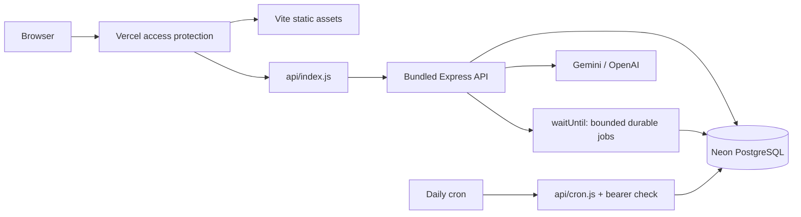

# Hosting Daybook

## Broader financial chat — 2026-10-31

The paired product comparison is complete: **composable queries18/20 versus authored tools6/20**, with7/7 versus6/7 on the predefined common-capability subset. Actual PostgreSQL replay checked both the chosen filters and exact results; the books stayed unchanged. Internal-AI review found no wrong displayed financial answer or hard-boundary violation in this small set. An account-group comparator false negative is documented separately; the primary score remains unchanged. [Evidence and CI](evidence/chat-query-runs/holdout-v1/ci.json), [two-page explanation](reports/chat-query-comparison.pdf), [details](CHAT_RELIABILITY.md).

The later candidate `7be9224` passed [full CI41237787408](https://github.com/rayidali/spiich_homework/actions/runs/41237787408), but its hosted acceptance **stopped after seven of eight requests**. Six answers passed review; the hiring calculation selected all assets where cash was required. Noncash balances happened to net to zero, so the displayed amount matched by coincidence; the source was still wrong. The stable alias was rolled back to the verified scoped-chat release `e7a514e`. The cohort is terminally closed at $0.0253555, with all 74 journals and 22 accounts unchanged and all seven requests correlated to the exact candidate runtime. [Incident and rollback](evidence/chat-broad-blocked-release.json). The later cash-source repair has separate CI and blocked hosted evidence below.

The preceding cash-source candidate `7b52a9b` was also never promoted. Its cohort remains closed after one pass and one HTTP502 / `AI_INVALID_RESPONSE` at `model_schema`, with $0.0088424 known use plus a retained $0.02 unknown reservation. The rejected field is still unknown; the later successful request does not reveal that cause. [Earlier staged incident](evidence/chat-cash-blocked-release.json).

**Latest candidate remains staged and blocked.** Schema-repair source `012edb2432f0843bd1f8581a7aa114a42620373d` passed [full CI41241451555](https://github.com/rayidali/spiich_homework/actions/runs/41241451555) and reached READY/STAGED as `dpl_CFRd32kxBfYump4D8r93K3yQkzef`; it was never promoted. All six planned HTTP requests completed, but acceptance was **five passes and one scope failure**. C05 asked for all recorded Office supplies history; the model invented `from: 2000-01-01`. Its $1,740 total happened to equal the current full-history total, so this is a wrong scope with no observed dollar error. The cohort is terminally closed at **$0.0281190**, all known usage, six provider attempts and zero live schema repairs. All 74 journals and 22 accounts stayed unchanged; each request matched usage, final-plan, selected-tool and HTTP logs. The stable demo remains on `e7a514e`. [Current blocked-release receipt](evidence/chat-schema-repair-blocked-release.json). Completing all slots is not successful acceptance; no old failure or score was rewritten.

## Current stable release after rollback — 2026-10-31

Executable `e7a514ef7072fbaabc6b63af026a6bab2fbd1478` passed [full CI41231800054](https://github.com/rayidali/spiich_homework/actions/runs/41231800054) and is deployed as `dpl_H7TtjDv11bmPNSiLnHT8QzuvGdX2`. The 66-file release adds account-scoped expenses, explicit expense top/all/total views, income totals and comparisons, scope-preserving date clarification and safe selected-query diagnostics. A separate closed hosted cohort passed16 exact-answer and7 clarification checks for $0.0298001; all74 current journal records and22 accounts stayed unchanged. Every request matched the selected tool and exact source in runtime logs. [Evidence](evidence/chat-scope-release.json).

The paired comparison remains complete and frozen. The broader release failed its separate hosted source-identity check; its replacement must pass new regression and release checks. Migration007 was additive and was not reverted by the routing rollback. [Reliability work](CHAT_RELIABILITY.md), [comparison protocol](research/CHAT_QUERY_EVALUATION.md).

## Previous category release — 2026-10-31

Executable `b7bf5fe024f6fca33fa5a93ef5e6188e96455bae` passed [full CI 41226562746](https://github.com/rayidali/spiich_homework/actions/runs/41226562746) and was deployed as **`dpl_F1mVMsNU5QUttzpgaH441iQ7aJoE`**, READY at that historical checkpoint. The release contains **66 exact source files**, normal migration/build preparation and no configuration overlay. Applied migrations 001–006 and runtime database credentials were preserved; owner credentials remained build-only. The current local Gemini key was bound to the completed comparison and supplied privately to this release. No key appears in source or evidence.

Both whole-entry/chat and the new category selector use **Gemini 3.5 Flash-Lite**. The focused comparison retained Gemini under its predefined rule; Jev remains an implemented configurable alternative, not the hosted default. The repaired correction memory and anomaly lifecycle remain deployed. [Release receipt](evidence/category-product-release.json), [selector findings](CATEGORY_SELECTOR.md).

**Eleven hosted HTTP checks passed:** four financial questions matched database-backed reports/search; Supplies/Card, rent/bank and existing-invoice settlement produced the exact expected lines; ambiguous rent and the party example asked clarifying questions; category suggestions handled Supplies and handed off a laptop purchase. All 73 journals, account balances and the complete dashboard remained unchanged. Every response reference matched actual runtime events carrying this deployment and source revision. The separate internal audit reproduced 144 checks over the saved evidence. No proposal was posted; proposal housekeeping may still write non-journal records.

The acceptance used 11 Gemini requests and an estimated **$0.0085057**, with no unknown reservations. It is a small regression check, not general model accuracy or the separate original 40-case evaluation. CI includes 18 browser workflows and actual automatic Compose scheduler/worker checks; these are separate from hosted HTTP evidence. Hosted automatic cron firing and physical-device behavior remain unobserved.

The earlier 3.1 outage, rent-account guessing failure and provider-only deployment overlay are retained in [repair evidence](evidence/entry-provider-recovery.json) and [BUILD_LOG](BUILD_LOG.md). The subsequent [core release](evidence/core-repair-release.json) established hosted error-reference tracing. Those historical overlays are not the current build configuration.

## Resources and access

| Resource            | Current state                                                               |
| ------------------- | --------------------------------------------------------------------------- |
| Owner               | Local CLI identity `rayidali`, team `rayidalis-projects`                    |
| Vercel project      | `daybook-ledger`; Hobby plan observed during provisioning                   |
| Stable URL          | https://daybook-ledger-delta.vercel.app                                     |
| Verified deployment | `dpl_H7TtjDv11bmPNSiLnHT8QzuvGdX2`, production, READY                       |
| Database            | Separate Neon `daybook-db`, free plan through an existing integration       |
| Region              | `iad1`                                                                      |
| Protection          | Vercel Authentication for all deployments; anonymous requests reach sign-in |
| Portable submission | Existing Docker Compose stack, independent of hosted resources              |

The user's existing local Vercel session was used; no chat connector was connected. The earlier unrelated database was not reused or changed. No paid subscription or plan upgrade was made. The hosted database contains its own synthetic demo history, separate from development data and the Compose volume.

The assignment excludes application authentication, so this remains one writable configured workspace. Vercel's login gate protects the demo, not tenant-level authorization. The owner can sign in to access it. Reviewer sharing still needs an explicit access/sharing choice; do not silently remove protection. Private automation credentials used for smoke checks are excluded from the repository and ZIP.

## Request and build paths



`api/index.js` and `api/cron.js` are tiny exports; their application code is TypeScript in `server/hosting/`. `scripts/bundle-hosting.mjs` compiles the internal extensionless imports into native Node ESM in ignored `.vercel-build/`, with npm packages external for dependency tracing. `vercel.json` includes these generated bundles, serves `dist`, routes API requests before the SPA fallback, sets the region and allows 60 seconds per function. CI imports both native modules before running database/browser tests.

The repository default for a full provisioning build is:

```sh
npm ci --include=dev --no-audit --no-fund
npm run hosting:prepare
npm run build
npm run hosting:bundle
```

Development dependencies are needed to compile TypeScript/Vite/esbuild even though the running app is in production mode. Docker's existing build/runtime separation remains available.

## Database roles and deployment variables

| Variable                            | Scope                                 | Purpose                                                             |
| ----------------------------------- | ------------------------------------- | ------------------------------------------------------------------- |
| `DATABASE_URL`                      | Runtime and build                     | TLS pooled connection for restricted `spiich_app`                   |
| `MIGRATION_DATABASE_URL`            | **Build only**                        | Unpooled migration owner for migrations/role setup/seed             |
| `CRON_SECRET`                       | Runtime                               | Generated bearer secret for scheduled work                          |
| `AI_PROVIDER`                       | Runtime                               | `gemini` for the verified deployment configuration                  |
| `GEMINI_API_KEY` / `OPENAI_API_KEY` | Runtime, chosen provider              | Server-only provider access                                         |
| `AI_MODEL`                          | Optional runtime override             | Model accessible to that provider account                           |
| `CATEGORY_PROVIDER`                 | Runtime                               | `gemini` in the verified release; optional `jev` or `reference`     |
| `TYPESAFE_API_KEY`                  | Runtime only when Jev is selected     | Category alternative; not included in the current Gemini deployment |
| `ORGANIZATION_ID`                   | Optional trusted server configuration | Defaults to the seeded assignment workspace                         |

Use a generated password of at least 32 characters for hosted `spiich_app`. `scripts/prepare-hosting.ts` applies checksummed migrations, sets that strong role password, and runs the seed idempotently before building. Applied migrations were not edited. Reuse the established restricted credential on routine deployments; changing it rotates access for existing instances and must be coordinated.

The owner integration is connected to the project's **development environment only**. Production/runtime and build values were supplied as **deployment overrides**. They were not committed or assumed to be persistent production project variables. The Gemini key was supplied to Vercel server-side, but no GitHub Actions secret was configured.

A new CLI deployment must receive the appropriate runtime variables through an authorized private mechanism. The default full-provisioning build additionally requires the build-only owner variable; the historical provider-only overlay deliberately omitted that preparation and credential, but the current release uses the normal build. Do not assume `vercel --prod` from a fresh checkout will inherit them. Do not put secrets in `vercel.json`, command-line flags, `VITE_*` variables or source files. Review existing private local deployment state without printing it. A repository push currently supplies CI evidence; no Git-triggered Vercel auto-deploy connection has been established.

## Background behavior and limitations

Successful API mutations register `processJobs(config.organizationId)` using Vercel `waitUntil`. This lets a bounded analysis batch continue after the response, while PostgreSQL stores the jobs durably. Failed work retains its retry state for later invocations. `waitUntil` is not itself a persistent queue or an unlimited worker runtime.

`GET /api/cron` is wrapped in Express and verifies `Authorization: Bearer <CRON_SECRET>` before any database work. It calls scoped recurring generation, then a bounded job batch. It never posts generated drafts. Missing/wrong credentials return 401; wrong methods return 405; internal work failures return safe 503 errors. Application scheduler authorization is separate from Vercel's deployment gate.

`vercel.json` configures daily **06:00 UTC** execution. The Hobby scheduler is daily and can run later within the hour. **An automatic scheduled firing has not been observed yet**; the manual authorized HTTP call only proves the handler works. Preview deployments do not establish production schedule behavior.

Recurring generation processes up to 20 templates/50 occurrences, capped at 10 per template per invocation; anomaly processing claims up to four jobs. Larger catch-up queues can take several invocations. Docker/native run the continuous scheduler/worker in the API process; the hosted demo relies on request-triggered processing and a daily catch-up. Continuous backlog processing, deployment-wide AI quotas, connection budgets and operational alerts need additional work before production-scale claims.

## Historical initial hosting observations

[Sanitized evidence](evidence/hosting-verification.json) records:

- SPA document, database health and organization metadata responded successfully after authenticated access.
- October 2026 trial balance debits and credits were both **$190,072.00**, with **$0.00 difference**.
- P&L responded; the balance sheet showed **$132,420.00 assets = $178.00 liabilities + $132,242.00 equity**, with **$0.00 difference**.
- Scheduler returned **401 without its bearer secret**; an authorized call generated zero due drafts and processed four queued jobs. Health remained OK.
- An authenticated Google model-metadata request succeeded for the configured model. A hosted financial question returned **HTTP 504 / `AI_TIMEOUT` after 25 seconds**. No successful live generation, token-use result, billing result or accuracy score is established.

These financial figures are synthetic demo observations at the recorded time. They are separate from the accounting walkthrough's five-event fixture and can change after legitimate postings.

Hosted browser visual review is pending. The latest CI's 18 browser workflows run against its built app and isolated PostgreSQL; they are not a live browser test of this protected URL.

## Failures resolved and next checks

1. Project creation initially rejected an unsupported `nodeVersion` property; the successful creation omitted it and deployment settings selected Node 22.x.
2. The first build applied migrations/seed, then lacked TypeScript because production installation omitted build dependencies. Explicit `--include=dev` resolved that build issue.
3. A READY deployment still failed API invocation. Explicit native ESM bundling was introduced, then hosted API checks passed; CI now checks both wrapper imports.
4. The raw scheduler request lacked Express's `req.get()`. Wrapping it in Express resolved the invocation; live authorization/work checks passed.

The provider repair and 11-request hosted regression acceptance are complete. Separate remaining operational checks are the original 40-case live evaluation, automatic hosted cron observation, hosted browser/physical-device inspection and reviewer access. These are not hidden successes of the completed HTTP acceptance. A successful build or metadata call alone would not establish them.

Private operational files are in ignored `.tools/vercel-session/` and contain credentials. Keep them local, excluded from archives and screenshots. Local Node CLI network failure did not imply invalid login: authorized HTTP using the local session worked. If credentials expire, use local login again; never switch to a different chat-connected account.
