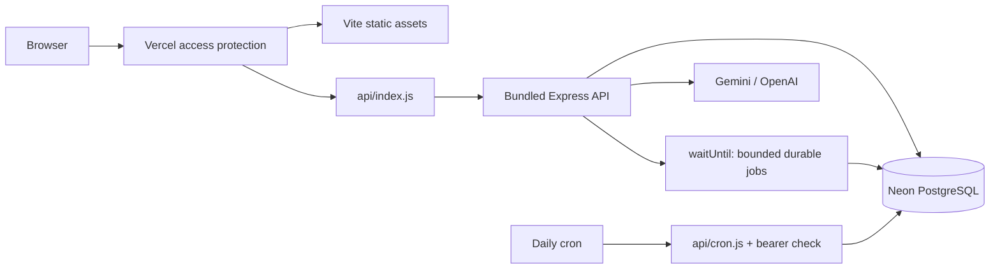

# Hosting Daybook

## Public reviewer access — November 4, 2026

At the owner's explicit request, the stable production domain is now **public**: https://daybook-ledger-delta.vercel.app. Anonymous homepage and health requests returned 200. Generated deployment URLs and previews still require Vercel authentication. The project protection scope changed from `all` to `prod_deployment_urls_and_all_previews`; the deployment, credentials and application settings were preserved. [Access verification](evidence/public-demo-access-20261104.json).

This is a shared fictional workspace with no application-user login. Public visitors can write demo entries and consume the configured AI allowance. The database checks and server-side keys remain in place, but public access does not create user isolation. Use the [reviewer Docker setup](SUBMISSION_GUIDE.md) for isolated books and your own Gemini key. No new deployment or model call was required for this access change.

## Current analyst hosting state

The public stable [Daybook site](https://daybook-ledger-delta.vercel.app) is promoted as `dpl_F3am1c39jixhAhChaj9P3MZZC1ja`, UI source `10778bae`. Both Daybook and Querio are available. Its 85 non-web backend/configuration files match the model-tested `60435f2` source exactly. Full CI, the repeated protected saved-rent browser review, unchanged-books audits and promotion were independently verified. [Release receipt](evidence/native-analyst-release.json). Earlier E/F model scores remain separate and unchanged.

Production and the isolated acceptance database have immutable migrations 001–009. A read-only audit verified migration hashes, eight analytics views and unchanged accounting fingerprints. Native SQL parsing requires package-relative `node_modules/libpg-query/wasm/**` assets, tested with the actual packaged parser in CI. HTTP handlers save/read durable work; the post-response worker advances one model or tool phase at a time within the hosted function budget. A caught transport failure may schedule one bounded, separately reserved fresh inference. A crashed pending dispatch or failure after a result arrived is never replayed. Unknown prior costs remain reserved.

Source `60435f2` keeps the existing generation and cost caps but allows 120 seconds per model request, a 180-second hosted function and a 210-second native lease. The lease outlasts the function so another worker cannot take over while the first is still running. Querio keeps its separate 75-second lease.

Authentic captured chart replay is recorded UI evidence, not a fresh hosted model test. The protected rent/hiring/follow-up calls passed financial review; the rent notebook also passed separate desktop/mobile browser verification. The original release retained all-deployment protection; the subsequent owner-authorized production-domain change is recorded above. No credential belongs in browser code or public receipts.

**Live Querio access — November 3:** `Daybook LIVE — all records` now reads the actual hosted database, including drafts, through a dedicated restricted reader. All 16 base tables/two views are catalogued; owner credentials were not supplied. Future tables created by the current owner in `public`/`research` inherit SELECT, with catalogue refresh needed for discovery. The research archive is clearly labeled fictional. Actual Querio SQL execution and unchanged database fingerprints were verified; no Daybook redeployment or model call occurred. The old fixture is renamed `TEST ONLY — synthetic benchmark`. [User guide and evidence](QUERIO_LIVE.md). Private provisioning/credentials/closure receipts: `.tools/querio-live-20261103/`.

**Querio evaluation resources:** a separate `daybook_querio_20261103` database and restricted reader were created in the existing Neon project. Querio has a configured datasource named `Daybook accounting test books` over four reporting views. Credentials and exact resource receipts remain only in `.tools/querio-evaluation-20261103/`; do not publish owner or reader URLs. All test execution environments were closed, but the datasource and saved notebooks remain for inspection. Production accounting fingerprints were unchanged after testing. No Daybook deployment or runtime configuration changed. [Evaluation report](QUERIO_EVALUATION.md).

All three hosted answers at `60435f2` passed independent financial review: the 11-month rent percentage, a $4,500 salary plus 20% overhead, and a same-conversation change to $5,000 salary. Added monthly cost changed from $5,400 to $6,000; the labeled no-income scenario changed from 7.65 to 7.38 months. The observed response times were 321, 169 and 94 seconds. These are three observations on the live dataset, not a paired latency benchmark. Slow responses and unrequested detail remain usability limitations. Protected browser verification and the unchanged-books audit passed. Final UI source `10778bae` passed full CI and protected saved-answer browser verification and is promoted at the stable Daybook URL. Its 85 non-web backend/configuration files are byte-identical to model-tested `60435f2`; no model score was changed and no extra generation occurred.

The rent summary query lacked an explicit lower-year bound; all audited live rows were in 2026. Hiring queries grouped months with records, and all three baseline months existed here. These passes therefore do not prove behavior after other-year data or missing months are introduced. The hiring scenario labels recorded expenses as a proxy for future cash spending, not a bank-reconciled cash forecast.

Protected browser run `41770291065` passed against source `60435f2` and deployment `dpl_765NRHeNpRBz9EB25U9bAcEaXocs`: four visually reviewed desktop/mobile screenshots show the real saved rent answer, notebook chart and Querio tab; reloading caused no generation. The 23 permitted requests were read-only, with no errors or provider calls. This rendered one completed live conversation, not all three hosted answers, and used emulated mobile viewports. Long answers and technical chart labels remain visible usability limits.

The final UI-only update humanizes visible labels, puts provenance under Source details and improves mobile chart readability. CI `41771396221` and protected browser run `41772563650` passed at `10778bae`; all four hosted screenshots were visually reviewed. Chart text measured at least 11.74 pixels, source disclosures and horizontal scrolling worked, and the exact saved table values were preserved. Model answers remain source `60435f2`, supported by an exact 85-file backend/configuration comparison. This UI change does not improve or replace earlier financial scores.

## Historical generated-analysis candidate — not deployed

The new candidate bundles an isolated QuickJS interpreter. `hosting:bundle` also writes `.vercel-build/analysis-program.js` and a source/bundle/WASM manifest. `vercel.json` explicitly includes `.vercel-build/**` and the release-sync QuickJS WASM asset. `scripts/check-analysis-runtime.mjs` imports the actual bundle and verifies exact arithmetic, zero-division handling and source references with no provider or database call. CI runs this check; it is not evidence of hosted execution. Keep the manifest/source match and asset inclusion when packaging the eventual release. [Design and pending model acceptance](GENERATED_ANALYSIS.md).

## Historical promoted conversational repair — 2026-11-03

Source **`9f90a500a98ea98e74bed592435fd045c4564b8d`** was promoted at that earlier checkpoint as **`dpl_6DnLS6KcK815D19dKz6mdtvkLy31`** at [Daybook](https://daybook-ledger-delta.vercel.app), with the **composable** route and all-deployment protection retained. Health, metadata, stable alias and project production target were verified against this source. The release packages 88 source files, preserves migrations 001–007 and the normal build, and keeps owner database credentials build-only. [Release evidence](evidence/conversation-repair-release.json).

The repair adds natural business clarification, a separately labeled general explanation beside checked financial results, and currency-pair validation inside the existing bounded planning repair. A base-currency query requires `currency:null`; a native query requires one supported currency. Invalid pairs are rejected before money reads and can use the existing single repair attempt. The compiler keeps its independent checks. No model can post entries or bypass accounting constraints.

[Exact-source CI 41677801649](evidence/conversation-currency-repair-ci.json) passed **2,809 normal tests across 135 files**, **35 browser workflows**, PostgreSQL checks and Compose/persistence (**2,808 overlapping tests across 134 files**). Normal and Compose counts are not additive. Ordinary CI uses scripted model responses; its repair tests verify bounded execution and failure handling, not live-model success.

The separate [focused acceptance 41679318831](evidence/conversation-acceptance-v4/report.md) passed **2/2 known cases, C02 and C17**, using a disposable synthetic database. It checked staffing-intent clarification and a supplies comparison with an explicit boundary between recorded contributors and unknown business causes. Both first plans were valid: **no live schema-repair attempt occurred**. Earlier v1 **23/31 cases, 27/35 turns**, v2 **6/10**, and v3 **3/5** remain tied to their original sources. They are not pooled into a new full-suite score.

[Protected hosted browser run 41680448475](evidence/conversation-repair-browser.json) passed **six desktop/mobile viewport views and 18 read requests**; root visually inspected all six captures. These are emulated mobile viewports, not physical-device tests. This release had **no fresh hosted model call or complete hosted-book fingerprint comparison**. The model acceptance records successful behavior on two fixture questions; browser, health and metadata checks establish separate hosted evidence.

The additional **$0.09** allowance is closed at **$0.0771448** across v2/v3/v4, including final v4 **$0.0092257**. Its **$0.0128552** remainder is not authorization for further calls. Costs are tracked estimates, not invoices or a verified provider balance. [Cost reconciliation](evidence/conversation-repair-costs.json). This is an incremental repair release, not universal conversational accuracy or a new 35-turn result.

## Previous promoted release — 2026-11-01

Source **`6691d76ad24574343b3eec9617546e9c019b8c95`** was promoted at this earlier checkpoint as **`dpl_CVQXU5jjfUKHW4Lt9biZm1RCnZe8`** at [Daybook](https://daybook-ledger-delta.vercel.app). The stable alias retains deployment protection and the active route is **`composable`**. [Exact-source release evidence](evidence/goal-completion-release.json).

[Full CI 41282013110](https://github.com/rayidali/spiich_homework/actions/runs/41282013110) passed **2,556 normal tests across 127 files**, with eight cases/two files skipped; four separate fixture checks; **32 browser workflows in 52.2 seconds**; native research (30 TypeScript and 35 Python checks); and Compose (**2,555 overlapping tests across 126 files**, nine cases/three files skipped). Ordinary CI used scripted provider responses. Compose and normal totals overlap and are not additive.

The separate held-out comparison completed **48 executions on 16 paired questions**. Its frozen results are **9/16 composable, 10/16 adaptive and 5/16 complete**. The descriptive replay after two grader compatibility corrections is **11/16, 11/16 and 5/16** on the same saved answers. Neither alternative qualified; retaining composable was the selection outcome. [Comparison](evidence/compact-completion-runs/report.md), [paper](reports/chat-route-comparison-explained.pdf).

Separate hosted acceptance captured three actual model responses: Supplies **$1,740 all-history**, Supplies **$340 in October**, and Rent **$7,200** with a **$6,860 Rent-minus-Supplies difference**. The automatic result remains **2/3**, preserving a currency-display formatting rejection. A separate **37-check internal semantic audit verified 3/3** without another model call. **32 runtime-correlation checks** bind the responses to this release. **Six hosted browser checks** and visual review of six captured views supplement the CI browser evidence. All **75 journals and 22 accounts stayed unchanged**. These are bounded hosted checks, not general accuracy or physical-device guarantees.

Total recorded charges and conservative reservations are **$0.6919872 within the approved $0.90**, including preserved failures. No closed cohort is reopened. These figures describe the November 1 release; its original evidence is preserved. The current deployment is identified in the November 3 section above.

## Compound grouping — deployed and CI verified

Questions can now group recorded amounts jointly by two or three ordered dimensions: account, person/business and month or quarter. Account/time views include every scoped posting account; person/business combinations fill missing periods only for tuples actually observed after the requested filters. Closing balances retain opening history. Exact arithmetic keeps each row’s account identity and period. The server caps the complete grid at 30,000 cells and 120 periods, then applies a global 50-row display limit with explicit truncation. This expands supported queries; it does not prove general question or formula intent. [Plain-language grouped-spending walkthrough](COMPOUND_GROUPING.md).

Exact-source CI passed **1,629 tests across 85 files and all 29 browser workflows**. The 98 named compound-grouping tests—45 compiler/output, four chat, 35 calculator and 14 real-PostgreSQL tests—are included in that test total. The one new compound-result browser workflow is included in the browser total. Provider responses and the browser chat response are stubbed; actual database cases use independently specified arithmetic. Browser checks run against the CI build, not the hosted demo. No provider inference, new model-accuracy score or reopened budget was involved. Protected health, metadata and SPA GETs verify deployment, not hosted browser behavior or model understanding. No fresh full-ledger comparison was made; unchanged current books are not claimed. Earlier studies and live-model results remain bound to their original source.

## Net cash movement — deployed and CI verified

`net_cash_movement` measures signed posted cash change over an inclusive date range: cash debits minus cash credits. The server selects all cash-designated asset posting accounts, including archived history. Results use saved USD base values or one explicit native currency, with activity filters and grouping kept visible. Calculator movement ancestry retains periods and identities separately from as-of cash balances. This is net change, not gross payments, payment allocation, revenue, profit or a formal cash-flow statement. [Plain-language cash-change walkthrough](CASH_MOVEMENT.md).

The earlier `012f297` cash-movement release passed **1,530 tests across 81 files and all 28 browser workflows**. The 75 named cash-movement cases—26 compiler/output, seven chat, 30 calculator and 12 real-PostgreSQL tests—are included in that total. Provider responses in engineering tests are stubbed; actual database cases use independently specified arithmetic. Browser checks run against the CI build, not the hosted demo. No provider inference, new model-accuracy score or reopened budget was involved. Protected health, metadata and SPA GETs verify deployment, not hosted browser behavior or model understanding. No fresh full-ledger comparison was made; unchanged current books are not claimed. Earlier studies and live-model results remain bound to their original source.

## Previous promoted compound-grouping release — 2026-10-31

Source **`93a8617932daff772c5b5d9c836be15692a64979` was promoted at this earlier checkpoint** at [Daybook](https://daybook-ledger-delta.vercel.app), deployment `dpl_2Rh1j9ryaPzor5vsREcDvYJHgFSQ`. [Full CI 41251437109](https://github.com/rayidali/spiich_homework/actions/runs/41251437109) passed verification, native research and Compose; live-AI was skipped. The actual stable alias and project production target then matched this READY/PROMOTED deployment, with all-deployment protection retained. [Release evidence](evidence/compound-grouping-release.json).

The active `composable` chat route combines existing report tools with validated ledger queries and exact scenario arithmetic. The model chooses a structured plan; application code compiles permitted queries and calculates the answer. It cannot execute arbitrary SQL or post entries. Cash sources are server-selected, assumptions require original-user evidence, and eligible explicit all-history requests retain their full date scope. Shared PostgreSQL request admission and safe request/provider/plan diagnostics are enabled. File Search, vector retrieval, Wren and reviewer agents remain separate research paths.

The expense scope guard checks supported standalone first-user questions, with no earlier user turns. Assistant-only preambles are allowed. It resolves exact account names/codes and complete posting descendants in the same execution snapshot as the amounts, withholding conflicting plans before reading money. The returned proof lists only checked fields: omitted dates remain unverified. Any earlier user turn makes this guard unassessed; all conversation context still reaches ordinary execution without a scope proof. It does not prove follow-up meaning, rewrite a plan or add a model call. The earlier `6082a36` expense-scope release passed **1,455 tests across 77 files and all 28 browser workflows**. Its 12 real-PostgreSQL expense-scope cases passed; the model callbacks were stubbed. These totals include the named suites and must not be added together. Local pre-publication checks passed 189 focused tests, including 71 pure guard and 36 mocked integration cases, plus eight offline compiler checks, TypeScript and production build. CI browser workflows exercise the built app, not the protected hosted page or physical devices. No provider inference, new accuracy score or reopened evaluation budget was involved in this release. Protected health, metadata and SPA GETs are read-only deployment checks, not hosted visual inspection or live model comprehension. No fresh full-ledger comparison was performed, so unchanged current books are not claimed. Earlier model results remain tied to their original source.

The preceding `7ac0a88` release passed **three known date-scope regressions** for $0.0100061 in three provider attempts, with all 74 journals and 22 accounts unchanged and all three requests matched to 12 runtime events. All-history guard provenance was observed, but the model already chose the canonical date (`changed: false`): no actual lower-bound replacement or schema-repair call occurred live. This is bounded regression evidence, not a new general accuracy score. The earlier frozen comparison's 18/20 result belongs to its own source. [Three-case acceptance](evidence/chat-history-acceptance.json). These calls were not repeated for the `f4f3a7` conversation release or the later expense-scope, cash-movement and compound-grouping releases.

## Comparison and preceding release checks — historical

The paired product comparison is complete: **composable queries18/20 versus authored tools6/20**, with7/7 versus6/7 on the predefined common-capability subset. Actual PostgreSQL replay checked both the chosen filters and exact results; the books stayed unchanged. Internal-AI review found no wrong displayed financial answer or hard-boundary violation in this small set. An account-group comparator false negative is documented separately; the primary score remains unchanged. [Evidence and CI](evidence/chat-query-runs/holdout-v1/ci.json), [two-page explanation](reports/chat-query-comparison.pdf), [details](CHAT_RELIABILITY.md).

The later candidate `7be9224` passed [full CI41237787408](https://github.com/rayidali/spiich_homework/actions/runs/41237787408), but its hosted acceptance **stopped after seven of eight requests**. Six answers passed review; the hiring calculation selected all assets where cash was required. Noncash balances happened to net to zero, so the displayed amount matched by coincidence; the source was still wrong. The stable alias was rolled back to the verified scoped-chat release `e7a514e`. The cohort is terminally closed at $0.0253555, with all 74 journals and 22 accounts unchanged and all seven requests correlated to the exact candidate runtime. [Incident and rollback](evidence/chat-broad-blocked-release.json). The later cash-source repair has separate CI and blocked hosted evidence below.

The preceding cash-source candidate `7b52a9b` was also never promoted. Its cohort remains closed after one pass and one HTTP502 / `AI_INVALID_RESPONSE` at `model_schema`, with $0.0088424 known use plus a retained $0.02 unknown reservation. The rejected field is still unknown; the later successful request does not reveal that cause. [Earlier staged incident](evidence/chat-cash-blocked-release.json).

**Previous schema-repair candidate — preserved failure.** Schema-repair source `012edb2432f0843bd1f8581a7aa114a42620373d` passed [full CI41241451555](https://github.com/rayidali/spiich_homework/actions/runs/41241451555) and reached READY/STAGED as `dpl_CFRd32kxBfYump4D8r93K3yQkzef`; it was never promoted. All six planned HTTP requests completed, but acceptance was **five passes and one scope failure**. C05 asked for all recorded Office supplies history; the model invented `from: 2000-01-01`. Its $1,740 total happened to equal the current full-history total, so this is a wrong scope with no observed dollar error. The cohort is terminally closed at **$0.0281190**, all known usage, six provider attempts and zero live schema repairs. All 74 journals and 22 accounts stayed unchanged; each request matched usage, final-plan, selected-tool and HTTP logs. At that checkpoint, the stable demo remained on `e7a514e`. [Preserved blocked-release receipt](evidence/chat-schema-repair-blocked-release.json). Completing all slots is not successful acceptance; no old failure or score was rewritten.

## Historical scoped-chat release after rollback — 2026-10-31

Executable `e7a514ef7072fbaabc6b63af026a6bab2fbd1478` passed [full CI41231800054](https://github.com/rayidali/spiich_homework/actions/runs/41231800054) and was deployed as `dpl_H7TtjDv11bmPNSiLnHT8QzuvGdX2` at that earlier checkpoint. The 66-file release adds account-scoped expenses, explicit expense top/all/total views, income totals and comparisons, scope-preserving date clarification and safe selected-query diagnostics. A separate closed hosted cohort passed16 exact-answer and7 clarification checks for $0.0298001; all74 current journal records and 22 accounts stayed unchanged. Every request matched the selected tool and exact source in runtime logs. [Evidence](evidence/chat-scope-release.json).

The paired comparison remains complete and frozen. Earlier broader releases failed separate hosted source-identity/schema/scope checks; the later promoted repair has its own acceptance evidence above. Migration007 was additive and was not reverted by the routing rollback. [Reliability work](CHAT_RELIABILITY.md), [comparison protocol](research/CHAT_QUERY_EVALUATION.md).

## Previous category release — 2026-10-31

Executable `b7bf5fe024f6fca33fa5a93ef5e6188e96455bae` passed [full CI 41226562746](https://github.com/rayidali/spiich_homework/actions/runs/41226562746) and was deployed as **`dpl_F1mVMsNU5QUttzpgaH441iQ7aJoE`**, READY at that historical checkpoint. The release contains **66 exact source files**, normal migration/build preparation and no configuration overlay. Applied migrations 001–006 and runtime database credentials were preserved; owner credentials remained build-only. The current local Gemini key was bound to the completed comparison and supplied privately to this release. No key appears in source or evidence.

Both whole-entry/chat and the new category selector use **Gemini 3.5 Flash-Lite**. The focused comparison retained Gemini under its predefined rule; Jev remains an implemented configurable alternative, not the hosted default. The repaired correction memory and anomaly lifecycle remain deployed. [Release receipt](evidence/category-product-release.json), [selector findings](CATEGORY_SELECTOR.md).

**Eleven hosted HTTP checks passed:** four financial questions matched database-backed reports/search; Supplies/Card, rent/bank and existing-invoice settlement produced the exact expected lines; ambiguous rent and the party example asked clarifying questions; category suggestions handled Supplies and handed off a laptop purchase. All 73 journals, account balances and the complete dashboard remained unchanged. Every response reference matched actual runtime events carrying this deployment and source revision. The separate internal audit reproduced 144 checks over the saved evidence. No proposal was posted; proposal housekeeping may still write non-journal records.

The acceptance used 11 Gemini requests and an estimated **$0.0085057**, with no unknown reservations. It is a small regression check, not general model accuracy or the separate original 40-case evaluation. CI includes 18 browser workflows and actual automatic Compose scheduler/worker checks; these are separate from hosted HTTP evidence. Hosted automatic cron firing and physical-device behavior remain unobserved.

The earlier 3.1 outage, rent-account guessing failure and provider-only deployment overlay are retained in [repair evidence](evidence/entry-provider-recovery.json) and [BUILD_LOG](BUILD_LOG.md). The subsequent [core release](evidence/core-repair-release.json) established hosted error-reference tracing. Those historical overlays are not the current build configuration.

## Resources and access

| Resource            | Current state                                                                     |
| ------------------- | --------------------------------------------------------------------------------- |
| Owner               | Local CLI identity `rayidali`, team `rayidalis-projects`                          |
| Vercel project      | `daybook-ledger`; Hobby plan observed during provisioning                         |
| Stable URL          | https://daybook-ledger-delta.vercel.app                                           |
| Stable deployment   | `dpl_F3am1c39jixhAhChaj9P3MZZC1ja`, UI `10778bae`, model-tested backend `60435f2` |
| Database            | Separate Neon `daybook-db`, free plan through an existing integration             |
| Region              | `iad1`                                                                            |
| Protection          | Vercel Authentication for all deployments; anonymous requests reach sign-in       |
| Portable submission | Existing Docker Compose stack, independent of hosted resources                    |

The user's existing local Vercel session was used; no chat connector was connected. The earlier unrelated database was not reused or changed. No paid subscription or plan upgrade was made. The hosted database contains its own synthetic demo history, separate from development data and the Compose volume.

The assignment excludes application authentication, so this remains one writable configured workspace. Vercel's login gate protects the demo, not tenant-level authorization. The owner can sign in to access it. Reviewer sharing still needs an explicit access/sharing choice; do not silently remove protection. Private automation credentials used for smoke checks are excluded from the repository and ZIP.

## Request and build paths



`api/index.js` and `api/cron.js` are tiny exports; their application code is TypeScript in `server/hosting/`. `scripts/bundle-hosting.mjs` compiles the internal extensionless imports into native Node ESM in ignored `.vercel-build/`, with npm packages external for dependency tracing. `vercel.json` includes these generated bundles, serves `dist`, routes API requests before the SPA fallback, sets the region, enables Fluid execution and allows 180 seconds per function. CI imports both native modules before running database/browser tests.

The repository default for a full provisioning build is:

```sh
npm ci --include=dev --no-audit --no-fund
npm run hosting:prepare
npm run build
npm run hosting:bundle
```

Development dependencies are needed to compile TypeScript/Vite/esbuild even though the running app is in production mode. Docker's existing build/runtime separation remains available.

## Database roles and deployment variables

| Variable                            | Scope                                 | Purpose                                                             |
| ----------------------------------- | ------------------------------------- | ------------------------------------------------------------------- |
| `DATABASE_URL`                      | Runtime and build                     | TLS pooled connection for restricted `spiich_app`                   |
| `MIGRATION_DATABASE_URL`            | **Build only**                        | Unpooled migration owner for migrations/role setup/seed             |
| `CRON_SECRET`                       | Runtime                               | Generated bearer secret for scheduled work                          |
| `AI_PROVIDER`                       | Runtime                               | `gemini` for the verified deployment configuration                  |
| `GEMINI_API_KEY` / `OPENAI_API_KEY` | Runtime, chosen provider              | Server-only provider access                                         |
| `AI_MODEL`                          | Optional runtime override             | Model accessible to that provider account                           |
| `CATEGORY_PROVIDER`                 | Runtime                               | `gemini` in the verified release; optional `jev` or `reference`     |
| `TYPESAFE_API_KEY`                  | Runtime only when Jev is selected     | Category alternative; not included in the current Gemini deployment |
| `ORGANIZATION_ID`                   | Optional trusted server configuration | Defaults to the seeded assignment workspace                         |

Use a generated password of at least 32 characters for hosted `spiich_app`. `scripts/prepare-hosting.ts` applies checksummed migrations, sets that strong role password, and runs the seed idempotently before building. Applied migrations were not edited. Reuse the established restricted credential on routine deployments; changing it rotates access for existing instances and must be coordinated.

The owner integration is connected to the project's **development environment only**. Production/runtime and build values were supplied as **deployment overrides**. They were not committed or assumed to be persistent production project variables. The Gemini key was supplied to Vercel server-side, but no GitHub Actions secret was configured.

A new CLI deployment must receive the appropriate runtime variables through an authorized private mechanism. The default full-provisioning build additionally requires the build-only owner variable; the historical provider-only overlay deliberately omitted that preparation and credential, but the current release uses the normal build. Do not assume `vercel --prod` from a fresh checkout will inherit them. Do not put secrets in `vercel.json`, command-line flags, `VITE_*` variables or source files. Review existing private local deployment state without printing it. A repository push currently supplies CI evidence; no Git-triggered Vercel auto-deploy connection has been established.

## Background behavior and limitations

Successful API mutations register `processJobs(config.organizationId)` using Vercel `waitUntil`. This lets a bounded analysis batch continue after the response, while PostgreSQL stores the jobs durably. Failed work retains its retry state for later invocations. `waitUntil` is not itself a persistent queue or an unlimited worker runtime.

`GET /api/cron` is wrapped in Express and verifies `Authorization: Bearer <CRON_SECRET>` before any database work. It calls scoped recurring generation, then a bounded job batch. It never posts generated drafts. Missing/wrong credentials return 401; wrong methods return 405; internal work failures return safe 503 errors. Application scheduler authorization is separate from Vercel's deployment gate.

`vercel.json` configures daily **06:00 UTC** execution. The Hobby scheduler is daily and can run later within the hour. **An automatic scheduled firing has not been observed yet**; the manual authorized HTTP call only proves the handler works. Preview deployments do not establish production schedule behavior.

Recurring generation processes up to 20 templates/50 occurrences, capped at 10 per template per invocation; anomaly processing claims up to four jobs. Larger catch-up queues can take several invocations. Docker/native run the continuous scheduler/worker in the API process; the hosted demo relies on request-triggered processing and a daily catch-up. Shared PostgreSQL admission already bounds per-workspace AI requests. Continuous backlog processing, global cost controls, connection budgets and operational alerts need additional work before production-scale claims.

## Historical initial hosting observations

[Sanitized evidence](evidence/hosting-verification.json) records:

- SPA document, database health and organization metadata responded successfully after authenticated access.
- October 2026 trial balance debits and credits were both **$190,072.00**, with **$0.00 difference**.
- P&L responded; the balance sheet showed **$132,420.00 assets = $178.00 liabilities + $132,242.00 equity**, with **$0.00 difference**.
- Scheduler returned **401 without its bearer secret**; an authorized call generated zero due drafts and processed four queued jobs. Health remained OK.
- An authenticated Google model-metadata request succeeded for the configured model. A hosted financial question returned **HTTP 504 / `AI_TIMEOUT` after 25 seconds**. No successful live generation, token-use result, billing result or accuracy score is established.

These financial figures are synthetic demo observations at the recorded time. They are separate from the accounting walkthrough's five-event fixture and can change after legitimate postings.

Hosted browser visual review was unverified at this earlier checkpoint. The current release has separate hosted browser and visual evidence above; CI browser workflows alone do not establish hosted behavior.

## Failures resolved and next checks

1. Project creation initially rejected an unsupported `nodeVersion` property; the successful creation omitted it and deployment settings selected Node 22.x.
2. The first build applied migrations/seed, then lacked TypeScript because production installation omitted build dependencies. Explicit `--include=dev` resolved that build issue.
3. A READY deployment still failed API invocation. Explicit native ESM bundling was introduced, then hosted API checks passed; CI now checks both wrapper imports.
4. The raw scheduler request lacked Express's `req.get()`. Wrapping it in Express resolved the invocation; live authorization/work checks passed.

The current native work has three real hosted financial passes, a full unchanged-core-ledger audit and protected browser evidence for its saved rent notebook. Its final frontend-only release has separate CI and browser gates; see the current section at the top. Earlier synthetic runs and release checks retain their original sources. Remaining gaps include the original whole-entry live suite, observed automatic hosted cron firing, physical-device inspection, broad capacity/recovery validation and reviewer access. Bounded analyst checks do not establish those capabilities.

Current private local-auth files are in ignored `.tools/conversation-reliability-20261101/focused-v3/auth/`; historical release/browser receipts are under `focused-v4/`, and the new analyst receipts are under `.tools/analyst-product-20261103/`. Earlier `.tools/vercel-session/` material remains historical. These directories can contain credentials. Keep them local, excluded from archives and screenshots. Local Node CLI network failure did not imply invalid login: authorized HTTP using the local session worked. If credentials expire, use local login again; never switch to a different chat-connected account.
