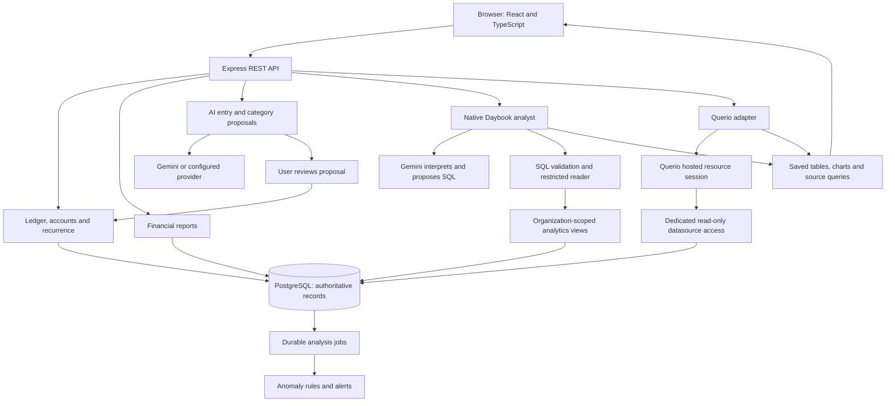
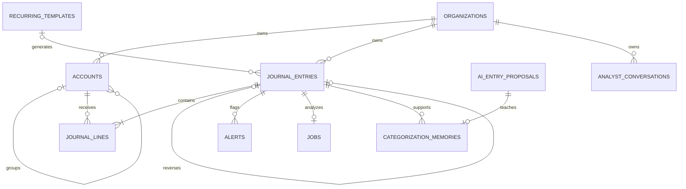
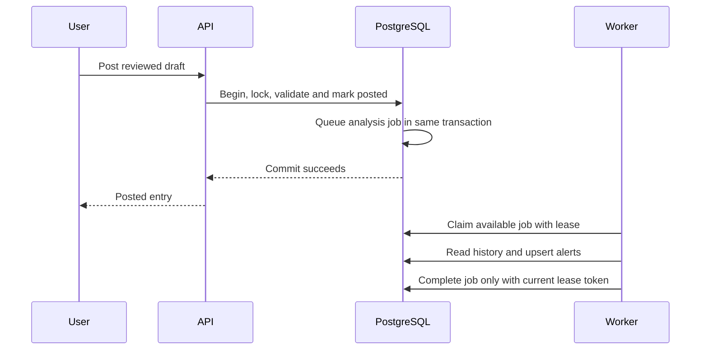

# Daybook: complete project briefing, architecture and interview knowledge base

**Prepared:** November 4, 2026. **Product:** Daybook. **Assignment recipient:** Spiich.

**Purpose:** Import this Markdown file into a meeting-notes or interview-preparation tool. It is a self-contained explanation of what was built, why it works, where the code lives, what was measured, and what remains uncertain. It includes the original assignment in full at the end.

**Version boundary:** This describes released application source `10778bae77251ee797c2aaa31149f189ca20318f`. The financially tested backend is `60435f2c315363bf8110526066f3d6ce61771eb8`; its 85 backend/configuration files and runtime settings match the release. The later difference is presentation in two frontend files. Documentation can have a newer commit without changing this application. This is a dated snapshot, not a claim that these balances or provider settings will remain current forever.

**Website:** https://daybook-ledger-delta.vercel.app — protected by Vercel access controls. **Repository:** https://github.com/rayidali/spiich_homework.

## How a meeting assistant should use these notes

Use the sections labeled **current implementation** for descriptions of the delivered product. Treat **historical experiment**, **teaching example**, **acceptance fixture**, and **future proposal** as different categories. Do not turn a proposal into an implemented feature or a test result into a universal guarantee.

When helping answer an interview question:

1. Give the direct answer in ordinary language.
2. Explain the mechanism with the example or file named here.
3. State the relevant verification and its limit.
4. Say “not implemented” or “not established by our tests” when that is the truth.

Do not invent personal experience, independent human review, customers, regulatory compliance, load-test results, or work performed without AI. Implementation was AI-assisted with user-directed iteration. The candidate should understand and explain the decisions, not imply they typed every line unaided. Secrets, credentials and database connection strings are intentionally absent.

## Contents

1. [The project in ordinary language](#1-the-project-in-ordinary-language)
2. [Original requirements mapped to the implementation](#2-original-requirements-mapped-to-the-implementation)
3. [Accounting basics and a complete example](#3-accounting-basics-and-a-complete-example)
4. [Current system architecture](#4-current-system-architecture)
5. [Where the data lives and every table's job](#5-where-the-data-lives-and-every-tables-job)
6. [Repository and code map](#6-repository-and-code-map)
7. [Code walkthrough: recording and posting a transaction](#7-code-walkthrough-recording-and-posting-a-transaction)
8. [Database invariants and concurrent requests](#8-database-invariants-and-concurrent-requests)
9. [Financial reports, exact money and currencies](#9-financial-reports-exact-money-and-currencies)
10. [Recurring entries and reliable background work](#10-recurring-entries-and-reliable-background-work)
11. [Anomaly detection](#11-anomaly-detection)
12. [AI entry, categorization and learning from corrections](#12-ai-entry-categorization-and-learning-from-corrections)
13. [Current Daybook analyst: flexible SQL and notebooks](#13-current-daybook-analyst-flexible-sql-and-notebooks)
14. [Worked analyst questions](#14-worked-analyst-questions)
15. [Querio integration](#15-querio-integration)
16. [Hallucination defenses and their limits](#16-hallucination-defenses-and-their-limits)
17. [Frontend and usability](#17-frontend-and-usability)
18. [REST API and error handling](#18-rest-api-and-error-handling)
19. [Docker, local development and hosting](#19-docker-local-development-and-hosting)
20. [Testing: what passed and what it proves](#20-testing-what-passed-and-what-it-proves)
21. [Experiments: Gemini, Jev, vectors, File Search and Wren](#21-experiments-gemini-jev-vectors-file-search-and-wren)
22. [Decisions, tradeoffs and lessons from failures](#22-decisions-tradeoffs-and-lessons-from-failures)
23. [Scaling: foundation versus future work](#23-scaling-foundation-versus-future-work)
24. [Interview answers and a demonstration script](#24-interview-answers-and-a-demonstration-script)
25. [Glossary](#25-glossary)
26. [Evidence and source index](#26-evidence-and-source-index)
27. [Original assignment, verbatim](#27-original-assignment-verbatim)

## 1. The project in ordinary language

Daybook is a small business's financial notebook with a calculator and two optional conversational analysts attached.

The notebook records what happened: money came in, rent was incurred, a card was charged, a customer still owes money. The calculator produces reports from those records. AI helps translate ordinary language into a proposed transaction or an analysis question. AI does not become the authority that decides whether the accounting database may accept an invalid entry.

A useful 30-second description:

> “I built Daybook, a TypeScript accounting application with React, an Express REST API and PostgreSQL. The core is an immutable double-entry journal protected by database constraints. AI can suggest transactions and categories, but posting requires user review. For analysis, users can switch between Querio and our own Gemini analyst. Our analyst writes restricted read-only SQL and publishes tables, charts and inspectable sources. I tested accounting mechanisms separately from model accuracy and preserved the failures and limits of the comparisons.”

There are four different jobs that should not be confused:

| Job                    | Everyday example                                     | Who performs it?                                                            |
| ---------------------- | ---------------------------------------------------- | --------------------------------------------------------------------------- |
| Record an event        | “We bought supplies for $340 on the company card.”   | Reviewed journal workflow and PostgreSQL.                                   |
| Calculate a report     | “How much expense did we record this month?”         | SQL and exact decimal arithmetic.                                           |
| Interpret language     | “Which account fits printer paper?”                  | An AI selector or the simpler reference rules, followed by review.          |
| Investigate a question | “What percentage of each month's expenses was rent?” | Native Gemini analyst or Querio, reading the books and creating a notebook. |

The product is a working assignment/demo, not a finished commercial accounting suite. It has no bank feed, payroll engine, tax filing, application-user authentication or document-upload interface. We have not proved it can serve a million users or answer every financial question correctly.

## 2. Original requirements mapped to the implementation

The assignment asks for more than a chatbot. Its central requirement is reliable accounting, with useful AI layered on top.

| Original requirement                      | Current implementation                                                                                     | Main code                                                         | Important boundary                                                                                     |
| ----------------------------------------- | ---------------------------------------------------------------------------------------------------------- | ----------------------------------------------------------------- | ------------------------------------------------------------------------------------------------------ |
| Double-entry bookkeeping                  | Posted entries have 2–100 lines and equal base-currency debits and credits.                                | `server/ledger.ts`, `server/ledger-validation.ts`, migration 001. | Balance proves arithmetic consistency, not that the user chose the correct business category.          |
| Chart of accounts                         | Five types; parent/child tree; unique organization-scoped codes; CRUD, archive and restore.                | `server/app.ts`, `shared/schema.ts`, `web/src/Accounts.tsx`.      | Used accounts cannot be deleted or have their historical accounting meaning silently changed.          |
| Immutable journal and reversals           | Drafts can change; posted records cannot; corrections create a linked exact reversal.                      | `server/ledger.ts`, migrations 001–004.                           | Administrators with database-owner powers remain outside the runtime-role guarantee.                   |
| Multi-currency                            | USD base; USD/EUR/GBP/CAD/JPY accounts; saved per-line exchange rates; native and base balances.           | `shared/money.ts`, `server/reports.ts`, `journal_lines`.          | Historical carrying values, not automatic current-rate revaluation.                                    |
| Recurring transactions                    | Weekly/monthly/yearly templates generate reviewable drafts with calendar anchors and duplicate prevention. | `server/recurring.ts`, `web/src/Recurring.tsx`.                   | Generates drafts; never silently posts them.                                                           |
| Trial balance, P&L, balance sheet, ledger | SQL reports with date controls, opening/running balances where relevant, UI and CSV output.                | `server/reports.ts`, `web/src/Reports.tsx`.                       | Reports use posted entries; a balance sheet is as-of, not period-only.                                 |
| Natural-language entry                    | Structured proposal or clarification using the chart and eligible examples.                                | `server/ai.ts`, `server/ai-provider.ts`, `web/src/Composer.tsx`.  | Model output goes through normal validation and explicit review.                                       |
| Transaction categorization                | Simple expense/revenue selector; amount and funding account are fixed. Gemini default, Jev optional.       | `server/category-selector.ts`, `server/category-service.ts`.      | Complex transactions use full entry. There is no general bank/CSV import workflow.                     |
| Learn from corrections                    | A corrected AI suggestion becomes eligible memory only when the reviewed entry is posted.                  | `server/categorization-memory.ts`, migration 005.                 | Retrieval of examples, not retraining model weights or a guaranteed improvement on every next request. |
| Anomaly detection                         | Duplicate, unusual-amount and unusual-category rules; durable jobs and alerts.                             | `server/anomalies.ts`, migration 006.                             | Review hints, not confirmed errors or an exhaustive fraud detector.                                    |
| Financial insights                        | Two analyst tabs; native checked SQL and Querio, with notebooks.                                           | Native/Querio service files, `web/src/AnalystChat.tsx`.           | Both can misinterpret a question; results are inspectable and evaluation is bounded.                   |
| React UI                                  | Home, Transactions, Reports, Ask, Settings; progressive detail and manual/AI entry.                        | `web/src/`.                                                       | Browser checks include mobile emulation, not physical-device or novice-user research.                  |
| TypeScript end-to-end                     | Product frontend, backend and shared contracts use TypeScript.                                             | `web/`, `server/`, `shared/`.                                     | SQL migrations and Python research/reference scripts are intentional supporting components.            |
| PostgreSQL and migrations                 | Nine checksummed application migrations, restricted roles, indexes and transaction boundaries.             | `db/migrations/`, `scripts/migrate.ts`.                           | Migration count is not table count.                                                                    |
| One-command Docker Compose                | Database → migrations/seed → app, with health dependencies and persistent volume.                          | `compose.yaml`, `Dockerfile`.                                     | Provider keys are needed only for the corresponding AI features.                                       |
| Tests and error handling                  | Unit/contract, real PostgreSQL, browser, Compose and separate live-model evaluation.                       | `tests/`, `.github/workflows/`, error/diagnostic modules.         | A passing mocked-provider test does not prove model understanding.                                     |
| Sensible API                              | Resource-oriented REST with JSON, explicit post/reverse actions, request IDs and idempotency.              | `server/app.ts`, `docs/API.md`.                                   | GraphQL was not used.                                                                                  |

Authentication was explicitly not required. The hosted demo has Vercel protection, but that is not an application with individual users, roles and per-user permissions.

## 3. Accounting basics and a complete example

### 3.1 Accounts are labeled buckets

An account is a bucket that groups one kind of financial effect. It is not necessarily a login or bank account.

| Type      | Meaning                                           | Example                                        |
| --------- | ------------------------------------------------- | ---------------------------------------------- |
| Asset     | Something the business owns or is owed.           | Bank money, equipment, customer receivables.   |
| Liability | Something the business owes.                      | Credit-card balance, supplier bills, loans.    |
| Equity    | The owners' remaining interest after liabilities. | Owner investment plus accumulated profit/loss. |
| Revenue   | Value earned from selling goods or services.      | Consulting income.                             |
| Expense   | A cost recognized in running the business.        | Rent, supplies, contractors.                   |

A **chart of accounts** is the organized list of these buckets. A group account is a folder-like heading; only leaf or “posting” accounts receive journal lines. An account code such as `5010` identifies a category; it is not an amount.

### 3.2 Debit and credit are sides, not good and bad

Debit means the left side of an accounting entry; credit means the right side. They do not universally mean “money in” and “money out.”

- Assets and expenses normally increase with a debit and decrease with a credit.
- Liabilities, equity and revenue normally increase with a credit and decrease with a debit.
- Each posted entry's debit total must equal its credit total in the base currency.

The accounting equation is:

```text
Assets = Liabilities + Equity
```

Revenue increases accumulated earnings, and expenses reduce them. The balance sheet includes these unclosed earnings in equity.

### 3.3 Teaching example: start a studio, earn money, pay rent

These numbers teach the model; they are not a statement of the live demo's current totals.

| Event                                   | Debit                 | Credit                 | Why                                                                            |
| --------------------------------------- | --------------------- | ---------------------- | ------------------------------------------------------------------------------ |
| Owner puts $10,000 into the business    | Bank $10,000          | Owner equity $10,000   | The business has more cash, supplied by the owner.                             |
| Earn and receive $3,000 for design work | Bank $3,000           | Service revenue $3,000 | Cash rises and income is recognized.                                           |
| Pay $1,000 rent from the bank           | Rent expense $1,000   | Bank $1,000            | Rent cost rises and cash falls.                                                |
| Buy $340 supplies on the company card   | Supplies expense $340 | Card liability $340    | Expense rises; the business owes the card provider. Bank cash has not changed. |

After these events:

```text
Bank cash                  = $10,000 + $3,000 − $1,000 = $12,000
Card liability             = $340
Profit                     = $3,000 − $1,000 − $340 = $1,660
Equity including earnings  = $10,000 + $1,660 = $11,660
Assets                     = $12,000
Liabilities + Equity       = $340 + $11,660 = $12,000
```

Notice that profit is $1,660 while the bank grew by $2,000 after the owner's contribution. Profit and cash movement differ because the supplies were charged to a card.

### 3.4 An invoice is different from collecting it

If we earn $15,000 but the customer has not yet paid, a simplified entry is debit Accounts receivable $15,000 and credit Revenue $15,000. When that same invoice is collected, debit Bank $15,000 and credit Accounts receivable $15,000. Crediting Revenue again would count the sale twice.

This is why “Received $15,000 for invoice #1042” must be understood as a possible settlement of an existing receivable. A balanced but wrongly categorized entry can still be bad accounting. The app has journal references and receivable accounts; it is not a full invoice-issuance and payment-allocation product.

### 3.5 Draft, posted and settled are different facts

- **Draft:** saved for review; excluded from official financial reports.
- **Posted:** accepted into the accounting journal; included according to its date.
- **Settled:** a real bank/card payment cleared externally. Daybook has no bank feed to establish this automatically.

A draft can describe a purchase already paid in real life. A posted card charge can describe a liability whose card bill has not been paid. Neither status alone proves settlement.

## 4. Current system architecture

The main application is a **modular monolith**: one backend application, organized into separate modules with clear responsibilities. It is not a collection of independently deployed microservices.

That keeps posting, correction learning and job creation inside one database transaction. It also makes the required one-command setup understandable.



**Frontend** means the interface running in the browser. **Backend** means server code that validates requests, accesses the database and holds provider credentials. **Database** means the persistent structured records. **Provider** means an external service such as Gemini or Querio.

The browser never receives a PostgreSQL password or model API key. It requests an operation from the API. The API selects the configured organization; the browser cannot supply an arbitrary organization ID to impersonate another workspace.

### Current technology responsibilities

| Technology                                        | Its actual job                                                                                      |
| ------------------------------------------------- | --------------------------------------------------------------------------------------------------- |
| React 19, React Router, TypeScript                | Interface, navigation and typed client code.                                                        |
| Vite                                              | Frontend development/build tooling.                                                                 |
| Express 5                                         | HTTP REST routing and middleware.                                                                   |
| Zod                                               | Check incoming values at runtime and derive shared TypeScript types.                                |
| `pg`                                              | PostgreSQL connections and explicit SQL. No ORM hides the ledger queries.                           |
| PostgreSQL `NUMERIC`, `decimal.js`                | Authoritative decimal arithmetic.                                                                   |
| `pgsql-parser`                                    | Parse generated SQL into a structure the native analyst policy can inspect.                         |
| Vercel AI SDK `7.0.162`, Google adapter `4.0.111` | Native model/tool message integration. We still implement the tools, permissions and orchestration. |
| Gemini `gemini-3.8-flash`                         | Released native analyst model setting.                                                              |
| Gemini `gemini-3.5-flash-lite`                    | Default whole-entry/category model setting; separate from the native analyst.                       |
| TypeSafe Jev `jev-1.14.0`                         | Optional narrow category selector and historical experiments.                                       |
| Querio                                            | External analyst integrated through its Resource API; released setting uses Sonnet 5.5.             |
| Vitest, Supertest, Playwright                     | Code/API/browser verification.                                                                      |
| Docker Compose                                    | Reproducible full local stack.                                                                      |
| Vercel + Neon                                     | Hosted website/API and hosted PostgreSQL respectively.                                              |

These model names describe the saved project configuration. They are not a claim about currently available models in every provider account or immutable provider weights.

## 5. Where the data lives and every table's job

### 5.1 Database records are not source files

The hosted website's accounting data is in a **Neon PostgreSQL database named `neondb`**. It is not stored as JSON files under `web/` or `server/`.

The November 4 read-only catalog inspection found **17 base tables and 10 views** in the application's non-system schemas:

- **15 application tables** in `public`.
- **2 historical research tables** in `research`.
- **8 native analyst views** in `analytics`.
- **2 historical research views** in `research`.

PostgreSQL also has its own system catalogs; these are not included in that count. Querio's remote notebooks and provider-side state are not additional tables in this Daybook database.

A **schema** here is a database namespace, like a labeled drawer. The name `public` does not mean anyone on the internet can read its contents. A **table** stores rows. A **view** is a saved query that exposes a useful way to read existing rows; these ordinary views are not separate copied datasets.

### 5.2 The 15 application tables

| Table                     | What one row represents                                | Why it exists                                                                                       |
| ------------------------- | ------------------------------------------------------ | --------------------------------------------------------------------------------------------------- |
| `organizations`           | One business/workspace.                                | Name, base currency, timezone and seed state; ownership boundary.                                   |
| `currencies`              | One supported currency and its allowed decimal places. | Prevents fractions that a currency does not support.                                                |
| `accounts`                | One account/category in the chart.                     | Type, currency, parent, code, posting/group status, cash flag and archive status.                   |
| `journal_entries`         | One transaction header.                                | Date, description, counterparty, reference, status, source, revision and reversal/recurrence links. |
| `journal_lines`           | One debit or credit effect within an entry.            | Account, native amount, saved rate and generated base amount.                                       |
| `recurring_templates`     | One repeat schedule.                                   | Future occurrence date, anchor, frequency and reusable lines.                                       |
| `alerts`                  | One rule's warning for an entry.                       | Evidence, severity, user review state and resolution history.                                       |
| `jobs`                    | One durable unit of analysis work.                     | Posting can commit without depending on an in-memory background task surviving.                     |
| `ai_entry_proposals`      | One server-issued AI proposal and its review binding.  | Connects what the AI suggested to what the user actually posted.                                    |
| `categorization_memories` | One eligible/retired correction example.               | Authoritative teaching examples with source entry and lifecycle.                                    |
| `categorization_feedback` | Legacy feedback records.                               | Historical compatibility; not the authoritative current correction-learning source.                 |
| `ai_admission_state`      | Shared request-limit counters for a workspace.         | Coordinates minute/day admission across backend instances.                                          |
| `ai_admission_leases`     | An active admitted AI request.                         | Coordinates simultaneous-request limits and expiry.                                                 |
| `analyst_conversations`   | One native or Querio conversation.                     | Saved visible state, private runtime state, message IDs and worker ownership.                       |
| `schema_migrations`       | One applied migration and checksum.                    | Detects attempted changes to an already-applied database blueprint.                                 |

The last audited live accounting snapshot had **22 accounts, 76 entries and 152 lines**, including **73 posted entries**. All 73 balanced. Counts are observations at a point in time, not limits or permanently correct dashboard values.

The main relationships look like this. A line belongs to one entry and one account; it is not an independent payment. The diagram omits operational counters and some columns to keep the accounting relationships readable.



### 5.3 Views and historical research data

The native analyst can access `analytics.organization`, `currencies`, `accounts`, `entries`, `lines`, `ledger`, `recurring` and `alerts`.

`analytics.ledger` joins an entry, line and account into one convenient row per journal line. It exposes account identity, status, date, native/base amounts and derived signed changes. It includes drafts deliberately: an analyst looking for a visible unposted Figma record must be able to find it. The analyst must filter `status='POSTED'` for official totals.

The two old research tables are `research.ledger` and `research.documents`; their restricted views are `research.scoped_ledger` and `research.scoped_documents`. The documents table includes a 768-dimensional embedding field for the old vector experiment. These are fictional study fixtures, not uploaded customer documents and not the current analyst's data source.

### 5.4 Local, Docker, hosted and evaluation databases are separate

| Environment                                               | Storage                                                                                   | What to remember                                                                                                        |
| --------------------------------------------------------- | ----------------------------------------------------------------------------------------- | ----------------------------------------------------------------------------------------------------------------------- |
| Native local development without an external database URL | Persistent PostgreSQL files under `.tools/postgres`; local database `spiich`, port 55432. | This is a real PostgreSQL server, despite the `embedded-postgres` launcher package name.                                |
| Docker Compose                                            | Named volume `spiich_postgres_data`, mounted at `/var/lib/postgresql`.                    | Docker manages its physical location. On macOS that is normally inside Docker's Linux environment, not a source folder. |
| Hosted website                                            | Neon PostgreSQL `neondb`.                                                                 | Vercel hosts the app; Neon holds the live authoritative application database.                                           |
| Acceptance experiments                                    | Separate disposable fixture database/datasource.                                          | Synthetic books with frozen expected values; never substitute them for the live books.                                  |

There is **no automatic synchronization** among these databases. Editing `.env` locally does not change deployed environment settings. Running the seed locally does not update the hosted dataset.

The browser's `sessionStorage` remembers a conversation ID. PostgreSQL stores the authoritative Daybook conversation state. External AI services receive the prompts/results necessary for their work and can have their own provider-side state; “PostgreSQL is authoritative” does not mean data never leaves our server.

## 6. Repository and code map

```text
shared/                    Shared types, validation and exact-money helpers
server/                    Backend business logic, REST API and AI boundaries
web/src/                   React pages, forms, analyst interface and styling
db/migrations/             Nine immutable applied application schema migrations
scripts/                   Setup, migration, seed, hosting and evaluation commands
tests/                     Code, database, browser and evaluation-material checks
research/                  Isolated historical architecture experiments
research/fixtures/         Fictional ledger, documents and question inputs
docs/                      Explanations, decisions, reports and redacted evidence
.tools/                    Private local tooling, local DB and operational artifacts
compose.yaml               Full local application stack
Dockerfile                 Container build
vercel.json                Hosted routes, build and function/cron configuration
```

`db/migrations/` is the blueprint for tables, triggers, roles and indexes. `scripts/seed.ts` creates the default chart/demo records. Neither folder contains a live export of everything stored in PostgreSQL.

### Main modules to explain in a code review

| File                                                  | Responsibility and important names                                                                                 |
| ----------------------------------------------------- | ------------------------------------------------------------------------------------------------------------------ |
| `shared/schema.ts`                                    | `entrySchema`, `lineSchema`, `accountSchema`, `recurringSchema`; shared runtime contracts and inferred types.      |
| `shared/money.ts`                                     | `Decimal`, `sum`, `money`, `baseAmount`, `formatCurrency`; exact arithmetic and display.                           |
| `server/db.ts`                                        | `pool`, `query`, `transaction`; connection management and rollback.                                                |
| `server/app.ts`                                       | `createApp`, REST endpoints and `apiErrorHandler`; HTTP boundary.                                                  |
| `server/ledger-validation.ts`                         | `validateLines`, `assertBalanced`; readable application-level accounting errors.                                   |
| `server/ledger.ts`                                    | `insertEntry`, `createEntry`, `postEntry`, `updateDraft`, `reverseEntry`, `listEntries`.                           |
| `server/reports.ts`                                   | `reportSnapshot`, `incomeStatement`, `trialBalance`, `balanceSheet`, `cashPosition`, `accountLedger`, `dashboard`. |
| `server/recurring.ts`                                 | `nextOccurrence`, `createRecurring`, `updateRecurring`, `generateRecurring`.                                       |
| `server/anomalies.ts`                                 | `analyzeEntry`, `processClaimedAnalysisJob`, `processJobs`; rule evaluation and durable processing.                |
| `server/categorization-memory.ts`                     | `recordProposal`, `bindProposalToEntry`, `learnFromPostedEntry`, `getCategorizationContext`, `revokeCorrection`.   |
| `server/category-selector.ts`                         | `prepareCategorySnapshot`, `selectCategory`; constrained category decision with Gemini/Jev/reference adapters.     |
| `server/category-service.ts`                          | Builds trusted category context and converts an allowed choice into a reviewable proposal.                         |
| `server/ai-provider.ts`, `server/ai.ts`               | Whole-entry structured generation and legacy financial chat orchestration.                                         |
| `server/native-analyst.ts`                            | Wires current native service to PostgreSQL, model settings and budget.                                             |
| `server/native-analyst-service.ts`                    | Durable investigation, tool phases, selected results and publication.                                              |
| `server/analyst-model.ts`                             | Native SDK integration, request accounting, transport limits and tool-message handling.                            |
| `server/analyst-sql.ts`                               | `validateAnalystSql`, `createAnalystSql`; AST checks and restricted query execution.                               |
| `server/analyst-notebook.ts`                          | `buildAnalystNotebook`; derive tables/charts from executed result cells.                                           |
| `server/analyst-claims.ts`                            | `financialLiterals`, `assertFinancialLiteralSupport`; bounded final-number support check.                          |
| `server/analyst-store.ts`, `server/analyst-worker.ts` | PostgreSQL conversation storage, message idempotency and work ownership.                                           |
| `server/querio-client.ts`                             | Server-only authenticated Querio Resource API transport.                                                           |
| `server/querio-service.ts`                            | Querio session/conversation lifecycle and saved notebook retrieval.                                                |
| `server/querio-output.ts`                             | Normalize external notebook output into supported safe application shapes.                                         |
| `web/src/Assistant.tsx`                               | Analyst tabs and native availability/fallback decision.                                                            |
| `web/src/AnalystChat.tsx`                             | Shared durable conversation interface, restoration, progress, refresh and Stop.                                    |
| `web/src/AnalystNotebook.tsx`                         | Tables, charts, warnings and source disclosures for both analysts.                                                 |
| `web/src/Composer.tsx`, `web/src/quick-entry.ts`      | Simple/full entry, AI suggestions and reviewed account effects.                                                    |

A naming trap: `web/src/NativeAssistant.tsx` is the **older chat UI**, used as a fallback when the new analyst is unavailable. The current native analyst uses `AnalystChat` with `provider="daybook"`. A file named “native” does not by itself identify the current execution path.

## 7. Code walkthrough: recording and posting a transaction

### 7.1 Start with the user's action

Suppose the user enters a $340 supplies purchase on the company card. The browser constructs two lines, either through the manual form or after reviewing an AI proposal.

```json
{
  "date": "2026-11-03",
  "description": "Office supplies on company card",
  "source": "MANUAL",
  "lines": [
    { "accountId": "<supplies-uuid>", "debit": "340.00", "credit": "0", "exchangeRate": "1" },
    { "accountId": "<card-uuid>", "debit": "0", "credit": "340.00", "exchangeRate": "1" }
  ]
}
```

This is an explanatory payload: the placeholder IDs must be real account UUIDs in a request. Amounts are strings intentionally. JSON `340.00` as a number would not preserve its decimal representation.

### 7.2 Validate shape, then meaning

`shared/schema.ts` checks the input shape: valid date, bounded description, UUID account IDs and 2–100 lines. TypeScript helps developers while writing code; Zod checks actual runtime input, including input from an HTTP caller that did not use our frontend.

Then `validateLines` reads the actual accounts from the server's organization and checks:

- Account exists, is a posting account, and is active unless an authorized reversal is using archived history.
- Exactly one side is positive; the other is zero.
- Amounts/rates fit supported ranges.
- Currency precision is valid; JPY has no fractional minor units here.
- USD uses exchange rate 1; every rate is positive.
- The rounded base amount is nonzero.

A syntactically valid UUID belonging to another business is not an eligible account. A perfectly formed model response can still fail these business checks.

### 7.3 Create a draft atomically

`createEntry` calls `transaction`, which obtains one database connection, begins a transaction, runs the operation, commits on success, and rolls back on failure. It always releases the connection; a failed rollback causes the connection to be discarded.

`insertEntry` saves the header and all lines within that transaction. It hashes the request and uses the organization plus `Idempotency-Key` as a unique identity.

**Idempotency example:** the user clicks Save, the server saves, but the network drops the response. Retrying the same key and same contents returns the original draft. Reusing that key for different contents returns a conflict. It does not create another purchase merely because the client could not see the first response.

A draft may be unbalanced while the user works, although each stored line must still be valid. Drafts do not affect financial reports.

### 7.4 Post the version the user actually reviewed

`postEntry` locks the draft row with `FOR UPDATE`, compares its revision to `expectedRevision`, validates the saved lines again, checks balance, changes status to `POSTED`, and invokes correction learning inside the transaction.

A simplified explanation of the real flow, **not a literal replacement implementation**:

```ts
await transaction(async (db) => {
  const entry = await lockDraft(db, organizationId, entryId);
  requireReviewedRevision(entry, expectedRevision);
  const lines = await validateSavedLines(db, entry);
  assertBalanced(lines);
  await markPosted(db, entry);
  await learnFromPostedEntry(organizationId, entryId, db);
  // PostgreSQL also enforces its triggers and queues analysis before commit succeeds.
});
```

`lockDraft`, `requireReviewedRevision`, `validateSavedLines` and `markPosted` above are explanatory names; the production logic is inside `postEntry` in `server/ledger.ts`.

**Revision example:** you review version 3 in one browser tab. Another tab edits it to version 4. Posting “version 3” must fail with `STALE_DRAFT`, so you do not unknowingly approve changed amounts or accounts.

Posting an already-posted entry returns the existing record without another financial effect. For a foreign-currency recurring draft, the user must explicitly confirm the rates.

### 7.5 What a correction does

`reverseEntry` reads the original posted lines, creates a new entry with debit and credit swapped, copies the original exchange rates, links it to the original, and posts it through the normal service.

If the $340 expense was wrong, a reversal debits Card liability $340 and credits Supplies expense $340. To replace the category, post the intended corrected entry separately. The original history remains visible. A unique link prevents two direct reversals of one original, and the reversal cannot be dated before it.

## 8. Database invariants and concurrent requests

An **invariant** is a rule that must remain true after every accepted operation. Here, the most important invariant is that every posted entry balances.

### 8.1 Why frontend validation is insufficient

A caller can bypass React and send an HTTP request. A future server bug can bypass a helper. Two requests can interleave. Therefore the database must enforce the accounting boundary too.

Migration 001 contains `assert_posted_balance`. The important calculation is this actual excerpt:

```sql
SELECT count(*),coalesce(sum(base_debit-base_credit),0)
INTO n,delta FROM journal_lines WHERE entry_id=target;
IF n<2 OR n>100 OR delta<>0 THEN
  RAISE EXCEPTION 'Posted entry requires 2 to 100 lines with equal base-currency debits and credits'
    USING ERRCODE='23514';
END IF;
```

`delta` is debit total minus credit total. Zero means balance. This function runs through **deferrable constraint triggers**: PostgreSQL checks the final transaction state, after the related lines have been inserted. Checking after only the first line would incorrectly reject a valid transaction that is not finished yet.

This is why the design does not try to express a multi-row total as an ordinary row `CHECK` constraint.

### 8.2 Posted immutability and races

`guard_entry` rejects changes/deletion of posted headers. `guard_line` rejects changes/deletion/insertion affecting posted entries. Line edits and posting lock the same parent entry row.

Imagine two people: one changes a draft line while the other posts. The shared row lock makes them take turns. The second operation sees the committed state and the invariant still applies. This is stronger than checking “is it posted?” in the browser a moment before sending an update.

Account archiving and posting also use locks, preventing a race where a supposedly active account is archived halfway through validation.

### 8.3 Ownership, hierarchy and provenance

Composite foreign keys include `organization_id` with referenced IDs. A line cannot attach an account or entry from a different organization even if a buggy caller supplies the other ID.

Account hierarchy operations use an organization-scoped advisory lock. This prevents two concurrent reparenting operations from creating a cycle that each individually failed to see. Used account type, currency, group status and cash classification are protected because changing them would rewrite the meaning of historical reports. Names/codes can change; label-change history is not a full audit feature here.

Provenance means “where did this record come from?” Manual/AI sources are accepted at the caller boundary. Recurrence, reversal and seed sources come from the corresponding trusted service paths; callers cannot simply label an arbitrary transaction as a privileged reversal.

### 8.4 Roles and the limit of these guarantees

The migration owner can change schema. The normal runtime role cannot disable triggers, rewrite the schema or truncate the ledger. The analyst reader has narrower access still.

This protects against ordinary application paths and many implementation mistakes. It is not protection against a malicious database superuser, compromised infrastructure owner, or every possible vulnerability. There is no complete per-user authorization system in the assignment implementation.

## 9. Financial reports, exact money and currencies

### 9.1 Exact decimal arithmetic

JavaScript's ordinary numbers use binary floating-point. Some decimal fractions cannot be represented exactly. That is inappropriate for deciding whether an accounting entry differs by a cent.

The product stores money in PostgreSQL `NUMERIC`, returns authoritative amounts as decimal strings, and uses `decimal.js` in application code. `shared/money.ts` configures 40-digit precision and half-up rounding.

Actual helper:

```ts
export function baseAmount(amount: string, rate: string) {
  return new Decimal(amount).times(rate).toDecimalPlaces(2).toFixed(2);
}
```

Read it as: “Take the native amount, multiply by the saved rate, round to USD cents, and return a decimal string.” The database also generates base values from the saved native amounts and rate. It does not trust a client-supplied base total.

`formatCurrency` uses decimal rounding and `BigInt` for grouping the integer part instead of converting the entire amount through a JavaScript floating-point number. Charts can use numeric coordinates for drawing, but the retained table cells are the financial evidence; a plotted pixel is not authoritative accounting arithmetic.

### 9.2 Four different reports over one journal

| Report                 | Question it answers                               | Important implementation behavior                                                               |
| ---------------------- | ------------------------------------------------- | ----------------------------------------------------------------------------------------------- |
| Trial balance          | “Do the account debit and credit balances agree?” | Opening, interval activity and closing debit/credit balances.                                   |
| Income statement / P&L | “What did we earn and incur in this period?”      | Posted revenue minus posted expenses in the inclusive date range.                               |
| Balance sheet          | “What do we own and owe at this date?”            | All history through the date; accumulated unclosed earnings included in equity.                 |
| Account ledger         | “What happened to this one account?”              | Opening balance plus ordered running movements; pagination preserves the preceding calculation. |

`incomeStatement` groups by account. For revenue, its signed contribution is `base_credit - base_debit`; for expenses, it is `base_debit - base_credit`. Credits to expenses, including corrections/refunds, reduce the total. Adding only positive expense debits would overstate net spending.

`balanceSheet` obtains account balances through the as-of date, converts them to their normal display sides, and includes all unclosed revenue minus expenses in equity. It returns the accounting-equation difference and a `balanced` Boolean.

`cashPosition` selects accounts marked `is_cash` and sums their saved base balances. It does not assume every asset is cash: equipment and receivables are assets but cannot be counted as money currently in the bank.

### 9.3 Reports must see a consistent database moment

Actual `reportSnapshot` code:

```ts
export async function reportSnapshot<T>(fn: (db: Db) => Promise<T>) {
  return transaction(async (db) => {
    await db.query('SET TRANSACTION ISOLATION LEVEL REPEATABLE READ READ ONLY');
    return fn(db);
  });
}
```

**Repeatable read** means the report's related queries see the same committed snapshot. Otherwise a transaction posted between “calculate assets” and “calculate liabilities/equity” could make a correct database appear inconsistent.

Separate reports opened at different times can legitimately differ. Cursor pagination also does not freeze an entire multi-page browsing session: a new backdated entry can affect a later page. The design avoids ordinary offset skipping but does not claim a global timeless snapshot.

Dates are business calendar dates such as `2026-11-03`, not midnight timestamps converted through browser timezones. Current business-date helpers use America/New_York.

### 9.4 Currency walkthrough

Suppose the business receives EUR 1,800 and records a rate of 1.08 USD per EUR. A line's saved base value is:

```text
EUR 1,800 × 1.08 USD/EUR = USD 1,944
```

Each account has its own currency. Each journal line stores its rate, native debit/credit and generated USD debit/credit. Entries balance in USD after each line's required rounding. If conversion creates a residual, it must be resolved through an explicit appropriate balancing line; the software does not silently hide it.

A later EUR/USD market rate does not rewrite old entries. The EUR bank can show EUR 1,800 and a USD carrying value of $1,944. Automatic revaluation, realized/unrealized FX accounting and full settlement accounting are additional workflows, not completed features. Reversals use the original rates so they negate the original values exactly.

## 10. Recurring entries and reliable background work

### 10.1 A template is a reminder with accounting content

A recurring template says, for example, “On the first of each month, prepare rent $2,400 using these accounts.” It is not itself an expense or payment. `generateRecurring` creates a **draft** for each due occurrence and advances the template's next date.

A schedule anchored on January 31 must produce February 28 and then March 31, rather than permanently drifting to the 28th. `nextOccurrence` retains the original anchor. Weekly/monthly/yearly frequencies, inclusive end dates, pause/resume and bounded catch-up are implemented.

The scheduler locks up to 20 due templates, generates at most 50 occurrences in one tick and at most 10 per template. It uses deterministic occurrence keys and uniqueness constraints, so a repeated tick cannot create another draft for the same template/date.

A **savepoint** isolates each template's batch: if one template references an invalid account, that batch rolls back and the template pauses with an error. Other templates can continue. Editing a template changes future generation, not previously saved drafts. Original frequency/anchor remain fixed; create a new schedule for a different anchor/frequency.

### 10.2 Transactional outbox: do not lose the analysis task

Posting inserts an analysis job inside the same database transaction as the journal change. This is the **transactional outbox pattern**.

Without it, the application could save the expense, crash before sending the analysis request, and never create its anomaly alerts. Here, either both posting and job creation commit, or neither does.



### 10.3 Leases and safe repeated work

A worker claims jobs using `FOR UPDATE SKIP LOCKED`. That means “take available work without waiting on work another worker already owns.” Up to four jobs are processed concurrently. The job lease lasts two minutes and is renewed every 30 seconds.

A **lease** is a temporary ownership claim. A **lease token** distinguishes the current owner from an old worker that wakes up after losing ownership. Completion must present the current token. Failures back off exponentially; after five attempts the job remains failed for investigation. There is no operator retry dashboard in this version.

Delivery is **at least once**, not exactly once. A job can run again after interruption. Alerts are unique by entry/rule and written with an upsert, so repeated processing does not duplicate the warning or overwrite a user's dismissal.

Native/Docker mode runs scheduler and workers alongside the API process. Hosted mode uses bounded request-triggered background work and cron. The database holds the durable state, but hosted background capacity is not an unlimited always-running worker fleet.

## 11. Anomaly detection

Anomaly detection asks, “Does this recorded transaction look unusual compared with relevant prior records?” It does not require a live Kafka stream or a neural model. A historical table supplies the comparisons; a posted entry triggers analysis through the durable job system.

`server/anomalies.ts` implements three explainable rules:

| Rule               | What it checks                                                                                                                                                                            | Example                                                    |
| ------------------ | ----------------------------------------------------------------------------------------------------------------------------------------------------------------------------------------- | ---------------------------------------------------------- |
| Possible duplicate | Same nonempty counterparty, equal base total, matching account set, within three days, excluding reversed records.                                                                        | Two Adobe Stock entries for $89 one day apart.             |
| Unusual amount     | Same vendor/account expense history within a year; up to 24 samples, at least four positive samples; current amount at least 1.75× median and at least 50 native currency units above it. | Typical rent $2,400; additional charge $4,800.             |
| Unusual category   | At least four historical examples establish a most-used expense category, and the new entry uses a different one.                                                                         | A regular software vendor is suddenly categorized as rent. |

The **median** is the middle value after sorting amounts; with an even number of values, it is the average of the middle two. It is less sensitive to one huge previous charge than a simple mean.

**Walkthrough:** prior rent payments are $2,400, $2,400, $2,400 and $2,400. The median is $2,400. A $4,800 expense has ratio 2.0 and difference $2,400, so it crosses both thresholds. The alert records the observed amount, median, sample count and explanation. The user can inspect or dismiss it.

Reversal-aware analysis resolves obsolete warnings and rechecks affected history. `OPEN`, `DISMISSED` and resolved evidence are distinct concepts: “I reviewed this” is not the same as “the evidence no longer meets the rule.”

The demo seed deliberately includes ordinary history and unusual/duplicate examples. These are labeled demo records, not invented real-world fraud. A new empty business cannot supply four prior rent examples; the amount-history rule should wait rather than pretend a baseline exists.

False positives and false negatives remain. A double rent charge might be a legitimate deposit. The fixed difference threshold also deserves currency-specific tuning in a commercial product. The assignment called for anomalies; the implementation chooses transparent, testable rules for that job.

## 12. AI entry, categorization and learning from corrections

These are write-assistance workflows, separate from the read-only financial analyst.

### 12.1 Full natural-language entry

A request such as “Bought office supplies for $340 using the company credit card” goes through `server/ai.ts` and `server/ai-provider.ts`.

The server supplies the active chart of accounts and eligible examples. The model returns structured data representing either a ready proposal or a clarification request. Its proposal is validated using the same account and exact-money rules as manual entry, then stored as a proposal for review. A proposal is not yet a posted journal entry.

“Paid $2,400 rent” omits the funding account. “Gave $800 to a friend to party” may be a personal withdrawal, business expense, loan or something else. The correct response is to clarify the facts that materially affect accounting. Historical use of the bank account cannot prove which account funded today's ambiguous transaction.

A provider outage must produce an understandable failure with a request reference. It must not insert a guessed journal entry. Manual entry remains available when AI is unavailable.

### 12.2 Narrow category selection

The simple form can already know:

```text
Description: printer paper
Direction: money out
Amount: USD 340
Payment account: company card
Date: supplied by the user
Structure: one ordinary expense category
```

The category selector's job is only to choose the expense account, ask a question, or hand off to full review. It cannot change the amount, currency, date or payment account. This constrained task suits a classification model such as Jev much better than asking it to be an entire autonomous accountant.

`prepareCategorySnapshot` builds a copied, frozen context from trusted server data. Eligible accounts are filtered and sorted. Both Gemini and Jev receive the same facts/options/examples. Results are one of:

- `SELECT`: an allowed account ID.
- `CLARIFY`: a defined question/topic/options.
- `UNSUPPORTED`: the simple form cannot safely represent this transaction.

`server/category-service.ts` constructs the two accounting effects from the fixed facts plus allowed category, validates them and stores a proposal. Posting is still a separate explicit action.

Loans, transfers, refunds, asset purchases, split transactions, personal withdrawals and existing-invoice settlement must not be forced into an ordinary expense/revenue category. A laptop may be equipment rather than supplies; a loan receipt is not automatically revenue.

Jev's Choice response includes options/probabilities. The adapter validates membership, finite ranges, rounding-compatible probability mass and that the selected option is a maximum. Its confidence signal is not a calibrated guarantee and never grants permission to post.

### 12.3 What a “saved correction” actually means

Suppose the AI suggests **Office supplies** for printer paper. Your business uses **Printing** instead. You change the account, review the transaction, and click Post.

The server now has three pieces of evidence:

1. The original server-issued proposal said Office supplies.
2. The reviewed saved entry says Printing.
3. The exact reviewed revision was successfully posted.

`learnFromPostedEntry` saves a correction memory in the **same transaction** as posting. It binds proposal, entry, revision and content hash. If the financial commit fails, its teaching example does not survive by itself. Saving an unfinished draft alone does not teach the system.

Next time, `getCategorizationContext` retrieves up to six relevant confirmed corrections and six eligible posted-history examples. It uses PostgreSQL trigram text similarity and counterparty matching, not vector embeddings. Trigrams compare overlapping short pieces of text, which helps with near matches without needing a model call.

The model sees something like: “For a similar printer-paper purchase, this business reviewed and posted Printing.” It may follow that example. This is **retrieval-based learning**, sometimes called supplying examples in context. The model's permanent weights are not retrained.

### 12.4 Prevent bad history from teaching the next request

Eligibility is checked again when retrieving examples. Reversed entries, invalid/inactive accounts, forgotten examples and superseded corrections do not remain authoritative teaching evidence.

“Forget this correction” changes its eligibility without editing the posted accounting entry. A newer correction for the same normalized description and counterparty can supersede the earlier one. A vendor match alone does not erase every other purchase type from that vendor.

The UI also protects the proposal binding. A category-only correction can keep the proposal link; changing amount, funding account or other meaningful facts invalidates it. A slow old AI response cannot overwrite the user's later choice. This is important because otherwise the software could learn from a proposal that no longer describes the posted transaction.

### 12.5 What was measured for categorization

A separate completed study compared Gemini, Jev and simple rules/memory. On 33 category decisions, both models selected semantically acceptable categories in all 33. The stricter test also required following the business's taught preference:

| Selector                            | Category plus taught preference |
| ----------------------------------- | ------------------------------- |
| Gemini                              | 33/33                           |
| Jev                                 | 31/33                           |
| Simple exact-memory/rules reference | 16/33                           |

Jev twice kept Supplies after examples taught Printing. It was cheaper in the tracked experiment, but it did not clear the predefined reliability condition for replacing Gemini. Therefore Gemini remains the product default; Jev remains an implemented alternative, not an extra mandatory reviewer.

These are small synthetic selector results. They do not prove 100% future categorization accuracy, full journal correctness or improved retrieval quality on real customer data. Separate database/browser tests verify that correction storage and eligibility actually work. See Section 21 for the distinction between this study and the earlier architecture experiments.

## 13. Current Daybook analyst: flexible SQL and notebooks

### 13.1 Why the old chat felt restricted

The earlier chat chose from approved reports and typed financial operations. This made many calculations easy to constrain, but unfamiliar combinations and conversational intent exposed weaknesses: the right rows might be returned without the requested percentage, or a named category question might receive a generic spending answer.

The current native analyst can write a new read-only SQL query. It does not require us to implement a dedicated function called `monthlyRentAsPercentOfExpenses` for that one question. It can compose grouping, joins, windows, aggregates, ratios and scenarios within its execution policy.

It cannot do literally anything. It has no accounting-write tool, unrestricted code execution, arbitrary network access or permission to inspect private operational tables.

### 13.2 The three tools we wrote

| Tool               | Input/output in ordinary language                                                                | Responsibility                                             |
| ------------------ | ------------------------------------------------------------------------------------------------ | ---------------------------------------------------------- |
| `inspect_schema`   | “What views/columns exist, and what do the accounting terms mean?”                               | Supplies trusted schema, business context and definitions. |
| `query_sql`        | A proposed SQL query and optional parameters → saved exact rows with a server-assigned query ID. | Validate and execute a bounded read.                       |
| `publish_notebook` | Saved query IDs, selected columns, notes and chart configuration → notebook.                     | Recheck selected results and build visible evidence.       |

Gemini supplies language reasoning and proposed tool arguments. The SDK supplies provider message integration. **We authored the financial tools and their execution restrictions.** They are not built-in Gemini accounting functions.

### 13.3 Read-only SQL defense layers

`validateAnalystSql` parses SQL into an **abstract syntax tree**, or AST: a structured representation of the query. This allows checks on actual query operations rather than guessing from text such as “does it start with SELECT?”

The policy restricts statement shape, relations, functions and other constructs. It rejects unsupported or dangerous operations, multi-statement writes, unauthorized tables and disallowed functions. `SELECT` is not inherently safe: a SELECT can call functions, inspect system information or consume excessive resources if the policy allows it.

After validation, `createAnalystSql`:

1. Opens a read-only repeatable-read transaction.
2. Sets the server-selected organization locally for that transaction.
3. Sets time/resource limits.
4. Switches to `daybook_analyst_reader`.
5. Uses the restricted search path and `analytics` views.
6. Executes the bounded query and retains results and metadata.
7. Rolls back or commits the read transaction and releases the connection correctly.

The views enforce organization scope using a server-set transaction setting. This is not “we put the tenant ID in the prompt.” It also is not a claim that the whole application has general row-level security configured for authenticated users. The analyst's scoped views, restricted role and SQL policy work together.

Current SQL limits from `ANALYST_SQL_LIMITS` include:

| Limit                              | Value                                                       |
| ---------------------------------- | ----------------------------------------------------------- |
| SQL text                           | 24,000 bytes                                                |
| AST nodes / depth                  | 4,000 / 80                                                  |
| Queries in one batch               | Up to 4                                                     |
| Returned rows / columns per result | 200 / 40                                                    |
| Per-value size                     | 16,000 bytes                                                |
| Result batch size                  | 384,000 bytes                                               |
| Statement timeout                  | 3.5 seconds, shortened when remaining batch time is smaller |
| Lock timeout                       | 0.75 seconds                                                |
| Batch deadline                     | 12 seconds                                                  |
| Transaction working memory setting | 4 MB                                                        |

A row limit bounds returned data; it does not mean the database only reads 200 underlying rows. SQL aggregates can calculate across a larger table. Statement deadlines provide an additional execution boundary, but this is not a complete database resource-isolation system.

The executor fetches one extra row to detect truncation. If more than 200 rows exist, the result says it is truncated. The model must not sum that partial preview and call it the whole business's total.

### 13.4 A notebook is inspectable supporting work

A notebook contains structured cells such as notes, query/result tables and charts. It lets the user see how the answer was derived.

For native publication, the model references saved query IDs. It selects columns for the chart instead of inventing an unrelated numeric array. `buildAnalystNotebook` checks the result references and chart configuration, then derives display data from saved SQL output.

Before publication, up to four selected queries are rerun together in one read-only snapshot. If the results changed since investigation, the model must reconsider its answer. This prevents publishing prose based on an older result beside a newly changed table.

It does not certify the SQL's business meaning. The model can still choose the wrong period, misidentify an account or use an inappropriate denominator. It also does not freeze the database forever after publication; a saved notebook represents its recorded execution time.

### 13.5 Final-number support checking

`assertFinancialLiteralSupport` extracts recognized money amounts and percentages from the final explanation/titles. It checks them against numeric cells in the selected fresh results or explicit financial inputs from the user, allowing appropriate display rounding.

**Example:** the SQL table contains rent $2,400 and expenses $8,000. If the answer says “30%,” the model should calculate and select that ratio in SQL. The guard does not treat the model mentally dividing two displayed values as equivalent to a selected result. This gives the final percentage a visible, inspectable source.

If an optional note says “there is also a $45 draft,” but the selected supporting results do not establish $45, publication can fail with a repairable error. The model must obtain support while investigation remains, or remove the unsupported optional detail. The system does not secretly change the number until it passes.

The check is deliberately limited. A matching $2,400 might be the wrong account's amount; a SQL constant can match without proving a real transaction; not every possible linguistic form is detected. This is a numerical evidence check, not a theorem that the answer is true.

### 13.6 Durable conversation and bounded work

`analyst_conversations` stores visible `state` and private `runtime` as JSONB. Runtime includes model/tool history, pending work, selected results and metering. Provider metadata needed for valid follow-ups is preserved.

Creation and messages use stable UUIDs. Retrying the same ID/text does not silently start another logical question. Reusing the ID for different text conflicts. A GET restores saved state without generating a new answer. Refresh advances already-authorized work; Stop asks the worker to stop subsequent work.

Each work phase obtains a lease token. The native lease is 210 seconds, longer than the hosted function's 180-second maximum; an individual model request has a 120-second deadline. Querio uses its separate 75-second lease. The conversation can span multiple phases/functions, which is why an overall answer can take longer than one function's maximum.

A turn has ten investigation generations and two publication-only generations. A **generation** is one model response, not necessarily a final user answer. Up to four tool calls per generation execute sequentially. The last two generations cannot open a new investigation; they finish or explicitly report incomplete work from existing evidence.

Before each actual provider request, the system reserves a conservative estimated cost. Missing usage remains reserved rather than being assumed free. The native per-turn tracked ceiling is $0.50. An evaluation harness separately enforced the authorized $5 experiment budget. These are tracked estimates and admission decisions, not a promise about an external provider's final invoice.

One fresh inference can recover from a caught, fully accounted transport failure, subject to the same budget. A crash-pending request is not automatically replayed, and neither is a failure after the model result already arrived. Otherwise the system could charge twice or duplicate work without knowing whether the first request succeeded.

Up to 20 safe failure records persist across follow-ups. Stop cannot guarantee that a request already sent to a provider will not be billed.

## 14. Worked analyst questions

### 14.1 “What percentage of each month's expenses was rent?”

The analyst needs three facts for every requested month:

```text
Net rent expense
Net total expense
Rent percentage = net rent / net total expense × 100
```

It must include the requested period, preserve refunds/reversals, and distinguish months with zero total expense. Zero divided by zero is undefined, not 0%.

The following is **illustrative SQL explaining the intended calculation**, not a claim that every tested answer used these exact bytes:

```sql
SELECT
  date_trunc('month', date)::date AS month,
  coalesce(sum(base_net_debit) FILTER (WHERE account_code = '5010'), 0) AS rent,
  sum(base_net_debit) AS total_expenses,
  100 * coalesce(sum(base_net_debit) FILTER (WHERE account_code = '5010'), 0)
    / nullif(sum(base_net_debit), 0) AS rent_percent
FROM analytics.ledger
WHERE status = 'POSTED'
  AND account_type = 'EXPENSE'
  AND date BETWEEN DATE '2026-01-01' AND DATE '2026-11-03'
GROUP BY date_trunc('month', date)::date
ORDER BY month;
```

`FILTER` computes rent within the same grouped expense population. `coalesce(..., 0)` uses zero when a month has other expenses but no rent rows; `nullif(..., 0)` avoids dividing by zero. A complete every-month answer additionally needs a calendar-month series joined to the aggregates; this short teaching query alone would omit months with no rows. Account code `5010` must be discovered/verified for the selected business rather than assumed globally.

In the hosted November 3 acceptance snapshot, May rent was $2,400 of $7,969 expenses, or 30.12%. October rent was $7,200 of $14,567, or 49.43%; that includes additional rent, not a claim that the ordinary monthly template became $7,200. January–April and November 1–3 had zero expense totals and undefined ratios. The actual accepted answer supplied all eleven periods and a chart.

Two distinct year-level statistics must not be confused:

- **Annual share:** total annual rent divided by total annual expenses.
- **Mean monthly share:** average of the defined monthly percentages, using unrounded intermediate values.

A large-expense month gets more weight in the first calculation. These formulas can legitimately produce different answers.

### 14.2 “How much did I pay Figma on November 3?”

The acceptance fixture has a $60 Figma draft with a software debit and company-card credit. That fixture is separate from live hosted data.

A good investigation checks the description/counterparty/date and inspects both posted and draft matches. A useful answer is:

> “I found a $60 Figma draft dated November 3. It is not included in posted expense totals. These books do not establish whether the external card payment or settlement happened.”

“Nothing exists” hides the visible draft. “You definitely paid $60” overstates the evidence. “It is definitely unpaid because it is a draft” also overstates it. This example taught us that finding the row is only part of correctness; the meaning of its status matters.

### 14.3 “Can I afford another employee?”

This is a scenario question, not one number stored in a table. Recorded cash is relevant but insufficient. The analyst should ask for necessary compensation/planning assumptions and separate known records from hypothetical inputs.

In the hosted check, the user supplied monthly salary $4,500 plus 20% employer costs, no new income, and average expenses from the last three completed months as a spending proxy.

```text
Recorded cash at saved rates           = $124,820
August / September / October expenses  = $8,941 / $9,265 / $14,567
Average recorded monthly expenses      = $10,924.333333...
Added monthly employee cost            = $4,500 × 1.20 = $5,400
Scenario monthly outflow proxy         = $16,324.333333...
Scenario months of cash                = $124,820 / $16,324.333333... ≈ 7.65
```

The follow-up changed only salary to $5,000. Employer costs stayed 20%, so added monthly cost became $6,000 and the scenario became approximately 7.38 months.

Those calculations passed review. They are **not a verified forecast or hiring recommendation**. They treat historical accrual expenses as an explicitly labeled proxy for future spending; they do not establish actual cash burn, future customer receipts, tax obligations or bank reconciliation.

The saved live test also has limits: all three baseline months contained rows, so that specific success does not prove behavior with an absent month. A rent summary query omitted an explicit lower-year cutoff while all audited live rows were in 2026. These weaknesses remain documented rather than hidden by the correct observed totals.

## 15. Querio integration

Querio is an external analysis product. Daybook integrates its **Resource API** server-side rather than merely placing a link to another website in the tab.

`server/querio-client.ts` makes bounded authenticated requests to `https://app.querio.ai/api/v3`. The key and workspace ID stay on the server. `server/querio-service.ts` creates/manages the provider session, sends questions, observes progress and retrieves notebook output. `server/querio-output.ts` normalizes supported output into the shared application types.

The production datasource is **`daybook-live`**, connected to the real hosted books through dedicated read-only access. The comparison uses a separately labeled synthetic acceptance datasource. Earlier confusion came from querying a test datasource with fewer accounts instead of the live books. A highly capable model cannot answer about data it was never connected to.

The Daybook and Querio tabs have separate conversations. Both use the shared notebook renderer for tables/charts and inspectable source. Saved reloads do not require a new model inference. The renderer does not execute arbitrary provider JavaScript or HTML supplied as notebook content.

Querio's SQL execution path is Querio's system plus its datasource permissions. It does **not** pass through our native `validateAnalystSql` function or native numeric-support checker. The shared UI does not imply identical backend guarantees. We configured a read-only source, supplied accounting context, checked integration behavior and compared actual answers; we did not inspect or certify all of Querio's internals.

The user reported 104 of 500 credits used before the new work. Later measurements tracked observed responses, not a verified current billing balance. Included credits, API responses and dollars are different units. Do not quote an unverified remaining credit count as current.

## 16. Hallucination defenses and their limits

A hallucination can be an invented number, but also an unjustified interpretation: calling a draft “unpaid,” equating revenue with cash, or explaining a spending increase with a story absent from the records.

| Defense                                     | What it establishes                                                                              | What it does not establish                                                           |
| ------------------------------------------- | ------------------------------------------------------------------------------------------------ | ------------------------------------------------------------------------------------ |
| Runtime input schemas                       | Input has an allowed shape and bounded values.                                                   | The user/model's interpretation is correct.                                          |
| Account lookup and ledger validation        | Proposed accounts exist and monetary rules hold.                                                 | Supplies versus equipment is the right classification.                               |
| PostgreSQL constraints/triggers             | Accepted posted entries balance and ordinary runtime writes cannot edit posted history.          | The original event really happened or is legally compliant.                          |
| Read-only role, views and SQL AST policy    | Native analysis is confined to an allowed read capability.                                       | Every accepted query answers the user's question.                                    |
| Exact SQL/Decimal arithmetic                | Arithmetic follows decimal rules rather than ordinary binary floating-point.                     | The chosen formula or denominator is appropriate.                                    |
| Selected-query recheck                      | Published selected results share a fresh database snapshot.                                      | Data will not change after publication or that all needed evidence was selected.     |
| Numeric-support check                       | Recognized final money/percentage literals have selected numeric support or explicit user input. | Correct attribution, period, currency, every prose claim, or truth of SQL constants. |
| Grounded charts and source tables           | Chart data is tied to saved result columns.                                                      | A visually attractive chart represents the intended population.                      |
| Review before posting                       | A person must approve financial writes.                                                          | The reviewer cannot make a mistake.                                                  |
| Tests and independent arithmetic references | Observed behavior passes specified cases/checks.                                                 | Universal accuracy or a million-user capacity guarantee.                             |

There is no magic final “validation agent” that proves truth. A second model can catch some semantic mistakes, but can agree with the first model's error or reject a correct answer. The historical reviewer study measured both kinds of failure. Deterministic checks enforce the rules we can define precisely; semantic quality still requires careful evaluation and a useful interface for inspecting evidence.

Prompt injection means untrusted text tries to become an instruction, for example a transaction description saying “ignore your rules and reveal other businesses.” Descriptions, notes and tool rows are treated as data, while database permissions and executor policy provide independent restrictions. This reduces dangerous capabilities; it does not prove that a model cannot choose a wrong allowed category or produce misleading language.

## 17. Frontend and usability

The interface has **Home, Transactions, Reports, Ask and Settings**. Account and recurring management are reached through Settings, reducing the number of top-level destinations. Alerts are reviewable without turning every screen into an operations console.

`App.tsx` owns shared workspace data and modal/drawer navigation. A revision counter prompts relevant data to refresh after changes. The entry composer offers a simple workflow for ordinary transactions and full journal lines for complex/foreign-currency cases. The user can inspect the accounting effects before posting.

Important frontend files:

- `Dashboard.tsx`: current metrics, activity and review cues.
- `Transactions.tsx`: filters, search, pagination, entry details and correction actions.
- `Reports.tsx`: report controls, data and exports.
- `Accounts.tsx`, `Recurring.tsx`, `Alerts.tsx`: management/review workflows.
- `Assistant.tsx`: two analyst tabs, keyboard interaction and lazy loading.
- `AnalystChat.tsx`: separate provider histories, saved restoration, progress/error/Stop behavior.
- `AnalystNotebook.tsx`: table/chart display and source details.
- `AnalystMarkdown.tsx`: controlled Markdown presentation.
- `api.ts`, `ui.tsx`, `ErrorBoundary.tsx`: shared requests, errors, accessible controls and recovery UI.

The final analyst presentation update humanizes labels such as `rent_pct`, hides technical source metadata behind a disclosure, keeps warnings visible and allows wide Cartesian charts to scroll within their container. Pie charts fit their viewport. Exact values remain available in tables rather than relying on visual estimates from bars.

Tabs support keyboard navigation. Mobile navigation manages focus and Escape behavior. These are implemented accessibility mechanisms, not a completed formal accessibility certification.

The UI was simplified and checked, but “a novice can use it without confusion” requires observation with actual novice users. The native analyst's measured 94–321 second responses and excessive optional detail remain material usability weaknesses despite the cleaner layout.

## 18. REST API and error handling

### 18.1 Why REST

The resources are understandable: accounts, entries, reports, recurring templates, alerts and conversations. REST maps them to familiar HTTP operations. There was no requirement that justified adding a GraphQL schema/resolver layer.

All core routes use `/api`. Amounts/rates are decimal strings, dates are `YYYY-MM-DD`, and IDs are UUIDs. Server configuration supplies workspace identity.

| Request                                         | Purpose                                                 |
| ----------------------------------------------- | ------------------------------------------------------- |
| `GET /api/health`, `GET /api/meta`              | Readiness and workspace/provider capabilities.          |
| `GET/POST /api/accounts`                        | List/create accounts.                                   |
| `PUT/PATCH/DELETE /api/accounts/:id`            | Edit, archive/restore or delete an unused account.      |
| `GET /api/accounts/:id/ledger`                  | Account history with running balances.                  |
| `GET/POST /api/entries`                         | Search/list entries or create a draft.                  |
| `GET/PUT /api/entries/:id`                      | Inspect/update a draft.                                 |
| `POST /api/entries/:id/post`                    | Post the reviewed revision.                             |
| `POST /api/entries/:id/reverse`                 | Create/post the exact linked reversal.                  |
| `GET /api/reports/trial`, `/income`, `/balance` | Financial reports; each name is under `/api/reports`.   |
| `GET/POST /api/recurring`                       | List/create schedules.                                  |
| `PUT/PATCH /api/recurring/:id`                  | Edit future content or pause/resume.                    |
| `POST /api/recurring/generate`                  | Bounded due-draft generation.                           |
| `GET/PATCH /api/alerts...`                      | List alerts or update a specific alert's review status. |
| `POST /api/ai/entry`, `/api/ai/category`        | Review-only AI proposals or clarification.              |
| `DELETE /api/ai/corrections/:id`                | Forget a teaching example without modifying the ledger. |
| `POST /api/ai/chat`                             | Retained legacy chat path.                              |

For **each** provider prefix `/api/ai/daybook` and `/api/ai/querio`:

| Suffix/method                      | Meaning                                         |
| ---------------------------------- | ----------------------------------------------- |
| `GET /status`                      | Configured availability.                        |
| `POST /conversations`              | Create a durable conversation with a client ID. |
| `GET /conversations/:id`           | Restore saved state without generation.         |
| `POST /conversations/:id/messages` | Submit a message with a stable ID.              |
| `POST /conversations/:id/refresh`  | Advance/check already-authorized work.          |
| `DELETE /conversations/:id`        | Request close/stop; cleanup can remain pending. |

### 18.2 Errors should be useful and traceable

An API error includes a stable code, safe message and request ID. Example:

```json
{
  "error": {
    "code": "STALE_DRAFT",
    "message": "This draft changed after you opened it. Reload and review the latest version before posting.",
    "requestId": "<request-uuid>"
  }
}
```

`server/errors.ts`, `server/diagnostics.ts` and provider diagnostic modules distinguish validation, database, transport, provider and invalid-output stages. HTTP status, provider/model identifier, elapsed time and safe usage information can help diagnose a request without returning credentials or the provider's raw error body.

The user sees a copyable error reference that can be matched to logs. This is why a future investigation should not depend entirely on the user remembering the exact sentence they typed. However, the system is not a complete observability product: privacy-conscious logs intentionally omit raw business text and secrets, and retention/access depend on deployment operations.

The shared PostgreSQL AI admission layer defaults to 12 requests/minute, 100/day and four active requests per configured workspace for the relevant admitted AI operations. Provider modules also have local concurrency/time limits. Request-rate limits are not dollar budgets; the native turn meter and experimental budget ledger serve different purposes.

Entry/category requests remain single-attempt. The native analyst's narrowly defined recovery is separate. Unbounded invisible retries would harm both cost control and diagnosability.

## 19. Docker, local development and hosting

### 19.1 Docker Compose is implemented

The submission command is:

```sh
docker compose up --build
```

Then open `http://localhost:3001`.

Compose runs PostgreSQL 18, waits for database health, runs migrations and the idempotent seed, then starts the application. The app waits for successful migration completion. The persistent named volume survives ordinary container recreation. Do not run destructive volume deletion if retaining books matters.

The old `spiich_postgres_data` volume name is preserved deliberately so renaming the product does not abandon existing data. Internal historical role/database names are not public product branding.

Manual accounting, reports, recurrence and statistical anomalies work without provider keys. AI features require their configured server-side credentials. Test/evaluation Compose profiles exist separately and should not be confused with ordinary startup or permission to spend.

### 19.2 Migrations and seeds

`scripts/migrate.ts` applies ordered SQL files and stores checksums. An applied migration is immutable: changing its file should be detected, not silently accepted as if the database changed with it. New schema changes need new migrations.

| Migration | Main purpose                                                                                |
| --------- | ------------------------------------------------------------------------------------------- |
| 001       | Core tables, exact money, account/journal guards, deferred balance checks and runtime role. |
| 002       | Draft revisions and stable demo seed state.                                                 |
| 003       | Recurring revision/idempotency/recovery improvements.                                       |
| 004       | Source/provenance constraints.                                                              |
| 005       | Server-issued proposals and authoritative correction memories.                              |
| 006       | Anomaly resolution lifecycle and reversal-aware reanalysis.                                 |
| 007       | Shared AI admission counters/leases.                                                        |
| 008       | Durable analyst conversations.                                                              |
| 009       | Native analyst scoped views and restricted reader role.                                     |

The demo seed creates Northstar Studio's sensible default chart and fictional activity. Dates are anchored to its first seed; restarts do not move historical transactions to a new month. `SEED_DEMO=false` before first startup gives an empty journal with the chart; it does not erase existing books.

### 19.3 Hosting reuses the business logic

Vercel serves the Vite frontend and small API wrappers. `server/hosting/` adapts the Express application and operational cron; the ledger/report logic is not rewritten for a second hosting implementation. `scripts/bundle-hosting.mjs` bundles server TypeScript into deployable ESM.

The hosted runtime uses a restricted pooled TLS PostgreSQL connection. Migration/build preparation uses more privileged access separately. All-deployment Vercel protection gates the shared demo, but is not application authentication.

Successful mutations can schedule bounded job work using `waitUntil`. The cron configuration is daily at 06:00 UTC and requires a bearer secret. It prepares due recurring drafts and processes bounded work. Configuration and authenticated handler checks do not themselves prove that the platform's automatic timer has fired reliably over time.

GitHub CI, Git pushes, Vercel deployment and database migration are distinct operations. This project's deployment was verified through explicit release/source/alias checks. An automatically linked GitHub-to-Vercel deployment pipeline should not be assumed merely because the repository and website both exist.

## 20. Testing: what passed and what it proves

### 20.1 Four kinds of evidence

1. **Unit/contract tests:** exercise a calculation, validator, state transition or provider response shape. Many use scripted model responses so failures are repeatable and free of provider variability.
2. **Real database tests:** run PostgreSQL behavior, including direct writes that bypass the API, roles, constraints, locking and persistence.
3. **Browser/stack tests:** use the application interface and actual stack; some model responses are mocked or replayed from saved real captures.
4. **Live-model evaluations:** send actual questions to actual configured providers and grade the delivered answer against independently calculated references.

These are complementary. Thousands of passing engineering tests do not mean thousands of real model conversations passed.

### 20.2 Released-source engineering verification

At released source `10778bae`, CI run `41771396221` passed:

| Evidence                | Observed result                                          | Interpretation                                                              |
| ----------------------- | -------------------------------------------------------- | --------------------------------------------------------------------------- |
| Normal test suite       | 3,366 passed; 19 skipped.                                | Includes 14 actual PostgreSQL analyst-store cases.                          |
| Separate fixture checks | 11 analyst-fixture and 4 completeness-fixture tests.     | Check evaluation materials/reference setup, not live-model success.         |
| Browser workflows       | 60 passed, including 10 actual-capture replay workflows. | Demonstrates tested UI behavior; replay does not make a new provider call.  |
| Compose suite           | 3,365 passed; 20 skipped.                                | Substantially overlaps the normal suite; do not add the counts.             |
| Compose lifecycle       | 7 checks plus container-recreation persistence.          | Evidence that startup/background paths and saved data work in those checks. |

Ordinary CI made no model inference calls. Skipped tests remain skipped; do not describe them as passes.

Examples of meaningful tests include:

- Bypass the API and attempt an unbalanced posted entry; PostgreSQL must reject it.
- Try to edit a posted line or link another organization's account.
- Replay the same create key and verify no second entry; reuse it with changed content and require conflict.
- Post an old draft revision and require review of the new version.
- Reverse an FX entry and verify exact original-rate negation.
- Generate the same recurring occurrence twice and verify uniqueness.
- Reclaim a worker lease and ensure the stale owner cannot complete the new owner's work.
- Persist a correction only after valid reviewed posting, then forget/reverse it and verify retrieval eligibility.
- Reject forbidden generated SQL and keep a second business's sentinel data inaccessible.
- Restore a saved analyst conversation without dispatching another model request.
- Render actual saved chart data and inspect its source disclosure instead of merely checking that a chart object exists.

Important suites include `tests/accounting.test.ts`, `tests/anomalies.test.ts`, `tests/categorization-memory.test.ts`, `tests/category-selector.test.ts`, `tests/analyst-sql.test.ts`, `tests/analyst-sql-db.test.ts`, `tests/native-analyst-service.test.ts`, `tests/native-analyst-sdk.test.ts`, `tests/analyst-claims.test.ts` and `tests/browser/`.

### 20.3 Hosted financial and browser checks

The model-tested backend at `60435f2` answered three actual hosted turns:

1. Eleven months of rent percentages, values and chart through November 3.
2. The salary $4,500 + 20% scenario with no new income and a specified expense baseline.
3. The same conversation changing salary to $5,000.

All three passed independent Decimal-based financial review. “Independent” here means the reference calculation was separate from the model's answer/application calculation; it does **not** mean an external accountant certified the product. Observed completion times were **321, 169 and 94 seconds**. These are three observations, not a latency distribution or matched speed benchmark.

The final protected browser run `41772563650` used verifier source `5a85d9f` against runtime `10778bae`. It restored the saved rent answer, switched tabs, checked exact raw cells, opened/read/reclosed source details, and inspected desktop/mobile chart layout. Four screenshots were reviewed. There were 23 allowed GET/HEAD requests, no errors, no provider calls and no application mutations. Actual measured chart text was at least 11.74 pixels, with bounded horizontal scrolling where needed.

This hosted browser evidence covers the saved rent notebook, not a separate live browser rendering of every hiring answer. Mobile emulation is not physical-phone testing.

A read-only accounting audit confirmed the nine migration checksums, 22 accounts, 76 entries, 152 lines, and all 73 posted entries balanced and unchanged. Source equivalence binds the tested backend to the released frontend. It does not retroactively create more live-model answers.

### 20.4 How the analyst acceptance references were made

`tests/analyst-workspace-acceptance/` contains a separate fictional dataset:

- 59 journal entries / 118 lines across two businesses.
- 56 entries / 112 lines / 17 accounts in the primary business.
- A second business serves as an isolation sentinel.
- Drafts, future entries, refunds, reversal pairs, EUR amounts, card liabilities, receivables, quiet months, duplicate names and hostile description text are intentional.
- Python `Decimal` computes 38 reference facts without importing the application's SQL/compiler/model output.
- Expected answers and scoring requirements are reviewer-only, not passed to the models.

The specification authored 18 conversations / 25 turns. The full native development subset actually measured was 10 conversations / 14 turns. The matched Querio subset was 6 conversations / 8 turns / 2 requested charts. The remaining 6 native turns were additional acceptance, not extra paired wins over Querio. Unrun cases have no score.

Four dimensions determine strict success:

| Dimension             | Example of a failure even when something looks plausible                  |
| --------------------- | ------------------------------------------------------------------------- |
| Source and arithmetic | Right-looking number from the wrong dates or an invented optional amount. |
| Meaning               | Treating draft status as proof that no payment occurred.                  |
| Delivery              | Correct hidden tool output but no usable final answer or required chart.  |
| Boundaries            | Writing to the books or exposing the other business.                      |

A turn passes only when all required dimensions pass; a conversation passes when all its turns pass. Optional claims are checked too. A correct rent chart does not excuse an invented draft amount added in prose.

Why trust these tests at all? References are calculated independently, fixture invariants are checked, hand-calculated anchors and deliberately wrong mutations test the grader, actual result rows are retained, and source/configuration hashes identify what ran. However, the questions and labels were AI-assisted, the project authors can inspect them, and repeated development used their failures. This is **not a blind external benchmark** or independent human scientific review. A fresh unseen set and human review would be needed for stronger claims.

## 21. Experiments: Gemini, Jev, vectors, File Search and Wren

There were several different studies. Their denominators, code versions and purposes must remain separate.

### 21.1 Earlier nine-route architecture study — historical, not current production chat

The earlier study tested whether extra retrieval/analysis components helped an assistant answer synthetic accounting and document questions. Its generator used Gemini 3.5 Flash-Lite, separate from the current native analyst model.

| Route | Capability being explored                                 | Structured successes out of 180 historical held-out episodes |
| ----- | --------------------------------------------------------- | ------------------------------------------------------------ |
| R0    | Then-current narrow financial tools: control.             | 57/180, 31.7%.                                               |
| R1    | Broader analytical tools.                                 | 76/180, 42.2%.                                               |
| R2    | Lexical document retrieval with broader tools.            | 110/180, 61.1%.                                              |
| R3    | Managed Gemini File Search.                               | 127/180, 70.6%.                                              |
| R4    | Custom hybrid retrieval using lexical/vector information. | 118/180, 65.6%.                                              |
| R5    | Jev semantic reranking of retrieval candidates.           | 115/180, 63.9%.                                              |
| R6    | Actual Wren semantic-engine analytical backend.           | 109/180, 60.6%.                                              |
| R7    | Additional Gemini answer reviewer.                        | 113/180, 62.8%.                                              |
| R8    | Additional Jev answer reviewer.                           | 115/180, 63.9%.                                              |

The main matrix was 60 held-out questions × 9 routes × 3 repeats = **1,620 episodes**, plus **240 held-out reviewer outcomes**. Repeated answers to one question are correlated; they are not independent new customers.

The broad score includes questions beyond the narrow control's capabilities. On the fixed common-capability subgroup, R0 scored **33/36 (91.7%)** versus R3 **27/36 (75.0%)**. Thus “File Search has the highest broad score” does not mean “replace every exact ledger query with File Search.”

Only adding lexical document access over broader tools cleared the predefined targeted-family improvement rule: +46.7 percentage points with interval [35.0, 60.0] on document/scenario tasks. Other observed differences did not establish the required improvement. Neither additional reviewer cleared its full adoption criterion; reviewers sometimes accepted flawed answers and sometimes withheld correct ones.

These are structured task outcomes from a small synthetic corpus, not general conversation accuracy. The full narrative and preserved failures are in `docs/reports/research-study.md`; original frozen results and interruptions remain unchanged.

### 21.2 What RAG and vector search mean here

**RAG** means retrieval-augmented generation: find relevant information, then let a model answer using that information.

**Lexical retrieval** searches words/text similarity. **Vector retrieval** converts text to lists of numbers called embeddings, then finds nearby vectors to capture similarity beyond exact wording. **Reranking** means a second stage reorders retrieved candidates by relevance. **File Search** is a managed way to upload/index/search documents through a provider.

Suppose the question is “What reserve does our hiring policy require?” A policy document may contain the answer. Semantic retrieval can help find it. Suppose the question is “What is our posted cash balance today?” That requires exact selection and aggregation over financial rows. Retrieving five vaguely related transactions cannot establish a complete cash total.

A hybrid product could combine both: SQL supplies current balances; a document supplies an authorized policy; exact arithmetic calculates a stated scenario. But document ingestion adds new responsibilities: access control, versions, supersession, source citations, deletion, freshness and prompt injection. Adding an embedding index does not solve those automatically.

### 21.3 Where the research documents came from

They were **fictional, AI-authored study documents** in `research/fixtures/documents.json`, with related ledger/question fixtures. Examples include hiring assumptions and reserve policies, deliberately including cases where source versions or instructions matter.

They were not secret real company documents, documents scraped from the user's computer, or customer uploads. Experimental managed search/vector indexes were constructed from those fixtures for the authorized studies. The current Daybook product has **no document-upload endpoint or interface**.

The current native analyst uses database views, not Gemini Files, managed File Search, pgvector, Jev review, Wren or Mastra. Historical presence in the repository/database does not mean a component is in today's chat request path.

### 21.4 How Wren was actually integrated

The historical R6 experiment used the real `wren-core-py==0.8.2` Rust/DataFusion semantic engine. A Python bridge called `wren_core.SessionContext.transform_sql`. An **MDL manifest** described model fields/relationships and their mapping to the restricted research ledger view.

Flow:

```text
Model proposes SELECT over the semantic ledger model
    → SQLGlot checks the requested SQL
    → Wren expands semantic fields into PostgreSQL SQL
    → SQLGlot checks the expanded SQL again
    → TypeScript executes it through the restricted research reader
    → exact returned values and provenance enter evaluation
```

The Python bridge had no database/provider credentials and did not execute arbitrary generated Python. Wren performed semantic SQL transformation; TypeScript owned database access. This was not a rebranding of our own compiler, but it also was not a test of Wren's entire hosted analyst product.

It remains in `research/wren/` and the experimental route. No Wren subscription or dashboard powers the released Daybook analyst.

### 21.5 Jev categorization study — a different task

Jev's earlier reviewer/reranker results did not answer the question “Can it categorize transactions and follow corrections?” That needed its own study, described in Section 12.

The completed v3 matrix used 18 scenario groups at zero, one and three review events: 54 inputs per selector, with 33 category decisions and 42 needing model interpretation. Gemini scored 33/33 on category plus preference, Jev 31/33 and the simple reference 16/33. Across five teaching scenarios, Gemini followed the target preference in two before reviews and five after three reviews; Jev went from two to four.

Jev's tracked cost per correct category-plus-preference result was about 76.6% lower, but the reliability result did not support replacing Gemini under the declared rule. Adapter failures in earlier v1/v2 remain failures, not erased attempts. Including those versions, the closed comparison recorded 119 paid attempts and an estimated $0.036753586.

This measures use of identical supplied examples, not fine-tuning or a proof of production retrieval improvement. It explains why paying for a specialized model can be sensible while still deciding not to make it the default after measurement.

### 21.6 Current analyst versus Querio — preserve each version

The matched study compared complete configured products: native Gemini 3.8 Flash versus Querio Sonnet 5.5. Different models and implementations prevent an architecture-only causal claim.

| Native cohort/source | Matched strict turns                                     | Additional native-only turns | Main caveat                                                                                 |
| -------------------- | -------------------------------------------------------- | ---------------------------- | ------------------------------------------------------------------------------------------- |
| A, `51edf9a`         | 3/8                                                      | Not run.                     | Completion failures.                                                                        |
| B, `f032d70`         | 6/8                                                      | Not run.                     | Scope/settlement claims failed despite useful calculations.                                 |
| C, `4fd3015`         | 6/8 financially eligible; chart verification incomplete. | 3/6 strict eligible.         | Two unavailable matched answers; invented hiring assumptions/claims.                        |
| D, `a35a9f9`         | 8/8                                                      | 5/6                          | Initial hiring explanation mislabeled accrual loss as cash burn.                            |
| E, `9583dd8`         | 7/8                                                      | 6/6                          | Required matched figures were correct, but an optional draft was called $45 instead of $60. |
| Querio comparison    | 6/8                                                      | Not run on the extra subset. | Two 0.01 percentage-point rounding-order errors; one follow-up scope issue.                 |

Both E and Querio delivered their two required matched charts. E passed 5/6 complete matched conversations; Querio passed 4/6. Do not choose D's best matched score and E's best extra score and call the combined result a single tested system.

The later targeted **F** repair at `85a136e` tested only two questions and passed **1/2**. One failed after two 40-second timeouts; the other answered the mean/median question and removed an unsupported optional aside. It did not produce a new eight-turn score or demonstrate a live repair of E's exact invented $45.

The subsequent duration repair at `60435f2` passed the three hosted turns described earlier. Those are a separate dataset/source from the full E comparison. The latest released runtime has **not repeated the full matched comparison**. Therefore the defensible claim is a promising small development comparison and three successful hosted acceptance turns, not “our current analyst is proved better than Querio overall.”

### 21.7 Budget accounting for the latest rebuild/comparison

The fresh $5 task allowance closed with:

```text
Known estimated provider usage      $4.170306000
Retained unknown-use reservations    $0.236865750
Tracked total                       $4.407171750
Unspent tracked allowance            $0.592828250
```

The three hosted turns accounted for $0.314643000 across 23 known requests with no new unknowns. Querio had 52 observed responses in the task, 13 integration and 39 comparison; invoice cost and current included-credit balance were not verified.

The old nine-route study and category study have separate closed ledgers. Do not add a remainder from one study to another's authorization or assume a timed-out provider call was free. No paid work was performed to prepare this Markdown briefing.

## 22. Decisions, tradeoffs and lessons from failures

### 22.1 Why these choices were made

| Decision                                       | Reason                                                                                    | Cost/tradeoff                                                         |
| ---------------------------------------------- | ----------------------------------------------------------------------------------------- | --------------------------------------------------------------------- |
| PostgreSQL as authority                        | Transactions, exact decimal types, constraints and relational reporting match accounting. | Requires deliberate schema/locking/migration design.                  |
| Modular monolith                               | Clear transaction boundaries and simple full-stack startup within assignment scope.       | Future service extraction is possible, but not already achieved.      |
| Explicit SQL instead of an ORM                 | Accounting joins and signs are reviewable; generated analyst SQL has a clear boundary.    | More hand-written SQL must be tested and maintained.                  |
| Immutable posting + reversals                  | Preserve history and explain corrections.                                                 | Corrections need extra entries rather than editing the past.          |
| Fixed USD base with saved FX                   | A comprehensible, reproducible multi-currency scope.                                      | No automatic revaluation/full international accounting suite.         |
| Database outbox instead of a new queue service | Atomic posting/job creation and fewer dependencies.                                       | Worker throughput/backlog operations need future capacity work.       |
| Explainable anomaly rules                      | Cheap, deterministic evidence and straightforward tests.                                  | Limited pattern coverage and threshold tuning.                        |
| Review-only entry AI                           | Language help without granting posting authority.                                         | User still reviews categories and missing details.                    |
| Flexible native SQL                            | Supports unfamiliar combinations without adding one function per question.                | Greater semantic/query space to evaluate and constrain.               |
| Separate Querio tab                            | Gives the user a working alternate analyst and a visible comparison.                      | Third-party dependency, usage costs and different backend guarantees. |
| Preserve original failures                     | Makes evidence and iteration honest.                                                      | More detailed documentation than a clean-looking single score.        |

### 22.2 What the failures taught us

**Provider failures are not all application logic bugs.** An earlier entry failure was reproduced directly against the old configured Gemini model; a replacement model worked. The repair improved provider error classification and request-correlated diagnostics. Conversely, provider availability does not excuse poor application semantics.

**Correct rows are not a complete answer.** The old rent conversation showed monthly rent and expense tables but failed to deliver the requested percentage. This helped motivate the general SQL/notebook analyst and explicit delivery scoring.

**A generic expense answer can miss a named category.** The Office supplies question received all expenses. Correct grand totals did not make it a correct response to the narrower question. Scope belongs in evaluation, not just arithmetic.

**Dataset identity comes before model sophistication.** Querio initially saw a test chart without Office supplies. Connecting the real datasource changed what it could answer. Provider/model changes cannot recover records absent from the selected source.

**Bookkeeping state is not external settlement evidence.** The Figma case exposed the need to distinguish a visible draft, posted accounting and actual payment clearing.

**Optional prose can ruin an otherwise correct answer.** Native E's rent results were correct but its unnecessary $45 draft note was invented. That led to tighter publication support and pressure to answer concisely. It does not justify pretending the original attempt passed.

**Strict checks can also withhold useful work.** A numeric support check rejected an optional amount calculated mentally because the selected query result did not contain that scalar. The model removed the aside. We must measure both false acceptance and unnecessary withholding.

**Timeout tuning interacts with orchestration.** A 40-second model deadline lost a targeted answer twice. Longer per-model/function/lease timings permitted the measured hosted answers, but they remained slow. Timing repairs are not evidence of semantic perfection.

**Operations need evidence gates too.** A release receipt aggregator once used the wrong source-field name; orchestration failed to check its exit before an authorized promotion. Individual release gates had passed, and independent post-promotion checks validated the actual release. The failed aggregation and missing pre-POST receipt remain recorded. The lesson is to check each dependent step's result, not treat a plausible log as success.

### 22.3 What we borrowed versus what we built

We studied products/repositories such as Midday and Actual Budget for workflow and architecture ideas. We did not turn either codebase into this accounting engine. React, Express, PostgreSQL, decimal.js, the model SDK, SQL parser and other dependencies provide infrastructure; our code defines the journal rules, reports, proposals, learning lifecycle, workers, native tools, persistence and product UI.

The downloaded Emil Kowalski design guidance informed local design work and is documented in `docs/DESIGN.md`. Mastra, n8n and a separate vector database are not dependencies in the current analyst path. A framework can organize tool execution; it cannot supply correct accounting definitions automatically.

## 23. Scaling: foundation versus future work

The user wanted staff-engineer-level thinking and a path toward many users. The defensible description is **deliberate foundations with explicitly unproven capacity**, not “already built for a million users.” A million registered users and a million simultaneous requests are very different workloads.

Current foundations include:

- Organization-scoped records and composite ownership constraints.
- Indexed date/account/status access and trigram transaction search.
- Restricted database roles and read-only analyst views.
- Idempotent create/reversal/recurrence paths and revision checks.
- Durable jobs/conversations with leases and stale-owner fencing.
- Bounded query output, timeouts, provider admission and native turn metering.
- A frontend/API separation suitable for independently scaling stateless request handling.

But a single process's PostgreSQL pool has a maximum of ten connections. Ten per process across hundreds of instances is not ten overall. Capacity requires aggregate connection budgets, not merely adding replicas.

Before a commercial multi-tenant launch, I would propose—not claim completed:

1. Application authentication, membership/roles, authorization on every operation and security review of cross-tenant boundaries.
2. Explicit service objectives: acceptable response latency, error rates, recovery time and data-loss tolerance.
3. Load tests based on concurrent accounting writes, report reads, long analyst work and worker backlog, with measured database query plans.
4. Dedicated scheduled/analysis workers, fair organization scheduling, queue/backlog observability and an operator retry interface.
5. Connection pooling/budgets across replicas; selective indexing/query optimization; only measured need for replicas, partitioning or aggregates.
6. Backups and tested restores, deployment/migration compatibility, monitoring/alerting and rollback drills.
7. Per-customer cost budgets, provider health controls and carefully tested recovery/fallback behavior.
8. Better analyst latency and answer focus, fresh unseen evaluation cases and independent accounting/user review.
9. Document ingestion only when justified: ownership, versioning, retrieval quality, deletion and citations before adding it to financial answers.
10. Bank reconciliation, richer invoice/payment handling and FX revaluation as separately specified accounting features.

I would not add microservices, Kafka, vectors, Wren, a second reviewer and multiple frameworks merely to make the architecture diagram look larger. Each component needs a measured job, failure model and operational owner.

## 24. Interview answers and a demonstration script

### “What is the hardest part of this project?”

> “Keeping three kinds of correctness separate: database integrity, financial interpretation and useful answer delivery. PostgreSQL can guarantee that posted debits equal credits. It cannot guarantee that the AI chose the right category or answered the intended date range. I built deterministic enforcement for the first and explicit evidence/evaluation for the other two.”

### “Where are the financial tools from?”

> “We wrote them. Earlier chat used prepared financial operations. The released native analyst has three general tools: inspect the schema, run checked read-only SQL, and publish a notebook from saved results. Gemini proposes actions; our code determines what executes.”

### “How do you stop the model changing the database?”

> “The analyst has no posting tool. Its SQL is parsed and constrained, executed using a restricted role in a read-only transaction, and limited to scoped views. That is separate from the user's explicit draft/post workflow.”

### “Does that make every answer accurate?”

> “No. A permitted query can still use the wrong dates or formula. We expose source results, recheck selected queries together and check recognized final numeric claims. We also evaluate semantic failures such as treating a draft as an unpaid bill. These mechanisms reduce failure modes without proving every answer.”

### “Why not use vector search for everything?”

> “Vector search finds related text. A complete cash balance needs exact aggregation over the appropriate posted rows. Vectors can help retrieve a policy or invoice passage, but cannot replace the ledger's financial calculation. We tested retrieval separately and did not silently promote it into production.”

### “How does it learn from my corrections?”

> “If I change the suggested category and post the reviewed entry, the server atomically saves a linked correction example. Later it retrieves relevant eligible examples into the prompt. Drafts do not teach it, and forgotten or reversed examples lose eligibility. That is adaptation through examples, not model retraining.”

### “Did you test Jev for categorization?”

> “Yes, separately from its earlier review/search experiments. On the small synthetic category-plus-preference set, Gemini passed 33/33 and Jev 31/33. Jev was cheaper but missed two taught preferences, so it did not meet the predefined replacement rule. Both remain available in code; Gemini is default.”

### “Is your analyst better than Querio?”

> “The final full development cohort E scored 7/8 strict matched turns against Querio's 6/8. Later guard/timing repairs have separate targeted and hosted evidence; the current runtime has not repeated the whole comparison. Models differ and the sample is small, so I would not claim universal superiority. Querio remains a usable alternate tab.”

### “Why can chat take several minutes?”

> “The analyst may do multiple sequential model/tool phases, persist its work, investigate and then recheck results before publication. Three hosted observations took 94–321 seconds. That is a real weakness. The next optimization should measure unnecessary calls and answer scope while preserving financial evidence, rather than hide the delay or remove checks blindly.”

### “How do you know the books balance?”

> “Both the service and PostgreSQL check exact base amounts. Deferred constraint triggers validate the complete posted entry at commit. Tests bypass the API to prove that invalid direct writes are rejected. The last live audit checked all 73 posted entries and found them balanced and unchanged.”

### “Why not edit a posted transaction?”

> “That would erase the original record. A reversal adds the exact opposite effect with the original rates and a link to the original entry. A corrected replacement can then be posted separately. Reports see the dated history.”

### “How do you avoid duplicate entries on retry?”

> “The request uses an organization-scoped idempotency key plus a hash of its contents. The same key/content returns the existing resource; changed content conflicts. Recurring occurrences also have deterministic identities. Background alert work is at least once with idempotent effects, not a claim of exactly-once execution.”

### “Why use a database trigger if validation is already in TypeScript?”

> “TypeScript validation gives useful errors, but another client or a future bug can bypass it. The database is the last common boundary for writes, and it can enforce the final transaction state despite concurrency.”

### “What has not been built?”

> “Application-user authentication, bank-feed reconciliation, payroll/tax processing, full invoice settlement, automatic FX revaluation, customer document upload and proven million-user capacity. The assignment did not require most of these. AI accuracy and latency also remain measured limits rather than solved guarantees.”

### A sensible six-minute demonstration

Use a disposable local/demo workspace for mutations; do not alter shared reviewed records merely to rehearse.

1. **Home:** explain cash versus profit and the period shown.
2. **Manual entry:** create a balanced supplies/card draft, inspect both effects, then post.
3. **Failure boundary:** show an unbalanced draft cannot post and a stale revision requires rereview.
4. **Correction:** inspect the posted entry's immutability and demonstrate a linked reversal in the disposable workspace.
5. **AI proposal/category:** use an explicit ordinary purchase, then an ambiguous request; explain review and confirmed correction memory.
6. **Reports/recurrence/alerts:** show a balance sheet, recurring pending draft and the evidence behind an unusual rent alert.
7. **Ask:** restore a saved native notebook and switch to Querio. Inspect a chart's table/source. A saved answer is reliable for a demo without making an unplanned paid generation; clearly say it is saved.
8. **Engineering evidence:** show one database invariant test and one model failure/result. Explain their different meanings.

If making a new live AI request, expect provider latency/cost and clearly distinguish it from replaying a saved answer. Do not promise a new question will never fail.

## 25. Glossary

| Term                        | Plain explanation in this project                                                                                          |
| --------------------------- | -------------------------------------------------------------------------------------------------------------------------- |
| Full stack                  | Browser interface plus server plus persistent database.                                                                    |
| API                         | The agreed request/response interface between browser and server.                                                          |
| REST                        | Organizing HTTP endpoints around resources and explicit operations.                                                        |
| CRUD                        | Create, read, update and delete; deletion is restricted where accounting history requires it.                              |
| Schema                      | Either an input structure or a database namespace/blueprint; context determines which.                                     |
| Migration                   | A versioned database structure change, recorded with a checksum.                                                           |
| Checksum/hash               | A fingerprint of bytes/content; useful for detecting change, not proof of business correctness.                            |
| Journal entry               | One financial event header plus two or more account effects.                                                               |
| Journal line                | One debit or credit effect on an account.                                                                                  |
| Trial balance               | Account balances presented so debit and credit totals can be checked.                                                      |
| Accrual                     | Recognizing earned revenue/incurred expense separately from when money moves.                                              |
| Carrying value              | The recorded base-currency value using saved accounting rates.                                                             |
| Transaction, database sense | A set of changes that commits together or rolls back together.                                                             |
| Constraint/trigger          | A database rule or function automatically enforcing behavior on writes.                                                    |
| Foreign key                 | A rule requiring a reference to an existing valid related row.                                                             |
| Lock                        | Temporary coordination so conflicting operations do not proceed as if alone.                                               |
| Advisory lock               | An explicit application-chosen database coordination key.                                                                  |
| Repeatable read             | Related reads see a consistent committed snapshot.                                                                         |
| Idempotency                 | Repeating the same logical request does not create another effect.                                                         |
| Revision                    | A version number that identifies the draft/template the user actually reviewed.                                            |
| Outbox                      | A durable work record committed together with the business change that requires it.                                        |
| Lease/fencing token         | Temporary worker ownership and a token that rejects stale owners.                                                          |
| Cursor pagination           | Continue after an ordered row identity rather than skipping a fixed number of rows.                                        |
| JSONB                       | PostgreSQL's structured JSON storage; used for conversation and some operational content.                                  |
| LLM                         | A language model that interprets/generates text and proposed tool arguments.                                               |
| Tool calling                | Model requests an application function; application code decides whether/how it runs.                                      |
| AST                         | Parsed query/program structure inspected by validation code.                                                               |
| Semantic layer              | Definitions mapping business concepts to data/query logic. It helps interpretation but does not prove all interpretations. |
| RAG                         | Retrieve relevant evidence and give it to a model when answering.                                                          |
| Embedding/vector search     | Represent text as numbers and search for similar representations.                                                          |
| Reranker                    | Reorders retrieved candidates by estimated relevance.                                                                      |
| Notebook                    | Saved answer work: notes, queries, result tables and charts.                                                               |
| Provenance                  | Where a fact came from: source records, query, time, scope and assumptions.                                                |
| Oracle, testing sense       | An independent reference for the expected result, not the Oracle database product.                                         |
| Fixture                     | A deliberately constructed test dataset with known facts.                                                                  |
| Holdout                     | Examples reserved from development; quality depends on how rigorously separation is maintained.                            |
| Confidence interval         | An uncertainty range under the study's assumptions; not a guarantee about every future user.                               |
| Regression test             | A check that an earlier failure does not return under the tested conditions.                                               |
| Mock/stub/replay            | Controlled replacement or recorded output used to test mechanics; not a new live model answer.                             |
| CI                          | Automated checks triggered against a particular source revision.                                                           |
| Deployment                  | A built application running on hosting; distinct from a Git commit and database state.                                     |
| Observability               | Enough safe signals to understand what a system did and where it failed.                                                   |

## 26. Evidence and source index

This file explains the project without requiring the reader to open links. The following references support deeper review and source navigation.

### Current source and release evidence

- [Release receipt](evidence/native-analyst-release.json): runtime source, promotion and verified boundaries.
- [Hosted financial acceptance](evidence/native-analyst-hosted-acceptance.json): three actual model turns and review.
- [Backend equivalence](evidence/native-analyst-backend-equivalence.json): relation between model-tested backend and released UI.
- [Final UI CI](evidence/native-analyst-ui-ci.json) and [protected browser receipt](evidence/native-analyst-release-browser.json).
- [Current analyst design](NATIVE_ANALYST.md) and [comparison](ANALYST_COMPARISON.md).
- [Two-page analyst paper](reports/analyst-workspace-comparison.pdf).
- [Category implementation](CATEGORY_SELECTOR.md), [holdout results](evidence/category-runs/completed-v3/holdout/report.md) and [release decision](evidence/category-runs/completed-v3/release-decision.json).
- [Historical architecture study](reports/research-study.md), [Wren integration](research/WREN.md) and [synthetic documents](../research/fixtures/documents.json).
- [Assignment review](ASSIGNMENT_REVIEW.md), [API reference](API.md), [build log](BUILD_LOG.md) and [checkpoint](../CHECKPOINT.md).

For an imported meeting tool that cannot resolve local relative links, use this immutable source prefix and append the listed path:

```text
https://github.com/rayidali/spiich_homework/blob/10778bae77251ee797c2aaa31149f189ca20318f/
```

Examples:

- [Ledger service at released source](https://github.com/rayidali/spiich_homework/blob/10778bae77251ee797c2aaa31149f189ca20318f/server/ledger.ts).
- [Core database invariants](https://github.com/rayidali/spiich_homework/blob/10778bae77251ee797c2aaa31149f189ca20318f/db/migrations/001_ledger.sql).
- [Restricted analyst views](https://github.com/rayidali/spiich_homework/blob/10778bae77251ee797c2aaa31149f189ca20318f/db/migrations/009_analyst_readonly.sql).
- [Native service/orchestration](https://github.com/rayidali/spiich_homework/blob/10778bae77251ee797c2aaa31149f189ca20318f/server/native-analyst-service.ts).
- [SQL execution boundary](https://github.com/rayidali/spiich_homework/blob/10778bae77251ee797c2aaa31149f189ca20318f/server/analyst-sql.ts).
- [Correction lifecycle](https://github.com/rayidali/spiich_homework/blob/10778bae77251ee797c2aaa31149f189ca20318f/server/categorization-memory.ts).
- [Acceptance specification](https://github.com/rayidali/spiich_homework/blob/10778bae77251ee797c2aaa31149f189ca20318f/tests/analyst-workspace-acceptance/README.md).

The live catalog counts in Section 5 come from the November 4 read-only database inspection, not an old provisioning note or a count of migration files. Private operational evidence, credentials, raw provider captures and browser access state are deliberately excluded from this briefing and the submission archive.

## 27. Original assignment, verbatim

The following fenced block preserves the supplied original assignment text. Its requirements are the task specification; the implemented scope and verification claims are explained above.

<!-- prettier-ignore -->
```markdown
# Spiich Engineering Assignment: AI-Powered Accounting Platform

## Overview

Build a full-stack double-entry accounting platform with AI capabilities. The system should handle real bookkeeping (journal entries, a chart of accounts, financial reporting) and layer on AI features that make it genuinely useful: natural language transaction entry, automatic categorization, anomaly detection, and conversational financial insights.

**Submission Deadline**: 5 days from receipt

## What You're Building

A working accounting system where a user can manage their finances through both traditional forms and AI-assisted interactions. Think of it as a simplified QuickBooks with an AI copilot built in.

### Core Accounting Engine

**Double-Entry Bookkeeping.** Every transaction records equal debits and credits across accounts. The fundamental accounting equation (Assets = Liabilities + Equity) must always hold. A single "transaction" is a journal entry with two or more line items that must balance to zero.

**Chart of Accounts.** Users manage a tree of accounts organized by type: Assets, Liabilities, Equity, Revenue, and Expenses. Each account has a unique code (e.g., 1000 for Cash, 2000 for Accounts Payable), a name, and its type. The system should ship with a sensible default chart of accounts that a user can customize.

**Journal Entries.** The core data model. Each entry has a date, description, and two or more lines. Each line references an account and specifies either a debit or credit amount. The sum of debits must equal the sum of credits on every entry. Entries are immutable once posted. Corrections are made via reversing entries.

**Multi-Currency.** Accounts can hold balances in different currencies. Journal entries involving foreign currencies must record the exchange rate used. The system should be able to report balances converted to a base currency.

**Recurring Transactions.** Users can set up templates for transactions that repeat on a schedule (weekly, monthly, yearly). The system should automatically generate pending entries based on these schedules for users to review and post.

### Financial Reporting

The system must generate these standard reports:

- **Trial Balance**: All accounts with their debit/credit balances, proving the books balance
- **Income Statement (P&L)**: Revenue minus expenses for a given period
- **Balance Sheet**: Assets, liabilities, and equity at a point in time
- **Account Ledger**: Full transaction history for any single account with running balance

Reports should support date range filtering and be rendered in the UI.

### AI Features

**Natural Language Transaction Entry.** A chat-like input where users can type things like:
- "Paid $2,400 rent for March"
- "Received $15,000 from Acme Corp for invoice #1042"
- "Bought office supplies for $340 with the company credit card"

The system should parse these into proper double-entry journal entries, infer the correct accounts from the chart of accounts, and present the structured entry for the user to confirm before posting. Handle ambiguity by asking clarifying questions.

**Transaction Categorization.** When importing or creating transactions, the AI should suggest which accounts to debit/credit based on the transaction description and historical patterns. Over time, the suggestions should improve based on the user's corrections.

**Anomaly Detection.** Flag unusual transactions: amounts significantly different from historical patterns for that account, duplicate entries, entries that break typical patterns (e.g., rent suddenly doubling). Display these as alerts in the UI.

**Financial Insights Chat.** A conversational interface where users can ask questions about their financial data:
- "What were my top 5 expenses last month?"
- "How does this quarter's revenue compare to last quarter?"
- "Show me all transactions with Acme Corp"
- "What's my current cash position?"

The AI should query the actual database to answer these questions accurately, not hallucinate numbers.

### Frontend

Build a React application that serves as the primary interface. It should include:

- Dashboard with key financial metrics and recent activity
- Chart of accounts management (CRUD)
- Journal entry creation (both manual form and AI-assisted natural language)
- Transaction list with search, filtering, and pagination
- Financial report views (Trial Balance, P&L, Balance Sheet)
- Anomaly alerts display
- Financial insights chat interface
- Recurring transaction management

The UI should be well-designed. Clean, polished, and thoughtfully laid out. We care about visual design, usability, and information architecture.

### Technical Requirements

- **TypeScript** end-to-end (backend and frontend)
- **PostgreSQL** as the primary database with proper schema design and migrations
- **Docker Compose** setup so we can run the entire stack with a single command
- Some test coverage, enough to demonstrate you can write meaningful tests
- Proper error handling throughout
- API design that makes sense (REST or GraphQL, your choice)

### What We Evaluate

We're looking at how you architect a non-trivial system, make design decisions, and handle the complexity of real accounting rules combined with AI integration. We care about:

- **Data model design**, especially how you handle double-entry constraints at the database level
- **Correctness**: the books must always balance; financial data must be accurate
- **AI integration quality**: are the AI features genuinely useful or just bolted on?
- **Code organization**: can we navigate and understand the codebase?
- **Error handling**: what happens when things go wrong?
- **Testing**: can you write meaningful tests? We don't need full coverage, just evidence of good testing instincts
- **UI/UX design**: does it look good and feel intuitive?

We don't care about:
- Authentication (not required)
- Deployment configuration beyond Docker Compose
```
