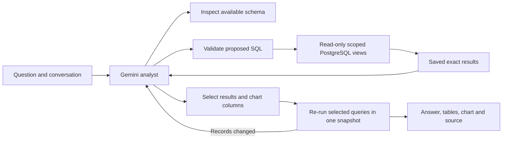

# A flexible analyst over Daybook's books

This replacement is integrated in candidate `51edf9a4bec987a628482f7c3dfe2b5cf3ef340b` and is under verification. Querio is already promoted in Ask → Querio. The new native analyst is not yet enabled on the hosted app, and no comparative answer score exists.

## What is verified now

Full CI `41746825331` has passed verification, native research and Compose. The first native paid acceptance cohort was dispatched exactly once at this source as run41748017431 and is in setup; results and usage receipts are pending. The source has an unpromoted staged deployment, `dpl_FX2LXjyEiKnB1jzGc8xdTw5TttTA`; hosted native acceptance is not complete. The earlier failed migration and reference-query runs remain recorded in the build log. The completed checks include 3,291 normal tests, 11 separate fixture tests, four completeness tests and 50 browser workflows. Compose passed 3,290 overlapping tests plus persistence checks; research passed 30 TypeScript tests. Successful engineering checks do not establish actual-model accuracy.

Production has migrations 001–008. Migration 009 is applied to the new acceptance database and is immutable, with checksum `33888d598e03fffa500db1ead1fc4e931408bed751ce06b480997defc670d919`. It has not been applied to production. The release must retain the existing entry/categorization flow and enable the new chat only after its acceptance checks.

The fresh fixture has 59 entries and 118 lines across two fictional businesses. An actual PostgreSQL audit checked every row, 38 independent reference facts, all nine migration hashes and the restricted reader's tenant isolation. Fingerprints stayed unchanged. Querio is connected to the same fixture through eight views that permanently filter the primary business. Changing a session's organization setting cannot expose the other business. Its catalog and accounting guidance were read back and matched exactly; other datasources and global LIVE guidance were unchanged. [Fixture and datasource evidence](evidence/native-analyst-fixture.json).

The shared new-task model allowance is $5. Gemini had a recorded total of $0 before the first native cohort was dispatched. Its usage receipt is pending; that does not mean the dispatched work is free. Thirteen observed Querio model responses are earlier integration checks; fixture provisioning and datasource setup made no model calls. Included Querio credits and token estimates are not verified invoice totals.

## What changed

The previous assistant chose from a menu of predefined financial operations. That made the accounting calculations predictable, but could leave a valid question unfinished when it needed a different calculation. The new analyst writes read-only PostgreSQL queries over eight workspace-scoped views. It can combine records, calculate new ratios, compare periods, rank vendors, inspect drafts, and explore explicitly labeled scenarios.

For example, “What percentage of each month's spending was rent?” needs three jobs: find each month's net rent, find each month's net expenses, and divide the two. PostgreSQL performs that calculation using exact `NUMERIC` values. The model chooses the question's meaning and explains the result; it does not supply invented chart values.

The same notebook interface serves Daybook and Querio. Their conversations and model histories are separate. Reloading an answer reads saved results and does not call a model.

## Boundaries and recovery

The analyst has three tools: inspect the available schema, execute a query, and publish a notebook. The query tool accepts general SELECTs, including joins, CTEs and windows. A PostgreSQL parser checks the entire syntax tree, and a separate restricted database role can read only the exposed views. Views filter the selected business. A read-only transaction, query deadlines and bounded outputs provide additional controls. These are execution protections, not a proof that the query matches the user's intent.

Posted entries and drafts remain distinguishable. A visible $180 Figma draft is a pending record, not evidence of a bank payment. Stored foreign-currency conversions are carrying values, not today's exchange rates. Existing anomaly alerts are warnings with a defined scope, not an exhaustive fraud assessment.

Each model step and each tool phase is saved under a database lease. Model messages retain signed tool-call metadata across follow-ups. A lost response after dispatch is marked uncertain and is not blindly resubmitted. Stop prevents later work; an already dispatched request may still incur a charge. The server records a conservative reservation before every provider HTTP request, including automatic continuations. Missing usage stays reserved. A turn has a $0.50 tracked allowance; the separate evaluation has the user's $5 shared ceiling. Neither is a provider invoice or a universal billing guarantee.

Queries can return at most 200 rows; a truncated preview never claims that its row count is the complete total. Charts are assembled from saved server-side result columns. Before publication, selected queries run together in a fresh read-only snapshot. Changed results are sent back for revision. This detects stale values; it does not prove every sentence, assumption or selected denominator correct.

## How the comparison is evaluated

The independent fixture defines known books and arithmetic using Python Decimal. Both routes must receive the same fixture, business date, context and question sequence. Engineering tests check isolation, arithmetic, persistence, cancellation, tool history and rendering. Actual-model runs separately check whether the answer finishes the question, uses the right records and period, distinguishes drafts, and includes the requested chart. Different provider models are a comparison of complete products, not an experiment isolating architecture alone.

The initial declared subset is six conversations/ eight turns: A01, A05, A06, A07, A11 and A18. The other twelve conversations remain outside that first score. Preserve failed attempts and report improvements as new attempts; do not replace a failure with a rerun or pool different source versions. No superiority claim is supported until those results exist.

For a concrete test, the fixture contains a Figma record dated November3 that is still a draft. Both analysts can see it. A useful answer says that the record exists, gives its amount and explains that it has not been posted; “nothing found” and “you paid it” both miss an important part of the question. Another test asks for monthly rent percentages and a chart. The reviewer checks the actual calculated percentages and saved chart, not merely whether the model said it created one.

The comparison does not reopen the older QuickJS/generated-analysis, Gemini/Jev categorization, vector/File Search or Wren studies. Those retain their original sources, outcomes and spending. This candidate's frozen questions and independent expected values are in `tests/analyst-workspace-acceptance/`; expected answers and grading rules are not supplied to either model.

## Bounded completion after the first actual-model run

The initial six-case/eight-turn capture delivered only three turns. Successful calculations sometimes consumed every investigation step before the model published its answer. The current candidate therefore shows the model its remaining work allowance and reserves two final generations for publication or correcting its table/chart choices. Those final generations cannot start new SQL or schema reads; the server independently enforces this restriction. They can recheck the already saved queries before publishing. The existing per-turn spending limit still applies. Original failed captures are retained; this is a repair awaiting a fresh live test, not a revised score for the failed run.
