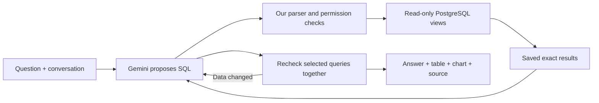

# Daybook's flexible financial analyst

Daybook has two analyst tabs with the same conversation and notebook interface. Querio is already released. Our native Gemini analyst is implemented and under verification. Cohort c is running and has observed transport failures; a separate recovery candidate d is implemented but not yet committed or released. The current source and release receipt belong in [CHECKPOINT](../CHECKPOINT.md), not in an assumption that the latest code is already live.

## What the model does, and what our code does

Think of an assistant who can read the books, ask the database questions and prepare a notebook. It cannot change the ledger. A notebook shows the answer, supporting rows, charts and the query used to get them.

The previous chat selected prepared financial operations. The replacement can write a new PostgreSQL `SELECT` query for the user's question. For example, a monthly rent percentage needs each month's net rent and net expenses, then rent divided by expenses. The model chooses that calculation; PostgreSQL calculates with exact `NUMERIC` values. A different question can produce a different query without adding a new function for every metric.

We wrote three general tools. They are application code, not built-in Gemini accounting features:

| Tool               | Responsibility                                                                                               |
| ------------------ | ------------------------------------------------------------------------------------------------------------ |
| `inspect_schema`   | Explain the available views, fields, business date and accounting definitions.                               |
| `query_sql`        | Validate and execute a bounded, read-only query for the selected business; retain its exact returned values. |
| `publish_notebook` | Select saved query IDs and columns, recheck their results, and publish notes, tables and charts.             |

The model can use joins, groups, windows, ratios, distributions and explicit scenarios. This is flexible SQL inside an enforced read boundary. A safe query can still answer the wrong question; syntax and permissions do not prove business meaning.

## Walkthrough: the Figma record

The fictional acceptance books contain a $60 Figma draft dated November 3, with a Software debit and a company-card liability credit. A **draft** means the entry has not been posted into these books. It is not proof that an external payment has or has not happened: someone could enter an already-paid purchase as a draft.

For “How much did I pay Figma on November 3?”, a useful answer identifies the matching $60 draft, distinguishes it from posted records, and explains that the books do not establish bank/card settlement. Saying only “nothing found” hides the record. Saying “paid” or “unpaid” from draft status alone overclaims the evidence. Even a posted card charge records a liability; it does not prove a bank payment cleared.

This $60 example is from the acceptance fixture. The hosted live books are a different dataset. Tests and live sources must never be substituted for each other.

## Financial scenarios need real inputs

When a user asks whether they can afford a hire, recorded cash alone cannot decide it. The analyst should summarize the known baseline and ask for employee cost and planning assumptions. Salary tiers, tax rates and reserve targets must not be invented. Explicitly requested hypothetical inputs remain labeled, and SQL calculates their effects. A draft or liability total is not automatically an unpaid future cash outflow. The initial hiring answer in cohort c violated these rules; it remains a failed example, and the revised instructions require a fresh live check.

## Database and execution boundaries

Migrations 001–009 are applied to production and the isolated acceptance database and are immutable. Migration 009 creates eight `analytics` views: organization, currencies, accounts, entries, lines, ledger, recurring and alerts. The native reader role can read these views, with organization scoping; it cannot write the ledger or read arbitrary internal tables. The isolated Querio comparison has its own eight fixed-business views. Its session organization setting cannot widen access to the second test business.

The server parses the full PostgreSQL syntax tree and restricts statements, objects and functions. Queries run under the reader role in a read-only transaction with deadlines. Output is bounded to 200 rows and 40 columns; a truncated preview does not imply a known full count. At publication, up to four referenced queries run together in a fresh snapshot. Changed results require reconsideration. Chart values come from server-held results, never arrays invented by the model. Unsupported or malformed chart data produces a useful failure instead of executing provider HTML or JavaScript.

These checks protect records and preserve evidence. They cannot guarantee that every chosen date, denominator or explanatory sentence is correct. Missing bank statements, payroll assumptions and future events must remain missing evidence or explicitly supplied scenario assumptions.

## Durable conversations, recovery and cost

The native adapter uses the pinned Vercel AI SDK with Gemini 3.8 Flash, separately from whole-entry and category providers. Each model step and tool phase is saved in PostgreSQL under a lease. Provider tool-call metadata survives follow-ups. The actual SDK integration supplies exactly one result for each attempted tool call, including invalid-tool errors.

There are ten investigation generations and two reserved publication-only generations. The final two cannot start new schema reads or SQL investigations; they finish from saved evidence, repair publication arguments, or disclose an incomplete answer. Every HTTP model request receives a conservative cost reservation before dispatch. Missing usage remains reserved. The configured per-turn tracked limit is $0.50; evaluation additionally shares the user's $5 task ceiling. Estimates are not invoices or a provider billing guarantee.

Saved conversations use stable UUIDs for creation and messages. Repeating an ID with different text conflicts. GET restores saved state without generation; refresh advances previously authorized work. A request left pending after a worker crash is not replayed. Candidate d permits one fresh inference on a later lease after a caught timeout or network failure, only after all accounting callbacks settle and the next request passes the existing budget checks. No failed model tool output is executed. The prior uncertain reservation stays in the ledger even if recovery succeeds. This is a separate attempt, not a relabeling of the failed request.

Candidate d raises the model-request deadline from 30 to 40 seconds while keeping the ten investigation/two publication generation limits. It retains up to 20 safe failure records across follow-ups: correlation and generation IDs, elapsed time, error category and receipt status, without prompts or credentials. An unsettled accounting callback, a budget denial or crash-pending generation cannot use the recovery path. Neither can a failure after a model result has already been received, even if saving it fails. Stop prevents subsequent work; an already sent request can still cost money. Focused tests passed 49 service, 24 adapter and two actual-SDK cases, plus TypeScript. PostgreSQL persistence and full CI remain pending for this new patch.

The shared UI shows progress, errors, Stop, tables and safe chart output. Provider tabs keep their histories separate. Native availability is advertised by `/api/meta`; when the native analyst is unavailable, the existing Daybook chat remains accessible. The manual entry, reviewed posting, categorization and financial-report paths retain their existing validation.

## What we measured

The frozen fictional fixture contains 59 entries / 118 lines across two businesses. Independent Python Decimal code derives 38 facts; actual database audits verify every loaded row, tenant isolation and unchanged fingerprints. Models receive business context and questions, not the answer sheet.

| Run                        | Delivered turns | Review outcome with recorded application rendering                                                               |
| -------------------------- | --------------: | ---------------------------------------------------------------------------------------------------------------- |
| Native a, source `51edf9a` |             3/8 | Three correct delivered answers; four step-limit failures and one skipped follow-up.                             |
| Native b, source `f032d70` |             8/8 | Correct requested numbers 8/8; requested scope 7/8; all-claims strict pass 6/8, including chart replay.          |
| Querio, Sonnet 5.5         |             8/8 | Strict pass 6/8, including chart replay; small rounding-order errors and follow-up scope drift.                  |
| Native c, source `4fd3015` |           12/14 | Run `41754286233` closed: 6/8 matched and 6/6 extra delivered; two transport failures. Financial review pending. |
| Recovery candidate d       |         Not run | One bounded transport recovery is implemented; no model score or release yet.                                    |

The original failure showed that correct calculations hidden in tool history are not a delivered answer. Native b fixed completion but still changed a year-to-date window to completed months and inferred “not settled” from a draft. Querio's two numerical errors were 0.01 percentage points: averaging rounded ratios and adding rounded shares. The underlying monetary amounts were correct. Preserve these distinctions and all original failures.

The matched comparison is six conversations/eight turns/two requested charts. The additional native-only checks are four conversations/six turns/one chart, including mean/median, hiring assumptions, missing bank evidence and attempted posting. They do not increase the matched score denominator. Actual saved chart data, replayed browser rendering and hosted product checks are different evidence and must be reported separately.

This compares complete configured products: native Gemini 3.8 Flash versus Querio with Sonnet 5.5. Different models, software and development feedback prevent an architecture-only causal claim. The authored development subset is not a blind holdout, independent accountant certification, universal accuracy result or proof of million-user capacity. Older Jev, File Search, pgvector, Wren and generated-analysis experiments retain their separate sources and closed budgets; they are not silently added to this route.
