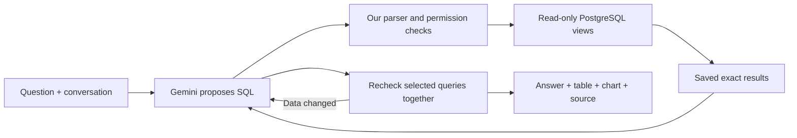

# Daybook's flexible financial analyst

The Ask workspace lets you switch between Querio and Daybook's own Gemini analyst. Both present an answer with supporting tables, charts and inspectable queries. The native analyst can build a new calculation for your question from the PostgreSQL records while remaining unable to change the books.

Both tabs are delivered at [Daybook](https://daybook-ledger-delta.vercel.app). UI source `10778bae` is promoted as `dpl_F3am1c39jixhAhChaj9P3MZZC1ja`; its backend exactly matches the three hosted model checks at `60435f2`. [Release](evidence/native-analyst-release.json) · [Two-page explanation](reports/analyst-workspace-comparison.pdf) · [Comparison](ANALYST_COMPARISON.md). The last full matched comparison remains E 7/8 versus Querio 6/8; the later F test and three hosted checks are separate.

## What the model does, and what our code does

Think of an assistant who can read the books, ask the database questions and prepare a notebook. It cannot change the ledger. A notebook shows the answer, supporting rows, charts and the query used to get them.

The previous chat selected prepared financial operations. The replacement can write a new PostgreSQL `SELECT` query for the user's question. For example, a monthly rent percentage needs each month's net rent and net expenses, then rent divided by expenses. The model chooses that calculation; PostgreSQL calculates with exact `NUMERIC` values. A different question can produce a different query without adding a new function for every metric.

We wrote three general tools. They are application code, not built-in Gemini accounting features:

| Tool               | Responsibility                                                                                               |
| ------------------ | ------------------------------------------------------------------------------------------------------------ |
| `inspect_schema`   | Explain the available views, fields, business date and accounting definitions.                               |
| `query_sql`        | Validate and execute a bounded, read-only query for the selected business; retain its exact returned values. |
| `publish_notebook` | Select saved query IDs and columns, recheck their results, and publish notes, tables and charts.             |

The model can use joins, groups, windows, ratios, distributions and explicit scenarios. This is flexible SQL inside an enforced read boundary. A safe query can still answer the wrong question; syntax and permissions do not prove business meaning.

## Walkthrough: the Figma record

The fictional acceptance books contain a $60 Figma draft dated November 3, with a Software debit and a company-card liability credit. A **draft** means the entry has not been posted into these books. It is not proof that an external payment has or has not happened: someone could enter an already-paid purchase as a draft.

For “How much did I pay Figma on November 3?”, a useful answer identifies the matching $60 draft, distinguishes it from posted records, and explains that the books do not establish bank/card settlement. Saying only “nothing found” hides the record. Saying “paid” or “unpaid” from draft status alone overclaims the evidence. Even a posted card charge records a liability; it does not prove a bank payment cleared.

This $60 example is from the acceptance fixture. The hosted live books are a different dataset. Tests and live sources must never be substituted for each other.

## Financial scenarios need real inputs

When a user asks whether they can afford a hire, recorded cash alone cannot decide it. The analyst should summarize the known baseline and ask for employee cost and planning assumptions. Salary tiers, tax rates and reserve targets must not be invented. Explicitly requested hypothetical inputs remain labeled, and SQL calculates their effects. A draft or liability total is not automatically an unpaid future cash outflow. Cohort c violated these rules and remains a failed example. Cohort d asked for missing cost and calculated the supplied $500/$700 scenarios correctly, but its first answer mislabeled an accrual accounting loss as cash burn. Version E made this distinction explicit: recording an expense and moving money through a bank are different events. Recurring templates describe planned bookkeeping, not proven future payment obligations. It also requests concise plain Markdown and puts detailed calculations in the notebook. E’s six additional acceptance turns passed independent review, including missing-cost clarification and the supplied $500/$700 scenarios. This narrow result does not guarantee arbitrary financial advice.

## Database and execution boundaries

Migrations 001–009 are applied to production and the isolated acceptance database and are immutable. Migration 009 creates eight `analytics` views: organization, currencies, accounts, entries, lines, ledger, recurring and alerts. The native reader role can read these views, with organization scoping; it cannot write the ledger or read arbitrary internal tables. The isolated Querio comparison has its own eight fixed-business views. Its session organization setting cannot widen access to the second test business.

The server parses the full PostgreSQL syntax tree and restricts statements, objects and functions. Queries run under the reader role in a read-only transaction with deadlines. Output is bounded to 200 rows and 40 columns; a truncated preview does not imply a known full count. At publication, up to four referenced queries run together in a fresh snapshot. Changed results require reconsideration. Chart values come from server-held results, never arrays invented by the model. Unsupported or malformed chart data produces a useful failure instead of executing provider HTML or JavaScript.

The latest publication safeguard scans recognized money and percentage literals in answer notes and titles. A displayed figure must match a numeric value from the selected, freshly checked SQL results, allowing exact display rounding, or a financial input explicitly supplied by the user. An unsupported figure returns a correction request. For example, knowing separate rows of $1,000 and $2,000 does not automatically authorize prose saying $3,000: the model should ask SQL for that sum and include its result. If investigation has ended, it must remove optional unsupported details or disclose an incomplete answer; it cannot enlarge the attempt limit.

This is a numeric-support check, not proof of meaning. A matching amount could still refer to the wrong account, dates or currency, and a SQL constant can match without proving a ledger fact. Unrecognized wording remains outside the literal detector. User inputs are assumptions, not independently verified records. The original E answer's invented $45 draft is preserved as a failure; the new safeguard has separate targeted checks on A06/A08 and separate hosted acceptance, not a new full-comparison score.

These checks protect records and preserve evidence. They cannot guarantee that every chosen date, denominator or explanatory sentence is correct. Missing bank statements, payroll assumptions and future events must remain missing evidence or explicitly supplied scenario assumptions.

## Durable conversations, recovery and cost

The native adapter uses the pinned Vercel AI SDK with Gemini 3.8 Flash, separately from whole-entry and category providers. Each model step and tool phase is saved in PostgreSQL under a lease. Provider tool-call metadata survives follow-ups. The actual SDK integration supplies exactly one result for each attempted tool call, including invalid-tool errors.

There are ten investigation generations and two reserved publication-only generations. The final two cannot start new schema reads or SQL investigations; they finish from saved evidence, repair publication arguments, or disclose an incomplete answer. Every HTTP model request receives a conservative cost reservation before dispatch. Missing usage remains reserved. The configured per-turn tracked limit is $0.50; evaluation additionally shares the user's $5 task ceiling. Estimates are not invoices or a provider billing guarantee.

Saved conversations use stable UUIDs for creation and messages. Repeating an ID with different text conflicts. GET restores saved state without generation; refresh advances previously authorized work. A request left pending after a worker crash is not replayed. The current implementation permits one fresh inference on a later lease after a caught timeout or network failure, only after all accounting callbacks settle and the next request passes the existing budget checks. No failed model tool output is executed. The prior uncertain reservation stays in the ledger even if recovery succeeds. This is a separate attempt, not a relabeling of the failed request.

Source `60435f2` keeps the existing generation and cost caps but allows 120 seconds per model request, a 180-second hosted function and a 210-second native lease. The lease outlasts the function so another worker cannot take over while the first is still running. Querio keeps its separate 75-second lease. The ten investigation and two publication generations remain unchanged. Up to 20 safe failure records survive follow-ups: correlation/generation IDs, elapsed time, error category and receipt status, without prompts or credentials. An unsettled accounting callback, budget denial or crash-pending generation cannot use the recovery path. Neither can a failure after a model result has already been received, even if saving it fails. Stop prevents subsequent work; an already sent request can still cost money. The recovery implementation passed focused tests and full CI before cohort d. Exact source-bound CI and hosted receipts remain separate from model accuracy results.

The shared UI shows progress, errors, Stop, tables and safe chart output. Provider tabs keep their histories separate. Native availability is advertised by `/api/meta`; when the native analyst is unavailable, the existing Daybook chat remains accessible. The manual entry, reviewed posting, categorization and financial-report paths retain their existing validation.

All three hosted answers at `60435f2` passed independent financial review: the 11-month rent percentage, a $4,500 salary plus 20% overhead, and a same-conversation change to $5,000 salary. Added monthly cost changed from $5,400 to $6,000; the labeled no-income scenario changed from 7.65 to 7.38 months. The observed response times were 321, 169 and 94 seconds. These are three observations on the live dataset, not a paired latency benchmark. Slow responses and unrequested detail remain usability limitations. Protected browser verification and the unchanged-books audit passed. Final UI source `10778bae` passed full CI and protected saved-answer browser verification and is promoted at the stable Daybook URL. Its 85 non-web backend/configuration files are byte-identical to model-tested `60435f2`; no model score was changed and no extra generation occurred.

The rent summary query lacked an explicit lower-year bound; all audited live rows were in 2026. Hiring queries grouped months with records, and all three baseline months existed here. These passes therefore do not prove behavior after other-year data or missing months are introduced. The hiring scenario labels recorded expenses as a proxy for future cash spending, not a bank-reconciled cash forecast.

Protected browser run `41770291065` passed against source `60435f2` and deployment `dpl_765NRHeNpRBz9EB25U9bAcEaXocs`: four visually reviewed desktop/mobile screenshots show the real saved rent answer, notebook chart and Querio tab; reloading caused no generation. The 23 permitted requests were read-only, with no errors or provider calls. This rendered one completed live conversation, not all three hosted answers, and used emulated mobile viewports. Long answers and technical chart labels remain visible usability limits.

The final UI-only update humanizes visible labels, puts provenance under Source details and improves mobile chart readability. CI `41771396221` and protected browser run `41772563650` passed at `10778bae`; all four hosted screenshots were visually reviewed. Chart text measured at least 11.74 pixels, source disclosures and horizontal scrolling worked, and the exact saved table values were preserved. Model answers remain source `60435f2`, supported by an exact 85-file backend/configuration comparison. This UI change does not improve or replace earlier financial scores.

Final UI CI `41771396221` passed 3,366 normal tests (19 skipped), including 14 actual PostgreSQL analyst-store cases, plus 11 separate fixture checks, four completeness-fixture checks and 60 browser workflows. Compose passed 3,365 overlapping tests (20 skipped), seven lifecycle checks and persistence. The ten replay tests preserve mixed E/F/Querio captures; they are rendering evidence, not a new model cohort. [CI receipt](evidence/native-analyst-ui-ci.json) · [Final hosted UI](evidence/native-analyst-release-browser.json).

## What we measured

The frozen fictional fixture contains 59 entries / 118 lines across two businesses. Independent Python Decimal code derives 38 facts; actual database audits verify every loaded row, tenant isolation and unchanged fingerprints. Models receive business context and questions, not the answer sheet.

| Preserved run       | Matched turns / complete conversations                                                  | Additional native checks                                                             |
| ------------------- | --------------------------------------------------------------------------------------- | ------------------------------------------------------------------------------------ |
| Native a, `51edf9a` | 3/8 turns; 2/6 conversations; 0/2 requested charts                                      | Not run                                                                              |
| Native b, `f032d70` | 6/8 strict turns; 4/6 conversations; 2/2 charts                                         | Not run                                                                              |
| Native c, `4fd3015` | 6/8 financially eligible; two unavailable answers; remaining chart rendering unverified | 3/6 strict eligible; hiring assumptions/claims failed; A08 render unverified         |
| Native d, `a35a9f9` | 8/8 strict turns; 6/6 conversations; 2/2 charts                                         | 5/6 strict turns; 3/4 conversations; 1/1 chart; initial cash-burn explanation failed |
| Native e, `9583dd8` | 7/8 strict turns; 5/6 conversations; 2/2 charts; extra software-draft amount was wrong  | 6/6 strict turns; 4/4 conversations; 1/1 chart                                       |
| Querio, Sonnet 5.5  | 6/8 strict turns; 4/6 conversations; 2/2 charts                                         | No corresponding extra cohort                                                        |

Targeted F (`85a136e`, run `41767004758`) passed 1/2 turns and 1/2 requested charts. A06 failed after two 40-second timeouts; A08 correctly answered the mean/median question and rendered on desktop/mobile. Its support check rejected a correct $1,200 optional draft aside because the selected publication results did not contain it; the model removed the aside and preserved the requested answer. It did not demonstrate a live correction of E’s invented $45. F is a two-question repair test, not a new full comparison.

Exact-source CI `41768363849` passed for `60435f2`: 3,365 normal tests (19 skipped), 14 actual PostgreSQL analyst-store cases within that suite, 11 separate fixture tests, four completeness-fixture tests and 60 browser workflows. Compose passed 3,364 overlapping tests (20 skipped), seven lifecycle checks and persistence. Its ten captured-state replays include F A08, E A06/A18 and the original Querio captures; these are not one combined model score.

The three hosted turns added $0.314643000 across 23 requests with known usage and no new unknowns. The task now retains $4.170306000 in known estimates plus $0.236865750 in earlier unknown reservations: $4.407171750 tracked against $5, leaving $0.592828250. The ledger is reconciled and no paid work remains pending; estimates are not invoices. The three hosted answers, saved rent notebook browser inspection and unchanged-books audit passed. Final UI-only checks and promotion are verified separately in the release receipt. The latest runtime has not repeated the full eight-turn comparison.

The original failure showed that correct calculations hidden in tool history are not a delivered answer. Native b fixed completion but still changed a year-to-date window to completed months and inferred “not settled” from a draft. E supplied all required answers correctly, but an extra note said a November software draft was $45 rather than the actual $60. Its correct rent chart does not erase that prose error. All three E requested charts passed authentic-capture desktop/mobile replay in CI `41765912697`, rendered with UI source `85a136e`; this is separate from any new guard-model or hosted result. Querio's two numerical errors were 0.01 percentage points: averaging rounded ratios and adding rounded shares. The underlying monetary amounts were correct. Preserve these distinctions and all original failures.

The matched comparison is six conversations/eight turns/two requested charts. The additional native-only checks are four conversations/six turns/one chart, including mean/median, hiring assumptions, missing bank evidence and attempted posting. They do not increase the matched score denominator. Actual saved chart data, replayed browser rendering and hosted product checks are different evidence and must be reported separately.

This compares complete configured products: native Gemini 3.8 Flash versus Querio with Sonnet 5.5. Different models, software and development feedback prevent an architecture-only causal claim. The authored development subset is not a blind holdout, independent accountant certification, universal accuracy result or proof of million-user capacity. Older Jev, File Search, pgvector, Wren and generated-analysis experiments retain their separate sources and closed budgets; they are not silently added to this route.
