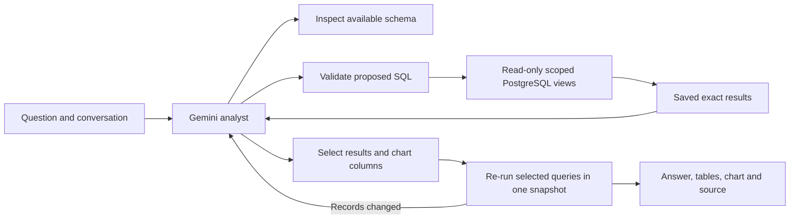

# A flexible analyst over Daybook's books

This replacement is under verification. Querio is already available in Ask → Querio; a successful notebook integration does not establish that the new Daybook analyst answers better.

## What changed

The previous assistant chose from a menu of predefined financial operations. That made the accounting calculations predictable, but could leave a valid question unfinished when it needed a different calculation. The new analyst writes read-only PostgreSQL queries over eight workspace-scoped views. It can combine records, calculate new ratios, compare periods, rank vendors, inspect drafts, and explore explicitly labeled scenarios.

For example, “What percentage of each month's spending was rent?” needs three jobs: find each month's net rent, find each month's net expenses, and divide the two. PostgreSQL performs that calculation using exact `NUMERIC` values. The model chooses the question's meaning and explains the result; it does not supply invented chart values.

The same notebook interface serves Daybook and Querio. Their conversations and model histories are separate. Reloading an answer reads saved results and does not call a model.

## Boundaries and recovery

The analyst has three tools: inspect the available schema, execute a query, and publish a notebook. The query tool accepts general SELECTs, including joins, CTEs and windows. A PostgreSQL parser checks the entire syntax tree, and a separate restricted database role can read only the exposed views. Views filter the selected business. A read-only transaction, query deadlines and bounded outputs provide additional controls. These are execution protections, not a proof that the query matches the user's intent.

Posted entries and drafts remain distinguishable. A visible $180 Figma draft is a pending record, not evidence of a bank payment. Stored foreign-currency conversions are carrying values, not today's exchange rates. Existing anomaly alerts are warnings with a defined scope, not an exhaustive fraud assessment.

Each model step and each tool phase is saved under a database lease. Model messages retain signed tool-call metadata across follow-ups. A lost response after dispatch is marked uncertain and is not blindly resubmitted. Stop prevents later work; an already dispatched request may still incur a charge. The server records a conservative reservation before every provider HTTP request, including automatic continuations. Missing usage stays reserved. A turn has a $0.50 tracked allowance; the separate evaluation has the user's $5 shared ceiling. Neither is a provider invoice or a universal billing guarantee.

Queries can return at most200 rows; a truncated preview never claims that its row count is the complete total. Charts are assembled from saved server-side result columns. Before publication, selected queries run together in a fresh read-only snapshot. Changed results are sent back for revision. This detects stale values; it does not prove every sentence, assumption or selected denominator correct.

## How the comparison is evaluated

The independent fixture defines known books and arithmetic using Python Decimal. Both routes must receive the same fixture, business date, context and question sequence. Engineering tests check isolation, arithmetic, persistence, cancellation, tool history and rendering. Actual-model runs separately check whether the answer finishes the question, uses the right records and period, distinguishes drafts, and includes the requested chart. Different provider models are a comparison of complete products, not an experiment isolating architecture alone.

The initial declared subset is six conversations/eight turns: A01, A05, A06, A07, A11 and A18. The other twelve conversations remain outside that first score. Preserve failed attempts and report improvements as new attempts; do not replace a failure with a rerun or pool different source versions. No superiority claim is supported until those results exist.
