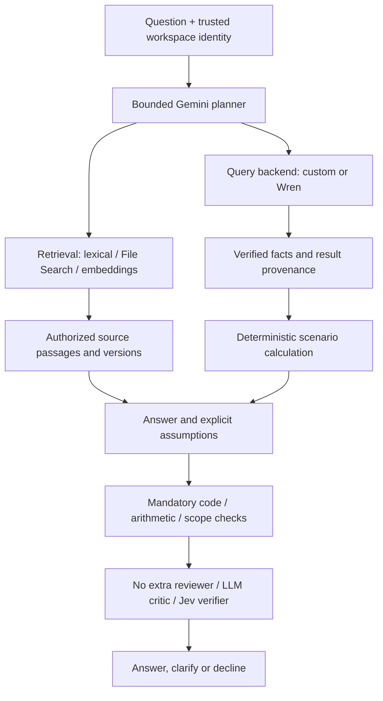

# Daybook comparative AI research plan

> **Planning only — 2026-10-30.** The user explicitly requested multiple experimental routes, a validation agent and paper-style comparison, and explicitly said **do not implement yet**. This document authorizes no integration, provider spend, indexing, migration, deployment or experiment execution. The current working application remains the baseline. Read [CHECKPOINT.md](../CHECKPOINT.md) for runtime and verification state.

## Objective and honest baseline

Determine which architecture broadens useful financial assistance while retaining financial correctness, source grounding, workspace isolation, reasonable latency and explainable operating cost. Produce a reproducible engineering study, not a promise of perfect accuracy or publication-grade statistical power.

The current application uses Gemini `gemini-3.1-flash-lite`, four financial query families plus clarification, structured transaction proposals, PostgreSQL text/history/correction retrieval, strict Zod/account/money validation and immutable posted bookkeeping. Full CI on `7ecb435c421862dba5efd4e3b6f743c93fd1888e` passed **103 backend tests, 10 browser workflows, native hosted imports and Docker startup/persistence**. Selected live questions and a review-only proposal passed; intermittent provider errors were observed. Those are engineering checks, not a completed live-model benchmark.

File Search, custom embeddings/pgvector, Jev, Wren, multi-step analytical planning, scenario analysis and a second-model validator are **proposed, not implemented**. The previous 40-case harness is a useful regression fixture, not sufficient evidence for the broader research questions.

## Questions and hypotheses

| ID  | Research question                                                                                     | Comparison that answers it                                                  |
| --- | ----------------------------------------------------------------------------------------------------- | --------------------------------------------------------------------------- |
| H1  | Does a broader query/scenario interface improve coverage without wrong financial results?             | R1 versus R0, with both common-capability and whole-benchmark results       |
| H2  | Does document retrieval improve document-backed and mixed financial questions?                        | R2 versus R1; report by task family                                         |
| H3  | Does managed File Search outperform lexical or custom hybrid retrieval for this corpus?               | R3 versus R2 and R4, holding generation/query capability fixed              |
| H4  | Do Gemini embeddings improve semantic evidence retrieval beyond lexical matching?                     | R4 versus R2, with the same corpus/chunks/context budget where controllable |
| H5  | Does Jev reranking improve evidence selection enough to justify cost/latency?                         | R5 versus R4                                                                |
| H6  | Does Wren improve complex analytical query correctness/coverage over the custom semantic query layer? | R6 versus R4, with the same approved metric definitions and retrieval       |
| H7  | Does an LLM critic or Jev verifier reduce harmful accepted answers without excessive false blocks?    | R7/R8 versus R4 and a separate error-injection benchmark                    |

These are hypotheses to test, not expected findings to manufacture. A simpler route winning is a useful result.

## Separate the components

The proposed architecture has three independently replaceable parts:

1. **Query and calculation:** current fixed tools, a custom semantic query-plan compiler, or Wren. This determines which structured financial questions can be answered.
2. **Retrieval:** none, lexical search, Gemini managed File Search, or Gemini embeddings with pgvector/hybrid retrieval. This determines which supporting documents/examples are available.
3. **Semantic verification:** none beyond mandatory code checks, an independent LLM reviewer, or Jev. This attempts to detect interpretation/evidence errors.

Do not call a cumulative sequence “A, then A+B, then A+B+C” an isolated comparison. Changing several parts together makes improvements impossible to attribute. First compare controlled components; combine winners only under a predeclared selection rule.

A semantic reviewer cannot authorize a query or posting that code/database checks reject. Every route keeps the same financial invariants. No experimental chat or evaluator can post model-generated entries.

## Nine primary configurations

All new routes below share the broader capability foundation defined in the next section. R0 is deliberately retained as the narrower deployed control.

| Route                      | Query/calculation                                | Retrieval                                                           | Extra semantic reviewer | Variable being tested                                 |
| -------------------------- | ------------------------------------------------ | ------------------------------------------------------------------- | ----------------------- | ----------------------------------------------------- |
| **R0 Current control**     | Existing four financial tools                    | Existing SQL/text history and corrections; no documents             | None                    | Current product behavior, reliability, cost and scope |
| **R1 Broad tools**         | Custom semantic query plan + scenario calculator | Existing history/corrections only                                   | None                    | Broader analytical capability                         |
| **R2 Lexical documents**   | Same as R1                                       | Fixed-corpus lexical document retrieval + existing context          | None                    | Adding documents without embeddings                   |
| **R3 Managed File Search** | Same as R1                                       | Gemini File Search over the same document corpus + existing context | None                    | Managed document retrieval                            |
| **R4 Custom hybrid**       | Same as R1                                       | Gemini embeddings + pgvector and lexical search + existing context  | None                    | Explicit semantic/hybrid retrieval                    |
| **R5 Jev reranking**       | Same as R1                                       | Same R4 candidate pool, with Jev reranking only                     | None                    | Evidence ranking, not answer verification             |
| **R6 Wren analytics**      | Wren-backed queries; same scenario calculator    | Same as R4                                                          | None                    | Query/semantic-layer backend                          |
| **R7 LLM verifier**        | Same as R1                                       | Same as R4                                                          | Independent LLM critic  | Added answer verification                             |
| **R8 Jev verifier**        | Same as R1                                       | Same as R4                                                          | Jev checks              | Alternative semantic verifier                         |

R4 is the fixed reference for R5–R8 so that retrieval selection does not confound the first component comparisons. Once development results are available, at most two finalists may receive a combined configuration selected by a rule written before held-out testing. If both reranking and verification appear useful, remove each separately from that combined configuration to measure its contribution. Do not add combinations after seeing held-out failures without a new evaluation version.

Jev categorization is an optional **separate secondary study**, not silently bundled into R5/R8: compare Gemini-only category suggestions with Gemini plus Jev Choice over the same active account candidates. Keep examples/thresholds fixed and evaluate wrong-category acceptance and unnecessary clarification. Any such additional configurations require their own declared call budget before execution.

## Shared broader capability foundation

A retrieval feature alone does not create flexible SQL analysis. R1–R8 need a common accounting-aware interface before their retrieval/reviewer effects can be compared fairly:

- Versioned definitions for posted revenue, expenses, cash, receivables, liabilities, currency carrying values, period boundaries and reversal treatment.
- Approved fields, dimensions, joins and filters. The custom backend accepts a typed analytical plan and compiles it to reviewed parameterized SQL; it does not expose an arbitrary database console.
- Bounded multi-step read-only investigations that can group by period/account/vendor, compare periods, drill into changes and combine relevant facts.
- A deterministic scenario calculator for cash runway and hiring scenarios, using explicit salary/benefit/start-date/reserve/payment assumptions. Historical average cash flow is an estimate, not a guaranteed future receipt.
- Explicit clarification when important assumptions or supporting data are missing. Responses distinguish observed facts, contractual commitments, assumptions and forecasts.
- Evidence identifiers and a consistent financial snapshot for the facts in one answer. If a coherent snapshot cannot span a backend's multi-step calls, record its version/timing and mark that comparison limitation.

### Wren fairness and isolation

Give custom analytics and Wren the same reviewed business definitions, approved views, fixtures and permitted workspace scope. Wren's own context/indexing and planning behavior must be pinned and recorded. If its internal retrieval/model cannot be held equal, label the result an **end-to-end backend comparison**, not proof that one isolated algorithm is better.

Use an isolated evaluation database with a role that can read only approved, workspace-scoped analytical views. Do not connect an experimental engine with the migration owner or give it unrestricted access to production journal tables. Enforce scope in database permissions/views or equivalent trusted controls, not a prompt instruction. Read-only execution alone is insufficient: approved functions/relations, statement deadlines, result limits and resource controls are still required.

Confirm the selected Wren revision's APIs, model compatibility, license and feature boundaries before implementation. The reviewed README places some row/column security and enterprise functionality in commercial offerings; do not assume installing the OSS package creates tenant isolation. If a necessary capability cannot be implemented within the approved scope, report R6 as unavailable/incompatible rather than silently substituting a different system.

## What the validation agent would do

Treat it like a second reviewer checking a proposed answer against evidence. It is not an omniscient correctness oracle and cannot promise that nothing is wrong. Same-model reviewers may share the generator's errors; a different model also does not guarantee independent mistakes.

### Mandatory checks in every route

Before query execution, code enforces identity/scope, approved query structure, permissions, deadlines and resource limits. Before a result is released, code validates structured output, decimal units/currency, result references, dates and deterministic calculations. Proposed journal entries retain complete Zod/account/currency/balance validation and explicit user review. Every experiment fingerprints the relevant journals before/after model calls and requires no unconfirmed financial write.

### Optional semantic checks

The reviewer receives the question, candidate answer/structured claims, explicit assumptions, tool plan/results and cited source passages with versions. It receives neither hidden reference answers nor a demand to agree with the generator's reasoning. Do not request private chain-of-thought; a brief decision and evidence-based reasons suffice.

Its output is a typed **PASS / CLARIFY / BLOCK** decision with reason categories and supporting/contradicting evidence IDs. Check whether the answer:

- Addresses the requested question, entity, period and workspace.
- Uses evidence that actually supports the claim and is current for that question.
- Confuses an invoice with its payment, native currency with base currency, or a forecast with an observed fact.
- Omits a material assumption or expresses unjustified certainty.
- Follows instructions embedded in retrieved documents rather than the trusted task.

In the primary experiment the reviewer may allow, clarify or block; it **does not rewrite the answer or start an open-ended repair loop**. That isolates verification quality from extra generation. Any later single-repair configuration is a distinct experiment, with its calls/costs counted and a fresh validation pass before release.

Jev can provide narrow typed evidence-support/ambiguity decisions using Noul/Choice/Score as appropriate. Use Choice confidence and Noul probabilities according to their documented meanings; neither is a measured probability that the entire financial answer is correct. Calibrate operating thresholds on development labels rather than assuming a vendor confidence score is our reliability score.

A reviewer looking only at the generator's evidence can miss a document the retriever omitted. Include missing-evidence cases and evaluate the complete system separately from the reviewer's ability to judge the evidence it was given. A bounded independent read-only challenge query may be evaluated later as a separate verifier setting; it is not silently added to R7 alone.

## Data and reference answers

### Regression foundation

Keep the existing 103 backend tests and 10 browser workflows as the unchanged accounting/product regression gate. Reuse the existing 40 AI cases as known development/regression material; their existence in the repository means they must not be advertised as a newly blind research holdout.

### Primary research set: proposed 120 questions

| Family                          |   Cases | Examples / expected behavior                                                                                             |
| ------------------------------- | ------: | ------------------------------------------------------------------------------------------------------------------------ |
| Exact financial questions       |      20 | Cash, P&L, date cutoffs, reversal-aware totals, recorded FX, invoice-payment distinction                                 |
| Broader analytical questions    |      20 | Vendor/month grouping, changes and concentration, joins, account/period comparisons beyond current tools                 |
| Document questions              |      20 | Contract terms, expense-policy clauses, receipts, correct version and citation                                           |
| Mixed/scenario questions        |      20 | Hiring affordability, renewal increases, cash runway with explicit assumptions, contradictory/missing evidence           |
| Entry/categorization            |      20 | Full balanced proposals, vendor synonyms, relevant corrections, same vendor/different purpose, required FX clarification |
| Ambiguity and adversarial cases |      20 | Missing assumptions, unanswerable questions, misleading descriptions, prompt injection, cross-workspace requests         |
| **Total**                       | **120** | Same task IDs, input snapshots and reference policies for every applicable route                                         |

Construct 60 scenario groups with two paraphrases each, ten groups per family. Split whole groups into **60 development questions and 60 held-out questions**, stratified by family; do not place two paraphrases of one scenario in different splits. Use entity/document-version/time variations and distinct held-out scenarios so memorized prompts or vendor examples do not masquerade as generalization. Conversations containing clarifications are scored as a single bounded task, not independent evidence for every turn.

Use synthetic ledger snapshots and a proposed 30–50 document corpus: contracts/amendments, invoices/receipts, policies, payroll assumptions, duplicates, irrelevant distractors and deliberately conflicting versions. Keep document IDs, effective dates, workspace labels and provenance. Candidate retrieval gets the source corpus, never gold answers or labels. Scope every external retrieval store from trusted server configuration; metadata filters alone are not the permission boundary.

Reference financial answers come from independently reviewed SQL/calculations and fixtures, not the same candidate query generator or verifier. Compare executed results on multiple data variants; SQL string equality is not correctness. Label expected evidence passages, assumptions, accepted alternative interpretations and when clarification is necessary. Specify currency/rounding and percentage tolerances per case in advance.

One human reviewer labels all references; a second reviews a stratified 20% plus every disputed/critical case. Resolve disagreements before freezing the set and retain an adjudication log. Synthetic annotations do not make this an audited accounting dataset or human financial advice.

### Separate validator stress set: proposed 160 candidates

Prepare **80 correct and 80 deliberately flawed answers**, balanced across periods, entities, units, citation support and assumptions. Include plausible-looking wrong totals, wrong periods, unsupported affordability claims, obsolete clauses, omitted contradictory evidence and duplicated revenue. Separate by source scenario into development/test partitions; do not let the verifier see the gold label.

Report acceptance of flawed answers, rejection of correct answers, sensitivity, specificity and class-balanced accuracy. Evaluate numeric errors both before and after mandatory deterministic checks so a critic is not credited for a simple code check's detection. The 50/50 error prevalence is artificial; it does not estimate production precision without real error prevalence.

Add a separate proposed **60-case hard-gate suite** for cross-workspace evidence, data exfiltration attempts, malicious SQL/tool requests, unauthorized posting and instruction-bearing documents. All routes face the same cases. Count observed failures; zero observed failures in a small set is not proof of safety in production.

## Fair retrieval and model controls

- Pin generator model/version/settings, prompts, date/timezone, metric definitions, data snapshots, permitted tools and system budgets across comparable routes. Record actual resolved model when returned; never silently fall back to another model during a run.
- Give R2/R4/R5 the same canonical extracted passages, document versions, chunking, evidence IDs and maximum exposed context. Fix the lexical weighting/vector distance, fusion method, candidate count and rerank depth on development data.
- For text retrieval, select one available Gemini embedding model and dimension before running; record them and keep them fixed. Embeddings are generated once per corpus version and once per query as appropriate. Isolate history/correction retrieval experiments from document retrieval experiments so effects are attributable.
- File Search manages its own indexing/chunking. Use the same raw corpus and evidence mapping, log exposed retrieval/citation metadata, and state that opaque internals prevent exact chunk-level control. Do not claim equal top-k/chunking if the API cannot provide it. Run an additional equal-information-budget comparison where feasible; otherwise report system-level results with the limitation explicit.
- Run supported capability and whole-product scoreboards. R0's safe refusal on an unsupported new task is appropriate behavior, but it earns no task-completion credit on that answerable task. This separates low coverage from a harmful wrong answer.
- Use the same end-to-end call/time/row budgets. Extra verifier calls count as part of a route's cost/latency; do not hide them or give a complex route unlimited inference. A matched-cost no-verifier challenger can be a declared secondary analysis.
- Round-robin route order across time blocks to reduce provider-load bias. Use fresh conversation state, consistent cache policy and separately labeled cold/warm measurements. Repeats are stochastic runs of the same task, not new independent questions.

## Scoring and decision rules

### Mandatory financial/data gates

Any observed unauthorized write, cross-workspace disclosure, invalid accepted posting or bypass of execution permissions disqualifies that version from deployment regardless of average score. Report the exact incident and repair/retest on a new version. Blocking a bad request is success. A model's semantic approval can never override these gates.

### Primary endpoint

**Macro-averaged end-to-end task success across the six families**, with a task passing only when its required facts/calculations, intended scope, evidence and clarification behavior satisfy its prewritten rubric. Count timeouts/provider errors as unsuccessful end-to-end episodes. Also report model-quality results conditional on provider success, clearly labeled; neither denominator can silently replace the other.

### Secondary 0–100 dashboard score

| Dimension                     | Weight | What is assessed                                                                      |
| ----------------------------- | -----: | ------------------------------------------------------------------------------------- |
| Factual/financial correctness |     40 | Exact required amounts, units, dates, entities, calculations and valid proposal lines |
| Task completion               |     20 | All required parts answered, rather than a correct but incomplete snippet             |
| Evidence grounding            |     20 | Claims supported by authorized, relevant, current sources/result provenance           |
| Uncertainty and clarification |     10 | Necessary questions/assumptions, no invented missing information or needless refusal  |
| Usefulness and clarity        |     10 | A blinded human rubric for an understandable, actionable explanation                  |

Predefine applicability per case. An answered task that needs no external document is not penalized for lacking a document citation; it still needs appropriate ledger evidence. An answerable task with no answer does not earn a high correctness score by avoiding claims. Correct clarification on a deliberately underspecified task can pass. Use these weights as an explicit product preference, not a universal scientific truth; show per-family metrics and sensitivity to reasonable weight changes.

### Report alongside every score

- Exact task success and safe completion/coverage, by family and overall.
- Financial error and unsupported-claim rates, including severe-error counts.
- Retrieval recall@k/MRR or nDCG where comparable evidence ranks are exposed; citation support and document-version accuracy in all retrieval routes. For opaque managed retrieval, disclose which retrieval metrics are unavailable rather than inventing them.
- Verifier false acceptance/false rejection, harmful-answer escape rate and calibration (for probability outputs with suitable labels); distinguish confidence from probability. Count unnecessary clarification and refusals separately.
- End-to-end p50/p95 latency, provider error/timeout rate, model/API calls and tokens, observed monetary cost per request and **per successful task**.
- One-time indexing cost, index/update latency, storage, ongoing service costs and implementation/operational complexity separately from per-query inference. Unknown provider usage is reported as unknown, never zero.

### What would justify keeping a component?

A proposed development-stage selection rule is at least **five percentage points of task-success improvement** on its relevant task families, no hard-gate regression, and an acceptable quality/cost/latency tradeoff. That is a practical target, not a significance threshold. For a verifier, target lower harmful acceptance with no more than five percentage points of additional false rejection on the correct-answer set; verify uncertainty and feasibility before treating it as achieved.

Show a quality/cost/latency Pareto comparison. An extra service can be rejected even with a small quality gain if it greatly increases latency, failures or operational burden. No component is selected because it has more agents, stars or vendor confidence.

## Execution sequence after a later implementation instruction

| Stage                | Work                                                                                            | Exit condition                                                                      |
| -------------------- | ----------------------------------------------------------------------------------------------- | ----------------------------------------------------------------------------------- |
| 0. Freeze            | Record baseline commit, schema/model settings, data snapshot, cost/call caps and capability map | Reproducible current reference, existing tests still pass                           |
| 1. Reference pack    | Review metrics, synthetic documents, task labels, split groups and expected clarification       | Independent references and frozen split manifest                                    |
| 2. Shared capability | Implement isolated analytical plan/scenario/evidence interfaces and database access boundary    | Broader tasks work in controlled tests without any retrieval/reviewer ambiguity     |
| 3. Component pilots  | Add routes separately; exercise 12 balanced development questions per route                     | 108 pilot episodes across nine routes; integration/latency failures recorded        |
| 4. Development study | Tune only on development cases; evaluate verifier stress cases and hard gates                   | Freeze configurations/thresholds and at most two finalist-combination rules         |
| 5. Held-out run      | Run each primary route on 60 held-out questions with three repeats                              | 180 episodes per route; 1,620 episodes across nine routes before optional finalists |
| 6. Analysis          | Paired comparisons, failure taxonomy, ablations, cost/latency and evidence review               | Complete scoreboards with uncertainty and an explicit recommendation                |
| 7. Product decision  | Retain only justified components, keep rollback, update user documentation                      | No benchmark stack is deployed merely because it was evaluated                      |

Proposed per-episode ceilings: **four generator model calls**, **one semantic-verifier call**, **eight read-only data/retrieval tool calls**, bounded result sizes and a **60-second end-to-end deadline**. No automatic repair loop. Query embedding and Jev reranking calls are explicitly additional provider operations with their own one-request-per-step caps and reported costs; do not hide them in tool counts. Concurrency starts at one and only rises after provider quota behavior is measured, given the observed intermittent failures.

The 1,620 main episodes could reach 8,100 generator/verifier calls under those ceilings, plus declared retrieval/embedding/reranking operations and indexing. This is an upper request-count illustration, not a monetary quote. Estimate current model/service prices and set an explicit dollar ceiling before any execution; do not assume paid/free quotas from the existing key. Stop scheduling on budget exhaustion/unknown usage, reserve for in-flight work, and use provider-side spending controls where supported. No budget has been spent or authorized by writing this plan.

Run a tiny smoke integration before the 108-episode pilot; the pilot itself is optional if budgets/time are too tight. Do not run the whole matrix simply because it exists. A focused pilot might fit **one to two days** after references/access are ready; a defensible nine-route implementation plus labeling/analysis is more realistically **several focused days, potentially a week or more**. These are estimates, contingent on integration compatibility and annotation effort, not promises. The working assignment submission stays usable throughout.

## Research hygiene and reporting

- Predeclare hypotheses, scoring, exclusions, budgets, splits and selection rules before the main run. Record code/prompt/model/corpus/index/config hashes and backend versions.
- Freeze the development-selected configurations before opening held-out outcomes. If test failures drive changes, label that set as reused and create new held-out scenarios for a new claim.
- Use the same task instances across routes. Report paired differences and bootstrap intervals clustered by scenario group, not confidence intervals that pretend every paraphrase/repeat is independent. There are only 30 held-out scenario groups; intervals may be wide.
- Report per-family denominators, all attempts, failures, provider versions and missing results. No cherry-picked examples, silent retries or replacement of unsuccessful runs. A declared manual retry is an additional attempt with its own result/cost.
- Blind human answer-quality reviewers to route identity, randomize presentation, and adjudicate disagreements. The production critic is not also the sole evaluation judge.
- Separate exploratory pilot findings from held-out confirmation. A small synthetic study can guide engineering; it cannot establish general financial accuracy, perfect safety or million-user capacity.

The final report should resemble a short engineering paper:

1. Problem, current product scope and hypotheses.
2. Shared data, metric definitions, reference labels and experimental controls.
3. Architecture/configuration table and implementation boundaries.
4. Results with per-family task success, quality, retrieval, verifier, latency and cost tables.
5. Paired uncertainty, ablations and failure analysis.
6. Threats to validity: synthetic data, small clustered samples, provider load, opaque retrieval, model drift, reviewer disagreement and scope differences.
7. Decision, operating cost, rollback and remaining unknowns.
8. Reproduction manifest and sanitized task-level results.

No results table should contain invented scores. Proposed columns are route, supported coverage, task success, correctness, grounding, clarification, severe errors, p50/p95, provider failures, cost/success and complexity; cells remain **not measured** until execution. Useful plots include per-family accuracy bars with uncertainty, cost-versus-success scatter and an error-category breakdown.

## Proposed one-to-two-day finish and comparison

This anchor is retained for older documentation links. The previous delivery allocation is preserved locally at `.tools/checkpoints/delivery-plan-before-research-2026-10-30.md`. The active plan is now the staged comparison above, not an instruction to add every candidate immediately. A one-to-two-day effort is a pilot with a clear scope/cost limit; it is not a full-scale research claim.

## Preconditions and current stop point

Before later implementation: agree the experimental tier and dollar/call ceiling, settle the reviewed metrics/reference corpus, confirm Jev access and the pinned Wren integration/feature set, select embedding/generator/reviewer model versions, and prepare isolated evaluation resources. Do not ask for keys in chat; use private local/server configuration when needed. Paid components are acceptable when justified, but no account/service change is authorized by this discussion.

**Stop now at the plan.** No application code, dependency, schema, provider configuration, hosted deployment or dataset/index was changed or created for this planning task. No agent was launched to execute a route; “validation agent” describes a future application component. Preserve the current production demo, database history and existing named Compose volume.

## Primary sources checked for planning

- [Gemini File Search](https://ai.google.dev/gemini-api/docs/file-search): managed import/chunk/index/retrieval and citations; provider details need pinning before experiments.
- [Gemini embeddings](https://ai.google.dev/gemini-api/docs/embeddings): embedding generation for semantic retrieval; model/dimension fixed per run.
- [pgvector](https://github.com/pgvector/pgvector): PostgreSQL vector storage/search; permissions and record freshness remain application concerns.
- [TypeSafe documentation index](https://docs.typesafe.ai/llms.txt), [Noul](https://docs.typesafe.ai/primitives/noul), [Choice](https://docs.typesafe.ai/primitives/choice), [Confidence](https://docs.typesafe.ai/confidence): narrow typed semantic decisions; no vendor certainty substitutes for a measured financial success rate.
- [WrenAI repository](https://github.com/Canner/WrenAI) and [README](https://github.com/Canner/WrenAI/blob/main/README.md): semantic/context layer, governed querying and documented OSS/commercial boundaries. Research described capabilities; the software was not installed, pinned for execution or tested here.
