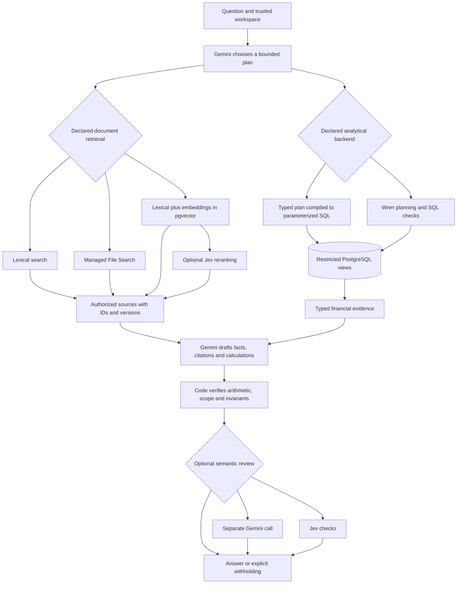

# Evaluating AI architectures for accounting: the Daybook nine-route study

**In progress — 2026-10-30, America/New_York.** The final `holdout-v1` evaluation has started: **1,620 planned route episodes**, followed by **240 planned held-out reviewer outcomes**. These are planned denominators, not completed measurements. The runtime, data, index, protocol and reviewer threshold are frozen. This document is a report scaffold while evaluation runs; it does not interpret partial outcomes, report final accuracy or select a winner.

The [run manifest](../evidence/research-runs/holdout-v1/manifest.json) binds the evaluated source to `fec9f71ad1426c8525d63c353d2f4f83892bdf24a8a5249e0383194f3c2fed08`. The [public pre-run freeze](../evidence/research-verifiers/verifiers-v1/verifier-freeze.json) preserves the development-selected Jev threshold of **0.8** and the reference/calibration hashes. The last development check, [smoke-v4](../evidence/research-runs/smoke-v4/README.md), completed before this freeze. Its results are development evidence, not held-out accuracy.

The main run was temporarily stopped at **777/1,620** after an observed dispatcher timing gap caused three timeouts and a circuit-open stop. Its exact interruption is archived; [bounded transport recovery](../research/TRANSPORT_INCIDENT.md) is being prepared without changing the frozen inference source or retrying failed trials. The final data fingerprint is currently unavailable.

The deployed accounting application is unchanged. Research uses synthetic data, restricted read-only financial access, and review-only entry proposals. No research route has been promoted into production chat.

## Abstract

An accounting assistant must combine exact financial calculations with interpretation of documents and questions. A plausible explanation is insufficient: an answer can use the wrong period, confuse an invoice with a cash receipt, retrieve an obsolete policy, or cite a number that does not support its claim. We implement nine controlled configurations to measure the contribution of broader analytical tools, lexical retrieval, managed Gemini File Search, Gemini embeddings with pgvector, Jev reranking, Wren analytics, and two optional semantic reviewers.

The main benchmark contains 120 synthetic questions in 60 paraphrase groups across six task families. Development and held-out groups are disjoint. The held-out design evaluates 60 questions three times through each route. A separate reviewer study evaluates correct and deliberately flawed candidates against identical supplied evidence. Independent exact-decimal reference arithmetic checks financial values; document and semantic labels have not received independent human adjudication.

The primary outcome is six-family macro structured task success, with errors retained in the denominator. Secondary outcomes include paired component effects, evidence coverage, unsafe acceptance, unnecessary withholding, latency, and tracked provider cost. Controls, practical-benefit thresholds, and conservative interpretation rules were fixed before held-out evaluation. **Results and the architecture recommendation remain pending complete, eligible measurements.** Development failures are preserved separately and cannot substitute for that evidence.

## 1. Problem and a worked example

Imagine you run a small design studio. Daybook is the notebook that records its money, and the chatbot is an assistant who can read the notebook and the studio's documents.

You ask: **“Can I afford another employee?”**

That question is missing several pieces. Which employee? What salary? Does the business need to keep some cash untouched? Are we planning for three months or a year? Will customers pay their bills on time? A useful assistant should identify these missing pieces, rather than turn a bank balance into an automatic “yes.”

Suppose you make the question precise:

> “Using September-end cash and the engineer hiring worksheet, how much cash above our required reserve remains after three months of this new hire's costs and recruiting? Ignore all other future money movements. This is an incremental scenario, not a forecast of the whole company.”

This is a development fixture, not a live customer example. The evidence divides naturally into three responsibilities:

| Needed information                                                             | Where it comes from                     | Why that matters                                                                    |
| ------------------------------------------------------------------------------ | --------------------------------------- | ----------------------------------------------------------------------------------- |
| Cash on September 30: **$164,615.00**                                          | Posted accounting entries in PostgreSQL | A document search result cannot establish the current bank-account total.           |
| Salary: **$6,000/month**; employer costs: **18%**; recruiting: **$3,000 once** | The current engineer hiring worksheet   | These planning assumptions are written in a document, not recorded as paid payroll. |
| Minimum cash reserve: **$50,000**                                              | The reserve policy                      | The business's rule affects how much cash it considers available.                   |
| Three-month horizon; no other future cash movements                            | The user's explicit scenario            | Changing these assumptions changes the answer.                                      |

The deterministic calculator then performs ordinary arithmetic using decimal amounts:

```text
Employer costs per month = $6,000 × 18% = $1,080
Total monthly hire cost   = $6,000 + $1,080 = $7,080
Three months plus hiring = $7,080 × 3 + $3,000 = $24,240
Remaining cash           = $164,615 − $24,240 = $140,375
Cash above reserve       = $140,375 − $50,000 = $90,375
```

A useful answer is: **“Under your stated assumptions, this hire leaves $90,375 above the required reserve after three months.”** It must also say that ordinary operating costs, future receipts, payment timing, and other obligations were excluded. This calculation alone does not establish that hiring is financially prudent.

The numbers are traceable to the [synthetic source documents](../../research/fixtures/documents.json), [independent reference implementation](../../research/reference.ts), and [fixture verification](../evidence/research-fixture-check.json). They illustrate the intended reasoning; they are not a claim that every route successfully answered the question.

## 2. System architecture and authority boundaries

The product separates three jobs that are easy to confuse:

| Responsibility                     | Plain-language explanation                                                 | Implementation                                                               |
| ---------------------------------- | -------------------------------------------------------------------------- | ---------------------------------------------------------------------------- |
| Financial truth                    | The official notebook and calculator                                       | Posted journal entries in PostgreSQL; exact-decimal queries and calculations |
| Finding relevant information       | A librarian locating the right document                                    | Lexical search, managed File Search, or custom hybrid retrieval              |
| Interpreting and checking language | An assistant drafting an explanation, optionally checked by another reader | Gemini planning/answer generation; optional Gemini or Jev review             |

An **embedding** represents text as numbers that help find related meanings. It can connect “employer burden” to “benefits and payroll taxes.” **pgvector** searches those representations within PostgreSQL. Neither embeddings nor vector distance compute an account balance or establish that a contract is current.

**Gemini File Search** is the managed retrieval alternative. This implementation uploads/indexes the authorized document corpus and uses the Interactions API for source selection. The harness resolves returned citations to authorized original documents before the shared answer stage. Its source citations do not expose a raw ranking of all passages, so we do not invent ranking metrics for that path. Accounting balances remain database queries, not documents exported for the model to sum.

**Jev reranking** scores relevance among retrieved candidates. **Jev verification** checks a candidate answer for specified problems. They are separate interventions. **Wren** expands queries over a declared business model into SQL over approved views; in R6 it replaces the custom analytical compiler while retaining R4's retrieval. It is not an additional database of financial truth.



_Figure 1. Controlled substitutions within shared boundaries. Each route follows its declared branches; it does not invoke every component. R0 retains its narrower existing tool interface. Invalid output is withheld at the mandatory code gate before optional review._

### Where the model has authority

The custom path lets Gemini choose typed metrics and filters; code constructs parameterized SQL. The Wren path permits model-proposed SQL only within a checked read-only subset, expands it through the actual pinned Wren engine, and revalidates the output. Models receive neither database owner credentials nor a financial posting tool. The database reader can access only the authorized research views.

The accounting engine remains responsible for balanced entries and immutable posted history. For example, invoicing a client creates revenue and a receivable. Collecting that already-recorded invoice increases cash and reduces the receivable; treating the payment as new revenue would count the sale twice. A chatbot must respect that distinction even when both descriptions mention the same client and amount.

For a scenario, the model proposes an arithmetic structure and cites operands. Code recomputes the result using exact decimals. A calculated $24,240 total must cite its calculation; pointing to a document containing a $6,000 monthly salary is insufficient. A semantic reviewer may withhold a candidate after these checks, but cannot override failed arithmetic, authorize a write, or make a missing source appear. Non-PASS review withholds the answer; this experiment does not run an automatic repair dialogue.

### What a citation proves

A correct-looking amount is not enough. Financial evidence carries machine-derived date bounds, account/entity identity, currency and supported query grain. For example, three equal monthly rent observations can support a monthly-rate statement across those months; one month's amount cannot prove a three-month total. A daily cash movement cannot be labeled a cumulative bank balance.

Custom-query scope comes from the validated compiler contract. Wren scope and units come from supported parsed expressions and the actual expanded output names, not from aliases chosen by the model. Unsupported SQL lineage fails closed. Calculation evidence retains the scopes of its operands; multiplying by one cannot create a different date or remove a grouping identity. Ambiguous equal-valued operands can therefore cause a valid calculation to be withheld. That limitation counts against task success—it is not evidence of better answer quality.

These checks establish bounded numeric and qualifier provenance. They do not prove that every sentence or economic interpretation is correct. An optional reviewer has the same limitation in a different form: it can also miss mistakes.

## 3. Configurations and controlled hypotheses

All configurations use the same study generator, synthetic workspace, question instances, output vocabulary and mandatory validation. R0 reproduces the production architecture with normalized study settings and metadata; it is not a byte-identical production deployment. The production model remains separate. R4 supplies the component control for R5–R8.

| Route                        | Available components                                                                   | Question being tested                                               |
| ---------------------------- | -------------------------------------------------------------------------------------- | ------------------------------------------------------------------- |
| **R0 — current control**     | Four existing financial tool families and review-only proposals; no document retrieval | How far does the existing simpler architecture go?                  |
| **R1 — broad tools**         | Typed analytical plans and exact scenario calculations                                 | Does broader analysis improve useful coverage?                      |
| **R2 — lexical documents**   | R1 plus word-based document search                                                     | What does document evidence add before embeddings?                  |
| **R3 — managed File Search** | R1 plus Gemini managed source selection and the common final answer stage              | How does managed retrieval compare with our retrieval paths?        |
| **R4 — custom hybrid**       | R1 plus lexical search and Gemini embeddings in pgvector                               | Does semantic retrieval add useful evidence?                        |
| **R5 — Jev reranking**       | R4 with Jev reordering retrieved candidates                                            | Does an extra relevance decision improve selection?                 |
| **R6 — Wren analytics**      | R4 retrieval; Wren replaces the custom analytical compiler                             | Does this bounded semantic-query integration improve analysis?      |
| **R7 — Gemini reviewer**     | R4 plus another Gemini invocation                                                      | Does review reduce accepted mistakes without excessive withholding? |
| **R8 — Jev reviewer**        | R4 plus the development-calibrated Jev checks                                          | How does the specialized decision model perform as a reviewer?      |

| Hypothesis | Declared paired comparison | Fixed targeted families                                |
| ---------- | -------------------------- | ------------------------------------------------------ |
| H1         | R1 − R0                    | Financial + analytics                                  |
| H2         | R2 − R1                    | Documents + scenario                                   |
| H3a / H3b  | R3 − R2 / R3 − R4          | Documents + scenario                                   |
| H4         | R4 − R2                    | Documents + scenario                                   |
| H5         | R5 − R4                    | Documents + scenario                                   |
| H6         | R6 − R4                    | Financial + analytics                                  |
| H7a / H7b  | R7 − R4 / R8 − R4          | All six families, plus the separate reviewer criterion |

Additional comparisons with R0 are descriptive. The targeted summaries cannot replace the primary whole-benchmark result, and entry/adversarial effects remain visible for every comparison. R4 and R5 independently generate retrieval queries: their contrast measures the route configurations, not reranking identical cached candidates. The R7 reviewer uses the same model weights in a separate invocation, so its errors need not be independent of the generator's.

## 4. Experimental methods

### Data, splits and planned denominators

The fixture contains **19 accounts, 60 journals, 40 documents, and 120 questions**. One journal and one document belong to another workspace as isolation canaries. The authorized workspace has 59 journals, including two drafts, and 39 documents; 57 entries and 114 lines are posted. The data include invoice/payment distinctions, reversals, duplicates, stored foreign-exchange rates, loans, owner contributions, superseded documents and unsigned material. This is a small synthetic ledger, not customer data. See the [fixture specification](../../research/fixtures/README.md).

Whole scenario groups are split between development and holdout. Each split contains 30 groups with two paraphrases each: 60 questions, ten per family. Holding whole groups apart prevents one wording of a scenario from becoming a development example while its paraphrase becomes the held-out test.

| Study            | Held-out units                                          | Repetitions / methods       |                Planned outcomes |
| ---------------- | ------------------------------------------------------- | --------------------------- | ------------------------------: |
| Main routes      | 60 questions in 30 groups; six families                 | Three repeats × nine routes |     **1,620**, or 180 per route |
| Each main family | Ten questions in five groups                            | Three repeats × nine routes | **270**, or 30 per route/family |
| Reviewer stress  | 80 candidates: 40 correct, 40 flawed, grouped by source | Deterministic, Gemini, Jev  |       **240**, or 80 per method |

The separate reviewer pack totals 160 candidates across development and holdout. Its expected decisions and fault labels are evaluator-side; providers receive only the candidate, question and authorized evidence. The main references and required per-question tags are also excluded from provider inputs. Public vocabulary is shared across routes. Repository maintainers can inspect labels, so this is a frozen engineering split, not an externally secret benchmark.

### References and outcome definitions

Financial references reduce fixture amounts using an independent exact-decimal implementation, separate from the candidate query compiler; tests also use integer-cent sums. USD/EUR amounts and counts must match exactly under their declared units. Percentages and months permit 0.01 of the output unit for rounding. Expected entity and date qualifiers matter. Synthetic document and semantic labels have **not** received independent human adjudication.

The **primary metric** is structured task success, macro-averaged equally across the six families. Success requires all applicable behavior, facts, evidence, scope, assumptions/clarification, proposal and deterministic-validation requirements. An HTTP 200, an `ok` execution, or a well-written sentence is not itself success. Provider and harness errors stay in end-to-end denominators; missing attempts stay missing and prevent a complete-study conclusion. Conditional results exclude execution errors and disclose their smaller denominators.

The supplementary automated rubric totals **90 points**: factual correctness 40, completion 20, grounding 20 and uncertainty 10. The missing human clarity dimension is not imputed, and no combined 100-point score is reported. Exact metric-key or tag failures are distinguished from wrong financial amounts. A correct structured tag does not establish that surrounding prose expresses it faithfully.

A predeclared [common-capability subset](../research/COMMON_CAPABILITIES.md) contains 12 held-out questions in six groups across two families. It helps compare shared capabilities without removing harder tasks from the primary benchmark. Its membership is fixed, with source amendments preserving that membership. Fixed alternative rubric weights provide sensitivity analysis; the most favorable weighting cannot be selected as a new objective. The [statistical review](../research/STATISTICAL_REVIEW.md) and [pre-holdout decision specification](../research/PRE_HOLDOUT_REVIEW.md) define these secondary analyses.

### Frozen settings, execution and uncertainty

The [manifest](../evidence/research-runs/holdout-v1/manifest.json) pins **Gemini `gemini-3.5-flash-lite`** for generation and optional review, **Jev `jev-1.14.0`**, **Gemini `gemini-embedding-001` at 768 dimensions**, and the fixed threshold **0.8**. Wren core is **0.8.2** with its pinned parser. A threshold of 0.8 is an operating setting selected on development data, not “80% accuracy” or a calibrated probability that the whole answer is wrong.

Route order rotates within question/repetition blocks. Bounds include a 60-second episode deadline, at most four generator calls, one reviewer call and eight logical tool calls, with separately limited retrieval operations. Gemini generation/review starts are paced by at least 4,200 ms; the research dispatcher adds its own guard. Queue and pacing waits are part of measured harness wall time. No failed scored episode is silently retried into success.

Paired differences match the same question and repetition. Main uncertainty resamples scenario groups within families, retaining paraphrases and repeats within their blocks. Reviewer differences use paired source-group blocks within correct/flawed strata. The analysis uses 2,000 deterministic-seed empirical bootstrap samples. There are only five held-out groups per family; coverage may be poor and degenerate intervals do not imply certainty. Intervals are unadjusted and descriptive, not formal significance, noninferiority or simultaneous-confidence tests. Sharing a small ledger and corpus can create dependence beyond those groups.

Source, dependency/runtime, protocol, data, index and reviewer settings are bound in saved artifacts. Full scoped ledger/document/embedding fingerprints are checked before and after execution. Changed or unverified state, missing planned episodes, or a known measurement defect prevents a final comparison; a route hard-gate violation disqualifies that route. The live research schema is logically isolated on the existing Neon server. Local reproduction uses a separate pgvector Compose database and volume. Neither arrangement gives the model owner credentials.

### Operational interruptions and resumption

An interrupted run keeps its recorded successes, blocks and errors. Resumption must verify the same frozen inputs and complete only previously unattempted IDs; it must not replace a failed trial with a successful retry. The [interruption record](../research/TRANSPORT_INCIDENT.md) separates a dispatcher delay from provider quota exhaustion, and preserves the original incomplete report and unavailable final fingerprint. A later matching fingerprint can support resumed execution, but cannot turn the earlier unavailable check into an observation made at that time.

A fixed availability probe is operational recovery, not a benchmark question or reviewer judgment. Its tokens and cost belong in a separate overhead row; its success cannot improve a route's score. The original unknown-use reservations remain charged. Any dispatcher launch-guard change, recovery attempt and resumption boundary must be disclosed alongside the unchanged inference source. Route order rotation reduces some time-order bias, but a long interruption and changing provider conditions can still affect the comparison. These are harness-dependent reliability and timing measurements.

## 5. Held-out results — awaiting complete measurements

**No final values are inserted here while the run is active.** The final report must first establish complete matching source/configuration and before/after fingerprints. Any overriding validity notice must accompany the original results. The sections below specify what to fill, not what the experiment has already found.

### 5.1 Primary task success and family coverage

| Route | Planned episodes | Recorded / successes | Six-family macro success [interval] | Execution errors | p95 harness time | Tracked USD per success |
| ----- | ---------------: | -------------------- | ----------------------------------- | ---------------- | ---------------- | ----------------------- |
| R0    |              180 | Pending              | Pending                             | Pending          | Pending          | Pending                 |
| R1    |              180 | Pending              | Pending                             | Pending          | Pending          | Pending                 |
| R2    |              180 | Pending              | Pending                             | Pending          | Pending          | Pending                 |
| R3    |              180 | Pending              | Pending                             | Pending          | Pending          | Pending                 |
| R4    |              180 | Pending              | Pending                             | Pending          | Pending          | Pending                 |
| R5    |              180 | Pending              | Pending                             | Pending          | Pending          | Pending                 |
| R6    |              180 | Pending              | Pending                             | Pending          | Pending          | Pending                 |
| R7    |              180 | Pending              | Pending                             | Pending          | Pending          | Pending                 |
| R8    |              180 | Pending              | Pending                             | Pending          | Pending          | Pending                 |

_Figure 2, pending: route macro success with clustered intervals. Figure 3, pending: six-family success heatmap._ Report micro success, conditional success, actual denominators, incomplete attempts and hard-gate violations beside these figures. Display the common-capability and weight-sensitivity tables as secondary results, never as replacements for an unfavorable primary outcome.

### 5.2 Paired component effects

_Figure 4 and decision table, pending:_ H1–H7 targeted effects, their full-benchmark effects, separate entry/adversarial effects, paired episode/group counts and intervals. The fixed comparison mapping is in Section 3. The final table must separate **point gain at least +5 percentage points** from **uncertainty resolved enough to justify another experiment**.

Prespecified candidate language is deliberately conservative. Query/retrieval candidates require the +5-point targeted benefit, an available interval with no negative lower bound, valid measurement and no treatment/control hard gate. An interval spanning harm and useful benefit is inconclusive. These are interpretation screens, not significance tests. See the [complete decision rules](../research/PRE_HOLDOUT_REVIEW.md#external-decision-supplement-and-conservative-uncertainty-rules).

For every contrast, show additional successful tasks, model calls, tracked cost, recorded error rate and p95 harness latency. A gain that costs more time or maintenance must remain visible as a tradeoff. Observed Pareto dominance is descriptive and uses both overall/targeted quality and operational measures; it does not establish population superiority.

### 5.3 Reviewer stress results

| Method / policy             |                 Planned method outcomes | Accepted flawed / flawed cases | Withheld correct / correct cases | Provider errors          | Conditional paired semantic result |
| --------------------------- | --------------------------------------: | ------------------------------ | -------------------------------- | ------------------------ | ---------------------------------- |
| Deterministic stress checks |                                      80 | Pending                        | Pending                          | Pending                  | Control                            |
| Gemini reviewer alone       |                                      80 | Pending                        | Pending                          | Pending                  | Pending                            |
| Jev reviewer alone          |                                      80 | Pending                        | Pending                          | Pending                  | Pending                            |
| Deterministic AND Gemini    | Derived from the same recorded outcomes | Pending                        | Pending                          | Same underlying requests | Pending                            |
| Deterministic AND Jev       | Derived from the same recorded outcomes | Pending                        | Pending                          | Same underlying requests | Pending                            |

_Figure 5, pending: false-acceptance and correct-withholding rates, with paired differences and uncertainty._ Artificially flawed candidates are a stress test; their prevalence is not real-user prevalence. The limited deterministic stress checker is not the entire accounting engine or complete answer validator.

The candidate reviewer policy must lower operational acceptance of flawed candidates while adding no more than +5 points of withholding on correct candidates. The conservative uncertainty screen additionally requires a false-acceptance-difference interval with upper bound below zero, a correct-withholding-difference interval with upper bound at most +5 points, and observed improvement among successful request pairs. A timeout that withholds an answer is operational protection, not semantic detection. R7/R8 also need nonnegative end-to-end task-success evidence versus R4; stress performance alone cannot qualify a product change.

### 5.4 Retrieval and failure analysis

_Retrieval table and Figure 6, pending:_ recall@6, mean reciprocal rank and nDCG where ranked results and required-document labels are actually observable; separate end-to-end document availability. R3 exposes citation-selected source coverage, while its raw passage rank metrics remain **unavailable**. Unknown retrieval stages after errors are not imputed as empty searches or zero recall. Conditional retrieval performance and all-attempt evidence availability use different denominators and must be labeled accordingly.

_Failure table, pending:_ numerical mistakes, metric-key/schema mismatches, missing/obsolete evidence, unsupported scopes or calculation inputs, omitted assumptions, unnecessary withholding, actual hard gates, and infrastructure/provider failures. Observed categories may overlap; they are not automatically causal diagnoses. Include matched examples that show both what code catches and where a reviewer fails. Do not label every protocol mismatch a financial hallucination, or a structured success as verified prose.

### 5.5 Latency, cost and implementation burden

_Figure 7, pending: p50/p95 paced-harness wall time and separately labeled provider HTTP duration sums. Figure 8, pending: quality versus tracked cost._ Report timing completeness: known full HTTP sums, measured partial sums, missing timing and no-provider-call cases. Legacy missing-duration values must not become measured zeros. Show all-attempt and non-error timing distributions separately. These sequential harness measurements are not production or concurrent-user latency.

Final costs must distinguish scored route calls, reviewer calls, first-time setup/indexing, historical debugging/reindexing, operational recovery probes, and interrupted requests without a completed episode. Report configured-rate usage estimates and unknown-use reservations separately. Tracked amounts are neither invoices nor verified account balances. Show cost per attempted and successful task with explicit denominators; zero successes do not imply zero cost per success. The primary report's route/setup/unassigned categories do not include the separately named recovery-probe records: reconcile those from the usage ledger and recovery receipts, rather than describe route totals as the whole project's spending.

The operational-complexity table must describe what would have to be maintained: typed analytical contracts, source/version management, embeddings and vector indexes, a managed search store, another provider integration, the pinned Wren engine/Python runtime and semantic model, or reviewer settings. No invented engineering-hour score is needed. R6 replaces the analytical backend; it does not run both compilers for each answer.

## 6. Discussion and architecture decision — pending

**Current decision: keep the deployed application unchanged while the complete study is evaluated.** There is no final ranking, retained-component claim or automatic deployment recommendation.

The final discussion will answer four questions using the complete tables above:

1. Which additional capabilities improved their predefined task families, and what happened to whole-benchmark success and adversarial/entry behavior?
2. Were improvements large enough for the declared five-point target, and did uncertainty leave plausible harm unresolved?
3. Did reviewers prevent flawed acceptance while preserving correct answers, including actual end-to-end completion rather than only the artificial stress set?
4. Which remaining tradeoffs justify another product experiment after considering errors, latency, cost and maintenance?

A favorable configuration can become a **candidate for further experiment**. The small synthetic study does not justify an unconditional production-reliability claim. Gains below the target or inconclusive evidence favor fewer services. Combining separate favorable components would create an unmeasured configuration and requires its own experiment.

## 7. Limitations

- **Reference and prose quality.** Documents and semantic labels are synthetic and have not been independently human-adjudicated. Exact arithmetic is stronger evidence than unreviewed semantic labels. Human clarity and full narrative faithfulness remain unmeasured.
- **Small, inspectable dataset.** Thirty held-out scenario groups share one small ledger/corpus. Repetitions do not create new businesses. This cannot establish general financial accuracy, fraud detection, tax/legal advice, or million-user capacity.
- **Different retrieval observability.** Managed File Search citation selection and custom ranked retrieval expose different outputs. The report must not imply identical raw retrieval control or invent missing rank metrics.
- **Conservative scope support.** The Wren integration and shared calculation checks withhold unsupported SQL lineage and ambiguous scope. A correct answer may therefore be lost. This evaluates our bounded integration, not every capability of Wren or every possible calculator design.
- **Review is conditional on available evidence.** A reviewer can miss a source never retrieved, share generator errors, or block a correct answer. The Gemini reviewer uses the same model weights. Jev's combined hazard score is not a calibrated probability of whole-answer invalidity.
- **Formal interaction contract.** Exact keys, qualifiers and tags are evaluated. Clarification is a scored response behavior; this study does not establish success across a real multi-turn clarification/repair conversation.
- **Incomplete security breadth.** The separate component suite recorded 57 PASS, zero FAIL and three UNASSESSED; it is not a completed execution of every proposed natural-language attack through every route. Main adversarial tasks and permission checks add evidence without erasing that gap. Zero observed violations is not a production guarantee.
- **Operational environment.** Provider load, quotas, model changes, dispatch queues and pacing affect cost, availability and timing. No concurrent production load test was performed. Live research uses logical isolation on a shared physical database.
- **Scenario interpretation.** A simplified expense proxy or incremental hiring calculation is not a cash-flow forecast. Payment timing, taxes, liabilities and plausible future receipts can change a real decision.

## 8. A short explanation to rehearse

> “I built the accounting engine first, because the books have to be correct regardless of the AI. The database enforces balanced postings, and corrections preserve history.
>
> “Then I separated three jobs: finding financial facts, finding documents, and explaining the result. A hiring question needs cash from the ledger, salary and reserve assumptions from documents, and exact arithmetic connecting them. Vector search helps find the right page; it does not calculate the bank balance.
>
> “The AI proposes a bounded plan and an answer. Code checks values, currencies, periods, identities and calculations. An optional reviewer can stop an answer, but it cannot override failed checks or post money movements.
>
> “I compared components separately using shared controls and held-out scenario groups. I measure both escaped mistakes and correct answers that get blocked, keep provider failures in the record, and show uncertainty, cost and latency. A second agent is another fallible check, not a guarantee.
>
> “At this checkpoint the held-out evaluation is running. I will only claim a component is worth another experiment if the completed evidence supports it. I am not claiming production-scale reliability from a small synthetic benchmark.”

Replace the last paragraph with the actual supported final conclusion only after Section 6 is complete. The explanation should be rehearsable without memorizing implementation names: **database for the books, retrieval for documents, calculator for math, model for interpretation, and measured checks before release.**

## Appendix A. Development history and diagnostic evidence

Development runs were used to discover implementation defects and freeze settings. They remain separate, append-only records. None is pooled into held-out results or used as a valid final architecture ranking.

| Stage                       | Recorded development evidence                                                                                                                                                              | Consequence and preserved sources                                                                                                                                                                                                                                                                                                                                                                                                                                                                                            |
| --------------------------- | ------------------------------------------------------------------------------------------------------------------------------------------------------------------------------------------ | ---------------------------------------------------------------------------------------------------------------------------------------------------------------------------------------------------------------------------------------------------------------------------------------------------------------------------------------------------------------------------------------------------------------------------------------------------------------------------------------------------------------------------- |
| Integration and permissions | Custom/Wren queries returned the expected cash total; 114 posted lines, 57 posted entries and 39 authorized documents/vectors matched. Four retrieval variants found the contract example. | Integration checks establish capability, not benchmark accuracy. [Database](../evidence/research-database-check.json), [fixtures](../evidence/research-fixture-check.json), [retrieval smoke](../evidence/research-retrieval-smoke.json), [initial failures](../evidence/research-retrieval-smoke-initial.json), [security scope](../evidence/research-security.json).                                                                                                                                                       |
| `pilot-v1`                  | 108/108 attempts: 87 ok, 11 blocked, ten errors; unchanged data.                                                                                                                           | Invalid for selection: missing R0 user/calculation evidence, wrong Wren planner grammar, early dispatcher gaps. [Interpretation](../evidence/research-runs/pilot-v1/README.md), [bound validity notice](../evidence/research-runs/pilot-v1/validity-notice.json), [original HTML](../evidence/research-runs/pilot-v1/report.html), [diagnostic PDF](../evidence/research-runs/pilot-v1/study-report.pdf).                                                                                                                    |
| `pilot-v2`                  | 101/108 attempts: 83 ok, nine blocked, nine errors; unchanged data.                                                                                                                        | Incomplete and invalid for selection: daily free-tier quota stop, an inferred partial-footer read race, and R0 metadata limitations. [Interpretation](../evidence/research-runs/pilot-v2/README.md), [notice](../evidence/research-runs/pilot-v2/validity-notice.json), [HTML](../evidence/research-runs/pilot-v2/report.html), [PDF](../evidence/research-runs/pilot-v2/study-report.pdf), [dispatch/quota receipt](../evidence/dispatch-pilot-v2.json), [race diagnosis](../evidence/queue-completion-race-pilot-v2.json). |
| `smoke-v3`                  | 54/54 fixed development attempts: 47 ok, seven blocked, no execution errors; unchanged data.                                                                                               | Invalid for selection: custom monthly evidence inherited broad query dates while Wren lacked matching scope proof. [Receipt](../evidence/research-smoke-v3-check.json), [notice](../evidence/research-runs/smoke-v3/validity-notice.json), [HTML](../evidence/research-runs/smoke-v3/report.html), [PDF](../evidence/research-runs/smoke-v3/study-report.pdf).                                                                                                                                                               |
| `smoke-v4`                  | 54/54 fixed development attempts: 40 ok, 13 blocked, one response-contract error; 28 structured successes; no recorded hard gate.                                                          | Internal review found no remaining concrete measurement blocker; full source/data/protocol remained unchanged, then the final freeze was recorded. Conservative scope rejections remain counted as lost success. [Interpretation](../evidence/research-runs/smoke-v4/README.md), [receipt](../evidence/research-smoke-v4-check.json), [original report](../evidence/research-runs/smoke-v4/report.html), [dispatch evidence](../evidence/dispatch-smoke-v4.json).                                                            |

An `ok` execution in this history does not mean a correct answer. In particular, R0's original zero successes in pilot-v1 is not an estimate of the production baseline's capability: the study adapter omitted required evidence. Post-pilot fixes preserve the original tools, results and failures; they do not retroactively validate old rankings.

The V2 footer race is an inference supported by final HTTP 200 completion after a runner read failure; the original bytes at the early read were not captured. A separate upstream HTTP 504 was a different event. The subsequent framed-completion reader waits for the terminal marker. Daily quota exhaustion was also distinct from minute-level pacing. These distinctions prevent a single “provider failure” category from hiding known harness defects.

Scope corrections before the final freeze derive row periods and grouping identity consistently for both query backends. Tests reject wrong-month values, missing months, partial coverage, raw/daily movements presented as balances, grouped vendor slices presented as whole-account totals, and calculation wrappers that widen scope. More conservative checks can lower observed completion even while repairing the measurement contract; old outcomes are not rewritten.

Historical supplemental artifacts remain available: [pilot-v1 retrieval/failures/timing](../evidence/research-runs/pilot-v1/supplemental/index.html), [pilot-v2 supplement](../evidence/research-runs/pilot-v2/supplemental/index.html), [pilot-v1 weight sensitivity](../evidence/research-runs/pilot-v1/sensitivity/report.md), and [pilot-v2 sensitivity](../evidence/research-runs/pilot-v2/sensitivity/report.md). Their validity notices remain controlling.

## Appendix B. Development-only reviewer calibration

Eighty development candidates—40 correct and 40 flawed—were reviewed by each method, producing 240 outcomes. Four Gemini requests returned HTTP 429. The following operational rates treat a failed request as withholding; they are **not held-out results**.

| Development policy                | Recorded outcomes | Provider errors | Accepted flawed | Withheld correct |
| --------------------------------- | ----------------: | --------------: | --------------: | ---------------: |
| Deterministic stress checks       |                80 |               0 |   28/40 (70.0%) |      0/40 (0.0%) |
| Gemini reviewer alone             |                80 |               4 |    8/40 (20.0%) |     4/40 (10.0%) |
| Jev reviewer alone, threshold 0.8 |                80 |               0 |   14/40 (35.0%) |      2/40 (5.0%) |
| Deterministic AND Gemini          |     Same outcomes |          Same 4 |    8/40 (20.0%) |     4/40 (10.0%) |
| Deterministic AND Jev             |     Same outcomes |               0 |   11/40 (27.5%) |      2/40 (5.0%) |

Two Gemini failures were on correct candidates and two on flawed candidates. Among 76 completed responses, false acceptance was 8/38 (21.1%) and false rejection was 2/38 (5.3%). These conditional figures illustrate why a failed request cannot count as a model detecting a flaw. The limited deterministic checker deliberately misses semantic contradictions; its missed-flaw rate is not Daybook accounting-engine failure prevalence.

Jev's threshold 0.8 was selected from the declared development grid to minimize flawed acceptance subject to the additional-correct-withholding constraint. It is preserved without held-out retuning. Full [development report](../evidence/research-verifiers/verifiers-v1/development-report.md), [structured results](../evidence/research-verifiers/verifiers-v1/development-results.json), [raw outcomes](../evidence/research-verifiers/verifiers-v1/development.jsonl), [usage](../evidence/research-verifiers/verifiers-v1/development-usage.json), [threshold artifact](../evidence/research-verifiers/verifiers-v1/verifier-config.json), and [final source binding](../evidence/research-verifiers/verifiers-v1/verifier-freeze.json) are preserved.

## Appendix C. Reproduction, budgets and artifact provenance

The [active protocol](../PLAN.md), [core review](../research/CORE_REVIEW.md), [statistical review](../research/STATISTICAL_REVIEW.md), [pre-holdout decision rules](../research/PRE_HOLDOUT_REVIEW.md), and [reproduction instructions](../research/REPRODUCE.md) define the evaluated system. The [common-capability mapping](../research/common-capabilities-v1.json) is unchanged across the [v2](../research/common-capabilities-amendment-v2.json), [v3](../research/common-capabilities-amendment-v3.json), and [v4](../research/common-capabilities-amendment-v4.json) source amendments. None of those amendments validates an earlier defective pilot.

The active additional tracked allowance is **$6.40 Gemini / $0.10 Jev**, within cumulative **$10 / $4** ceilings. Historical records, failed-request reservations, the consumed one-probe policy and its parent policy history are retained. The user reported funding; this is not an independently verified account balance or billing tier. The old managed store was inaccessible to the replacement key, so the same 39 authorized documents were indexed in a new store while existing vectors were retained. Key availability, resource access and model quality are separate checks. Details are in [quota and policy recovery](../research/QUOTA_RECOVERY.md), [funded indexing](../evidence/research-funded-index-ready.json), and [funded fixture verification](../evidence/research-funded-fixture-check.json).

Final reporting should attach the original route/reviewer results, raw outcomes and per-call usage; manifests and before/after fingerprints; common-capability, sensitivity, retrieval/timing/failure and decision supplements; and a printable PDF. Every supplement must retain the primary run ID and input/analyzer hashes, with any validity notice. Final values and conclusions belong in Sections 5–6; historical diagnostic evidence remains intact.

## Appendix D. Final report assembly checklist

This checklist concerns reporting, not additional experiments, tuning or a new scoring rule. The command sequence is in [reproduction instructions](../research/REPRODUCE.md#6-produce-the-final-analyses-and-printable-report). Until all applicable checks pass, keep the status incomplete and the final recommendation pending.

| Deliverable                      | Source to reconcile after both runs                                                                                        | Required presentation                                                                                                                                                                                                   |
| -------------------------------- | -------------------------------------------------------------------------------------------------------------------------- | ----------------------------------------------------------------------------------------------------------------------------------------------------------------------------------------------------------------------- |
| Complete and valid measurements  | Main manifest, original/resumed fingerprints, final freeze, raw episode IDs; reviewer manifest and raw case/method IDs     | Exactly 1,620 unique planned main outcomes and 240 held-out reviewer outcomes, with original errors retained. Matching source/configuration/data, any validity notice, and the operational interruption/recovery trail. |
| Primary route comparison         | Main `results.json`, `report.html`, and `report.md`                                                                        | Nine-route table, macro-success intervals, six-family heatmap, counts, execution errors and hard gates. Structured success and the automated rubric out of 90 remain distinct.                                          |
| Component and reviewer decisions | `decisions/decisions.json`, reviewer `holdout-results.json` and raw outcomes                                               | Fixed targeted paired contrasts, uncertainty and +5-point criteria; flawed acceptance and correct withholding, operational and conditional rates, source-group denominators, and no automatic deployment claim.         |
| Secondary analyses               | `common-capabilities/common-capabilities.json`, `sensitivity/sensitivity.json`, `supplemental/retrieval-and-failures.json` | Fixed common-capability and weighting comparisons; observable retrieval coverage/ranks; skipped and unknown retrieval stages; overlapping failure categories rather than unsupported root-cause claims.                 |
| Cost, timing and complexity      | Sanitized usage records, supplemental timing completeness, decision complexity/Pareto tables, operational receipts         | Known-use estimates versus unknown-use reservations; per-attempt/per-success costs; setup, debugging and recovery overhead separately; harness wall time versus measured HTTP sums; maintenance obligations.            |
| Portable report and handoff      | `study-report.pdf`, adjacent PDF provenance, rendered-page review; completed Sections 5–6                                  | Matching JSON/narrative/figure values and denominators, readable pages, direct evidence links, visible limitations, and a concise defensible recommendation for the next experiment.                                    |

Check provenance before copying a number into the narrative. The common-capability, sensitivity and decision supplements bind the primary report hash; the decision supplement also binds the reviewer results and raw outcomes. The retrieval/timing supplement instead records its episode-file and usage-file hashes, so verify those against the same final run snapshot explicitly. The PDF must use the **held-out** reviewer input, not the development calibration report. Its hashes and automated page-bound checks support reproducibility; they do not constitute independent human scientific review.

Finish the discussion with a small evidence-to-decision table: the component, its fixed comparison, measured benefit and interval, added cost/time/maintenance, applicable limits, and the resulting candidate or inconclusive status. Include an unfavorable or inconclusive result just as visibly as a favorable one. Do not combine individually promising components into an untested “best” route or replace the primary metric with whichever secondary table looks strongest.
