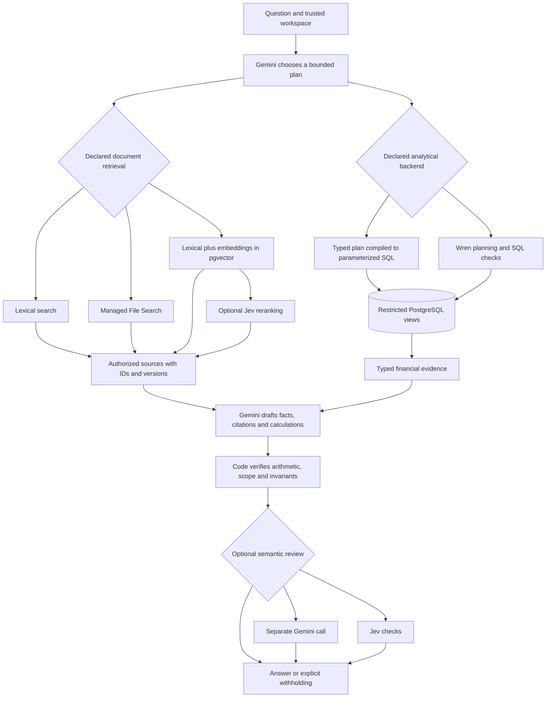
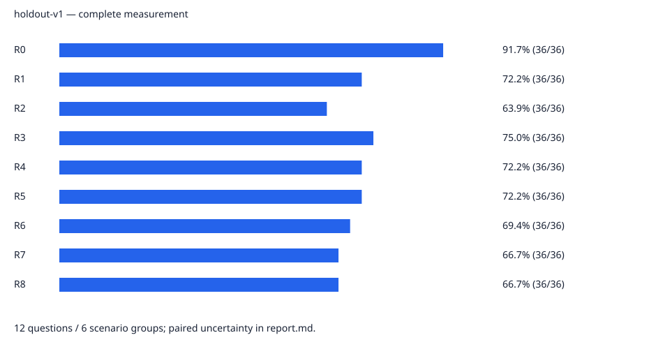
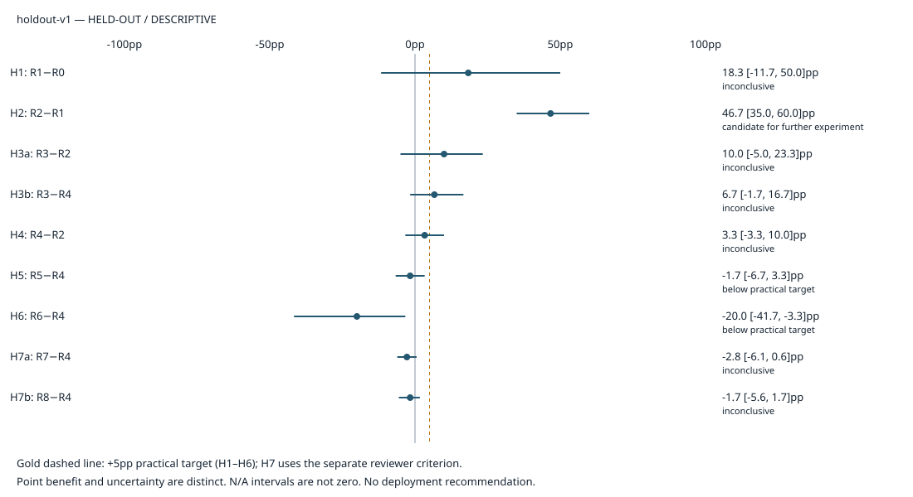
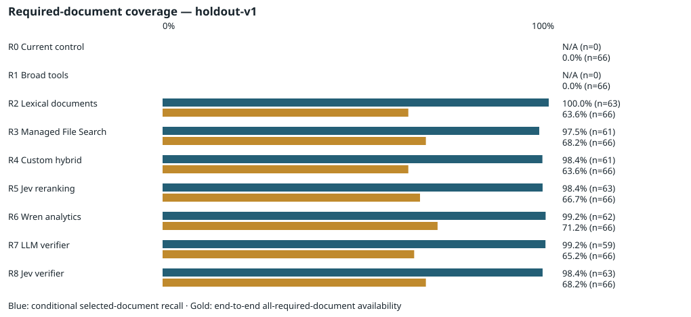

# Evaluating AI architectures for accounting: the Daybook nine-route study

**Complete — 2026-10-31.** All **1,620 main trials and 240 held-out reviewer outcomes** are recorded and audited. The main and reviewer integrity audits passed 41 and 31 checks; final analysis/cost reconciliation passed 59 checks. Provider work has stopped. The original failures and recovery history are retained, and the final full data fingerprint matches the starting snapshot.

**Main finding:** managed File Search has the highest observed broad score (70.6%), but only adding document access passes the predefined component-improvement screen. On the fixed common-capability subset, the existing narrow tools score 91.7% versus 75.0% for managed search. The recommendation is a controlled document-workflow experiment while preserving the existing tools, not automatic production replacement.

Start with the **[16-page visual report](../evidence/research-runs/holdout-v1/study-report.pdf)**, [standalone charts and results](../evidence/research-runs/holdout-v1/report.html), and [worked failure examples](research-worked-examples.md). This narrative explains the design, findings and limits; the linked artifacts retain exact scores and provenance. All PDF pages passed bounds checks and [AI visual inspection](../evidence/research-final-pdf-visual-review.json); this is not independent human scientific review.

The [run manifest](../evidence/research-runs/holdout-v1/manifest.json) binds the inference source to `fec9f71ad1426c8525d63c353d2f4f83892bdf24a8a5249e0383194f3c2fed08`. The [pre-run freeze](../evidence/research-verifiers/verifiers-v1/verifier-freeze.json) preserves the development-selected Jev threshold of 0.8. The main run resumed from a preserved 777-trial interruption without replacing any recorded outcome. Its complete final fingerprint matches; the earlier unavailable check remains in the [immutable interruption archive](../evidence/research-runs/holdout-v1/interruption-01/snapshot.json). [Transport history](../research/TRANSPORT_INCIDENT.md).

The deployed Daybook application is unchanged. Research uses synthetic data, restricted read-only financial access and review-only entry proposals. No experimental route has been enabled in production chat.

## Abstract

An accounting assistant must combine exact financial calculations with interpretation of documents and questions. A plausible explanation is insufficient: an answer can use the wrong period, confuse an invoice with a cash receipt, retrieve an obsolete policy, or cite a number that does not support its claim. We implement nine controlled configurations to measure the contribution of broader analytical tools, lexical retrieval, managed Gemini File Search, Gemini embeddings with pgvector, Jev reranking, Wren analytics, and two optional semantic reviewers.

The main benchmark contains 120 synthetic questions in 60 paraphrase groups across six task families. Development and held-out groups are disjoint. The held-out design evaluates 60 questions three times through each route. A separate reviewer study evaluates correct and deliberately flawed candidates against identical supplied evidence. Independent exact-decimal reference arithmetic checks financial values; document and semantic labels have not received independent human adjudication.

The primary outcome is six-family macro structured task success, with errors retained in the denominator. Secondary outcomes include paired component effects, evidence coverage, unsafe acceptance, unnecessary withholding, latency, and tracked provider cost. Controls, practical-benefit thresholds, and conservative interpretation rules were fixed before held-out evaluation. **All held-out measurements are complete.** Managed File Search reaches 127/180 structured successes (70.6%), hybrid retrieval 118/180 (65.6%), and lexical retrieval 110/180 (61.1%). Adding lexical documents to broader tools yields a targeted +46.7-point improvement [35.0, 60.0] and is the only component meeting the declared screen. The narrower control leads the common-capability subset; reviewers reduce planted-flaw acceptance but do not meet the complete adoption criteria. Total tracked research usage is approximately $6.05, including development and retained unknown-use reservations. These results support a further document-workflow experiment, not a production correctness guarantee.

## 1. Problem and a worked example

Imagine you run a small design studio. Daybook is the notebook that records its money, and the chatbot is an assistant who can read the notebook and the studio's documents.

You ask: **“Can I afford another employee?”**

That question is missing several pieces. Which employee? What salary? Does the business need to keep some cash untouched? Are we planning for three months or a year? Will customers pay their bills on time? A useful assistant should identify these missing pieces, rather than turn a bank balance into an automatic “yes.”

Suppose you make the question precise:

> “Using September-end cash and the engineer hiring worksheet, how much cash above our required reserve remains after three months of this new hire's costs and recruiting? Ignore all other future money movements. This is an incremental scenario, not a forecast of the whole company.”

This is a development fixture, not a live customer example. The evidence divides naturally into three responsibilities:

| Needed information                                                             | Where it comes from                     | Why that matters                                                                    |
| ------------------------------------------------------------------------------ | --------------------------------------- | ----------------------------------------------------------------------------------- |
| Cash on September 30: **$164,615.00**                                          | Posted accounting entries in PostgreSQL | A document search result cannot establish the current bank-account total.           |
| Salary: **$6,000/month**; employer costs: **18%**; recruiting: **$3,000 once** | The current engineer hiring worksheet   | These planning assumptions are written in a document, not recorded as paid payroll. |
| Minimum cash reserve: **$50,000**                                              | The reserve policy                      | The business's rule affects how much cash it considers available.                   |
| Three-month horizon; no other future cash movements                            | The user's explicit scenario            | Changing these assumptions changes the answer.                                      |

The deterministic calculator then performs ordinary arithmetic using decimal amounts:

```text
Employer costs per month = $6,000 × 18% = $1,080
Total monthly hire cost   = $6,000 + $1,080 = $7,080
Three months plus hiring = $7,080 × 3 + $3,000 = $24,240
Remaining cash           = $164,615 − $24,240 = $140,375
Cash above reserve       = $140,375 − $50,000 = $90,375
```

A useful answer is: **“Under your stated assumptions, this hire leaves $90,375 above the required reserve after three months.”** It must also say that ordinary operating costs, future receipts, payment timing, and other obligations were excluded. This calculation alone does not establish that hiring is financially prudent.

The numbers are traceable to the [synthetic source documents](../../research/fixtures/documents.json), [independent reference implementation](../../research/reference.ts), and [fixture verification](../evidence/research-fixture-check.json). They illustrate the intended reasoning; they are not a claim that every route successfully answered the question.

## 2. System architecture and authority boundaries

The product separates three jobs that are easy to confuse:

| Responsibility                     | Plain-language explanation                                                 | Implementation                                                               |
| ---------------------------------- | -------------------------------------------------------------------------- | ---------------------------------------------------------------------------- |
| Financial truth                    | The official notebook and calculator                                       | Posted journal entries in PostgreSQL; exact-decimal queries and calculations |
| Finding relevant information       | A librarian locating the right document                                    | Lexical search, managed File Search, or custom hybrid retrieval              |
| Interpreting and checking language | An assistant drafting an explanation, optionally checked by another reader | Gemini planning/answer generation; optional Gemini or Jev review             |

An **embedding** represents text as numbers that help find related meanings. It can connect “employer burden” to “benefits and payroll taxes.” **pgvector** searches those representations within PostgreSQL. Neither embeddings nor vector distance compute an account balance or establish that a contract is current.

**Gemini File Search** is the managed retrieval alternative. This implementation uploads/indexes the authorized document corpus and uses the Interactions API for source selection. The harness resolves returned citations to authorized original documents before the shared answer stage. Its source citations do not expose a raw ranking of all passages, so we do not invent ranking metrics for that path. Accounting balances remain database queries, not documents exported for the model to sum.

**Jev reranking** scores relevance among retrieved candidates. **Jev verification** checks a candidate answer for specified problems. They are separate interventions. **Wren** expands queries over a declared business model into SQL over approved views; in R6 it replaces the custom analytical compiler while retaining R4's retrieval. It is not an additional database of financial truth.



_Figure 1. Controlled substitutions within shared boundaries. Each route follows its declared branches; it does not invoke every component. R0 retains its narrower existing tool interface. Invalid output is withheld at the mandatory code gate before optional review._

### Where the model has authority

The custom path lets Gemini choose typed metrics and filters; code constructs parameterized SQL. The Wren path permits model-proposed SQL only within a checked read-only subset, expands it through the actual pinned Wren engine, and revalidates the output. Models receive neither database owner credentials nor a financial posting tool. The database reader can access only the authorized research views.

The accounting engine remains responsible for balanced entries and immutable posted history. For example, invoicing a client creates revenue and a receivable. Collecting that already-recorded invoice increases cash and reduces the receivable; treating the payment as new revenue would count the sale twice. A chatbot must respect that distinction even when both descriptions mention the same client and amount.

For a scenario, the model proposes an arithmetic structure and cites operands. Code recomputes the result using exact decimals. A calculated $24,240 total must cite its calculation; pointing to a document containing a $6,000 monthly salary is insufficient. A semantic reviewer may withhold a candidate after these checks, but cannot override failed arithmetic, authorize a write, or make a missing source appear. Non-PASS review withholds the answer; this experiment does not run an automatic repair dialogue.

### What a citation proves

A correct-looking amount is not enough. Financial evidence carries machine-derived date bounds, account/entity identity, currency and supported query grain. For example, three equal monthly rent observations can support a monthly-rate statement across those months; one month's amount cannot prove a three-month total. A daily cash movement cannot be labeled a cumulative bank balance.

Custom-query scope comes from the validated compiler contract. Wren scope and units come from supported parsed expressions and the actual expanded output names, not from aliases chosen by the model. Unsupported SQL lineage fails closed. Calculation evidence retains the scopes of its operands; multiplying by one cannot create a different date or remove a grouping identity. Ambiguous equal-valued operands can therefore cause a valid calculation to be withheld. That limitation counts against task success—it is not evidence of better answer quality.

These checks establish bounded numeric and qualifier provenance. They do not prove that every sentence or economic interpretation is correct. An optional reviewer has the same limitation in a different form: it can also miss mistakes.

## 3. Configurations and controlled hypotheses

All configurations use the same study generator, synthetic workspace, question instances, output vocabulary and mandatory validation. R0 reproduces the production architecture with normalized study settings and metadata; it is not a byte-identical production deployment. The production model remains separate. R4 supplies the component control for R5–R8.

| Route                        | Available components                                                                   | Question being tested                                               |
| ---------------------------- | -------------------------------------------------------------------------------------- | ------------------------------------------------------------------- |
| **R0 — current control**     | Four existing financial tool families and review-only proposals; no document retrieval | How far does the existing simpler architecture go?                  |
| **R1 — broad tools**         | Typed analytical plans and exact scenario calculations                                 | Does broader analysis improve useful coverage?                      |
| **R2 — lexical documents**   | R1 plus word-based document search                                                     | What does document evidence add before embeddings?                  |
| **R3 — managed File Search** | R1 plus Gemini managed source selection and the common final answer stage              | How does managed retrieval compare with our retrieval paths?        |
| **R4 — custom hybrid**       | R1 plus lexical search and Gemini embeddings in pgvector                               | Does semantic retrieval add useful evidence?                        |
| **R5 — Jev reranking**       | R4 with Jev reordering retrieved candidates                                            | Does an extra relevance decision improve selection?                 |
| **R6 — Wren analytics**      | R4 retrieval; Wren replaces the custom analytical compiler                             | Does this bounded semantic-query integration improve analysis?      |
| **R7 — Gemini reviewer**     | R4 plus another Gemini invocation                                                      | Does review reduce accepted mistakes without excessive withholding? |
| **R8 — Jev reviewer**        | R4 plus the development-calibrated Jev checks                                          | How does the specialized decision model perform as a reviewer?      |

| Hypothesis | Declared paired comparison | Fixed targeted families                                |
| ---------- | -------------------------- | ------------------------------------------------------ |
| H1         | R1 − R0                    | Financial + analytics                                  |
| H2         | R2 − R1                    | Documents + scenario                                   |
| H3a / H3b  | R3 − R2 / R3 − R4          | Documents + scenario                                   |
| H4         | R4 − R2                    | Documents + scenario                                   |
| H5         | R5 − R4                    | Documents + scenario                                   |
| H6         | R6 − R4                    | Financial + analytics                                  |
| H7a / H7b  | R7 − R4 / R8 − R4          | All six families, plus the separate reviewer criterion |

Additional comparisons with R0 are descriptive. The targeted summaries cannot replace the primary whole-benchmark result, and entry/adversarial effects remain visible for every comparison. R4 and R5 independently generate retrieval queries: their contrast measures the route configurations, not reranking identical cached candidates. The R7 reviewer uses the same model weights in a separate invocation, so its errors need not be independent of the generator's.

## 4. Experimental methods

### Data, splits and planned denominators

The fixture contains **19 accounts, 60 journals, 40 documents, and 120 questions**. One journal and one document belong to another workspace as isolation canaries. The authorized workspace has 59 journals, including two drafts, and 39 documents; 57 entries and 114 lines are posted. The data include invoice/payment distinctions, reversals, duplicates, stored foreign-exchange rates, loans, owner contributions, superseded documents and unsigned material. This is a small synthetic ledger, not customer data. See the [fixture specification](../../research/fixtures/README.md).

Whole scenario groups are split between development and holdout. Each split contains 30 groups with two paraphrases each: 60 questions, ten per family. Holding whole groups apart prevents one wording of a scenario from becoming a development example while its paraphrase becomes the held-out test.

| Study            | Held-out units                                          | Repetitions / methods       |                Planned outcomes |
| ---------------- | ------------------------------------------------------- | --------------------------- | ------------------------------: |
| Main routes      | 60 questions in 30 groups; six families                 | Three repeats × nine routes |     **1,620**, or 180 per route |
| Each main family | Ten questions in five groups                            | Three repeats × nine routes | **270**, or 30 per route/family |
| Reviewer stress  | 80 candidates: 40 correct, 40 flawed, grouped by source | Deterministic, Gemini, Jev  |       **240**, or 80 per method |

The separate reviewer pack totals 160 candidates across development and holdout. Its expected decisions and fault labels are evaluator-side; providers receive only the candidate, question and authorized evidence. The main references and required per-question tags are also excluded from provider inputs. Public vocabulary is shared across routes. Repository maintainers can inspect labels, so this is a frozen engineering split, not an externally secret benchmark.

### References and outcome definitions

Financial references reduce fixture amounts using an independent exact-decimal implementation, separate from the candidate query compiler; tests also use integer-cent sums. USD/EUR amounts and counts must match exactly under their declared units. Percentages and months permit 0.01 of the output unit for rounding. Expected entity and date qualifiers matter. Synthetic document and semantic labels have **not** received independent human adjudication.

The **primary metric** is structured task success, macro-averaged equally across the six families. Success requires all applicable behavior, facts, evidence, scope, assumptions/clarification, proposal and deterministic-validation requirements. An HTTP 200, an `ok` execution, or a well-written sentence is not itself success. Provider and harness errors stay in end-to-end denominators; missing attempts stay missing and prevent a complete-study conclusion. Conditional results exclude execution errors and disclose their smaller denominators.

The supplementary automated rubric totals **90 points**: factual correctness 40, completion 20, grounding 20 and uncertainty 10. The missing human clarity dimension is not imputed, and no combined 100-point score is reported. Exact metric-key or tag failures are distinguished from wrong financial amounts. A correct structured tag does not establish that surrounding prose expresses it faithfully.

A predeclared [common-capability subset](../research/COMMON_CAPABILITIES.md) contains 12 held-out questions in six groups across two families. It helps compare shared capabilities without removing harder tasks from the primary benchmark. Its membership is fixed, with source amendments preserving that membership. Fixed alternative rubric weights provide sensitivity analysis; the most favorable weighting cannot be selected as a new objective. The [statistical review](../research/STATISTICAL_REVIEW.md) and [pre-holdout decision specification](../research/PRE_HOLDOUT_REVIEW.md) define these secondary analyses.

### Frozen settings, execution and uncertainty

The [manifest](../evidence/research-runs/holdout-v1/manifest.json) pins **Gemini `gemini-3.5-flash-lite`** for generation and optional review, **Jev `jev-1.14.0`**, **Gemini `gemini-embedding-001` at 768 dimensions**, and the fixed threshold **0.8**. Wren core is **0.8.2** with its pinned parser. A threshold of 0.8 is an operating setting selected on development data, not “80% accuracy” or a calibrated probability that the whole answer is wrong.

Route order rotates within question/repetition blocks. Bounds include a 60-second episode deadline, at most four generator calls, one reviewer call and eight logical tool calls, with separately limited retrieval operations. Gemini generation/review request submission is paced by at least4,200ms; the dispatcher adds4,500ms preparation-time pacing. Actual network starts are unobserved, and tool scheduling can alter their gaps. Queue and pacing waits are part of measured harness wall time. No failed scored episode is silently retried into success.

Paired differences match the same question and repetition. Main uncertainty resamples scenario groups within families, retaining paraphrases and repeats within their blocks. Reviewer differences use paired source-group blocks within correct/flawed strata. The analysis uses 2,000 deterministic-seed empirical bootstrap samples. There are only five held-out groups per family; coverage may be poor and degenerate intervals do not imply certainty. Intervals are unadjusted and descriptive, not formal significance, noninferiority or simultaneous-confidence tests. Sharing a small ledger and corpus can create dependence beyond those groups.

Source, dependency/runtime, protocol, data, index and reviewer settings are bound in saved artifacts. Full scoped ledger/document/embedding fingerprints are checked before and after execution. Changed or unverified state, missing planned episodes, or a known measurement defect prevents a final comparison; a route hard-gate violation disqualifies that route. The live research schema is logically isolated on the existing Neon server. Local reproduction uses a separate pgvector Compose database and volume. Neither arrangement gives the model owner credentials.

### Operational interruptions and resumption

An interrupted run keeps its recorded successes, blocks and errors. Resumption must verify the same frozen inputs and complete only previously unattempted IDs; it must not replace a failed trial with a successful retry. The [interruption record](../research/TRANSPORT_INCIDENT.md) separates a dispatcher delay from provider quota exhaustion, and preserves the original incomplete report and unavailable final fingerprint. A later matching fingerprint can support resumed execution, but cannot turn the earlier unavailable check into an observation made at that time.

A fixed availability probe is operational recovery, not a benchmark question or reviewer judgment. Its tokens and cost belong in a separate overhead row; its success cannot improve a route's score. The original unknown-use reservations remain charged. Any dispatcher launch-guard change, recovery attempt and resumption boundary must be disclosed alongside the unchanged inference source. Route order rotation reduces some time-order bias, but a long interruption and changing provider conditions can still affect the comparison. These are harness-dependent reliability and timing measurements.

## 5. Held-out results

Both planned matrices are complete. The main audit passed **41/41 checks** and the reviewer audit **31/31**. Source, protocol, indexes, threshold and preserved development calibration match their frozen bindings. The final ledger/corpus/vector fingerprint matches the starting snapshot. The original interruption and all failed outcomes remain intact. [Main audit](../evidence/research-holdout-final-check.json), [reviewer audit](../evidence/research-verifier-holdout-final-check.json).

The main run contains **1,620 recorded trials**, including 1,333 execution-status successes, 267 withheld answers and 20 execution errors. **940 trials met the complete structured-success rubric.** A successful API call is therefore different from a successful answer. All errors remain in the primary denominator. No route recorded a defined hard-gate violation; this does not establish that every sentence was faithful or every attack was prevented.

### 5.1 Primary task success and family coverage

Each route has 180 trials: 60 questions repeated three times. There are **30 scenario groups**, not 180 independent business problems. The intervals below resample those groups within families and are exploratory, unadjusted 95% intervals.

| Route                    | Successes / 180 | Six-family success [95% interval] | Automated /90 | Errors | p95 harness | USD per success |
| ------------------------ | --------------: | --------------------------------- | ------------: | -----: | ----------: | --------------: |
| R0 — Current control     |              57 | 31.7% [18.3, 45.0]                |          42.5 |      5 |       5.83s |        $0.00488 |
| R1 — Broad tools         |              76 | 42.2% [31.7, 53.3]                |          45.9 |      1 |      10.54s |        $0.00587 |
| R2 — Lexical documents   |             110 | 61.1% [48.9, 72.2]                |          58.8 |      1 |      11.26s |        $0.00491 |
| R3 — Managed File Search |             127 | 70.6% [58.9, 82.2]                |          65.1 |      3 |      17.47s |        $0.00598 |
| R4 — Custom hybrid       |             118 | 65.6% [54.4, 77.2]                |          62.2 |      1 |      14.85s |        $0.00472 |
| R5 — Jev reranking       |             115 | 63.9% [52.2, 75.6]                |          59.9 |      0 |      14.35s |        $0.00498 |
| R6 — Wren analytics      |             109 | 60.6% [48.9, 72.2]                |          57.1 |      5 |      14.84s |        $0.00485 |
| R7 — LLM verifier        |             113 | 62.8% [51.7, 74.4]                |          59.3 |      3 |      18.28s |        $0.00565 |
| R8 — Jev verifier        |             115 | 63.9% [52.8, 75.6]                |          61.0 |      1 |      15.72s |        $0.00493 |

**Managed File Search has the highest observed broad score, but the existing control is strongest on the predefined common-capability subset.** R3 answered 127/180 broad tasks successfully; R0 answered 57/180. The broad benchmark includes document and analytical questions that R0 cannot answer through its existing four tools. Its 31.7% result must not be described as the accuracy of Daybook's accounting engine or of questions within its supported scope.

On the fixed 12-question common-capability subset, covering six financial/entry groups, **R0 passed 33/36 trials (91.7%)**, versus **27/36 (75.0%) for R3** and **26/36 (72.2%) for R4**. R0's other three trials were execution errors. This secondary subset does not replace the primary objective, but it is a material warning against wholesale replacement of reliable narrow tools. Its small-sample intervals are especially uncertain. [Common-capability results](../evidence/research-runs/holdout-v1/common-capabilities/report.md).



Family results explain the broad coverage difference:

| Family, 30 trials per route | R0 control | R2 lexical | R3 managed | R4 hybrid | Implication                                                                            |
| --------------------------- | ---------: | ---------: | ---------: | --------: | -------------------------------------------------------------------------------------- |
| Financial                   |      18/30 |      19/30 |      22/30 |     21/30 | Broader routes still lose some valid answers to scope/contract checks.                 |
| Analytics                   |       0/30 |      12/30 |      16/30 |     13/30 | New tools enable some previously unavailable work; complex analysis remains imperfect. |
| Documents                   |       0/30 |      23/30 |      27/30 |     24/30 | Supplying missing documentary evidence provides a substantial capability gain.         |
| Scenarios                   |       6/30 |      10/30 |      12/30 |     11/30 | Retrieval alone does not solve assumption-heavy planning.                              |
| Entry proposals             |      21/30 |      25/30 |      27/30 |     27/30 | Proposed accounts, amounts and behavior are checked; models never post entries.        |
| Adversarial                 |      12/30 |      21/30 |      23/30 |     22/30 | These are structured responses to this synthetic set, not a universal security score.  |

Across all nine routes, scenario success ranges from **5/30 to 13/30**. Even the highest broad-scoring configuration passes only 12/30 scenario trials. The hiring walkthrough describes the intended evidence flow; it does not imply that complex financial planning is solved.

The [16-page visual report](../evidence/research-runs/holdout-v1/study-report.pdf) contains the primary interval chart and full nine-route family heatmap. The [standalone HTML](../evidence/research-runs/holdout-v1/report.html) and [raw results](../evidence/research-runs/holdout-v1/results.json) retain all denominators and scores.

### 5.2 Prespecified component effects

The decision rules use fixed targeted families, rather than choosing whichever whole-benchmark contrast looks favorable. Query/retrieval candidates require at least a +5-percentage-point targeted gain, a nonnegative interval lower bound, complete valid measurements and no recorded hard gate. Each non-reviewer comparison below contains **60 paired trials in ten groups**. Reviewer route comparisons contain 180 pairs in 30 groups and also require the separate stress-test criterion.

| Hypothesis | Comparison and target                                | Targeted difference [95% interval], percentage points | Declared interpretation              |
| ---------- | ---------------------------------------------------- | ----------------------------------------------------: | ------------------------------------ |
| H1         | Broad tools − control; financial/analytics           |                                  +18.3 [−11.7, +50.0] | Inconclusive                         |
| H2         | Lexical documents − broad tools; documents/scenarios |                              **+46.7 [+35.0, +60.0]** | **Candidate for further experiment** |
| H3a        | Managed search − lexical; documents/scenarios        |                                   +10.0 [−5.0, +23.3] | Inconclusive                         |
| H3b        | Managed search − hybrid; documents/scenarios         |                                    +6.7 [−1.7, +16.7] | Inconclusive                         |
| H4         | Hybrid − lexical; documents/scenarios                |                                    +3.3 [−3.3, +10.0] | Inconclusive                         |
| H5         | Jev reranking − hybrid; documents/scenarios          |                                     −1.7 [−6.7, +3.3] | Below practical target               |
| H6         | Wren − custom analytics; financial/analytics         |                                   −20.0 [−41.7, −3.3] | Below practical target               |
| H7a        | Gemini reviewer − hybrid; all families               |                                     −2.8 [−6.1, +0.6] | Inconclusive                         |
| H7b        | Jev reviewer − hybrid; all families                  |                                     −1.7 [−5.6, +1.7] | Inconclusive                         |



**Only H2 passes the declared component screen.** R3's highest observed score remains useful descriptive evidence, but its targeted advantages over lexical/hybrid retrieval include possible harm in their intervals. The study does not establish that managed search is generally superior. Likewise, the negative Wren result describes this pinned engine, planner and bounded scope adapter; it is not a verdict on all Wren applications.

Tradeoffs remain visible. Across 180 trials, R3 versus R2 gains 17 structured successes, adds 110 provider records and about $0.21903 tracked cost, and adds 6.215 seconds to the paced-harness p95. R4 versus R2 gains eight successes and adds 110 records, about $0.01704 and 3.597 seconds. R5 versus R4 loses three successes while adding 107 records; R7 loses five while adding 116. These are observed route comparisons, not token-matched or identical-candidate ablations. [Complete decisions and tradeoffs](../evidence/research-runs/holdout-v1/decisions/report.md).

### 5.3 Reviewer stress results

All **80 candidates × three methods = 240 outcomes** were recorded, with **zero execution errors**. Each method saw the same visible candidate/evidence inputs. The expected labels stayed evaluator-side, and Jev's threshold remained **0.8**.

| Method / policy              | Accepted flawed candidates, out of 40 | Withheld correct candidates, out of 40 |
| ---------------------------- | ------------------------------------: | -------------------------------------: |
| Deterministic stress checker |                            28 (70.0%) |                               0 (0.0%) |
| Gemini reviewer alone        |                             9 (22.5%) |                               1 (2.5%) |
| Jev reviewer alone           |                            12 (30.0%) |                              5 (12.5%) |
| Deterministic AND Gemini     |                             7 (17.5%) |                               1 (2.5%) |
| Deterministic AND Jev        |                             6 (15.0%) |                              5 (12.5%) |

The two combined policies are derived from the same recorded decisions; they are not another 160 model calls. Because there were no request errors, conditional and operational rates coincide here. The deterministic stress checker intentionally covers fewer semantic problems than the full accounting engine and answer validator. Its 70% missed-flaw rate must not be presented as a production accounting failure rate.

Adding Gemini to that checker reduces flawed acceptance by **52.5 points [−68.4, −35.0]**, but adds **2.5 points [0.0, 7.9]** of correct-answer withholding. The upper bound exceeds the declared +5-point limit, so the reviewer criterion remains **inconclusive**. Adding Jev reduces flawed acceptance by **55.0 points [−73.2, −35.7]**, but withholds **12.5 points [0.0, 31.6]** more correct answers, missing the practical limit. Both main reviewer routes also have negative whole-benchmark point effects versus R4.

The original generated report's phrase “5pp false-rejection constraint satisfied” refers to **development threshold selection**, not held-out performance. Jev's held-out 12.5% withholding exceeds that limit. We preserve the frozen threshold and the original report rather than tune it after observing these results.

These results support measuring a reviewer as a fallible filter, not treating its approval as proof. The stress pack contains 50% deliberately flawed cases and synthetic labels, so these rates are not estimates of real-user error prevalence. [Held-out reviewer report](../evidence/research-verifiers/verifiers-v1/holdout-report.md), [paired decision criteria](../evidence/research-runs/holdout-v1/decisions/report.md#reviewer-criterion).

### 5.4 Retrieval, failures and worked traces

The document-applicable set contains 22 questions in 11 groups, or **66 trials per route**. Conditional retrieval metrics use only observed completed retrievals; delivery availability uses all 66 applicable trials, including blocks and errors.

| Route            | Completed retrievals /66 | Conditional recall@6 |       MRR@6 | Released results with all required documents /66 |
| ---------------- | -----------------------: | -------------------: | ----------: | -----------------------------------------------: |
| R2 lexical       |                       63 |               100.0% |       0.976 |                                       42 (63.6%) |
| R3 managed       |                       61 |          Unavailable | Unavailable |                                       45 (68.2%) |
| R4 hybrid        |                       61 |                98.4% |       0.975 |                                       42 (63.6%) |
| R5 reranking     |                       63 |                98.4% |       1.000 |                                       44 (66.7%) |
| R6 Wren          |                       62 |                99.2% |       0.992 |                                       47 (71.2%) |
| R7 Gemini review |                       59 |                99.2% |       0.992 |                                       43 (65.2%) |
| R8 Jev review    |                       63 |                98.4% |       0.992 |                                       45 (68.2%) |

R3's conditional **citation-selected document coverage is 97.5%**. That is a different observable from raw passage recall or ranking: the managed service does not expose those ranks. R0 and R1 have no document-retrieval capability and no conditional retrieval score. Their end-to-end required-document availability is zero.

High retrieval recall coexists with much lower task success. Finding a source is only one stage: the answer must also use the correct scope, metric, assumptions and evidence bindings. R5's perfect observed MRR does not produce a better overall task-success score than R4. Conditional samples differ, and R4/R5 independently plan retrieval queries, so this is not proof of a reranker effect on identical cached candidates. Across document-capable routes, 23 applicable trials skipped retrieval, seven had an unknown retrieval stage, and 11 observed retrievals missed at least one required source. Unknown stages were not imputed as zero recall.



The 267 withheld answers comprise **262 deterministic rejections and five semantic-review rejections**. They are not all proven avoided hallucinations. The failure labels overlap: 540 required-fact mismatches, 446 wrong behaviors, 420 missing-ledger-provenance checks, 219 missing-assumption checks and 120 metric-key mismatches. Eight trials receive the narrow numeric-value-mismatch diagnostic, but missing or withheld facts often never reach that diagnostic. “Only eight numerical mistakes” would therefore be misleading.

The 20 execution errors comprise ten response-contract failures, three Wren plan rejections, three inception-range rejections, three transport timeouts and one circuit-open stop. The last four are the preserved interruption outcomes. The original taxonomy remains unchanged; the inception-range errors are reported under its generic unclassified operational category.

Two traceable examples show why these distinctions matter:

1. **Correct sum, unsupported aggregate identity.** For the October-end cash question, R0 returns **$174,450** from its cash tool. In the same question/repeat, R3 obtains **$173,570 + $880 = $174,450**, but its combined account-identity string fails the current scope contract. The broader route withholds a numerically correct total. This is a conservative usability limitation, not a failed sum or a demonstrated benefit of refusal.
2. **Correct headline calculation, problematic extra facts and qualifiers.** R5 retrieves the reserve policy and calculates **($174,450 − $50,000) ÷ $18,365 = 6.78 months**. It also labels the $50,000 minimum reserve as a remaining buffer, assigns incompatible date qualifiers to the calculation, and omits one required structured assumption tag. The validator withholds the answer. The released-answer scorer then sees empty evidence; that must not be paraphrased as a retrieval miss.

The [worked examples](research-worked-examples.md) retain exact episode IDs, candidate versus released outputs, reference expectations and code-supported mechanisms. They were selected after the complete run as illustrations, not as a new prevalence estimate or counterfactual repair experiment. [Full retrieval, timing and failure supplement](../evidence/research-runs/holdout-v1/supplemental/index.html).

### 5.5 Latency, cost and implementation burden

The earlier primary table reports **paced-harness wall time**. Measured provider HTTP sums are separate:

| Route | Harness p50 / p95 | Complete provider HTTP-sum p50 / p95 | Trials with complete HTTP timing |
| ----- | ----------------- | ------------------------------------ | -------------------------------: |
| R0    | 4.48s / 5.83s     | 1.42s / 2.74s                        |                          179/180 |
| R1    | 8.93s / 10.54s    | 2.75s / 4.59s                        |                          179/180 |
| R2    | 9.30s / 11.26s    | 2.89s / 5.19s                        |                          179/180 |
| R3    | 13.53s / 17.47s   | 6.64s / 10.82s                       |                          180/180 |
| R4    | 13.30s / 14.85s   | 3.12s / 4.78s                        |                          180/180 |
| R5    | 13.59s / 14.35s   | 3.27s / 5.01s                        |                          180/180 |
| R6    | 9.61s / 14.84s    | 2.81s / 4.51s                        |                          180/180 |
| R7    | 13.99s / 18.28s   | 4.00s / 5.91s                        |                          179/180 |
| R8    | 13.85s / 15.72s   | 3.24s / 4.94s                        |                          180/180 |

There are 1,616 complete HTTP-time totals, three unknown totals and one no-provider-call trial. Unknown durations are not measured zeros. The supplement separately reports non-error distributions. Neither timing measure establishes production latency, concurrent throughput or million-user capacity. Actual network-start spacing was not observed; the recorded pacing gates apply to preparation/submission.

R3 has longer provider-time sums and costs more than R4 despite similar paced wall medians. R4 has the smallest observed tracked cost per structured success, **$0.00472**, versus **$0.00598 for R3**. That ratio depends on this task mix and uncertain success counts; it excludes engineering labor, hosting and product traffic.

The full research ledger contains **5,271 records**. Exact addition of their stored serialized values gives approximately **$5.62066 reported-use estimates + $0.42994 retained unknown reservations = $6.05060 tracked**:

| Phase                                | Usage records | Tracked USD, rounded |
| ------------------------------------ | ------------: | -------------------: |
| Main held-out routes                 |         3,881 |            $4.887828 |
| Held-out reviewer calls              |           160 |            $0.030792 |
| Reviewer development                 |           160 |            $0.053535 |
| Development pilots and smokes        |           758 |            $0.990759 |
| Indexing and preflight               |           308 |            $0.085487 |
| Four operational recovery categories |             4 |            $0.002202 |
| **All recorded research**            |     **5,271** |        **$6.050603** |

These are alternative phase partitions, not additional costs to add to route totals again. The original 841-record baseline accounts for about **$0.778564**; the 4,430-record continuation suffix accounts for **$5.272039**. Its provider totals are **$5.23873405 Gemini / $0.033304824 Jev**, below the authorized additional $6.40/$0.10 caps. The whole ledger totals about **$6.0101104 Gemini / $0.040492368 Jev**.

All **804 unknown-cost records** retain their reservations. In the main run specifically, 502 successful embedding responses lack usage metadata and three generation records lack a recorded HTTP status. Missing cost metadata is therefore not synonymous with a failed API call. A reservation is not proof of network dispatch, and neither estimates nor reservations are a provider invoice or an independently verified account balance. The ledger also excludes production traffic and unrecorded external services. [Exact cost reconciliation](../evidence/research-final-costs/cost-reconciliation.md), [sanitized usage snapshot](../evidence/research-final-costs/all-study-usage.json), [59-check final analysis audit](../evidence/research-final-analysis-check.json).

Operational burden is qualitative, not an invented engineering-hours score. Lexical retrieval needs authorized ingestion and document/version management. Managed search adds store permissions and citation resolution. Hybrid search adds embedding versions, vector indexes and fusion. Jev adds a provider contract and limits. Wren adds a pinned engine, semantic model and bounded SQL provenance. Reviewers add evidence contracts and threshold/prompt maintenance. [Detailed maintenance table](../evidence/research-runs/holdout-v1/decisions/report.md#operational-complexity).

### 5.6 Fixed-weight sensitivity

All five predeclared automated /90 dashboards retain R3 first and R4 second; R8, R5, R7, R2 and R6 retain third through seventh positions. R0 and R1 exchange eighth/ninth positions under some weights. This is descriptive robustness of those dashboards, not five independent replications, human clarity measurement, or a replacement for binary task success. No weighting was selected after seeing the results. [Full sensitivity table](../evidence/research-runs/holdout-v1/sensitivity/report.md).

## 6. Discussion and architecture decision

**Keep the deployed accounting application unchanged. Treat authorized document access as the clearest candidate for the next product experiment, with lexical retrieval as the simplest tested addition.** Preserve the existing narrow financial tools while investigating broader workflows. A router combining R0 with a document-capable route would be a new, unmeasured configuration; this study does not claim it has been tested.

| Component                   | Evidence-to-decision interpretation                                                                                                                                           |
| --------------------------- | ----------------------------------------------------------------------------------------------------------------------------------------------------------------------------- |
| Broader typed analytics     | Enables some previously unavailable tasks, but H1 remains uncertain and familiar tasks regress. Improve scope representation and clarification before replacing narrow tools. |
| Lexical document access     | H2 meets the fixed benefit/uncertainty screen. It is the supported candidate for a controlled document workflow experiment.                                                   |
| Managed File Search         | Highest observed broad score; targeted superiority over lexical/hybrid remains inconclusive and calls cost more. Retain it as a useful alternative for a larger comparison.   |
| Embeddings and pgvector     | High retrieval recall, but H4 does not establish the required additional task benefit. The present evidence does not require adding vector infrastructure.                    |
| Jev reranking               | Below the practical target despite good retrieved-document ranking. Extra calls did not improve end-to-end success here.                                                      |
| Wren analytics              | Below the practical target in this bounded integration, especially on financial queries. Do not infer a limitation of every Wren implementation.                              |
| Gemini or Jev answer review | Both reduce accepted planted flaws, but withholding/end-to-end criteria remain unresolved or fail. Do not enable either as a universal blocking layer on this evidence.       |

This answers the original architecture question without assuming that a provider-managed service or a larger component list is automatically correct. **PostgreSQL and deterministic code still establish the books and calculations. Retrieval supplies documentary context. Models interpret requests and draft answers.** Managed File Search is an alternative retrieval implementation; it does not replace database truth. A second model is another fallible check, and pgvector is useful only when its added retrieval capability justifies its cost and maintenance.

The most useful next experiment would address the observed scope and output-contract limitations, preserve the common-capability cases as regression tests, and test a realistic task mix with independent human review of references and final prose. Document permissions, version handling and evidence display must remain explicit. A prospective router or repaired scope validator needs a new version and evaluation; this completed holdout must not be reused as an untouched test set after its failures guide development.

The practical recommendation is deliberately narrower than “R3 wins.” R3 has the largest observed broad score; **only adding document access passes the predeclared component screen**, and the control's stronger common-capability result argues for preserving useful specialization. No experimental route was deployed automatically, and this small synthetic study does not establish production financial accuracy or million-user readiness.

## 7. Limitations

- **Reference and prose quality.** Documents and semantic labels are synthetic and have not been independently human-adjudicated. Exact arithmetic is stronger evidence than unreviewed semantic labels. Human clarity and full narrative faithfulness remain unmeasured.
- **Small, inspectable dataset.** Thirty held-out scenario groups share one small ledger/corpus. Repetitions do not create new businesses. This cannot establish general financial accuracy, fraud detection, tax/legal advice, or million-user capacity.
- **Different retrieval observability.** Managed File Search citation selection and custom ranked retrieval expose different outputs. The report must not imply identical raw retrieval control or invent missing rank metrics.
- **Conservative scope support.** The Wren integration and shared calculation checks withhold unsupported SQL lineage and ambiguous scope. A correct answer may therefore be lost. This evaluates our bounded integration, not every capability of Wren or every possible calculator design.
- **Review is conditional on available evidence.** A reviewer can miss a source never retrieved, share generator errors, or block a correct answer. The Gemini reviewer uses the same model weights. Jev's combined hazard score is not a calibrated probability of whole-answer invalidity.
- **Formal interaction contract.** Exact keys, qualifiers and tags are evaluated. Clarification is a scored response behavior; this study does not establish success across a real multi-turn clarification/repair conversation.
- **Incomplete security breadth.** The separate component suite recorded 57 PASS, zero FAIL and three UNASSESSED; it is not a completed execution of every proposed natural-language attack through every route. Main adversarial tasks and permission checks add evidence without erasing that gap. Zero observed violations is not a production guarantee.
- **Operational environment.** Provider load, quotas, model changes, dispatch queues and pacing affect cost, availability and timing. No concurrent production load test was performed. Live research uses logical isolation on a shared physical database.
- **Scenario interpretation.** A simplified expense proxy or incremental hiring calculation is not a cash-flow forecast. Payment timing, taxes, liabilities and plausible future receipts can change a real decision.

## 8. A short explanation to rehearse

> “I built the accounting engine first, because the books have to be correct regardless of the AI. The database enforces balanced postings, and corrections preserve history.
>
> “Then I separated three jobs: finding financial facts, finding documents, and explaining the result. A hiring question needs cash from the ledger, salary and reserve assumptions from documents, and exact arithmetic connecting them. Vector search helps find the right page; it does not calculate the bank balance.
>
> “The AI proposes a bounded plan and an answer. Code checks values, currencies, periods, identities and calculations. An optional reviewer can stop an answer, but it cannot override failed checks or post money movements.
>
> “I compared components separately using shared controls and held-out scenario groups. I measure both escaped mistakes and correct answers that get blocked, keep provider failures in the record, and show uncertainty, cost and latency. A second agent is another fallible check, not a guarantee.
>
> “The completed study showed that document access helps broader questions, while the existing narrow tools remain stronger on familiar tasks. Managed File Search had the highest broad score, but its targeted advantage over simpler retrieval remained uncertain. Only document access passed my preset improvement screen. I would test that extension next, preserve the useful existing tools, and keep the production system unchanged until that new experiment is validated.”

The explanation should be rehearsable without memorizing implementation names: **database for the books, retrieval for documents, calculator for math, model for interpretation, and measured checks before release.**

## Appendix A. Development history and diagnostic evidence

Development runs were used to discover implementation defects and freeze settings. They remain separate, append-only records. None is pooled into held-out results or used as a valid final architecture ranking.

| Stage                       | Recorded development evidence                                                                                                                                                              | Consequence and preserved sources                                                                                                                                                                                                                                                                                                                                                                                                                                                                                            |
| --------------------------- | ------------------------------------------------------------------------------------------------------------------------------------------------------------------------------------------ | ---------------------------------------------------------------------------------------------------------------------------------------------------------------------------------------------------------------------------------------------------------------------------------------------------------------------------------------------------------------------------------------------------------------------------------------------------------------------------------------------------------------------------- |
| Integration and permissions | Custom/Wren queries returned the expected cash total; 114 posted lines, 57 posted entries and 39 authorized documents/vectors matched. Four retrieval variants found the contract example. | Integration checks establish capability, not benchmark accuracy. [Database](../evidence/research-database-check.json), [fixtures](../evidence/research-fixture-check.json), [retrieval smoke](../evidence/research-retrieval-smoke.json), [initial failures](../evidence/research-retrieval-smoke-initial.json), [security scope](../evidence/research-security.json).                                                                                                                                                       |
| `pilot-v1`                  | 108/108 attempts: 87 ok, 11 blocked, ten errors; unchanged data.                                                                                                                           | Invalid for selection: missing R0 user/calculation evidence, wrong Wren planner grammar, early dispatcher gaps. [Interpretation](../evidence/research-runs/pilot-v1/README.md), [bound validity notice](../evidence/research-runs/pilot-v1/validity-notice.json), [original HTML](../evidence/research-runs/pilot-v1/report.html), [diagnostic PDF](../evidence/research-runs/pilot-v1/study-report.pdf).                                                                                                                    |
| `pilot-v2`                  | 101/108 attempts: 83 ok, nine blocked, nine errors; unchanged data.                                                                                                                        | Incomplete and invalid for selection: daily free-tier quota stop, an inferred partial-footer read race, and R0 metadata limitations. [Interpretation](../evidence/research-runs/pilot-v2/README.md), [notice](../evidence/research-runs/pilot-v2/validity-notice.json), [HTML](../evidence/research-runs/pilot-v2/report.html), [PDF](../evidence/research-runs/pilot-v2/study-report.pdf), [dispatch/quota receipt](../evidence/dispatch-pilot-v2.json), [race diagnosis](../evidence/queue-completion-race-pilot-v2.json). |
| `smoke-v3`                  | 54/54 fixed development attempts: 47 ok, seven blocked, no execution errors; unchanged data.                                                                                               | Invalid for selection: custom monthly evidence inherited broad query dates while Wren lacked matching scope proof. [Receipt](../evidence/research-smoke-v3-check.json), [notice](../evidence/research-runs/smoke-v3/validity-notice.json), [HTML](../evidence/research-runs/smoke-v3/report.html), [PDF](../evidence/research-runs/smoke-v3/study-report.pdf).                                                                                                                                                               |
| `smoke-v4`                  | 54/54 fixed development attempts: 40 ok, 13 blocked, one response-contract error; 28 structured successes; no recorded hard gate.                                                          | Internal review found no remaining concrete measurement blocker; full source/data/protocol remained unchanged, then the final freeze was recorded. Conservative scope rejections remain counted as lost success. [Interpretation](../evidence/research-runs/smoke-v4/README.md), [receipt](../evidence/research-smoke-v4-check.json), [original report](../evidence/research-runs/smoke-v4/report.html), [dispatch evidence](../evidence/dispatch-smoke-v4.json).                                                            |

An `ok` execution in this history does not mean a correct answer. In particular, R0's original zero successes in pilot-v1 is not an estimate of the production baseline's capability: the study adapter omitted required evidence. Post-pilot fixes preserve the original tools, results and failures; they do not retroactively validate old rankings.

The V2 footer race is an inference supported by final HTTP 200 completion after a runner read failure; the original bytes at the early read were not captured. A separate upstream HTTP 504 was a different event. The subsequent framed-completion reader waits for the terminal marker. Daily quota exhaustion was also distinct from minute-level pacing. These distinctions prevent a single “provider failure” category from hiding known harness defects.

Scope corrections before the final freeze derive row periods and grouping identity consistently for both query backends. Tests reject wrong-month values, missing months, partial coverage, raw/daily movements presented as balances, grouped vendor slices presented as whole-account totals, and calculation wrappers that widen scope. More conservative checks can lower observed completion even while repairing the measurement contract; old outcomes are not rewritten.

Historical supplemental artifacts remain available: [pilot-v1 retrieval/failures/timing](../evidence/research-runs/pilot-v1/supplemental/index.html), [pilot-v2 supplement](../evidence/research-runs/pilot-v2/supplemental/index.html), [pilot-v1 weight sensitivity](../evidence/research-runs/pilot-v1/sensitivity/report.md), and [pilot-v2 sensitivity](../evidence/research-runs/pilot-v2/sensitivity/report.md). Their validity notices remain controlling.

## Appendix B. Development-only reviewer calibration

Eighty development candidates—40 correct and 40 flawed—were reviewed by each method, producing 240 outcomes. Four Gemini requests returned HTTP 429. The following operational rates treat a failed request as withholding; they are **not held-out results**.

| Development policy                | Recorded outcomes | Provider errors | Accepted flawed | Withheld correct |
| --------------------------------- | ----------------: | --------------: | --------------: | ---------------: |
| Deterministic stress checks       |                80 |               0 |   28/40 (70.0%) |      0/40 (0.0%) |
| Gemini reviewer alone             |                80 |               4 |    8/40 (20.0%) |     4/40 (10.0%) |
| Jev reviewer alone, threshold 0.8 |                80 |               0 |   14/40 (35.0%) |      2/40 (5.0%) |
| Deterministic AND Gemini          |     Same outcomes |          Same 4 |    8/40 (20.0%) |     4/40 (10.0%) |
| Deterministic AND Jev             |     Same outcomes |               0 |   11/40 (27.5%) |      2/40 (5.0%) |

Two Gemini failures were on correct candidates and two on flawed candidates. Among 76 completed responses, false acceptance was 8/38 (21.1%) and false rejection was 2/38 (5.3%). These conditional figures illustrate why a failed request cannot count as a model detecting a flaw. The limited deterministic checker deliberately misses semantic contradictions; its missed-flaw rate is not Daybook accounting-engine failure prevalence.

Jev's threshold 0.8 was selected from the declared development grid to minimize flawed acceptance subject to the additional-correct-withholding constraint. It is preserved without held-out retuning. Full [development report](../evidence/research-verifiers/verifiers-v1/development-report.md), [structured results](../evidence/research-verifiers/verifiers-v1/development-results.json), [raw outcomes](../evidence/research-verifiers/verifiers-v1/development.jsonl), [usage](../evidence/research-verifiers/verifiers-v1/development-usage.json), [threshold artifact](../evidence/research-verifiers/verifiers-v1/verifier-config.json), and [final source binding](../evidence/research-verifiers/verifiers-v1/verifier-freeze.json) are preserved.

## Appendix C. Reproduction, budgets and artifact provenance

The [active protocol](../PLAN.md), [core review](../research/CORE_REVIEW.md), [statistical review](../research/STATISTICAL_REVIEW.md), [pre-holdout decision rules](../research/PRE_HOLDOUT_REVIEW.md), and [reproduction instructions](../research/REPRODUCE.md) define the evaluated system. The [common-capability mapping](../research/common-capabilities-v1.json) is unchanged across the [v2](../research/common-capabilities-amendment-v2.json), [v3](../research/common-capabilities-amendment-v3.json), and [v4](../research/common-capabilities-amendment-v4.json) source amendments. None of those amendments validates an earlier defective pilot.

The active additional tracked allowance is **$6.40 Gemini / $0.10 Jev**, within cumulative **$10 / $4** ceilings. Historical records, failed-request reservations, the consumed one-probe policy and its parent policy history are retained. The user reported funding; this is not an independently verified account balance or billing tier. The old managed store was inaccessible to the replacement key, so the same 39 authorized documents were indexed in a new store while existing vectors were retained. Key availability, resource access and model quality are separate checks. Details are in [quota and policy recovery](../research/QUOTA_RECOVERY.md), [funded indexing](../evidence/research-funded-index-ready.json), and [funded fixture verification](../evidence/research-funded-fixture-check.json).

The evidence bundle includes the original route/reviewer results, raw outcomes and usage; manifests and before/after fingerprints; common-capability, sensitivity, retrieval/timing/failure and decision supplements; exact all-study cost reconciliation; and the 16-page PDF. Every supplement retains its input/analyzer bindings. The [final analysis audit](../evidence/research-final-analysis-check.json) reconciles these artifacts; historical diagnostic evidence remains intact.

## Appendix D. Final report assembly checklist

This checklist concerns reporting, not additional experiments, tuning or a new scoring rule. The command sequence is in [reproduction instructions](../research/REPRODUCE.md#6-produce-the-final-analyses-and-printable-report). The measurement, analysis and report checks below are complete, with receipts linked in this document. Source/ZIP publication verification is recorded in the [checkpoint](../../CHECKPOINT.md).

| Deliverable                      | Source to reconcile after both runs                                                                                        | Required presentation                                                                                                                                                                                                   |
| -------------------------------- | -------------------------------------------------------------------------------------------------------------------------- | ----------------------------------------------------------------------------------------------------------------------------------------------------------------------------------------------------------------------- |
| Complete and valid measurements  | Main manifest, original/resumed fingerprints, final freeze, raw episode IDs; reviewer manifest and raw case/method IDs     | Exactly 1,620 unique planned main outcomes and 240 held-out reviewer outcomes, with original errors retained. Matching source/configuration/data, any validity notice, and the operational interruption/recovery trail. |
| Primary route comparison         | Main `results.json`, `report.html`, and `report.md`                                                                        | Nine-route table, macro-success intervals, six-family heatmap, counts, execution errors and hard gates. Structured success and the automated rubric out of 90 remain distinct.                                          |
| Component and reviewer decisions | `decisions/decisions.json`, reviewer `holdout-results.json` and raw outcomes                                               | Fixed targeted paired contrasts, uncertainty and +5-point criteria; flawed acceptance and correct withholding, operational and conditional rates, source-group denominators, and no automatic deployment claim.         |
| Secondary analyses               | `common-capabilities/common-capabilities.json`, `sensitivity/sensitivity.json`, `supplemental/retrieval-and-failures.json` | Fixed common-capability and weighting comparisons; observable retrieval coverage/ranks; skipped and unknown retrieval stages; overlapping failure categories rather than unsupported root-cause claims.                 |
| Cost, timing and complexity      | Sanitized usage records, supplemental timing completeness, decision complexity/Pareto tables, operational receipts         | Known-use estimates versus unknown-use reservations; per-attempt/per-success costs; setup, debugging and recovery overhead separately; harness wall time versus measured HTTP sums; maintenance obligations.            |
| Portable report and handoff      | `study-report.pdf`, adjacent PDF provenance, rendered-page review; completed Sections 5–6                                  | Matching JSON/narrative/figure values and denominators, readable pages, direct evidence links, visible limitations, and a concise defensible recommendation for the next experiment.                                    |

Check provenance before copying a number into the narrative. The common-capability, sensitivity and decision supplements bind the primary report hash; the decision supplement also binds the reviewer results and raw outcomes. The retrieval/timing supplement instead records its episode-file and usage-file hashes, so verify those against the same final run snapshot explicitly. The PDF must use the **held-out** reviewer input, not the development calibration report. Its hashes and automated page-bound checks support reproducibility; they do not constitute independent human scientific review.

Section 6 provides an evidence-to-decision table covering the component, its fixed comparison, measured benefit and interval, added cost/time/maintenance, applicable limits, and the resulting candidate or inconclusive status. Include an unfavorable or inconclusive result just as visibly as a favorable one. Do not combine individually promising components into an untested “best” route or replace the primary metric with whichever secondary table looks strongest.
