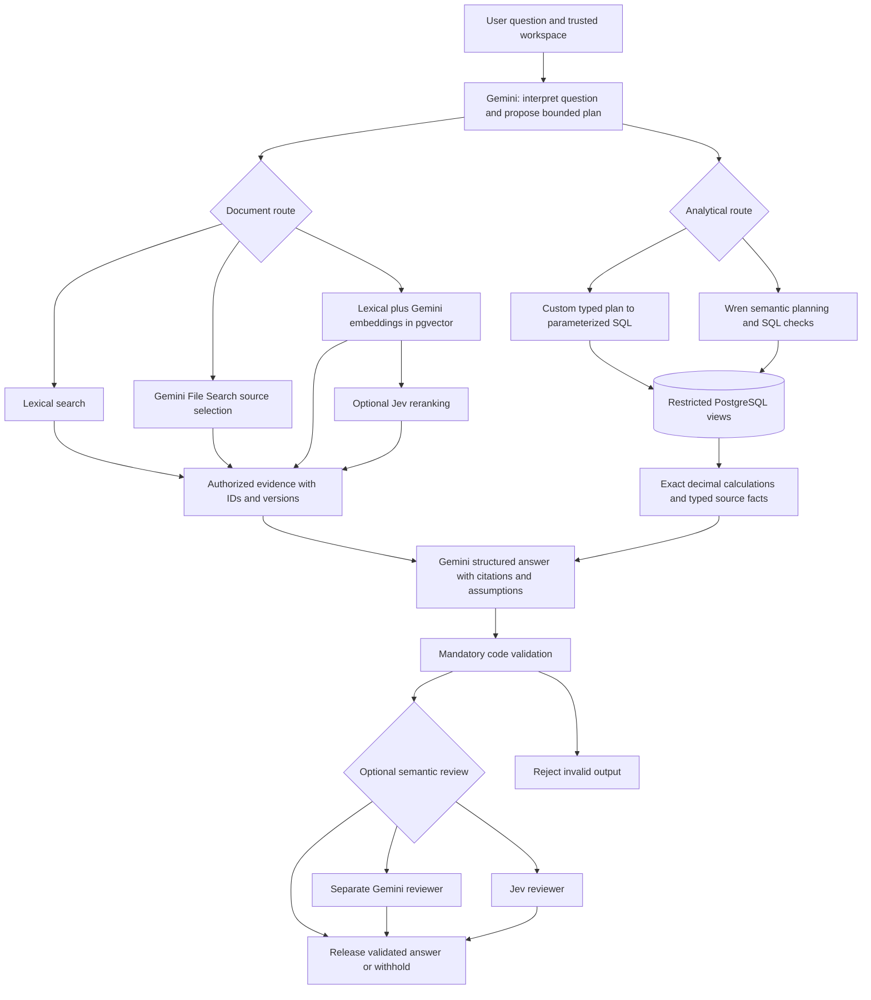

# Daybook AI accounting architecture: progress report, held-out results pending

**Status: 2026-10-30.** The nine experimental routes are implemented. The development reviewer study and first 108-episode route pilot are recorded. The first pilot exposed adapter and planner defects; the second, `pilot-v2`, stopped at **101/108 episodes** after Gemini's daily free-tier quota was exhausted. Both are **ineligible for architecture selection**. V2's complete scoped data fingerprint was unchanged, but missing attempts, an inferred completion-read race and a control-metadata limitation prevent a fair final ranking. Post-pilot corrections are undergoing offline verification; their live effect is unmeasured. **The planned 1,620 held-out route episodes and 240 held-out reviewer outcomes have not run.** This report names no winning architecture.

The deployed Daybook application remains separate and unchanged by these experiments. Research routes use a synthetic workspace, restricted database access, and review-only entry proposals. They have not been enabled in the production chat.

## Abstract

An accounting assistant must do two different jobs: calculate correctly from the books and understand information written in documents. A language model can help interpret a question, retrieve relevant evidence, and explain an answer, but plausible wording does not establish financial correctness. We implemented nine controlled configurations to compare broader analytical tools, document retrieval, Gemini File Search, Gemini embeddings with PostgreSQL vector search, Jev reranking, Wren semantic queries, and additional answer reviewers.

The benchmark contains 120 questions in 60 paraphrase groups across six task families. Development and held-out sets contain separate scenario groups. Financial references use independently implemented exact decimal calculations; documentary and semantic labels are synthetic and have not received independent human adjudication. The primary outcome is structured task success. Additional measures include error rates, provenance, latency, cost, and unsafe acceptance versus unnecessary withholding. Human prose quality remains unmeasured.

Development reviewer testing produced 240 recorded outcomes: 80 candidates evaluated by each of three methods. Four Gemini requests returned HTTP 429 and remain errors in the record. The initial route pilot recorded all 108 planned outcomes with unchanged data, but diagnosed implementation and measurement defects make its scores unsuitable for architecture selection. V2 recorded 101 outcomes before a 500-request daily project/model quota and the persistent failure circuit stopped further work. Its data remained unchanged. These development records support debugging and failure analysis; they do not establish which complete route should ship. Final conclusions require completed held-out measurements, unchanged source/data fingerprints, and no disqualifying safety failure.

## 1. The idea, explained through one business

Imagine you run a small design studio. Daybook is the notebook that records its money, and the chatbot is an assistant who can read the notebook and the studio's documents.

You ask: **“Can I afford another employee?”**

That question is missing several pieces. Which employee? What salary? Does the business need to keep some cash untouched? Are we planning for three months or a year? Will customers pay their bills on time? A useful assistant should identify these missing pieces, rather than turn a bank balance into an automatic “yes.”

Suppose you make the question precise:

> “Using September-end cash and the engineer hiring worksheet, how much cash above our required reserve remains after three months of this new hire's costs and recruiting? Ignore all other future money movements. This is an incremental scenario, not a forecast of the whole company.”

This is a development fixture, not a live customer example. The evidence divides naturally into three responsibilities:

| Needed information                                                             | Where it comes from                     | Why that matters                                                                    |
| ------------------------------------------------------------------------------ | --------------------------------------- | ----------------------------------------------------------------------------------- |
| Cash on September 30: **$164,615.00**                                          | Posted accounting entries in PostgreSQL | A document search result cannot establish the current bank-account total.           |
| Salary: **$6,000/month**; employer costs: **18%**; recruiting: **$3,000 once** | The current engineer hiring worksheet   | These planning assumptions are written in a document, not recorded as paid payroll. |
| Minimum cash reserve: **$50,000**                                              | The reserve policy                      | The business's rule affects how much cash it considers available.                   |
| Three-month horizon; no other future cash movements                            | The user's explicit scenario            | Changing these assumptions changes the answer.                                      |

The deterministic calculator then performs ordinary arithmetic using decimal amounts:

```text
Employer costs per month = $6,000 × 18% = $1,080
Total monthly hire cost   = $6,000 + $1,080 = $7,080
Three months plus hiring = $7,080 × 3 + $3,000 = $24,240
Remaining cash           = $164,615 − $24,240 = $140,375
Cash above reserve       = $140,375 − $50,000 = $90,375
```

A useful answer is: **“Under your stated assumptions, this hire leaves $90,375 above the required reserve after three months.”** It must also say that ordinary operating costs, future receipts, payment timing, and other obligations were excluded. This calculation alone does not establish that hiring is financially prudent.

The numbers are traceable to the [synthetic source documents](../../research/fixtures/documents.json), [independent reference implementation](../../research/reference.ts), and [fixture verification](../evidence/research-fixture-check.json). They illustrate the intended reasoning; they are not a claim that every route successfully answered the question.

## 2. Why three different tools are involved

Think of these as three separate helpers:

| Helper                             | Everyday analogy                         | Its real responsibility                                                                                           |
| ---------------------------------- | ---------------------------------------- | ----------------------------------------------------------------------------------------------------------------- |
| Accounting database and calculator | The official notebook plus a calculator  | Retrieve posted entries, respect dates/currencies, and calculate exact totals.                                    |
| Retrieval                          | A librarian finding the relevant pages   | Find the current hiring worksheet, signed contract, or policy.                                                    |
| Semantic reviewer                  | A second person checking the explanation | Look for a wrong interpretation, missing assumption, unsupported statement, or malicious instruction in evidence. |

An embedding is a numerical representation of text that helps find related meanings. It can connect “employer burden” with “benefits and payroll taxes” even when the words differ. **pgvector** stores and searches those representations inside PostgreSQL. It does not replace accounting calculations or automatically determine whether a document is current.

**Gemini File Search** supplies a managed alternative for finding documents. In this implementation, its Interactions API returns source citations; the harness resolves those citations to the authorized original documents. Google manages that search path, while our application still controls the workspace, evidence handling, calculations, and answer checks. Its citation order does not expose a raw ranking of all retrieved passages.

**Jev reranking** asks which candidate passages are more relevant after an initial search. **Jev verification** asks whether the proposed answer exhibits specified problems. They are separate roles in separate routes. **Wren** is tested as the semantic query backend: it turns queries over declared business models into SQL over approved views. It does not replace document retrieval or supply a universal correctness guarantee.

The question is therefore not whether one vendor has “all the features.” It is whether a particular component improves a measured part of our product enough to justify its cost, latency, and maintenance.

## 3. Implemented architecture



_Figure 1. Shared responsibilities and controlled substitutions. Each route selects its declared branches; it does not run every component. The existing narrow control uses its original tool interface. All routes retain mandatory checks._

The language model may choose a permitted query or propose a plan. It does not receive database owner credentials, the ability to post an entry, or an unrestricted SQL terminal. The custom query layer compiles approved fields, metrics, and filters. Wren output passes its own bounded SQL and unit-provenance checks. The reader role is restricted to the study workspace's views.

Posted journal entries remain the accounting source of truth. Invoices, cash receipts, loans, owner investments, drafts, reversals, and foreign-currency transactions are deliberately different things. For example, collecting an already-recorded invoice reduces receivables and increases cash; counting it again as revenue would overstate sales.

Code checks enforce schema, amounts, currencies, query/source references, calculation inputs, and proposal balancing. A semantic reviewer can withhold an answer after these checks; it cannot approve an invalid calculation or authorize a financial write. In the current implementation, a non-PASS review withholds the candidate rather than starting a repair conversation.

## 4. The nine configurations

The corrected design applies the same study model, synthetic data, question instances, output protocol, and mandatory validation to all routes. The first pilot exposed an omitted R0 shared-validation/evidence adapter; its original results remain preserved and are qualified in Section 6. R0 reproduces the deployed control architecture with normalized study settings; production still uses its existing model. R4 is the component control for R5–R8.

| Route                       | What it can use                                                                        | What this comparison asks                                                     |
| --------------------------- | -------------------------------------------------------------------------------------- | ----------------------------------------------------------------------------- |
| **R0: current control**     | Existing four financial tool families and review-only proposals; no document retrieval | How far does the simpler existing architecture go?                            |
| **R1: broad tools**         | Typed analytical plans and exact scenario calculations                                 | Does more flexible analysis improve coverage?                                 |
| **R2: lexical documents**   | R1 plus document search by words                                                       | How much does adding document evidence help before using embeddings?          |
| **R3: managed File Search** | R1 plus Gemini managed source selection                                                | How does managed search compare with our document retrieval?                  |
| **R4: custom hybrid**       | R1 plus lexical retrieval and Gemini embeddings searched in pgvector                   | Do semantic matches add useful evidence?                                      |
| **R5: Jev reranking**       | R4 candidate evidence, reordered by Jev                                                | Does a second relevance decision improve selection?                           |
| **R6: Wren analytics**      | R4 retrieval and calculator, with Wren for analytical queries                          | Does a semantic query engine improve analytical coverage or correctness?      |
| **R7: LLM reviewer**        | R4 plus a separate Gemini reviewer call                                                | Does a second reading reduce accepted mistakes without excessive withholding? |
| **R8: Jev reviewer**        | R4 plus Jev checks                                                                     | How does a specialized decision model perform as the extra reviewer?          |

These are controlled alternatives. Installing everything at once would make it difficult to tell which component helped or harmed the result.

## 5. What has actually been tested

The following evidence exists independently of the unfinished main comparison:

| Check                                                     | Observed result                                                                                                               | What it does not establish                                        |
| --------------------------------------------------------- | ----------------------------------------------------------------------------------------------------------------------------- | ----------------------------------------------------------------- |
| Restricted database access and basic analytical execution | Custom and actual Wren queries returned the expected $164,615.00 cash figure; boundary checks passed                          | General SQL correctness on every question                         |
| Live fixture comparison                                   | 114 posted scoped lines, 57 posted entries, and 39 authorized documents matched; all 39 authorized vectors had 768 dimensions | Retrieval quality or prose accuracy                               |
| Retrieval integration smoke                               | Four document retrieval variants found Acme's contract                                                                        | A benchmark-wide retrieval score                                  |
| Component security suite                                  | 57 PASS, 0 FAIL, 3 UNASSESSED                                                                                                 | Proof that all natural-language attacks fail across every route   |
| Reviewer development study                                | 240 outcomes across three methods on 80 candidates                                                                            | Held-out reliability or production error prevalence               |
| Initial nine-route pilot                                  | 108/108 recorded; 10 errors, 11 blocked, 87 completed without a runtime block; known validity defects                         | A valid architecture ranking                                      |
| Second nine-route pilot                                   | 101/108 recorded; 9 errors, 9 blocked, 83 completed without a runtime block; daily-quota stop and known validity limits       | The seven missing attempts, held-out accuracy or a winner         |
| Native research CI                                        | Separate pgvector startup, actual Wren tests and restricted database/security checks passed for the recorded revision         | Provider capacity, live answer accuracy or post-pilot corrections |

Source evidence: [database checks](../evidence/research-database-check.json), [fixture checks](../evidence/research-fixture-check.json), [retrieval smoke](../evidence/research-retrieval-smoke.json), [initial retrieval failures](../evidence/research-retrieval-smoke-initial.json), [component security results](../evidence/research-security.json), and [research CI](../evidence/research-ci-v2.json). Retaining the initial failures prevents the final successful probe from erasing the integration history.

### Development reviewer results

The stress set used **40 correct candidates and 40 deliberately flawed candidates**. Each of the three methods reviewed all 80, producing **240 recorded outcomes**. There were 236 successful method executions and four Gemini `RATE_LIMIT` errors; the usage record identifies four HTTP 429 responses. The deterministic checks made no provider requests, so 240 outcomes do not mean 240 API calls.

The following table uses **operational fail-closed behavior**: a request error withholds the answer. “Accepted flawed” is bad because a mistake escaped. “Withheld correct” is also bad because a useful answer was stopped.

| Development configuration         |        Recorded outcomes | Provider errors | Accepted flawed candidates | Withheld correct candidates |
| --------------------------------- | -----------------------: | --------------: | -------------------------: | --------------------------: |
| Deterministic stress checks alone |                    80/80 |               0 |          28/40 = **70.0%** |             0/40 = **0.0%** |
| Gemini reviewer alone             |                    80/80 |               4 |           8/40 = **20.0%** |            4/40 = **10.0%** |
| Jev reviewer alone, threshold 0.8 |                    80/80 |               0 |          14/40 = **35.0%** |             2/40 = **5.0%** |
| Code checks followed by Gemini    | Same recorded candidates |          Same 4 |           8/40 = **20.0%** |            4/40 = **10.0%** |
| Code checks followed by Jev       | Same recorded candidates |               0 |          11/40 = **27.5%** |             2/40 = **5.0%** |

The last two rows combine existing recorded decisions; they are not extra provider runs. Two Gemini failures occurred on correct candidates and two on flawed ones. Among its **76 completed responses**, conditional false acceptance was **8/38 = 21.1%** and conditional false rejection was **2/38 = 5.3%**. Blocking a request that failed is operational protection, not evidence that the model detected a semantic flaw.

These deterministic stress checks deliberately cover schema, citation existence, and exact amount/currency pairs. Their 70% missed-flaw rate must not be presented as the failure rate of Daybook's full accounting engine or complete answer validator. The injected set also contains semantic contradictions these particular checks do not attempt to recognize.

The Jev threshold was selected on development data from a declared grid. A threshold of **0.8** met the rule limiting additional correct-answer rejection to five percentage points while minimizing flawed acceptance among feasible choices. This is a frozen operating setting, not an “80% accurate” claim. Jev's combined hazard score is not a calibrated probability that a whole financial answer is wrong.

The data are synthetic and the fault labels are **not independently human-adjudicated**. The artificial 50% flawed prevalence and repeated source scenarios prevent these rates from being interpreted as real-user precision. They motivate the held-out test; they do not name a winner. Full counts, fault breakdowns, and settings are in the [development reviewer report](../evidence/research-verifiers/verifiers-v1/development-report.md), [structured results](../evidence/research-verifiers/verifiers-v1/development-results.json), [preserved outcomes](../evidence/research-verifiers/verifiers-v1/development.jsonl), [usage record](../evidence/research-verifiers/verifiers-v1/development-usage.json), and [frozen threshold configuration](../evidence/research-verifiers/verifiers-v1/verifier-config.json).

## 6. Development pilots; held-out comparison unrun

### Initial pilot: complete attempts, invalid for selection

The initial development pilot, `pilot-v1`, recorded **108/108 planned episodes**: 12 questions × nine routes. The raw outcomes contain **87 `ok`, 11 `blocked`, and 10 `error`** records. An `ok` execution does not necessarily mean a correct answer. The full ledger-and-corpus fingerprint was unchanged.

**This pilot cannot select a winning architecture.** Completing every attempt and preserving data establish coverage and integrity, but they do not make a faulty measurement adapter fair. The [validity notice](../evidence/research-runs/pilot-v1/validity-notice.json) and [pilot interpretation](../evidence/research-runs/pilot-v1/README.md) supersede the original generated report's mechanical eligibility flag. The notice records a SHA-256 digest of the preserved original results.

| Diagnosed issue          | What happened                                                                                                                                                                                                 | What the development correction changes                                                                                                                                 |
| ------------------------ | ------------------------------------------------------------------------------------------------------------------------------------------------------------------------------------------------------------- | ----------------------------------------------------------------------------------------------------------------------------------------------------------------------- |
| Control evidence adapter | R0 proposals cited the user input, but the adapter did not supply a user-evidence record. Revenue calculations also lacked materialized calculation evidence. Valid candidates could fail provenance scoring. | Apply the shared validator, attach the user evidence, and create checked calculation-source nodes. The original tools and one-model-call architecture remain unchanged. |
| Planner backend grammar  | A shared grammar exposed both custom and Wren query fields. Wren repeatedly produced custom plans that its backend gate correctly rejected.                                                                   | Expose only the permitted backend schema and the actual typed Wren columns; keep the read-only query gate.                                                              |
| Dispatcher startup gaps  | Three early requests expired during the transition from manual to continuous dispatch.                                                                                                                        | Use the continuously serviced dispatcher and preserve the original timeout records. These cases are harness failures, not established provider outages.                 |

R0's original **0/12 structured successes** is therefore **not a valid estimate of the deployed baseline's ability**. It includes missing-evidence penalties introduced by the study adapter. Likewise, poor Wren routing cannot fairly establish the quality of Wren's query engine when the planner was offered the wrong backend grammar. The 319 requests in the continuous dispatcher log all returned HTTP 200; that observation does not erase the earlier startup failures or prove semantic correctness.

The corrected R0 adapter passed four targeted tests covering actual proposal scoring, derived revenue citations, unchanged cash evidence, and withholding of unsupported candidates. Together with the baseline and route suites, **48 tests passed**, followed by TypeScript validation. These tests verify the correction; they do not retroactively change the first pilot's scores or establish improved live accuracy. A new development run receives its own name, source hashes, costs, and outcomes. No old episode is silently replaced, and no held-out result informed these fixes.

The held-out main study remains planned for **1,620 episodes**: 60 questions × three repetitions × nine routes. The held-out reviewer study plans **240 method outcomes**: 80 stress candidates × three methods. Neither has run at this checkpoint.

The [preserved initial pilot report](../evidence/research-runs/pilot-v1/report.html) contains self-contained SVG figures and original completeness/integrity status. Read it alongside the [superseding validity notice](../evidence/research-runs/pilot-v1/validity-notice.json); its scores are diagnostic rather than evidence for selecting a component. The [pilot manifest](../evidence/research-runs/pilot-v1/manifest.json) records models, question IDs, timing settings, threshold, and hashes. The [working-source manifest](../evidence/research-runs/pilot-v1/source-manifest.json) identifies the evaluated code; the listed published ancestor alone is not the tested working tree.

The [printable pilot report](../evidence/research-runs/pilot-v1/study-report.pdf) includes the known-defect warning and a dedicated validity discussion. It preserves the diagnostic figures while marking them unsuitable for architecture selection.

### Second pilot: incomplete because of daily quota

`pilot-v2` evaluated the corrected control evidence adapter and backend-specific planner contracts. It recorded **101 of 108 planned episodes: 83 `ok`, 9 `blocked`, and 9 `error`**. Seven planned attempts were not made. An `ok` status means the execution completed without a runtime block; it does not mean the answer satisfied every reference criterion. The full scoped ledger, document contents and embeddings fingerprint was unchanged before and after this partial run.

The provider explicitly reported `GenerateRequestsPerDayPerProjectPerModel-FreeTier`, limit **500**, with an initial retry delay of **29,601 seconds**, about 8 hours 13 minutes. This is a daily project/model allowance. Slower minute-level pacing cannot restore an exhausted daily allowance. No billing-tier upgrade or replacement key was made by this study, and no old failure was retried into a successful result.

The dispatcher recorded **365 requests: 360 HTTP 200, one HTTP 504, and four HTTP 429**. Every curl process exited normally. Gemini pre-curl start gaps were at least 4.594 seconds; queue delay was 1.592 seconds at p50 and 3.646 seconds at p95. HTTP 200 establishes transport completion, not answer correctness or successful ingestion by the runner. These are measurements of the queued research harness, not production latency. [Dispatch and quota evidence](../evidence/dispatch-pilot-v2.json).

One R6 cash episode returned `RESEARCH_HTTP_FAILURE` even though its completed curl footer later contained HTTP 200 and exit 0. The queue reader checked file existence before parsing the footer; curl wrote that file directly. This supports an **inferred partial-read race**, but the exact bytes at the original read were not captured. The original failed episode and unknown-usage reservation remain unchanged. A separate R3 call returned the genuine upstream 504. Those are different failure classes. [Race diagnostic](../evidence/queue-completion-race-pilot-v2.json).

The [V2 validity notice](../evidence/research-runs/pilot-v2/validity-notice.json) also records a pre-holdout audit finding: R0 lacked model-output fields and advertised vocabulary for the required assumption and clarification tags. Its penalties therefore include a study-adapter limitation. Development amendments normalize those metadata fields within R0's existing single call, add complete-footer parsing, and clarify shared instructions about draft proposals versus posted historical facts. They do not add control tools or retrieval, weaken financial checks, consult held-out answers, or rewrite either pilot. Offline verification and a small authorized live development check are needed before final freezing; live improvement has not been measured.

The [V2 HTML report](../evidence/research-runs/pilot-v2/report.html), [12-page PDF](../evidence/research-runs/pilot-v2/study-report.pdf), and [supplemental retrieval/failure analysis](../evidence/research-runs/pilot-v2/supplemental/index.html) are **diagnostic and incomplete**. Read them with the [interpretation](../evidence/research-runs/pilot-v2/README.md) and validity notice. Their figures preserve recorded values; unequal attempt counts and the identified issues prohibit selecting a winner from visual rank. The [manifest](../evidence/research-runs/pilot-v2/manifest.json), [source manifest](../evidence/research-runs/pilot-v2/source-manifest.json), [original episodes](../evidence/research-runs/pilot-v2/episodes.jsonl) and [per-call usage](../evidence/research-runs/pilot-v2/usage.json) make the evaluated snapshot inspectable.

### Work still required for a final conclusion

| Final result section      | Status and intended content                                                                                  |
| ------------------------- | ------------------------------------------------------------------------------------------------------------ |
| Held-out task success     | Pending: micro and equal-family macro success, errors included                                               |
| Component effects         | Pending: paired differences for H1–H7 and group-bootstrap intervals                                          |
| Failure examples          | Pending: wrong amounts, schema mismatches, missing evidence, unsupported claims, and unnecessary withholding |
| Retrieval analysis        | Pending: only metrics actually observable for each backend                                                   |
| Latency and cost          | Pending: end-to-end and provider durations, usage estimates, reservations, and setup costs                   |
| Held-out verifier results | Pending: accepted flaws, withheld correct answers, provider errors, fault families                           |
| Product recommendation    | Pending: quality, safety gates, latency, cost, and implementation burden considered together                 |

_Figure plan._ The generated report provides four views: macro success with uncertainty, family success heatmap, p50/p95 latency, and quality versus cost. Paired effects appear in a separate table. Incomplete or disqualified configurations can still be displayed descriptively; their visual position does not make them eligible for selection.

The [supplemental retrieval and failure analysis](../evidence/research-runs/pilot-v1/supplemental/index.html) adds a retrieval figure and structured failure details from the available pilot records. It separates retrieval among completed operations from document availability across all applicable episodes. For R3, the observable measure is coverage of citation-selected sources; raw search ranking metrics remain unavailable. Its [analysis provenance](../evidence/research-runs/pilot-v1/supplemental/analysis-provenance.json) identifies the analyzed snapshot. The supplemental analysis inherits the initial pilot's validity limitations; a technically complete figure cannot repair a biased adapter.

## 7. What I would explain in an interview

> “I started with an accounting system whose database enforces balanced, immutable posted entries. I kept the language model outside that authority boundary. It can interpret a question and propose a bounded plan, but code and restricted database views supply the financial values.
>
> “Broader questions need both accounting facts and document evidence. For a hiring question, the ledger supplies cash, documents supply salary and policy assumptions, and an exact calculator connects them. The answer must state its assumptions rather than turn a scenario into a guaranteed forecast.
>
> “I tested retrieval, analytical backends, and reviewers separately with shared controls. A reviewer can still miss a mistake or block a correct answer, so I measured both, preserved provider failures, and separated development tuning from held-out evaluation. I would add a component to the product only after the evidence justifies the extra complexity.”

That is an implemented design and a testable argument. The final sentence is still a decision rule: this progress report does not claim the experiments have already justified a particular addition.

## Appendix A. Methods for a technical reviewer

**Data.** The shared fixture contains 19 accounts, 60 journals, 40 documents, and 120 questions. One journal and one document belong to a foreign workspace as isolation canaries. The authorized workspace has 59 journals, including two drafts, and 39 documents. Posted entries include invoice/payment distinctions, reversals, deliberate duplicates, foreign-currency amounts and stored rates, loans, and owner contributions. Document versions include superseded and unsigned material. Dataset details and limitations are recorded in the [fixture README](../../research/fixtures/README.md).

**Splits.** Sixty scenario groups each have two paraphrases. Whole groups are assigned to development or holdout, giving 60 questions in each split, balanced across financial, analytics, documents, scenario, entry, and adversarial families. The separate reviewer pack contains 160 candidates: 80 correct and 80 flawed, divided into 80 development and 80 held-out candidates by source group. Gold facts, fault labels, and per-question required tags stay outside provider-visible inputs. The labels remain inspectable in this repository: this is a frozen engineering split, not an externally secret benchmark.

**Reference arithmetic.** The reference module reduces exact decimal fixture amounts independently of the candidate query compiler. Tests also sum integer cents. USD/EUR financial values and counters must match exactly under their declared units; percentages and months allow 0.01 of the output unit for the declared rounding. Expected entity and period qualifiers matter. A correct number with a wrong metric key is recorded as a protocol mismatch separately from a numeric mismatch.

**Primary score.** Structured success requires all applicable fact, behavior, evidence, scope, assumption/clarification, proposal, and deterministic validation checks. Automated rubric points total 90: factual 40, task completion 20, grounding 20, and uncertainty 10. The unavailable human clarity dimension is not filled by another model, and no combined 100-point score is reported. A correct tag cannot establish that contradictory prose is faithful; prose review remains pending.

**Common capabilities.** A supplementary subset was defined during development, before holdout, from the original tool contracts and question texts rather than observed correctness. It includes 30 questions (18 development, 12 held-out), with explicit exclusions for unavailable document/analytic capabilities and clarification/security tasks. The held-out subset has only six groups and two represented families. Its observed-family macro is not the primary six-family macro. The [definition and rationale](../research/COMMON_CAPABILITIES.md) and [static mapping](../research/common-capabilities-v1.json) remain fixed. The [v2 route-source amendment](../research/common-capabilities-amendment-v2.json) binds the source used for pilot-v2 to the original mapping. The [v3 amendment](../research/common-capabilities-amendment-v3.json) separately binds the post-pilot baseline metadata normalization and shared route-contract corrections, before held-out execution. Both preserve every membership decision; neither rescores or validates either diagnostic pilot. Whole-benchmark safety gates still apply.

**Controls.** H1 compares R1−R0; H2 R2−R1; H3 R3−R2 and R3−R4; H4 R4−R2; H5 R5−R4; H6 R6−R4; H7 R7−R4 and R8−R4. Additional R0 contrasts are descriptive. Settings are pinned to Gemini 3.5 Flash-Lite, Jev 1.14.0, Gemini embedding 001 at 768 dimensions, and Wren core 0.8.2. A separate invocation of the same Gemini model is a second review, not an independent set of model weights.

**Budgets and operations.** Each route has bounded calls and tool results, a 60-second episode deadline, at most four generator calls, one reviewer call, and eight logical tool calls, with separately limited embedding/reranking operations. Subsequent Gemini starts are paced by at least 4,200 ms, with the observed dispatcher using a 4,500 ms guard. That pacing does not prevent the documented daily quota. Queue and pacing delays count in harness wall time. Returned usage produces configured-rate cost estimates; unknown usage retains conservative reservations. The tracked allowances are $10 Gemini and $4 Jev, with setup/indexing separate and no account billing-plan upgrade inferred. Errors are preserved, not silently retried into success. The persistent circuit remains a separate guard from dollar allowances; apparent remaining budget is not permission to bypass exhausted provider capacity.

**Database boundary.** The live sandbox uses a separate research schema and restricted reader on the existing Neon server. This is logical isolation on a shared physical database. The reproducible local alternative uses a separate pgvector Compose database and volume. Neither model receives owner credentials. Existing application tables, applied migrations, and the application's Compose volume are preserved. See [reproduction instructions](../research/REPRODUCE.md).

**Run integrity.** Source, dependency/runtime, protocol, dataset, index, and verifier settings are recorded in manifests. The full scoped ledger, document contents/versions/dates, and embeddings are fingerprinted before and after runs. A changed or unverified snapshot, source drift, missing planned episodes, or a route's hard-gate violation prevents the relevant comparative selection. Unknown or interrupted request costs remain visible.

**Uncertainty.** Repeats and paraphrases of one scenario are correlated. Paired effects match question/repeat IDs and resample scenario groups within families. The pilot has two groups per family and the held-out set has five; empirical bootstrap coverage may be poor. Zero-width empirical intervals do not imply certainty. All intervals are exploratory and unadjusted for multiple comparisons. Sharing one small ledger and corpus can introduce dependence beyond the scenario grouping. See the [statistical review](../research/STATISTICAL_REVIEW.md).

## Appendix B. Limits that affect the eventual recommendation

1. Synthetic, AI-authored labels and documents have not received independent human adjudication. Some semantic judgments may be imperfect even when financial arithmetic is exact.
2. A small, inspectable benchmark cannot establish general financial accuracy, production fraud detection, legal/tax advice, or million-user capacity.
3. Managed File Search exposes source selection differently from custom retrieval. Its citations do not justify invented raw-passage recall or ranking metrics.
4. The Wren integration conservatively withholds monetary evidence whose complex SQL lineage it cannot prove. This evaluates our bounded integration, not all capabilities of Wren.
5. Semantic reviewers inspect supplied evidence. They can share generator errors or miss a document that was never retrieved. They are additional checks, not omniscient validators.
6. Provider load, free-tier quotas, pacing, queue transport, and model drift affect latency and availability. The measured environment is not a concurrent production load test.
7. A simplified expense-based cash-burn scenario is not a cash-flow forecast. A real hiring decision would need payment timing, taxes, obligations, and plausible future receipts.
8. No experiment may post model-generated financial entries. Product integration and any deployment decision remain separate from this comparative study.

The [preregistered plan and dated amendments](../PLAN.md), [core review](../research/CORE_REVIEW.md), [statistical review](../research/STATISTICAL_REVIEW.md), and preserved run artifacts define what was tested and what remains uncertain. Held-out results should be inserted into Section 6 without rewriting development failures or expanding claims beyond the evidence.
