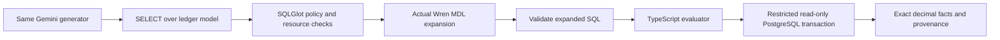

# R6: Wren semantic-engine experiment

Implemented 2026-10-30 after the user's explicit authorization to execute the research plan. This component is separate from the hosted Daybook demo.

**Current study status:** the Wren adapter is implemented and exercised, but its comparative value is unestablished. Initial-pilot backend grammar defects and V2's incomplete 101/108 run prevent architecture selection. V2 stopped on Gemini's daily free-tier quota; its full data fingerprint was unchanged. Its first R6 cash failure is separately attributed to an **inferred queue completion-read race**, not demonstrated Wren or database failure. The completed curl record was HTTP 200/exit 0. The original outcome remains preserved. [V2 validity notice](../evidence/research-runs/pilot-v2/validity-notice.json), [race diagnostic](../evidence/queue-completion-race-pilot-v2.json), [diagnostic PDF](../evidence/research-runs/pilot-v2/study-report.pdf).

## What is actually used

The experiment runs **Wren's Rust/DataFusion semantic engine**, distributed as `wren-core-py==0.8.2`. It does not simulate Wren by renaming our own SQL compiler. The bridge calls the upstream `wren_core.SessionContext.transform_sql` implementation. Model names and calculated fields in [the MDL manifest](../../research/wren/mdl.json) are expanded by that engine into PostgreSQL SQL.

The current Wren project has changed from the old Docker-based chat application: the maintained OSS product is an engine, CLI and agent context layer. Its former chat product is on a legacy branch. We inspected the current Wren CLI source, but do not install its dashboard, connector, local memory or agent framework dependencies merely to perform semantic SQL expansion. Source and release provenance are pinned in [provenance.json](../../research/wren/provenance.json). [Upstream architecture](https://github.com/Canner/WrenAI/blob/8edc086b1f8f9f2974b9faf8ab7c639c85851b46/docs/core/reference/architecture.md), [upstream README](https://github.com/Canner/WrenAI/blob/8edc086b1f8f9f2974b9faf8ab7c639c85851b46/README.md).

The Wren core release is `0.8.2`, source revision `86fcca2d26cb20bcca9c09aa59a97286290abd3f`. SQLGlot is `30.27.0`. Both distributions and wheel hashes are fixed in [requirements.txt](../../research/wren/requirements.txt). Wren is Apache-2.0; it is installed as an external dependency, not copied into the application source. No Wren subscription or provider call is required by this bridge.

## Architecture and comparison boundary



The Python process has **no database credentials or connection**, no provider key and no network operation. The TypeScript caller executes successful plans using its scoped reader role. It retains PostgreSQL decimal strings; Wren's CLI JSON output can convert nonintegral decimals into floating-point values, so that output path is deliberately not used. [CLI behavior](https://github.com/Canner/WrenAI/blob/8edc086b1f8f9f2974b9faf8ab7c639c85851b46/docs/core/reference/cli.md).

R6 is a **Wren semantic-engine/backend comparison**, not a benchmark of Wren's complete agent experience. It uses model-authored SQL instead of R4's typed analytical plan. That changes the query representation as well as the backend and must be disclosed in result interpretation. The generator, accounting definitions, retrieval, documents and scenario calculator remain controlled by the overall study. Wren's optional schema-memory retrieval and commercial security features are not being evaluated.

## Permission and resource boundaries

- The model can reference only `ledger`. The trusted MDL maps that model to `research.scoped_ledger`, an evaluation-only view whose organization restriction must be enforced when the reader role/view is provisioned. Supplying an organization ID in a prompt is not access control.
- The bridge does not accept request-supplied manifests, schema names, file paths, connection settings or Python code.
- SQLGlot validates both the input and the actual expanded SQL. Unknown tables, metadata queries, non-SELECT operations, multiple statements, mutating/recursive CTEs, locks, file/network functions, arbitrary functions, parameters and unsafe cast types are rejected.
- Function access is a positive allowlist. Filtering and ordinary grouping/conditional aggregates are supported. Input is limited to 16 KiB, the input AST to 500 nodes, joins to two and SELECT nodes to eight. Final results are capped at 100 rows.
- The TypeScript adapter launches without a shell, excludes inherited application secrets, limits output size and terminates the process after five seconds by default. The SQL executor must independently enforce its statement timeout, read-only transaction and database privileges. AST checks are an additional boundary, not a replacement for those privileges.
- Planning failures return an explicit failed route. There is no hidden fallback to the custom backend that could make Wren's score misleadingly high.

## Running the pinned component

From the project root, using Python 3.11 or newer:

```sh
python3 -m venv .tools/research/wren/venv
.tools/research/wren/venv/bin/python -m pip install --require-hashes -r research/wren/requirements.txt
.tools/research/wren/venv/bin/python research/wren/test_bridge.py
```

The TypeScript adapter is [client.ts](../../research/wren/client.ts). `RESEARCH_WREN_PYTHON` can select the installed interpreter. It defaults to the project-local virtual environment above.

The JSON-lines bridge accepts:

```json
{ "id": "example", "sql": "SELECT SUM(net_debit) AS expenses FROM ledger WHERE account_type = 'EXPENSE'" }
```

A successful response includes `plannedSql`, actual engine/parser versions, input and manifest SHA-256 hashes, planning time and the row ceiling. Failed responses contain safe machine-readable error codes; raw native errors and untrusted SQL are not forwarded to the user.

Numeric evidence also carries `columnUnits` derived from the parsed expression and fixed ledger schema. An alias cannot change a value's unit: `COUNT(*) AS cash` is a count, while `SUM(net_debit) AS account_code` is USD. Account codes, dates, years and exchange rates are unsupported numeric evidence. Output names are matched to the actual expanded projection because Wren sometimes renames unaliased expressions.

Base-currency sums, compatible arithmetic and conditional amount expressions retain USD. Native amounts require a direct single-currency equality in the conjunctive filter, an explicit projected currency and, for aggregates, grouping by that currency. The response then includes `nativeCurrency` and `currencyColumn`; the caller must confirm each returned row agrees. A same-unit ratio is dimensionless (represented by the shared `count` unit), not automatically a percentage. These checks establish units, not that the query answers the user's question or uses the correct accounting definition.

This first unit analyzer deliberately withholds monetary proof for CTEs, joins, subqueries, table-column renaming and unions. Such SQL can still be planned and executed, but its unsupported numeric output cannot back a released typed financial fact. Unknown lineage, missing metadata and duplicate output aliases fail closed. This narrower evidence coverage can reduce R6's answer coverage and must remain visible in the comparison.

## Verification so far

The real macOS arm64 Wren core wheel was downloaded from PyPI, its SHA-256 verified and installed into the isolated virtual environment. **Twenty-two Python tests pass**, covering calculated-field expansion, month/vendor grouping, distinct entry counts, cash/date predicates, conditional aggregation, governed CTEs, unknown-column rejection, request schema validation, output revalidation and numeric-unit provenance. The attack test includes 32 separately checked inputs. Unit tests exercise misleading aliases, currency ambiguity, dimensional arithmetic, mixed CASE branches and unsupported lineage against the actual engine. A live TypeScript-to-Python subprocess smoke also passed a SUM query and rejected `pg_sleep`.

The first real-engine smoke caught a concrete integration bug: precision-bearing MDL strings such as `decimal(24,2)` were interpreted as strings by this core binding. The manifest now uses Wren's recognized `decimal` type. The generated SQL preserves the underlying PostgreSQL numeric expressions; the database retains the declared precision. A test exercises the real expansion so a fake or mocked backend would not establish this evidence.

These Python tests establish local planning/protocol behavior. Separate live database checks executed actual Wren SQL through the restricted reader and returned the independent fixture's **USD 164,615.00** cash total; access checks and before/after fingerprints passed. The provider-free native research job also completed in [CI 41142335257](https://github.com/rayidali/spiich_homework/actions/runs/41142335257), exercising a real pgvector/PostgreSQL container and the pinned engine. [Database evidence](../evidence/research-database-check.json), [CI evidence](../evidence/research-ci-v3.json).

Those checks do not establish correctness for every SQL plan, live answer quality or production throughput. The 1,620 held-out route episodes and 240 held-out reviewer outcomes remain unrun. Read the [V2 HTML report](../evidence/research-runs/pilot-v2/report.html) with its validity notice; a diagnostic score is not a benchmark of Wren's complete product. Post-pilot control/protocol corrections and live capacity recovery require separate verification before the final comparison.

The optional local DuckDB execution shortcut was not used because the installed Python 3.15 had no matching DuckDB 2.0 wheel at integration time. No incompatible binary was forced into the environment.
